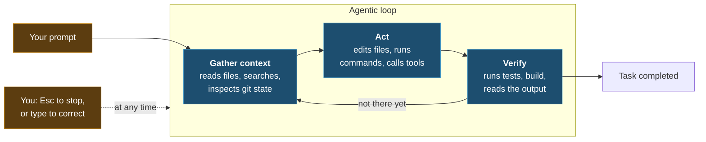

import { Tabs, TabItem, Steps, Aside } from '@astrojs/starlight/components';
import Zero from '@/components/Zero.astro';

<div class="meta-modulo">
	<span><strong>Estimated time:</strong> 45 minutes</span>
	<span><strong>Prerequisites:</strong> modules <a href="/en/fondamenta/setup/">0</a> and <a href="/en/fondamenta/anatomia-file/">2</a>. For the guided example a project with <a href="/en/glossario/#test">automated tests</a> is useful; if you don't have one, the small project from module 1 is enough.</span>
</div>

This is the theory module of the course — the only one, and it is short. So far you have seen Claude *do* things;
here you understand **how it reasons while doing them**, because all the good habits of the following
modules flow from this. "Agentic" is not a marketing word: it describes a precise difference.
A normal AI answers and stops; an [agent](/en/glossario/#agent) looks, acts, checks the
result and tries again — as a person would. This module takes that loop apart and shows you where
you can get your hands on it.

## Objectives

- Describe the agentic loop and recognize its three phases while Claude works.
- Tell the model apart from the harness, and understand why the tools are what make Claude Code "agentic".
- Adopt the four habits that really change the results: verify, explore first, delegate, correct early.
- Recognize and avoid the five most common failure patterns.

## Key concepts

**The agentic loop has three phases.** When you give it a task, Claude works in **gather context → act
→ verify the result**, and repeats until the task is done. The phases blend: Claude uses tools in
all three, whether it is searching files to understand the code, editing to make changes, or running tests to
check its own work.

The loop adapts to the request. A question about the codebase may stop at gathering context. A
bug fix goes through all three phases several times. Claude decides what is needed at each step based
on what it learned at the previous step, chaining dozens of actions and correcting course along
the way.

**Model + tools = harness.** The loop is powered by two components. The **model** is the engine that
reasons — the [LLM](/en/glossario/#llm), the AI system trained on text that sits underneath everything. The **tools**
are its hands: reading a file, running a command, searching the web. And the **harness**
— literally the "rig" you strap on — is everything around the model that lets it use those
hands safely: Claude Code is exactly that. Without tools, Claude could only answer with
text; with tools it can read your code, edit files, run commands and talk to
external services.

The built-in tools fall into five categories:

| Category | What Claude can do |
| --- | --- |
| **File operations** | Read files, edit code, create new files, rename and reorganize |
| **Search** | Find files by pattern, search content with regex, explore codebases |
| **Execution** | Run shell commands, start servers, run tests, use git |
| **Web** | Search the web, fetch documentation, look up error messages |
| **Code intelligence** | Understand code the way an IDE does: notice errors right after an edit, trace where a function is defined and who uses it (requires the dedicated plugins, [module 16](/en/professionale/ecosistema/)) |

**Sessions are independent.** Each new session starts with a clean context window, without the
history of the previous ones. Persistence across sessions goes through two other routes: **auto memory**, the
notes Claude takes on its own, and **`CLAUDE.md`**, the instructions you write. If a rule must
survive, don't say it in chat: write it in `CLAUDE.md`.

**The dominant constraint is context.** The context window holds the whole conversation: every
message, every file read, every command output. It fills up fast, and performance degrades as
it fills: Claude starts to "forget" instructions given at the beginning and to make more mistakes.
Almost all the good practices of the next module flow from this single constraint.

**You are inside the loop too.** You can interrupt at any time: `Esc` stops Claude immediately and the
tool call in progress is cancelled; typing a correction and pressing Enter sends it **without**
stopping the current tool, and Claude reads it as soon as the action finishes. Claude works autonomously but stays
responsive.

## The loop, visualized



A concrete example. You ask *"fix the failing tests"*. Claude might:

<Steps>

1. Run the test suite to see what fails. *(gather context)*
2. Read the error output. *(gather context)*
3. Search for the relevant source files. *(gather context)*
4. Read those files to understand the code. *(gather context)*
5. Edit them to fix the problem. *(act)*
6. Run the tests again. *(verify)*

</Steps>

Each tool use returns information that feeds the next step. It is not a script: it is a
chain of decisions.

## What Claude has access to

When you run `claude` in a directory, Claude Code gets access to:

- **Your project** — the files in the directory and its subdirectories, and other files elsewhere with your permission.
- **Your terminal** — any command you could run: build tools, git, package managers, scripts.
- **Your git state** — current branch, uncommitted changes, recent commit history.
- **Your `CLAUDE.md`** — instructions, conventions and context Claude must have in every session.
- **Auto memory** — what Claude has learned while working. The first 200 lines or 25 KB of `MEMORY.md`, whichever limit is hit first, are loaded at the start of every session.
- **The extensions you configure** — MCP servers, skills, subagents, Claude in Chrome.

This is the substantial difference from an inline assistant that only sees the open file: when you ask it to
fix the authentication bug, Claude searches for the relevant files, reads several of them to understand the
context, makes coordinated edits across multiple files, runs the tests to verify and — if you ask — commits.

## The mindset: four habits

### 1. Give Claude something to verify

It is the habit with the highest return, and the one most often neglected.

Claude stops when the work **looks** finished. Without a check it can run on its own,
"looks finished" is the only signal it has — and quality control falls entirely on you: every
mistake stays there until you notice it. Give it instead something that produces a clear outcome — pass or fail
— and the loop closes on its own: Claude runs the check, reads the outcome and corrects until it passes.

| Strategy | Before | After |
| --- | --- | --- |
| **Provide verification criteria** | *"implement a function that validates email addresses"* | *"write `validateEmail`. Test cases: `user@example.com` → true, `invalid` → false, `user@.com` → false. Run the tests after implementing"* |
| **Verify UI changes visually** | *"make the dashboard look better"* | *"\[paste screenshot] implement this design. Take a screenshot of the result and compare it with the original. List the differences and fix them"* |
| **Go to the root cause, not the symptom** | *"the build is failing"* | *"the build fails with this error: \[paste]. Fix it and verify the build passes. Address the root cause, don't suppress the error"* |

The check is anything that returns a readable signal: a test suite, the exit code of a
build, a linter, a script that compares output against a fixture, a browser screenshot compared
with a design.

Also ask Claude to **show the evidence** instead of declaring success: the test output, the
command it ran and what it returned. Reading the evidence is faster than redoing the check by hand, and
it works for sessions you didn't watch too.

### 2. Explore, then plan, then code

Letting Claude jump straight into the code can produce code that solves the wrong problem. The
recommended workflow has four phases — **Explore → Plan → Implement → Commit** — and we look at them in detail
in [module 6](/en/fondamenta/plan-mode/).

<Aside type="note" title="But not always">
Plan Mode is useful and has a cost. For tasks with a clear scope and a small change — fixing a typo,
adding a log line, renaming a variable — just ask Claude to do it. The rule of thumb:
**if you could describe the diff in one sentence, skip the plan.**
</Aside>

### 3. Delegate, don't dictate

Think of delegating to a capable colleague: give context and direction, then trust them to figure out the details.

```text
The checkout flow is broken for users with expired cards.
The relevant code is in src/payments/. Can you investigate and fix it?
```

You don't have to specify which files to read or which commands to run. But **delegating is not being vague**: the more
precise the initial prompt, the fewer corrections you need. Mention specific files, state the constraints, point to
patterns to follow.

| Strategy | Before | After |
| --- | --- | --- |
| **Scope the task** | *"add tests for foo.py"* | *"write a test for foo.py covering the edge case where the user is logged out. Avoid mocks."* |
| **Point to the source** | *"why does ExecutionFactory have such a weird API?"* | *"look through ExecutionFactory's git history and summarize how its API came to be"* |
| **Reference existing patterns** | *"add a calendar widget"* | *"look at how existing widgets are implemented on the home page to understand the pattern. `HotDogWidget.php` is a good example. Follow that pattern for a calendar widget..."* |
| **Describe the symptom** | *"fix the login bug"* | *"users report that login fails after session timeout. Check the flow in `src/auth/`, especially token refresh. Write a failing test that reproduces the issue first, then fix it"* |

Vague prompts do have their use, though: when you are exploring and can afford to correct course.
*"what would you improve in this file?"* surfaces things you would not have thought to ask.

### 4. Correct early and often

The best results come from tight feedback loops.

- **`Esc`** — stops Claude mid-action. Context is preserved, you can redirect.
- **`Esc` `Esc` or `/rewind`** — opens the rewind menu and restores conversation and code state to an earlier point.
- **`"Undo that"`** — have Claude revert its changes.
- **`/clear`** — resets the context between unrelated tasks.

<Aside type="tip" title="The two-correction rule">
If you have corrected Claude more than twice on the same issue in the same session, the context is by now
full of failed attempts. Run `/clear` and start again with a more specific prompt that incorporates what you have
learned. A clean session with a better prompt almost always beats a long session with accumulated
corrections.
</Aside>

## The two safety nets

**Checkpoints.** Before editing a file, Claude saves a snapshot of it. If something goes wrong, press
`Esc` twice to go back, or ask Claude to undo. Checkpoints are separate from git and
remain available when you resume a conversation.

<Aside type="caution" title="Checkpoints don't replace git">
They track **only** the changes made with Claude's editing tools. Changes made by Bash commands
or by external processes are not captured. And actions that touch remote systems — databases, APIs,
deploys — cannot be undone: that is why Claude asks for permission before running commands with
external effects.
</Aside>

**Permissions.** A "permission mode" determines how much Claude can do **without asking you
for confirmation**. `Shift+Tab` cycles through the main ones:

- **Manual** — asks before file edits and shell commands.
- **Accept edits** — edits files and runs common filesystem commands like `mkdir` and `mv` without asking; asks for other commands.
- **Plan** — explores and proposes a plan without modifying the sources.
- **Auto** — evaluates all actions with background safety checks.

There are two more for special cases: the full list, with when to use which, is in
[module 6](/en/fondamenta/plan-mode/).

You can also allow specific commands in `.claude/settings.json`, useful for trusted things like `npm test`
or `git status`.

## Guided example: the same task, two ways

Let's put the difference between "dictating" and "delegating with verification" to the test. You need a project with tests that
run; if you don't have one, reuse `health-api/` from [module 1](/en/fondamenta/ide/).

<Steps>

1. **Prepare a real bug.** Introduce a genuine defect, not a typo. In your project, break the
   validation of an input so that an edge case fails — for example by accepting an empty string
   where it shouldn't.

2. **Way A — dictating.** Start a session and type:

   ```text
   there's a bug, fix it
   ```

   Watch what happens: Claude first has to **discover** that there is a bug, then where. It reads many files. The
   "gather context" phase stretches out and consumes context. Note how many steps it takes before the first
   edit.

3. **Look at how much context has been consumed.**

   ```text
   /context
   ```

   It shows what is taking up space in the context window.

4. **Start clean.**

   ```text
   /clear
   ```

5. **Way B — delegating with verification.** Same bug, different prompt:

   ```text
   Users can submit the form with an empty name and it is accepted.
   The validation lives in src/. Write a failing test that reproduces
   this first, then fix it, then run the test suite and show me the output.
   ```

   Note the four ingredients: the **symptom**, the **likely location**, the **verification criterion**
   (a failing test) and the request to **show the evidence**.

6. **Compare.** Run `/context` again and compare with step 3. In way B the context-gathering phase is
   short because you provided it, and the loop closes on its own because there is a test that says pass or fail.

7. **Interrupt on purpose.** Start a task again and, while Claude is working, type a correction and
   press Enter **without** pressing `Esc`:

   ```text
   also make sure the error message is user-facing, not a stack trace
   ```

   Claude reads it as soon as the current action finishes and adapts, without starting over. Then try with
   `Esc`: the action in progress is cancelled immediately.

</Steps>

## Exercise

Turn a vague prompt into one that closes the loop on its own.

Start from this one, deliberately bad:

```text
make the API better
```

1. Rewrite it applying the four habits: symptom, location, verification criterion, request for evidence.
2. Run it in Plan Mode and read the plan before approving it.
3. After the implementation, have a subagent with fresh eyes review the diff.

<details class="soluzione">
<summary>Solution</summary>

**Step 1.** The vague prompt doesn't say what is wrong, where to look, or what "better" means. A
possible rewrite:

```text
The POST /users endpoint returns 500 when the request body is missing
required fields, instead of 400 with a validation error.

The handler is in src/routes/users.js and validation helpers live in
src/lib/validate.js. Write failing tests for these cases first:
  - missing email          → 400, body { error: "email is required" }
  - missing name           → 400, body { error: "name is required" }
  - valid payload          → 201

Then fix the handler so the tests pass. Run the test suite and show me
the output. Don't change the response shape for the success case.
```

Let's reread it line by line, because every piece has a role:

- **The symptom** — *"returns 500 … instead of 400"*. The numbers are standard codes a web service
  replies with: **500** = "I blew up" (server error), **400** = "your request is wrong"
  (caller error). That is exactly the bug: a missing field should produce a polite "400,
  email missing", not a crash. Without saying which code you expect, Claude doesn't know what "right" is.
- **The location** — two precise files. Claude would find them on its own, but it would spend half the context
  looking for them.
- **The verification criteria** — three cases with the expected outcome, including **201** ("created successfully")
  for the valid case: without it, Claude could "fix" the bug by breaking the case that works.
- **The request for evidence** — *"show me the output"*: we want to see the test results, not be
  told that they pass.
- **The non-regression constraint** — *"don't change the response shape"*: the shape of the success
  response is off-limits, because someone else might depend on it.

It is the same prompt as before, with the four habits of the module built in.

**Step 2.** Enter Plan Mode with `Shift+Tab` until the status bar shows `⏸ plan mode on`, or
start the session with:

```bash
claude --permission-mode plan
```

Send the prompt. Claude reads the files and proposes a plan without touching anything. Press `Ctrl+G` to open the
plan in your editor and edit it directly before Claude proceeds. If the plan touches files that are
unrelated, this is the moment to notice: afterwards, the diff would already be written.

**Step 3.** After the implementation, ask for an adversarial review in a fresh context:

```text
Use a subagent to review the diff for this change. Check that all three
test cases are covered, that the success response shape is unchanged, and
that nothing outside src/routes/users.js and src/lib/validate.js was
modified. Report gaps that affect correctness, not style preferences.
```

The subagent runs in a separate context window and sees only the diff and the criteria, not the reasoning
that produced the change: it judges the result for what it is. Alternatively, for a generic correctness
check, there is the built-in `/code-review` skill.

**Watch out for the flip side** (we will come back to it in [module 11](/en/personalizzazione/agents-subagents/),
when we build a real reviewer): a reviewer you ask to find gaps will almost always
find some, even when the work is solid — that is what you asked it to do. Chasing them all
leads to over-engineering: useless abstractions, defensive code, tests for impossible cases. Tell it
explicitly to report only the gaps that affect correctness or stated requirements.

</details>

## Common mistakes & troubleshooting

The five most frequent failure patterns, and what to do:

| Pattern | What happens | Fix |
| --- | --- | --- |
| **The kitchen-sink session** | You start with one task, ask for an unrelated one, go back to the first. The context is full of irrelevant stuff | `/clear` between unrelated tasks |
| **Correcting over and over** | Claude gets it wrong, you correct, it gets it wrong again, you correct again. The context fills with failed approaches | After two failed corrections, `/clear` and rewrite the initial prompt incorporating what you learned |
| **The overloaded `CLAUDE.md`** | The file is too long and Claude ignores half of it: the important rules get lost in the noise | Prune ruthlessly. If Claude already does something correctly without the instruction, delete it or turn it into a hook |
| **The trust-verify gap** | Claude produces a plausible implementation that doesn't handle edge cases | Always provide verification: tests, scripts, screenshots. If you can't verify it, don't ship it |
| **Infinite exploration** | You ask it to "investigate" without scoping. Claude reads hundreds of files and fills the context | Scope the investigation, or use subagents so the exploration doesn't consume the main context |

Other frequent symptoms:

| Symptom | Cause | Solution |
| --- | --- | --- |
| Claude "forgets" an instruction given at the start | The context was compacted and the early instructions were lost | Persistent rules go in `CLAUDE.md`, not in the conversation |
| Claude says "done" but it doesn't work | It had no runnable check: "looks done" was the only signal | Add a verification criterion to the prompt |
| Claude edits unrelated files | The scope was not stated | State explicitly what is out of scope, and use Plan Mode to notice it earlier |
| A rewind didn't restore everything | Checkpoints only track changes made by the editing tools | Changes made by Bash commands are not captured: use git |
| The session gets slower and makes more mistakes | The context window is almost full | `/context` to see what takes up space, then `/clear` or `/compact` |

## Cheat sheet

**The loop**

```text
prompt → gather context → act → verify → (repeat) → done
                 ↑                          ↓
                 └─────── correction ───────┘
```

**Commands and keys**

| Command / key | What it does |
| --- | --- |
| `Esc` | Stops Claude immediately, cancelling the tool in progress. Context stays |
| type + `Enter` (while it works) | Sends a correction without stopping the current tool |
| `Esc` `Esc` or `/rewind` | Rewind menu: restores conversation, code, or both |
| `/clear` | Resets the context — use between unrelated tasks |
| `/context` | Shows what is taking up the context window |
| `/compact <instructions>` | Compacts the conversation keeping the given focus |
| `Shift+Tab` | Cycles through permission modes |
| `/init` | Generates a starter `CLAUDE.md` for the project |
| `/code-review` | Review of the current diff in a fresh subagent |
| `/model` | Switches model during the session |

**The four habits**

| Habit | In one line |
| --- | --- |
| Verify | Give Claude a check that produces pass or fail, and ask for the evidence |
| Explore first | Separate research and planning from implementation — but not for small tasks |
| Delegate | Give symptom, location and constraints; don't dictate the steps |
| Correct early | `Esc` to stop, `/clear` after two failed corrections |

## Sources

Official pages consulted, checked on **16 August 2026**:

- [How Claude Code works](https://code.claude.com/docs/en/how-claude-code-works) — agentic loop, tools, access, sessions, checkpoints and permissions
- [Best practices](https://code.claude.com/docs/en/best-practices) — verification, explore-plan-code-commit, specific prompts, failure patterns
- [Tools available to Claude](https://code.claude.com/docs/en/tools-reference) — full list of built-in tools
- [Permission modes](https://code.claude.com/docs/en/permission-modes) — the permission modes and when to use them
- [Checkpointing](https://code.claude.com/docs/en/checkpointing) — how checkpoints work and their limits
- [Subagents](https://code.claude.com/docs/en/sub-agents) — delegation and review in a separate context
