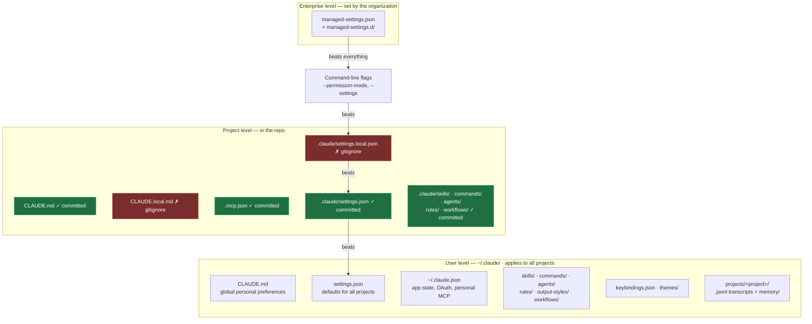

import { Tabs, TabItem, Steps, Aside, FileTree } from '@astrojs/starlight/components';
import Zero from '@/components/Zero.astro';

<div class="meta-modulo">
	<span><strong>Estimated time:</strong> 50 minutes</span>
	<span><strong>Prerequisites:</strong> <a href="/en/fondamenta/setup/">module 0</a> completed and at least one Claude Code session already done.</span>
</div>

Every time you use Claude Code, it reads and writes files on your disk: settings, instructions,
recordings of conversations. Knowing **where** these things are is what separates those who
put up with the tool from those who are in charge of it: it lets you understand why it behaves a certain way,
share configuration with the team, find a conversation from weeks ago and clean up
without breaking anything. This module is the map.

<Zero title="What a configuration file is">
Many programs are customized from a "Settings" menu. Terminal tools, instead,
read their preferences from **text files** in conventional places: change the file, and the
behavior changes. It is less convenient than a menu, but it has a huge advantage: those files can be copied,
versioned with git and shared with the team — settings become part of the project. Names
that start with a dot (`.claude`, `.gitignore`) are "hidden": file managers don't show them
by default, but they are there.
</Zero>

## Objectives

- Know by heart where Claude Code's configuration, extensions and data live, on macOS and on Windows.
- Tell the user level from the project level, and understand which file gets committed and which doesn't.
- Reconstruct the precedence order in which settings override each other.
- Find the transcript of a past session and resume it.
- Clean up and back up safely, knowing what can be deleted and what can't.

## Key concepts

**Two levels, same structure.** Claude Code reads configuration from two places that have almost the
same shape: `~/.claude/` in your home folder (**user** level: applies to all your
projects) and `.claude/` inside the [repository](/en/glossario/#repository-repo) (**project** level: applies
only there, and travels with the code). In both you find the same subfolders — one for each type of
customization the course teaches in the next modules: `skills/` and `commands/` (packaged
instructions, modules 7-8), `agents/` (specialized helpers, module 11), `rules/` (rules by
topic, module 5), plus `settings.json` for permissions and options. What changes is the scope, not
the format: a [skill](/en/glossario/#skill) written in `~/.claude/skills/` follows you everywhere; the same
skill in `.claude/skills/` belongs to the project and you [commit](/en/glossario/#commit) it for the team.

**The distinction that matters most: what gets committed.** Inside the project `.claude/`, `settings.json` is the
**shared** file — permissions, hooks, environment variables agreed with the team — and it goes into git.
`settings.local.json` is your **personal** file for that project and stays out of git: Claude Code
adds it to `.gitignore` on its own when it saves a setting there. Same logic for memory: `CLAUDE.md`
belongs to the project and is committed, `CLAUDE.local.md` holds your private preferences and you create it by hand,
adding it to `.gitignore`.

**`.mcp.json` lives at the root, not inside `.claude/`.** It is the file of the MCP servers shared with the team, and
it is committed. Personal MCP servers end up in `~/.claude.json` instead.

**`~/.claude.json` is not `settings.json`.** It is a very common mistake. `~/.claude.json` is an
**application state** file, that is, the things Claude Code manages on its own: the
[login](/en/glossario/#oauth) session, personal [MCP](/en/glossario/#mcp) servers, the registry of projects
you trust, [caches](/en/glossario/#cache) and interface preferences. `~/.claude/settings.json` is instead the
official mechanism for configuring behavior: permissions, hooks, `env`, default model.
You edit the second; the first is managed by Claude Code.

**`~/.claude/` also contains data, not just configuration.** Conversation transcripts, prompt
history, snapshots of files before edits, caches, logs. They are **plain-text** files: if a tool reads
a `.env` or a command prints a credential, that value ends up in the transcript on disk. That is why
the cleanup section at the end of this module is not a minor detail.

**Precedence resolves conflicts.** When the same setting appears in multiple files, the one with
the highest priority wins. From strongest to weakest: **Managed → command-line arguments → Local →
Project → User**. Settings managed by the organization sit above everything and cannot be
overridden, except for very narrow exceptions.

## The hierarchy at a glance

The diagram below puts the whole module together in one figure: the three configuration levels
(organization, user, project), what each contains, and the precedence arrows — who wins
when two levels say different things. **Green = files that get committed** (shared with the team via
git), **red = personal files** that stay out. You don't need to understand it all now: it is the map to
keep in view while the module walks through it piece by piece.



## User level: `~/.claude/`

The paths:

<Tabs syncKey="os">
<TabItem label="macOS" icon="apple">
- Configuration and extensions: `~/.claude/`
- Application state: `~/.claude.json`
- Credentials: **macOS Keychain** (encrypted) — not a file
</TabItem>
<TabItem label="Windows" icon="seti:windows">
- Configuration and extensions: `%USERPROFILE%\.claude\`
- Application state: `%USERPROFILE%\.claude.json`
- Credentials: `%USERPROFILE%\.claude\.credentials.json`, protected by the user profile's permissions
</TabItem>
</Tabs>

<FileTree>

- ~/
  - .claude.json App state, OAuth, personal MCP servers, UI preferences
  - .claude/
    - CLAUDE.md Personal preferences valid in every project
    - settings.json Default settings for all projects
    - keybindings.json Custom keyboard shortcuts
    - rules/ User-level rules, valid everywhere
    - skills/ Personal skills, available in every project
    - commands/ Personal single-file commands
    - agents/ Personal subagents
    - output-styles/ [System prompt](/en/glossario/#system-prompt) sections (the model's permanent instructions) that change how Claude works
    - workflows/ Personal dynamic workflows
    - agent-memory/ Persistent subagent memory
    - themes/ Custom color themes
    - plugins/ Cloned marketplaces and installed plugins
    - projects/ **Session history**, one folder per project
      - &lt;project&gt;/
        - &lt;session&gt;.jsonl Full transcript of the conversation
        - &lt;session&gt;/subagents/ Subagent transcripts
        - &lt;session&gt;/tool-results/ Tool outputs too large for the transcript
        - memory/ Auto memory: the notes Claude keeps between sessions
    - file-history/ Snapshots of files before edits, for checkpoints
    - plans/ Plans written in Plan Mode
    - history.jsonl Every prompt you typed, with timestamp and project
    - shell-snapshots/ Shell aliases and functions captured at startup
    - debug/ Per-session debug logs (only with `--debug` or `/debug`)
    - paste-cache/, image-cache/ Long pastes and attached images
    - backups/ Copies of `~/.claude.json` before config migrations

</FileTree>

### Sessions: `projects/`

It is the part you need most often and that almost nobody knows. Claude Code creates a folder for each
project you have worked in, with the **path turned into a name**: slashes become dashes and there is
a leading dash. The project `/home/utente/work/my-repo` becomes:

```text
~/.claude/projects/-home-utente-work-my-repo/
```

Inside, one `.jsonl` file per session with the full [transcript](/en/glossario/#transcript): every
message, every command run, every result. The format is [JSONL](/en/glossario/#jsonl) — one JSON
object per line — and this has a valuable practical consequence: **you can search inside it with ordinary
text tools**, as we will see shortly in the guided example.

<Aside type="caution" title="They are plain-text files">
Transcripts and history are not encrypted at rest: the only protection is filesystem permissions.
Everything that passes through a tool ends up in there — file contents, command output, pasted text.
</Aside>

## Project level

<FileTree>

- your-project/
  - CLAUDE.md Project instructions, read in every session — **committed**
  - CLAUDE.local.md Your private preferences for this project — **gitignore**, to be created by hand
  - .mcp.json Project MCP servers, shared with the team — **committed**
  - .worktreeinclude Gitignored files to copy into new worktrees — **committed**
  - .claude/
    - settings.json Permissions, hooks, env, configuration — **committed**
    - settings.local.json Your personal overrides — **gitignore**
    - rules/ Instructions by topic, optionally tied to paths
      - testing.md Testing conventions, valid on test files
      - api-design.md API conventions, valid on backend code
    - skills/
      - security-review/
        - SKILL.md Entrypoint: when it activates, how it is invoked, instructions
        - checklist.md Supporting file included in the skill
    - commands/
      - fix-issue.md Single-file prompt, invocable with `/fix-issue`
    - agents/
      - code-reviewer.md Subagent with its own context window
    - output-styles/ Project output styles, if the team shares any
    - workflows/ Workflow scripts that orchestrate multiple subagents
    - agent-memory/ Persistent memory of project subagents

</FileTree>

### Enterprise level: `managed-settings.json`

The settings imposed by the organization, which you cannot override:

| System | Path |
| --- | --- |
| macOS | `/Library/Application Support/ClaudeCode/managed-settings.json` — drop-ins in `managed-settings.d/` |
| Windows | `C:\Program Files\ClaudeCode\managed-settings.json` — drop-ins in `managed-settings.d\` |
| Linux and WSL | `/etc/claude-code/managed-settings.json` — drop-ins in `managed-settings.d/` |

On macOS there is also the managed preferences domain `com.anthropic.claudecode`; on Windows the registry
keys `HKLM\SOFTWARE\Policies\ClaudeCode` (admin) and `HKCU\SOFTWARE\Policies\ClaudeCode` (user).

## Settings precedence

When the same key appears in multiple files, the order is this — from strongest to weakest:

<Steps>

1. **Managed** — the settings managed by the organization. Cannot be overridden by any other scope,
   except for narrow, documented exceptions.
2. **Command-line arguments** — temporary overrides for that session, for example
   `--permission-mode` or `--settings`.
3. **Local** — `.claude/settings.local.json`: beats both project and user.
4. **Project** — `.claude/settings.json`: beats user.
5. **User** — `~/.claude/settings.json`: applies when nothing else specifies that setting.

</Steps>

<Aside type="note" title="Mind the order">
Many guides out there give "enterprise → CLI → project → user", forgetting `settings.local.json`.
It is the file that drives you crazy in practice: you put a permission in the shared `settings.json`, it has no
effect, and the reason is a `settings.local.json` that overrides it.
</Aside>

Some environment variables take precedence over the equivalent setting, but not all: when it matters,
check the individual variable in the [env vars reference](https://code.claude.com/docs/en/env-vars).

## Summary table: which file, when

| File | Scope | Committed? | When to use it |
| --- | --- | --- | --- |
| `CLAUDE.md` | Project and user | ✓ (project) | Give Claude the project's context and conventions |
| `CLAUDE.local.md` | Project | ✗ | Your private preferences on this project |
| `rules/*.md` | Project and user | ✓ | Instructions by topic, optionally tied to file paths |
| `.claude/settings.json` | Project | ✓ | Permissions, hooks, env vars, default model shared with the team |
| `.claude/settings.local.json` | Project | ✗ | Your personal overrides on this project |
| `~/.claude/settings.json` | User | — | Your defaults for all projects |
| `.mcp.json` | Project | ✓ | MCP servers shared with the team |
| `~/.claude.json` | User | — | App state, OAuth, personal MCP. **Claude Code manages it, not you** |
| `.worktreeinclude` | Project | ✓ | Gitignored files to copy into new worktrees |
| `skills/<nome>/SKILL.md` | Project and user | ✓ | Reusable prompts invocable with `/nome` or triggered automatically |
| `commands/*.md` | Project and user | ✓ | Single-file prompts — same mechanism as skills |
| `agents/*.md` | Project and user | ✓ | Subagents with their own prompt and tools |
| `workflows/*.js` | Project and user | ✓ | Orchestrate many subagents from a script |
| `output-styles/*.md` | Project and user | ✓ | Change how Claude formats its answers |
| `agent-memory/<nome>/` | Project and user | ✓ | Persistent subagent memory |
| `keybindings.json` | User | — | Custom keyboard shortcuts |
| `themes/*.json` | User | — | Custom color themes |
| `projects/<progetto>/memory/` | User | — | Auto memory: Claude's notes between sessions |
| `managed-settings.json` | System | — | Settings imposed by the organization |

## Guided example: explore your `~/.claude/`

<Steps>

1. **Look at what is there.**

   <Tabs syncKey="os">
   <TabItem label="macOS" icon="apple">
   ```bash
   ls -la ~/.claude/
   ```

   If you have `tree` installed, a two-level view is more readable:

   ```bash
   tree -L 2 -a ~/.claude/
   ```
   </TabItem>
   <TabItem label="Windows" icon="seti:windows">
   ```powershell
   Get-ChildItem -Force $env:USERPROFILE\.claude\
   ```

   For a tree view:

   ```powershell
   tree /F /A $env:USERPROFILE\.claude | Select-Object -First 60
   ```
   </TabItem>
   </Tabs>

2. **Measure what takes up space.** Usually the answer is `projects/`, the transcripts folder.

   <Tabs syncKey="os">
   <TabItem label="macOS" icon="apple">
   ```bash
   # du = "disk usage": measures each item in ~/.claude ("-s" one total
   # per item, "-h" in readable units like MB), then sorts by
   # size and shows the 10 largest
   du -sh ~/.claude/* | sort -h | tail -10
   ```
   </TabItem>
   <TabItem label="Windows" icon="seti:windows">
   PowerShell has no direct equivalent of `du`, so the command is longer: it lists the
   folders, sums the bytes of the files in each, converts to MB and sorts. Copy it as is — it only
   reads:

   ```powershell
   # for each folder inside .claude...
   Get-ChildItem $env:USERPROFILE\.claude -Directory |
     ForEach-Object {
       # ...build a table row: name and total size in MB
       [PSCustomObject]@{
         Nome = $_.Name
         MB   = [math]::Round((Get-ChildItem $_.FullName -Recurse -File |
                Measure-Object Length -Sum).Sum / 1MB, 1)
       }
       # finally: sort from the largest and keep the first 10
     } | Sort-Object MB -Descending | Select-Object -First 10
   ```
   </TabItem>
   </Tabs>

3. **Find a project's sessions folder.** Remember the rule: the slashes in the path
   become dashes, with a leading dash.

   <Tabs syncKey="os">
   <TabItem label="macOS" icon="apple">
   ```bash
   ls ~/.claude/projects/ | grep -i nome-del-progetto
   ```
   </TabItem>
   <TabItem label="Windows" icon="seti:windows">
   ```powershell
   Get-ChildItem $env:USERPROFILE\.claude\projects\ |
     Where-Object Name -like '*nome-del-progetto*'
   ```
   </TabItem>
   </Tabs>

4. **Search inside the transcripts.** This is the real superpower: sessions are JSON Lines, so they are searchable.

   <Tabs syncKey="os">
   <TabItem label="macOS" icon="apple">
   ```bash
   grep -l "endpoint" ~/.claude/projects/-home-*/*.jsonl
   ```

   To see session files from the most recent:

   ```bash
   ls -lt ~/.claude/projects/-home-*/*.jsonl | head -5
   ```
   </TabItem>
   <TabItem label="Windows" icon="seti:windows">
   ```powershell
   Select-String -Path "$env:USERPROFILE\.claude\projects\*\*.jsonl" -Pattern 'endpoint' -List |
     Select-Object -ExpandProperty Path
   ```

   To see session files from the most recent:

   ```powershell
   Get-ChildItem "$env:USERPROFILE\.claude\projects\*\*.jsonl" |
     Sort-Object LastWriteTime -Descending | Select-Object -First 5 Name, LastWriteTime
   ```
   </TabItem>
   </Tabs>

5. **Resume the session.** You don't need to open the `.jsonl`: use the built-in picker from the
   project folder.

   ```bash
   claude --resume
   ```

   A browsable list of that project's conversations opens. To resume the last one directly:

   ```bash
   claude --continue
   ```

6. **See the precedence order in action.** The experiment: we create a test project with the
   **same** [environment variable](/en/glossario/#environment-variable) `DEMO` defined in two settings
   files with different values, and ask Claude which one it sees.

   <Tabs syncKey="os">
   <TabItem label="macOS" icon="apple">
   ```bash
   # create the test folder (with the .claude subfolder) and enter it
   mkdir -p /tmp/precedenza/.claude && cd /tmp/precedenza

   # write the two settings files (">" = "write to this file"):
   # in the shared settings, DEMO is "progetto"...
   printf '{\n  "env": { "DEMO": "progetto" }\n}\n' > .claude/settings.json
   # ...in the personal one, DEMO is "locale"
   printf '{\n  "env": { "DEMO": "locale" }\n}\n' > .claude/settings.local.json
   ```
   </TabItem>
   <TabItem label="Windows" icon="seti:windows">
   ```powershell
   # create the test folder (with the .claude subfolder) and enter it
   New-Item -ItemType Directory -Force $env:TEMP\precedenza\.claude | Out-Null
   cd $env:TEMP\precedenza

   # write the two settings files:
   # in the shared settings, DEMO is "progetto"...
   '{ "env": { "DEMO": "progetto" } }' | Set-Content .claude\settings.json
   # ...in the personal one, DEMO is "locale"
   '{ "env": { "DEMO": "locale" } }' | Set-Content .claude\settings.local.json
   ```
   </TabItem>
   </Tabs>

   Then launch `claude` and, in the chat, ask it to run the command that prints the variable:

   ```text
   run: echo $DEMO
   ```

   *(= "run: print the value of DEMO" — `run:` is not special syntax, it is just a clear way
   to ask Claude to run a command)*

   Claude will answer **`locale`**: `settings.local.json` beats `settings.json`, as the precedence
   ladder says. If you had launched with `--settings` from the command line, that would have won.

7. **Check the configuration state.** From inside the session:

   ```text
   /status
   ```

   It shows the active account, login method and configuration. Outside the session, `claude doctor` validates the
   settings files and reports parsing errors.

</Steps>

## Backup and safe cleanup

### What is already cleaned up automatically

Claude Code deletes on its own files older than `cleanupPeriodDays` (default **30 days**, minimum 1;
the value `0` fails with a validation error). Automatic cleanup covers, under `~/.claude/`:

| Path | Content |
| --- | --- |
| `projects/<progetto>/<sessione>.jsonl` | Full transcript of the conversation |
| `projects/<progetto>/<sessione>/subagents/` | Subagent transcripts |
| `projects/<progetto>/<sessione>/tool-results/` | Tool outputs that are too large |
| `file-history/<sessione>/` | Pre-edit snapshots used by checkpoints |
| `plans/` | Plans written in Plan Mode |
| `debug/` | Per-session debug logs |
| `paste-cache/`, `image-cache/` | Long pastes and attached images |
| `session-env/`, `tasks/`, `shell-snapshots/` | Per-session metadata and state |
| `backups/` | Copies of `~/.claude.json` before migrations |
| `usage-data/`, `feedback-bundles/` | Usage reports and feedback archives |

**Auto memory** (`projects/<progetto>/memory/`) is excluded from cleanup: the folder is removed only
after it has stayed empty for the entire retention period.

### What stays until you delete it

| Path | Content |
| --- | --- |
| `history.jsonl` | Every prompt you typed, with timestamp and project. Used for recall with the up arrow |
| `stats-cache.json` | Aggregated [token](/en/glossario/#token) counts (the unit of measure of text for the AI — and of your plan's usage) and costs shown by `/usage` |
| `remote-settings.json` | Cached copy of the organization's managed settings |
| `cache/changelog.md` | Cached copy of the changelog |
| `policy-limits.json` | Your organization's policy settings |

### Deleting the state of a single project

There is a dedicated command, which prints the plan and asks for confirmation before touching anything:

```bash
claude project purge ~/work/my-repo --dry-run
```

The output lists every item and the reason it is included:

```text
Purge plan for /home/user/work/my-repo:

  dir:    /home/user/.claude/projects/-home-user-work-my-repo
           project transcripts (.jsonl) and memory/
  config: projects["/home/user/work/my-repo"]
           project entry in ~/.claude.json (trust, history, MCP servers)
  filter: /home/user/.claude/history.jsonl
           12 prompt(s) typed in this project

Dry run: 3 item(s) would be deleted.
```

Remove `--dry-run` to run it for real.

<Aside type="danger" title="What NOT to delete by hand">
- **`~/.claude.json`** — contains the OAuth session, personal MCP servers and the trust state of
  projects. Deleting it makes you log in again and reconfigure MCP.
- **`~/.claude/settings.json`, `skills/`, `commands/`, `agents/`, `rules/`, `CLAUDE.md`** — this is the stuff
  you wrote. No automatic cleanup touches it, and no manual cleanup should.
- **`~/.claude/plugins/`** — managed by the `claude plugin` commands. Editing it by hand leaves
  inconsistent installations.

If the goal is freeing space, act on `projects/` and `file-history/`, or lower
`cleanupPeriodDays`. If the goal is privacy, `claude project purge` does a more thorough job than `rm`,
because it also cleans `history.jsonl` and the entry in `~/.claude.json`.
</Aside>

### Reducing data exposure

- Lower `cleanupPeriodDays` to shorten transcript retention.
- Set `CLAUDE_CODE_SKIP_PROMPT_HISTORY` to not write transcripts and prompt history.
  In non-interactive mode you can also pass `--no-session-persistence` together with `-p`.
- Use permission rules to **deny reading credential files**.

## Exercise

Take a reasoned inventory of your installation.

1. Find the project you have worked on most with Claude Code, by measuring the space taken by its
   transcripts.
2. Find which past session you talked about a certain topic in, and resume it.
3. In a test project, create a conflict between `settings.json` and `settings.local.json` and check who
   wins.
4. Back up only the configuration you wrote yourself, excluding data and caches.

<details class="soluzione">
<summary>Solution</summary>

**Step 1.**

<Tabs syncKey="os">
<TabItem label="macOS" icon="apple">
```bash
du -sh ~/.claude/projects/* | sort -h | tail -5
```
</TabItem>
<TabItem label="Windows" icon="seti:windows">
```powershell
Get-ChildItem "$env:USERPROFILE\.claude\projects" -Directory |
  ForEach-Object {
    [PSCustomObject]@{
      Progetto = $_.Name
      MB = [math]::Round((Get-ChildItem $_.FullName -Recurse -File |
           Measure-Object Length -Sum).Sum / 1MB, 1)
    }
  } | Sort-Object MB -Descending | Select-Object -First 5
```
</TabItem>
</Tabs>

The folder name is the project path with dashes instead of slashes: read there which
project it is.

**Step 2.** Search for the term in the transcripts, then resume from the project folder:

<Tabs syncKey="os">
<TabItem label="macOS" icon="apple">
```bash
grep -rl "autenticazione" ~/.claude/projects/ --include='*.jsonl' | head
cd ~/percorso/del/progetto
claude --resume
```
</TabItem>
<TabItem label="Windows" icon="seti:windows">
```powershell
Select-String -Path "$env:USERPROFILE\.claude\projects\*\*.jsonl" -Pattern 'autenticazione' -List |
  Select-Object -ExpandProperty Path
cd C:\percorso\del\progetto
claude --resume
```
</TabItem>
</Tabs>

`--resume` shows the sessions **of the current directory**: you must be in the right project, otherwise
the list is empty or wrong. It is the number one mistake with this command.

**Step 3.** See step 6 of the guided example: `settings.local.json` wins. The quick way to
convince yourself without starting a session is to reason about the order — Managed, CLI, **Local**, Project, User —
but the empirical test is more instructive because it gets you used to verifying instead of remembering.

**Step 4.** The useful backup is the one of the **configuration you wrote yourself**. Transcripts, caches and
snapshots are useless in a backup: they are large, in plain text and can be rebuilt.

<Tabs syncKey="os">
<TabItem label="macOS" icon="apple">
```bash
# tar = archiving tool: "czf" = create (c) a compressed (z)
# archive in the given file (f). "-C ~/.claude" = "go there
# before picking up the files". The "\" at the end of a line splits the command
# over several lines for readability: it is ONE single command.
tar czf ~/claude-config-backup.tgz \
  -C ~/.claude \
  CLAUDE.md settings.json keybindings.json \
  skills commands agents rules output-styles workflows themes
```
</TabItem>
<TabItem label="Windows" icon="seti:windows">
```powershell
# the starting folder
$src = "$env:USERPROFILE\.claude"

# builds the list of paths to save and keeps only those
# that really exist (Test-Path), so the command doesn't fail
# if you are missing a folder
$items = 'CLAUDE.md','settings.json','keybindings.json','skills','commands',
         'agents','rules','output-styles','workflows','themes' |
         ForEach-Object { Join-Path $src $_ } |
         Where-Object { Test-Path $_ }

# compresses everything into a zip in your user folder
Compress-Archive -Path $items -DestinationPath "$env:USERPROFILE\claude-config-backup.zip" -Force
```
</TabItem>
</Tabs>

Note what is **not** in the command: `projects/`, `file-history/`, `history.jsonl`, `plugins/` and
`~/.claude.json`. The first three are regenerable and potentially sensitive data; `plugins/` should be
reinstalled with `claude plugin`; `~/.claude.json` contains OAuth credentials and should not go into an
archive that then ends up who knows where.

</details>

## Common mistakes & troubleshooting

| Symptom | Cause | Solution |
| --- | --- | --- |
| A permission in `.claude/settings.json` has no effect | A `settings.local.json` overrides it | Check `.claude/settings.local.json`: it is higher in precedence |
| A setting doesn't apply at all | It is imposed by `managed-settings.json` | Managed settings cannot be overridden: talk to whoever administers them |
| You edited `~/.claude.json` and something broke | It is a state file, not a configuration file | Restore from `~/.claude/backups/`, and put your settings in `settings.json` |
| `claude --resume` shows no sessions | The picker lists the sessions of the **current directory** | Move to the project folder and try again |
| You can't find the project folder in `projects/` | The name is the path with dashes instead of slashes | Search with `ls ~/.claude/projects \| grep nome`; watch out for projects that were moved |
| `~/.claude/` is huge | Transcripts and file snapshots | Lower `cleanupPeriodDays`, or run `claude project purge` on finished projects |
| The team doesn't see your project skills | They are in `~/.claude/skills/`, which is personal | Move them to the repo's `.claude/skills/` and commit them |
| An MCP server is missing for your colleagues | It is in the personal scope, inside `~/.claude.json` | Put it in `.mcp.json` at the root of the repo and commit it |
| You delete old sessions but the space doesn't go down | `history.jsonl` and caches are not part of automatic cleanup | They are in the "kept until you delete them" list: remove them by hand or with `project purge` |
| A syntax error in a settings file blocks automatic cleanup | If it can't read how long to keep data, Claude Code suspends periodic cleanup to be safe | `claude doctor` shows the validation errors; `/status` warns you until you fix them |

## Cheat sheet

**Paths**

| Item | macOS / Linux | Windows |
| --- | --- | --- |
| User config | `~/.claude/` | `%USERPROFILE%\.claude\` |
| App state | `~/.claude.json` | `%USERPROFILE%\.claude.json` |
| Credentials | Keychain (macOS) · `~/.claude/.credentials.json` (Linux) | `%USERPROFILE%\.claude\.credentials.json` |
| Sessions | `~/.claude/projects/<progetto>/<sessione>.jsonl` | `%USERPROFILE%\.claude\projects\...` |
| Managed settings | `/Library/Application Support/ClaudeCode/` · `/etc/claude-code/` | `C:\Program Files\ClaudeCode\` |
| Project config | `.claude/` in the repo | same |

**Precedence** — from strongest to weakest:

```text
Managed  →  CLI flags  →  settings.local.json  →  settings.json (project)  →  ~/.claude/settings.json
```

**Commands**

| Command | What it does |
| --- | --- |
| `claude --resume` | Picker for the sessions of the current directory |
| `claude --continue` | Resumes the last session directly |
| `claude doctor` | Validates installation and settings files |
| `/status` | Account, login method, configuration state |
| `claude project purge <path> --dry-run` | Shows what would be deleted for a project |
| `claude project purge <path>` | Deletes transcripts, memory, tasks, history and config entry |

## Sources

Official pages consulted, checked on **16 August 2026**:

- [Explore the .claude directory](https://code.claude.com/docs/en/claude-directory) — full file map, reference table, application data and cleanup
- [Settings](https://code.claude.com/docs/en/settings) — settings file paths by operating system and precedence order
- [Server-managed settings](https://code.claude.com/docs/en/server-managed-settings) — settings managed by the organization
- [Memory](https://code.claude.com/docs/en/memory) — `CLAUDE.md`, rules and auto memory
- [MCP installation scopes](https://code.claude.com/docs/en/mcp) — difference between `.mcp.json` and personal servers
- [Sessions](https://code.claude.com/docs/en/sessions) — resuming sessions
- [Environment variables](https://code.claude.com/docs/en/env-vars) — variables that take precedence over settings
