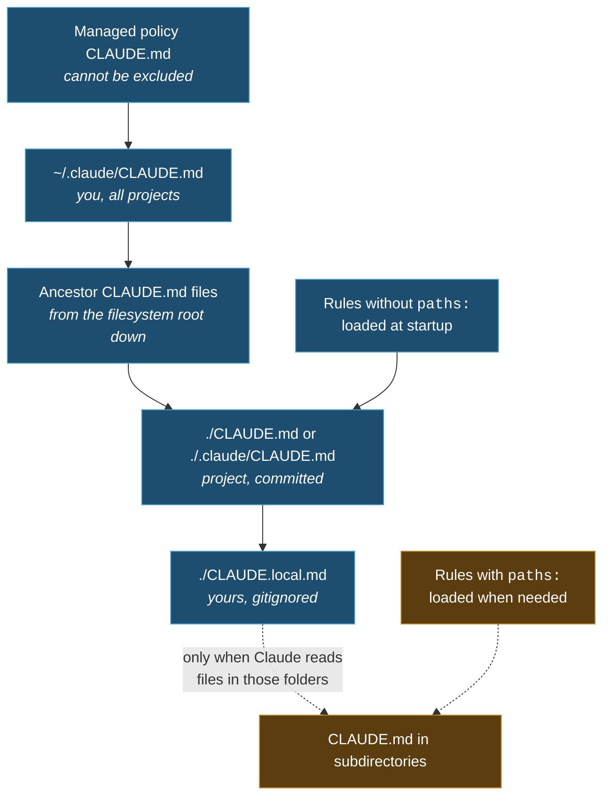

import { Tabs, TabItem, Steps, Aside, FileTree } from '@astrojs/starlight/components';
import Zero from '@/components/Zero.astro';

<div class="meta-modulo">
	<span><strong>Estimated time:</strong> 45 minutes</span>
	<span><strong>Prerequisites:</strong> modules <a href="/en/fondamenta/anatomia-file/">2</a> and <a href="/en/fondamenta/memoria-e-contesto/">4</a>, and a real project to work on.</span>
</div>

[`CLAUDE.md`](/en/glossario/#claudemd) is a text file with the instructions Claude reads
at the start of **every** session. The right analogy is the handover sheet for whoever stands in for you:
everything they need to know before touching anything — how to run the tests, which conventions
you follow, what must never be done. It is the tool with the best effort-to-result ratio in the whole
course: ten minutes to write it, and every future session starts already briefed. This module teaches
where to put it, how to write it so it is **actually** followed, and how to diagnose the classic
"I wrote it down but it doesn't do it".

## Objectives

- Choose the right level — organization, user, project, directory — for each instruction.
- Reconstruct the exact order in which `CLAUDE.md` files are found and concatenated.
- Use `@path` imports and rules in `.claude/rules/` without bloating the context.
- Write instructions Claude really follows, and recognize the ones that would be ignored.
- Diagnose the classic case: "I wrote it in `CLAUDE.md` but it doesn't do it".

## Key concepts

**`CLAUDE.md` is context, not configuration.** Its content is delivered to Claude as a user
message after the system prompt. Claude reads it and tries to follow it, but **there is no guarantee of strict
compliance**, especially for vague or conflicting instructions. If something must always happen, without
exception, it is not `CLAUDE.md` material: it is a [hook](/en/personalizzazione/hooks/), which runs as code at
fixed lifecycle events.

**What goes in, and what doesn't.** `CLAUDE.md` is where you write what you would otherwise explain again every
time. The working criterion for each line is just one: *"if I removed it, would Claude make mistakes?"*. If not, it
goes.

| ✅ Include | ❌ Exclude |
| --- | --- |
| Shell commands Claude cannot guess | Anything Claude can figure out by reading the code |
| Style rules that diverge from the defaults | Standard language conventions, which it already knows |
| Test instructions and preferred test runners | Detailed API documentation (put a link) |
| The repository's house rules: how [branches](/en/glossario/#branch) are named, how [PRs](/en/glossario/#pr-pull-request) are written | Information that changes frequently |
| Project-specific architectural decisions | Long explanations or tutorials |
| Quirks of the development environment (required env vars) | File-by-file descriptions of the codebase |
| Pitfalls and non-obvious behaviors | Platitudes like "write clean code" |

**When to add something.** There are four reliable signals: Claude makes the same mistake for the
second time; a code review catches something Claude should have known about this codebase; you
find yourself typing in chat the same correction as last session; a new colleague would need
the same context to be productive.

**Size matters.** The documented target is **under 200 lines** per file. Longer files
consume more context and **reduce adherence**: if the file is too long, Claude ignores half of it because
the important rules get lost in the noise. If the instructions grow, the answer is not a longer file:
it is **path-scoped rules** (they load only when Claude works on the files
they refer to — we cover them below).

**All the files found are concatenated, they don't override each other.** This is the substantial difference from
`settings.json`. There is no "the most specific wins": there is "they are all read, in order". Which makes
**contradictory instructions** a real problem — if two rules contradict each other, Claude may pick
one arbitrarily.

## The hierarchy

`CLAUDE.md` files can live in four places, listed in **loading order**, from the broadest to the most
specific:

| Scope | Location | What it is for | Shared with |
| --- | --- | --- | --- |
| **Managed policy** | macOS: `/Library/Application Support/ClaudeCode/CLAUDE.md`<br/>Linux and WSL: `/etc/claude-code/CLAUDE.md`<br/>Windows: `C:\Program Files\ClaudeCode\CLAUDE.md` | Organization-wide instructions, managed by IT | Everyone in the organization |
| **User instructions** | `~/.claude/CLAUDE.md` | Personal preferences for all projects | Only you, everywhere |
| **Project instructions** | `./CLAUDE.md` **or** `./.claude/CLAUDE.md` | Instructions shared with the team | The team, via version control |
| **Local instructions** | `./CLAUDE.local.md` | Personal preferences for this project | Only you, this project |

The managed policy `CLAUDE.md` **cannot be excluded** by individual settings. As an alternative
to the file, the organization can put the content directly in `managed-settings.json` with the
`claudeMd` key — which is honored **only** in managed and policy settings.



### How they are found

Claude Code **walks up the directory tree** from the working directory, checking each folder for
`CLAUDE.md` and `CLAUDE.local.md`. If you launch Claude Code in `foo/bar/`, it loads instructions from
`foo/bar/CLAUDE.md`, `foo/CLAUDE.md` and the `CLAUDE.local.md` files next to them.

The order inside the context goes **from the filesystem root toward the working directory**: `foo/CLAUDE.md`
appears before `foo/bar/CLAUDE.md`. The instructions closest to where you launched Claude are the last
read. Within each directory, `CLAUDE.local.md` is appended **after** `CLAUDE.md`, so your personal
notes are the last thing Claude reads at that level.

`CLAUDE.md` files in **subdirectories** below the working directory are discovered but **not** loaded
at startup: they enter the context when Claude reads files in those subdirectories.

<Aside type="tip" title="Free HTML comments">
Block HTML comments (`<!-- nota per i manutentori -->`) in `CLAUDE.md` files are **removed** before
being injected into the context. Use them to leave notes for human maintainers without spending tokens. Comments
inside code blocks, on the other hand, stay.
</Aside>

## Imports with `@path`

What is importing for? To **avoid duplication**: if the instructions for the git workflow are already in a
project document, `CLAUDE.md` can point to it instead of copying them — only one place to keep
up to date. The syntax is `@path/to/file`: imported files are expanded and loaded into
context at startup, together with the `CLAUDE.md` that references them. (Note the flip side right away: importing
**organizes**, but does not save context — imported files are all loaded anyway.)

```markdown title="CLAUDE.md"
See @README for project overview and @package.json for available npm commands.

# Additional Instructions
- git workflow @docs/git-instructions.md
```

The rules:

- **Relative and absolute** paths are allowed. Relative paths resolve against the file containing the import, not the working directory.
- Imported files can import recursively, up to a **maximum depth of 4 hops**.
- Anything that is "code" in Markdown is ignored by imports: both inline code between backticks and blocks between triple backticks. So to **mention** a path without importing it, just put it between backticks: `` `@README` `` stays text, `@README` outside backticks imports the file.

<Aside type="caution" title="External imports ask for approval">
An import in a project memory file is **external** when the path resolves outside the working
directory — for example `@~/.claude/mie-istruzioni.md`. The first time Claude Code meets one in a
project, it shows an approval dialog listing the files. If you decline, the imports stay
disabled and the dialog does not reappear.

It is there to protect you from files other people commit to a shared project. Imports in
user-scope memory files — `~/.claude/CLAUDE.md`, `~/.claude/rules/` — are things you wrote yourself and
load without a dialog.
</Aside>

**Be careful about what imports really solve:** they organize the file, but **do not reduce the context**,
because imported files are loaded at startup anyway. If the problem is size, the solution
is path-scoped rules.

### The worktree case

A gitignored `CLAUDE.local.md` exists only in the worktree where you created it. To share personal
instructions across several worktrees of the same repo, import a file from your home directory:

```markdown title="CLAUDE.md"
# Individual Preferences
- @~/.claude/my-project-instructions.md
```

### Living with `AGENTS.md`

Claude Code reads `CLAUDE.md`, **not** `AGENTS.md`. If the repo already uses `AGENTS.md` for other agents, create
a `CLAUDE.md` that imports it, so both tools read the same instructions without duplicating them:

```markdown title="CLAUDE.md"
@AGENTS.md

## Claude Code

Use plan mode for changes under `src/billing/`.
```

A **symlink** also works — a symbolic link: a "fake" file that points to another, so
both names open the same content. It makes sense if you don't need to add anything Claude-specific:

```bash
# ln -s <existing-file> <link-name>
# creates "CLAUDE.md" as a link pointing to AGENTS.md
ln -s AGENTS.md CLAUDE.md
```

On Windows, creating a symlink requires Administrator privileges or Developer Mode: there the
`@AGENTS.md` import is the better choice.

## Rules in `.claude/rules/`

For large projects, instructions are organized into separate files inside `.claude/rules/`. Each file
covers one topic, with a descriptive name. All `.md` files are discovered **recursively**, so you can
organize them into subfolders.

<FileTree>

- your-project/
  - .claude/
    - CLAUDE.md Main project instructions
    - rules/
      - code-style.md Style guidelines
      - testing.md Testing conventions
      - security.md Security requirements
      - frontend/
        - components.md Organized in subfolders too

</FileTree>

Rules **without** `paths:` frontmatter are loaded at startup, with the same priority as
`.claude/CLAUDE.md`.

### Path-scoped rules

This is the mechanism that lets you have many instructions without always paying for them:

```markdown title=".claude/rules/api-design.md"
---
paths:
  - "src/api/**/*.ts"
---

# API Development Rules

- All API endpoints must include input validation
- Use the standard error response format
- Include OpenAPI documentation comments
```

These rules enter the context **only when Claude reads a matching file**, not on every tool
use. Supported glob patterns:

| Pattern | Matches |
| --- | --- |
| `**/*.ts` | All TypeScript files in any directory |
| `src/**/*` | All files under `src/` |
| `*.md` | Markdown files in the project root |
| `src/components/*.tsx` | React components in a specific directory |

You can use several patterns and brace expansion:

```markdown
---
paths:
  - "src/**/*.{ts,tsx}"
  - "lib/**/*.ts"
  - "tests/**/*.test.ts"
---
```

Each group of braces multiplies the number of expanded patterns: `src/*.{ts,tsx}` becomes two,
`{a,b}/{c,d}/*.{ts,tsx}` becomes eight. To keep expansion bounded, the whole `paths` list of a
rule shares a budget of **1,000 expanded patterns and 4 MiB**; patterns without braces don't count.
A pattern that would exceed the budget is used **unexpanded**, and its literal braces
match nothing.

<Aside type="caution" title="Square brackets">
Glob syntax interprets `[` as the start of a bracket expression like `[abc]`. A pattern with a `[`
that does not read as a bracket expression — for example `photos [2024/**` — is **invalid**: it matches
nothing, while the other patterns in the same rule keep working. To match a literal `[`
in a file name, it must be escaped: `photos \[2024/**`.
</Aside>

### User-level and shared rules

Personal rules in `~/.claude/rules/` apply to every project on the machine, and are loaded
**before** project rules, which therefore have higher priority.

The `.claude/rules/` directory supports **symlinks**, so you can maintain a shared set of rules and
link it into several projects:

```bash
ln -s ~/shared-claude-rules .claude/rules/shared
ln -s ~/company-standards/security.md .claude/rules/security.md
```

(A detail for the more experienced: even circular symlinks — A pointing to B pointing to A —
are detected and handled without sending anything into a loop.)

## Excluding other people's `CLAUDE.md` files

In [monorepos](/en/glossario/#monorepo) — a single repository containing several projects from different teams —
it happens that the `CLAUDE.md` files in the parent folders contain instructions from other teams, irrelevant to
you. The `claudeMdExcludes` setting skips them by path or glob:

```json title=".claude/settings.local.json"
{
  "claudeMdExcludes": [
    "**/monorepo/CLAUDE.md",
    "/home/user/monorepo/other-team/.claude/rules/**"
  ]
}
```

Patterns are matched against **absolute paths**. You can configure it at any settings level —
user, project, local or managed policy — and the arrays are merged across levels. Managed
policy `CLAUDE.md` files are **not** excludable.

## Guided example: from nothing to a working `CLAUDE.md`

<Steps>

1. **Generate the base instead of writing it by hand.**

   ```text
   /init
   ```

   Claude analyzes the codebase and creates a file with build commands, test instructions and conventions it
   discovered. If a `CLAUDE.md` already exists, `/init` **proposes improvements** instead of overwriting it.

   For an interactive multi-phase flow, set `CLAUDE_CODE_NEW_INIT=1`: `/init` asks which artifacts
   to prepare (CLAUDE.md, skills, hooks), explores the codebase with a subagent, fills gaps with
   follow-up questions and presents a reviewable proposal before writing any file.

   `/init` also reads Cursor rules (`.cursor/rules/` or `.cursorrules`) and Copilot rules
   (`.github/copilot-instructions.md`) and incorporates the relevant parts.

2. **Check that it has been loaded.**

   ```text
   /context
   ```

   Your `CLAUDE.md` must appear under **Memory files**. If it is not there, everything else is pointless.

3. **Add what Claude could not discover on its own.** The generated file knows the code; it does not
   know your implicit conventions. A realistic example:

   ```markdown title="CLAUDE.md"
   # Code style
   - Use ES modules (import/export) syntax, not CommonJS (require)
   - Destructure imports when possible (eg. import { foo } from 'bar')

   # Workflow
   - Be sure to typecheck when you're done making a series of code changes
   - Prefer running single tests, and not the whole test suite, for performance
   ```

   Note the form: headers and bullets, short, verifiable sentences. `"Use 2-space indentation"` works better
   than `"Format code properly"`; `` "Run `npm test` before committing" `` better than `"Test your changes"`.

4. **Move area-specific instructions into rules.** If you have a section that applies only to the backend,
   it becomes a file with `paths:`:

   ```markdown title=".claude/rules/backend.md"
   ---
   paths:
     - "src/server/**/*.ts"
   ---

   # Backend

   - Ogni handler è puro: nessuna I/O diretta, usa i repository in `src/server/repos/`
   - Gli errori attesi sono `AppError`, non eccezioni generiche
   ```

5. **Add your private preferences.** Watch the difference between the two redirection symbols,
   because here it is **critical**: `>` writes the file **from scratch** (fine for creating a new one), `>>`
   **appends to the end** without touching what is there. On `.gitignore` you need `>>`: with `>` you would wipe
   all the project's existing rules.

   <Tabs syncKey="os">
   <TabItem label="macOS" icon="apple">
   ```bash
   # create CLAUDE.local.md with two lines of preferences (">" = new file)
   printf 'Il mio sandbox è su http://localhost:4000\nUsa i dati di test in fixtures/dev.json\n' > CLAUDE.local.md

   # APPENDS the file to the ignore list (">>" = append, don't overwrite!)
   echo 'CLAUDE.local.md' >> .gitignore
   ```
   </TabItem>
   <TabItem label="Windows" icon="seti:windows">
   ```powershell
   # create CLAUDE.local.md with two lines of preferences
   "Il mio sandbox è su http://localhost:4000`nUsa i dati di test in fixtures/dev.json" | Set-Content CLAUDE.local.md

   # APPENDS the file to the ignore list (Add-Content = append, don't overwrite!)
   Add-Content .gitignore 'CLAUDE.local.md'
   ```
   </TabItem>
   </Tabs>

6. **Test that the behavior really changes.** Don't trust the fact that the file exists: have
   Claude do something that should respect the new rule and see whether it does. If it doesn't, the
   problem is almost always one of the three in the troubleshooting below.

7. **Have the file pruned when it grows.**

   ```text
   /doctor
   ```

   Among its checks, it proposes cuts for a committed `CLAUDE.md`: it removes what Claude can infer
   from the codebase — directory layout, dependency lists, architecture overviews — and keeps
   pitfalls, rationale and conventions that diverge from the tools' defaults.

</Steps>

## Exercise

Take a real project and build a three-level memory hierarchy.

1. Write a `~/.claude/CLAUDE.md` with **at most five lines** of personal preferences that apply
   everywhere.
2. In the project, separate the always-valid instructions from the area-specific ones.
3. Create a deliberate conflict between two levels and observe what happens.
4. Check which part of the hierarchy survives a compaction.

<details class="soluzione">
<summary>Solution</summary>

**Step 1.** The user level is the one that bloats most easily, because you pay for it in **every** session
of **every** project. Five lines are already a lot:

```markdown title="~/.claude/CLAUDE.md"
- Rispondi in italiano; codice, commenti e nomi di file in inglese.
- Non aggiungere commenti che ripetono quello che il codice già dice.
- Prima di un commit, mostrami la diff invece di descriverla.
- Se una scelta ha più di un'opzione ragionevole, proponi la tua e spiega perché in una riga.
- Non creare file di documentazione se non te li ho chiesti.
```

Note that they are all **process** preferences, not technical ones: technical things change from project to
project and belong at the project level.

**Step 2.** The practical rule: the project `CLAUDE.md` holds what is needed **in every session**;
`.claude/rules/` with `paths:` holds what is needed only when working on one part. (This example is in
Italian, the one in the guided example was in English: **both work** — Claude reads both
languages well. Choose your team's language and be consistent.)

```markdown title="CLAUDE.md"
# Progetto

App Next.js con Supabase. Il codice sta in `src/`, i test accanto ai file come `*.test.ts`.

# Comandi

- `npm run dev` — dev server
- `npm test` — test (Vitest). Lancia il singolo file, non la suite intera
- `npm run typecheck` — obbligatorio prima di ogni commit

# Convenzioni

- ES modules, mai CommonJS
- Le variabili d'ambiente sono validate in `src/env.ts`: aggiungine di nuove solo lì
```

```markdown title=".claude/rules/react.md"
---
paths:
  - "src/components/**/*.tsx"
---

# Componenti React

- Server Component di default; `"use client"` solo quando serve davvero stato o effetti
- Niente `useEffect` per il data fetching: usa i loader del framework
```

*(The content is React jargon — if you don't use it, you don't need to understand it: what matters is the **form**.
The `paths:` frontmatter says "these rules apply only to `.tsx` files inside `src/components/`",
and so they load only when Claude works there.)*

**Step 3.** Put a line like `- Usa sempre tabulazioni per l'indentazione` (always use tabs for indentation) in `~/.claude/CLAUDE.md` and
`- Usa 2 spazi per l'indentazione` (use 2 spaces for indentation) in the project `CLAUDE.md`. Then ask Claude to create a new
file.

What you observe: both files **are loaded**, they don't override each other. The project is read **after**
the user file, and in practice the closest and most specific instruction tends to prevail — but **it is not a
guarantee**: the documentation explicitly says that with contradictory rules Claude may pick one
arbitrarily. The lesson is not "learn the order of precedence": it is **don't leave contradictions**.
Periodically re-read nested `CLAUDE.md` files and rules to remove obsolete or conflicting instructions.

**Step 4.** Fill the context by working, then run `/compact` and check:

| What | Survives? |
| --- | --- |
| `~/.claude/CLAUDE.md` and root `CLAUDE.md` | ✅ re-injected from disk |
| Rules without `paths:` | ✅ re-injected |
| `.claude/rules/react.md` (with `paths:`) | ❌ lost until you re-read a `.tsx` |
| A `CLAUDE.md` in a subdirectory | ❌ lost until you re-read a file in there |
| An instruction given only in chat | ❌ lost |

The practical consequence: if a rule **must** apply even after compaction, remove its `paths:`
frontmatter or move it into the root `CLAUDE.md`. You are trading saved context for reliability.

</details>

## Common mistakes & troubleshooting

### "I wrote it in `CLAUDE.md` but it doesn't do it"

It is the most common problem, and it has three causes, in order of frequency:

<Steps>

1. **The file was not loaded.** Run `/context` and check the **Memory files** section. If the file
   is not listed, Claude does not see it: it is probably not in a location that gets loaded for this
   session. Use `/memory` to open and fix the files.

2. **The instruction is too vague.** `"Use 2-space indentation"` works; `"format code nicely"` doesn't. Make it
   concrete to the point of being verifiable.

3. **The file is too long.** If Claude keeps doing something you have forbidden, the file is probably
   too long and the rule gets lost. Prune. You can also add emphasis (`IMPORTANT`, `YOU MUST`) to
   improve adherence, but it is a band-aid: the cure is shortening.

</Steps>

If the instruction **must** run at a precise point — before every commit, after every file change —
it is not `CLAUDE.md` material: write it as a [hook](/en/personalizzazione/hooks/).

To find out exactly which instruction files were loaded, when and why, there is the
`InstructionsLoaded` hook, useful for understanding why a path-scoped rule or a lazily loaded file did not enter the context.

### Symptom table

| Symptom | Cause | Solution |
| --- | --- | --- |
| `CLAUDE.md` does not appear in `/context` | Location not loaded for this session | Check the hierarchy; `/memory` to open it |
| Claude follows one rule and ignores an opposite one | Contradictory instructions across levels | Review all `CLAUDE.md` files and rules, remove the conflict |
| An `@file` import does not work | It is inside a backtick or a code block | Parsing skips code spans and fenced blocks |
| An external import is not loaded | You declined the approval dialog | The refusal is permanent for that project |
| The import does not reduce the context | Imported files are loaded at startup anyway | Use rules with `paths:`, not imports |
| A rule with `paths:` never triggers | The glob pattern does not match | Watch out for an unescaped `[` and the brace budget |
| Other teams' rules loaded in the monorepo | Ancestor `CLAUDE.md` files are read walking up the tree | `claudeMdExcludes` in `.claude/settings.local.json` |
| A `CLAUDE.local.md` is missing in another worktree | It is gitignored, it exists only where you created it | Import a file from your home with `@~/...` |
| Claude Code does not read `AGENTS.md` | It reads only `CLAUDE.md` | Create a `CLAUDE.md` with `@AGENTS.md`, or a symlink |
| Instructions vanish after `/compact` | They were only in chat, or in a path-scoped rule | Move them into the root `CLAUDE.md` |
| `--add-dir` does not load the added folder's `CLAUDE.md` files | Default behavior | `CLAUDE_CODE_ADDITIONAL_DIRECTORIES_CLAUDE_MD=1` |

## Cheat sheet

**Locations, in loading order**

```text
1. Managed policy   /Library/Application Support/ClaudeCode/CLAUDE.md   (macOS)
                    /etc/claude-code/CLAUDE.md                          (Linux, WSL)
                    C:\Program Files\ClaudeCode\CLAUDE.md               (Windows)
2. User             ~/.claude/CLAUDE.md
3. Ancestors        every CLAUDE.md walking up the tree, from the root down
4. Project          ./CLAUDE.md  or  ./.claude/CLAUDE.md
5. Local            ./CLAUDE.local.md
→ lazy              CLAUDE.md in subdirectories, when Claude reads inside them
```

**Commands**

| Command | What it does |
| --- | --- |
| `/init` | Generates a starter `CLAUDE.md` from the codebase |
| `/memory` | Lists and opens memory files of every scope |
| `/context` | Checks which memory files are **really** loaded |
| `/doctor` | Proposes cuts for a committed `CLAUDE.md` |
| `/import` | Imports another agent's configuration (v2.1.213+) |

**Syntax**

| What | How |
| --- | --- |
| Import a file | `@path/to/file` — max 4 hops deep |
| Mention a path without importing it | `` `@README` `` between backticks |
| Note for humans, free in context | `<!-- block comment -->` |
| Path-scoped rule | `paths:` frontmatter with glob patterns |
| Exclude other people's `CLAUDE.md` | `claudeMdExcludes` in settings |
| Inline managed content | `claudeMd` key in `managed-settings.json` |

**Numbers**

| What | Value |
| --- | --- |
| Recommended size per file | Under 200 lines |
| Maximum import depth | 4 hops |
| `paths` expansion budget | 1,000 patterns, 4 MiB per rule |

## Sources

Official pages consulted, checked on **16 August 2026**:

- [How Claude remembers your project](https://code.claude.com/docs/en/memory) — hierarchy, loading order, imports, rules, troubleshooting
- [Best practices](https://code.claude.com/docs/en/best-practices) — what to include and exclude, size, specificity
- [Explore the context window](https://code.claude.com/docs/en/context-window) — what survives compaction
- [Settings](https://code.claude.com/docs/en/settings) — `claudeMdExcludes` and settings levels
- [Hooks](https://code.claude.com/docs/en/hooks) — when an instruction should be written as a hook, and the `InstructionsLoaded` hook
- [Skills](https://code.claude.com/docs/en/skills) — when to use a skill instead of a line in `CLAUDE.md`
- [Monorepos and large repos](https://code.claude.com/docs/en/large-codebases) — `CLAUDE.md` layout and rules in monorepos
