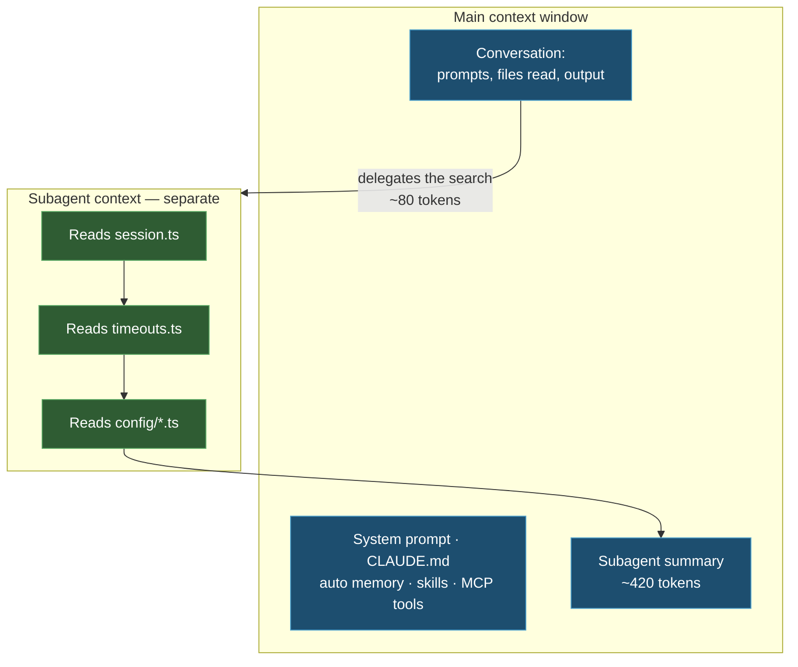

import { Tabs, TabItem, Steps, Aside } from '@astrojs/starlight/components';
import Zero from '@/components/Zero.astro';

<div class="meta-modulo">
	<span><strong>Estimated time:</strong> 50 minutes</span>
	<span><strong>Prerequisites:</strong> <a href="/en/fondamenta/agentic-coding/">module 3</a> and at least one long session already behind you.</span>
</div>

The industry calls it *context engineering*, but the idea is easiest to explain with a desk. The [context
window](/en/glossario/#context-window) is Claude's **working memory**: everything it knows at this
moment has to physically sit there — the conversation, the files it has read, the instructions. The desk
is large but not infinite, it is measured in [tokens](/en/glossario/#token) (the unit of measure for text: ~3-4
characters each), and **when it is cluttered, work goes badly**. This module teaches you to keep it tidy:
it is the single skill that most separates people who get excellent results from people who wonder why "Claude
went dumb after an hour". If the five basic AI concepts are new to you, [The
basics](/en/basi/#how-an-ai-model-reasons) covers them in two minutes.

## Objectives

- Know what enters the context window, when, and how much it costs in [tokens](/en/glossario/#token).
- Read the output of `/context` and act on it.
- Choose deliberately between `/compact`, `/clear`, `/autocompact` and delegating to a subagent.
- Understand what survives compaction and what does not — it is the number one cause of "vanished" instructions.
- Configure auto memory and know where the notes Claude takes end up.

## Key concepts

**Context is the fundamental resource.** The context window holds the whole conversation: every
message, every file read, every command output, plus the system prompt, `CLAUDE.md`, auto memory,
skill descriptions and system instructions. It fills up fast — a single debugging
session can consume tens of thousands of tokens — and **performance degrades as it fills**.
When it is nearly full, Claude starts "forgetting" instructions given at the start and makes more mistakes.

**It starts half occupied.** Before you even type anything, the context already holds the system prompt,
auto memory, environment information, MCP tool names, skill descriptions, user and project
`CLAUDE.md`. On a typical setup this is in the order of 7–8,000 tokens: not much on a
200,000 window, but it grows with every MCP server and every skill you add.

**MCP tool schemas are deferred.** By default, only the **names** of MCP tools enter the context;
full schemas are loaded on demand through *tool search*, when Claude needs a specific
tool. That is why you can afford many MCP servers without drowning the context. With
`ENABLE_TOOL_SEARCH=auto` schemas are loaded up front if they fit within 10% of the window; with
`ENABLE_TOOL_SEARCH=false` everything is loaded.

**Skills cost little until you use them.** At startup Claude sees only the skill **descriptions**; the
full content loads when the skill is used. For skills you only invoke by hand, set
`disable-model-invocation: true` to keep even the description out of the context.

**Compaction is automatic but not free.** As it approaches the limit, Claude Code first drops the oldest
tool outputs, then summarizes the conversation. Your requests and key code snippets
are preserved; **detailed instructions given at the start of the conversation can be lost**.
That is why persistent rules belong in `CLAUDE.md` and not in chat.

**Subagents are the real multiplier.** A subagent runs in a context window of **its own**,
completely separate from the main conversation. If you delegate a search that reads twenty files to it, the
twenty files sit in its context, not yours: only a summary comes back to you. That is why
subagents help in long sessions more than any other technique.

**If you need more room, change model.** The most recent Claude [models](/en/glossario/#model) — Fable 5, Sonnet 5, Opus 4.6 and later, and Sonnet 4.6 —
support a **1 million token** window. Sonnet 5 runs at 1M without needing to select a
`[1m]` variant. Compaction works the same way at the larger limit too.

## What gets loaded, and when

A typical session, with representative token values:

| Moment | What enters the context | Indicative cost |
| --- | --- | --- |
| **Startup** | System prompt | ~4,200 |
| | Auto memory (`MEMORY.md`) | ~680 |
| | Environment info (cwd, platform, shell, git status) | ~280 |
| | MCP tool names (deferred schemas) | ~120 |
| | Skill descriptions | ~450 |
| | `~/.claude/CLAUDE.md` | ~320 |
| | Project `CLAUDE.md` | ~1,800 |
| **While Claude works** | Each file read | 1,000–2,500 each |
| | Rules with `paths:` triggered by the files read | ~300–400 |
| | Command output (e.g. `npm test`) | ~1,200 |
| | `PostToolUse` hook output | ~100–150 |
| **Delegation** | Spawning a subagent | ~80 |
| | The subagent reads N files | **0 in your context** |
| | Summary returned by the subagent | ~420 |

Look at the two delegation rows: the subagent reads N files and **0 tokens** enter **your** context;
only the summary comes back to you (~420). That is the point of the whole module: the same search costs thousands
of tokens if you do it in the main context, and ~500 if you delegate it.



## What survives compaction

This table explains 90% of the "but I told you!" moments you will run into. "Re-injected from disk"
means: after compaction, Claude Code **re-reads the file and puts it back in context on its own** —
so it survives. What lives only in the conversation, on the other hand, gets summarized, and the details are
lost:

| Mechanism | After compaction |
| --- | --- |
| System prompt and output style | Unchanged: they are not part of the message history |
| `CLAUDE.md` at the project root and rules without `paths:` | **Re-injected from disk** |
| Auto memory | **Re-injected from disk** |
| Rules with `paths:` frontmatter | **Lost** until a matching file is read again |
| Nested `CLAUDE.md` in subdirectories | **Lost** until a file in that subdirectory is read |
| Bodies of invoked skills | Re-injected, capped at 5,000 tokens per skill and 25,000 in total; the oldest drop first |
| Hooks | Not applicable: hooks run as code, not as context |
| **Instructions given only in chat** | **Lost** |

<Aside type="tip" title="Skills are truncated from the start">
Truncation of skill bodies keeps the **beginning** of the file. Put the most important instructions at the
top of `SKILL.md`, not at the bottom.
</Aside>

## The tools at your disposal

### `/context` — the diagnosis

Shows a live breakdown of context usage by category, with optimization suggestions, and
includes the list of `CLAUDE.md` and auto memory files actually loaded under **Memory files**.
It is also the way to check that your `CLAUDE.md` has really been read: if it does not appear there, Claude
does not see it.

### `/compact` — summarize, don't reset

Replaces the conversation with a structured summary, keeping continuity. Use it with a **focus**
before starting a new long task:

```text
/compact focus on the auth bug fix
```

The summary keeps what you choose, instead of what the automatic pass guesses is
important. You can also configure the behavior by adding a **Compact Instructions** section to
`CLAUDE.md`, for example: *"When compacting, always preserve the full list of modified files and any test
commands"*.

### `/clear` — reset

Fully resets the context window. It is the right tool **between unrelated tasks**: the
old conversation takes room away from the files you need now and costs tokens on every message.

### `/autocompact` — move the threshold earlier

Automatic compaction kicks in when the window is nearly full. With `/autocompact` **you** decide
the threshold: `500k` means "compact when you reach 500,000 tokens" (the `k` stands for thousands). Useful
on models with a 1 million window, to compact halfway instead of at the last moment:

```text
/autocompact 500k
```

### `Esc` `Esc` or `/rewind` — partial compaction

Select a checkpoint and choose **Summarize from here** (condenses the messages from that point onward,
keeping the earlier context intact) or **Summarize up to here** (condenses the earlier messages,
keeping the recent ones in full).

### `/btw` — off-context questions

For questions whose answer should not stay in context. The answer never enters the conversation
history, so you can check a detail without growing the context.

### Subagents — delegation

A [subagent](/en/glossario/#subagent) is the helper with a separate desk: you hand it a search, it
reads all the files it needs **in its own context**, and only the summary comes back to you. No special
command is needed — just ask for it in the prompt:

```text
Use subagents to investigate how our authentication system handles token
refresh, and whether we have any existing OAuth utilities I should reuse.
```

*(= "use subagents to investigate how our authentication system handles token renewal, and whether we
already have OAuth utilities to reuse" — here "token" is the access token of a login,
a different meaning from AI tokens)*

Subagents have a whole module of their own, [module 11](/en/personalizzazione/agents-subagents/): here it is enough
to know they exist and when to invoke them.

## Auto memory

Auto memory is the mechanism by which **Claude takes notes for itself** from one session to the next: build
commands, debugging insights, architecture notes, style preferences, workflow habits. Claude
does not save something every session: it decides what is worth remembering based on how useful it would be in
a future conversation.

### Where it lives

```text
~/.claude/projects/<progetto>/memory/
├── MEMORY.md          # Concise index, loaded in every session
├── debugging.md       # Detailed notes on debugging patterns
├── api-conventions.md # API design decisions
└── ...                # Other topic files created by Claude
```

The `<progetto>` (project) is derived from the **git repository**, so all worktrees and subdirectories of the same
repo share a single auto memory folder. Outside a git repo, the project root is used.
Auto memory is **local to the machine**: it is not shared between machines or with cloud environments.

To change its location, set `autoMemoryDirectory` in `settings.json` (an absolute path or one starting with `~/`).

### How loading works

The **first 200 lines of `MEMORY.md`, or the first 25 KB — whichever comes first** — are loaded
at the start of every conversation. Content beyond that threshold is not loaded at startup: Claude
keeps `MEMORY.md` concise by moving detailed notes into topic files, which it reads on demand.

If the file approaches the limit, Claude Code reminds Claude to shorten it. If it exceeds it, the write
still succeeds but an error is returned asking to rewrite the index, because everything
beyond the limit is discarded at the next load. YAML frontmatter and block HTML comments are
stripped before loading and **do not count** toward the limits.

<Aside type="note" title="The limit applies only to MEMORY.md">
`CLAUDE.md` files are loaded **in full**, regardless of length. Which is not an
invitation to make them long: shorter files produce better adherence.
</Aside>

The main conversation's auto memory is **not** loaded into subagents, with the exception of forks,
which inherit the parent conversation. A subagent can have its own separate auto memory.

### Enabling, disabling, inspecting

Auto memory is **on by default**. To manage it:

| How | Effect |
| --- | --- |
| `/memory` → toggle | Saves `autoMemoryEnabled` in `~/.claude/settings.json` |
| `{"autoMemoryEnabled": false}` in `.claude/settings.json` | Disables it for the single project |
| `CLAUDE_CODE_DISABLE_AUTO_MEMORY=1` | Disables it via environment variable |

When the interface shows *"Saved 2 memories"* or *"Recalled 2 memories"*, Claude is writing to or reading
from that folder. The files are plain markdown: you can open, correct and delete them whenever you want.

Auto memory is **excluded from the automatic cleanup** of transcripts: `MEMORY.md` and the topic files
stay until you or Claude modify or delete them.

## Guided example: slimming down a session

<Steps>

1. **Take a snapshot of the starting point.** In a session already running on a real project:

   ```text
   /context
   ```

   Note the total and the two or three largest entries. Typically: the files read and the project `CLAUDE.md`.

2. **Check what was really loaded.** In the `/context` output, look at the **Memory
   files** section. If your `CLAUDE.md` is not listed, the problem is not that Claude ignores it: it has
   never seen it.

3. **Do a search the wrong way.** Ask for a broad investigation directly in the main context:

   ```text
   investigate how error handling works across this codebase
   ```

   Let it work, then run `/context` again. You will see the jump: every file read has stayed in your context.

4. **Reset and redo it the right way.**

   ```text
   /clear
   ```

   ```text
   Use a subagent to investigate how error handling works across this
   codebase. Report the patterns used, where they diverge, and which files
   are the canonical examples. Keep the report under 30 lines.
   ```

   Run `/context` again: the cost is the summary, not the files. Note also the constraint on the length of the
   report — without it, a subagent can hand you back a wall of text that eats up your savings.

5. **Compact with a focus instead of at random.** Before switching task:

   ```text
   /compact focus on the error handling conventions we just mapped
   ```

6. **Check what survived.** After compaction, ask something that depends on an instruction
   you had given **only in chat** at the start of the session. Most likely it is gone. Then ask
   something that depends on the project `CLAUDE.md`: that one is still there, because it is re-injected from disk.

7. **Inspect what Claude has learned.**

   ```text
   /memory
   ```

   Select the auto memory folder and read `MEMORY.md`. If during the session you corrected Claude on
   something recurring, it has probably made a note of it.

</Steps>

## Exercise

Optimize a real session and measure the result.

1. Open a real project and measure the context cold, right after the session starts.
2. Identify the most expensive startup entry and reduce it.
3. Set compaction instructions in `CLAUDE.md` and check that they work.
4. Find a skill you are paying for in context without using it, and get it out of the way.

<details class="soluzione">
<summary>Solution</summary>

**Step 1.** Start the session and, **without typing anything else**, run `/context`. What you see is the fixed
cost of your setup: you pay it in every single session on that project.

**Step 2.** In most cases the largest entry is the project `CLAUDE.md`. Two routes:

- **Prune it.** The documented target is **under 200 lines**. For each line ask yourself: *"if I removed it,
  would Claude make mistakes?"*. If not, it goes. The `/doctor` command also proposes automatic cuts for a
  committed `CLAUDE.md`: it removes what Claude can infer from the code — directory layout, dependency
  lists, architecture overviews — and keeps pitfalls, rationale and conventions that diverge
  from the tools' defaults.
- **Move it into rules with `paths:`.** Instructions that apply only to part of the codebase become
  files in `.claude/rules/` with frontmatter:

  ```markdown title=".claude/rules/api-design.md"
  ---
  paths:
    - "src/api/**/*.ts"
  ---

  # Regole per le API

  - Ogni endpoint deve validare l'input
  - Usa il formato standard per le risposte di errore
  ```

  That way those instructions enter the context **only** when Claude reads a matching file.

  The flip side: rules with `paths:` **do not survive compaction** until a file that triggers them
  is read again. If a rule must always apply, remove its frontmatter or
  move it into the root `CLAUDE.md`.

**Step 3.** Add a dedicated section at the bottom of `CLAUDE.md`:

```markdown title="CLAUDE.md"
## Compact Instructions

Quando compatti, preserva sempre: l'elenco completo dei file modificati,
i comandi di test lanciati e il loro esito, e le decisioni di design prese
in questa sessione.
```

To verify it: work long enough to fill the context, run `/compact`, then ask *"which files have you
modified so far in this session?"*. If the list is complete, the instruction worked.

**Step 4.** In `/context`, the skill descriptions entry tells you how much you are paying. For a
skill you only invoke by hand, add to its `SKILL.md`:

```markdown title=".claude/skills/deploy/SKILL.md"
---
name: deploy
description: Deploy in produzione
disable-model-invocation: true
---
```

The description stays out of the context until you invoke `/deploy`. For skills you did not write yourself
— those that come from plugins — the same effect is achieved from settings with `skillOverrides`.

</details>

## Common mistakes & troubleshooting

| Symptom | Cause | Solution |
| --- | --- | --- |
| An instruction given at the start has "vanished" | It was only in chat, and was lost in compaction | Move it into `CLAUDE.md`: it is re-injected from disk |
| A rule with `paths:` no longer has effect after `/compact` | Path-scoped rules are not re-injected | Re-read a matching file, or remove the `paths:` frontmatter |
| `CLAUDE.md` does not seem to be read | It may not be in a location that gets loaded | `/context` → **Memory files** section: if it is not there, Claude does not see it |
| The session slows down and makes more and more mistakes | Context nearly full | `/context` for the diagnosis, then `/clear` or `/compact` with a focus |
| Automatic compaction stops with a *thrashing* error (it compresses, fills up again immediately, compresses again — forever) | A single file or tool output is so large that the context fills up right after each summary | Don't read that file in full: have only the needed parts read, or delegate to a subagent |
| A long skill's instructions are ignored after compaction | Skill bodies are truncated to 5,000 tokens, keeping the beginning | Put the important instructions at the top of `SKILL.md` |
| You don't know what auto memory has saved | The files are plain markdown | `/memory`, then open the auto memory folder |
| Auto memory does not update | Disabled at user or project level | Check `autoMemoryEnabled` and `CLAUDE_CODE_DISABLE_AUTO_MEMORY` |
| `MEMORY.md` gives a size error | It exceeds 200 lines or 25 KB | Rewrite it as an index: one line per entry, details in the topic files |
| Too many MCP tools eat context | Schemas are deferred, but names are not | `/mcp` to see the cost per server, and disable the ones you don't use |

## Cheat sheet

| Command | What it does |
| --- | --- |
| `/context` | Live breakdown of context usage + loaded memory files |
| `/compact <focus>` | Summarizes the conversation keeping the given focus |
| `/clear` | Fully resets the context |
| `/autocompact 500k` | Sets the automatic compaction threshold |
| `Esc` `Esc` or `/rewind` | Rewind, with **Summarize from here** / **Summarize up to here** |
| `/btw <question>` | A question whose answer does not enter the context |
| `/memory` | Lists and opens memory files; toggles auto memory |
| `/mcp` | Context cost per MCP server |
| `/model` | Changes model — useful to switch to a 1M window |

**Numbers to remember**

| What | Value |
| --- | --- |
| `MEMORY.md` loaded at startup | First 200 lines **or** 25 KB, whichever comes first |
| Recommended `CLAUDE.md` | Under 200 lines (but loaded in full anyway) |
| Skills re-injected after compaction | 5,000 tokens per skill, 25,000 in total |
| Extended window | 1 million tokens on Fable 5, Sonnet 5, Opus 4.6+, Sonnet 4.6 |
| Automatic tool search | Schemas loaded up front if they fit within 10% of the window |

**Order of moves when the context fills up**

```text
1. /context            → understand what is taking up space
2. delegate to subagent → heavy reads stay outside your context
3. /compact <focus>    → if you need to keep continuity
4. /clear              → if the next task is unrelated to the previous one
```

## Sources

Official pages consulted, checked on **16 August 2026**:

- [Explore the context window](https://code.claude.com/docs/en/context-window) — what gets loaded, token costs, what survives compaction
- [How Claude remembers your project](https://code.claude.com/docs/en/memory) — auto memory, `MEMORY.md`, limits and configuration
- [How Claude Code works](https://code.claude.com/docs/en/how-claude-code-works) — context management and automatic compaction
- [Best practices](https://code.claude.com/docs/en/best-practices) — aggressive context management and use of subagents
- [Subagents](https://code.claude.com/docs/en/sub-agents) — separate context and subagent memory
- [Model configuration](https://code.claude.com/docs/en/model-config) — 1M extended context and auto-compact thresholds
- [Reduce token usage](https://code.claude.com/docs/en/costs) — strategies to reduce consumption
