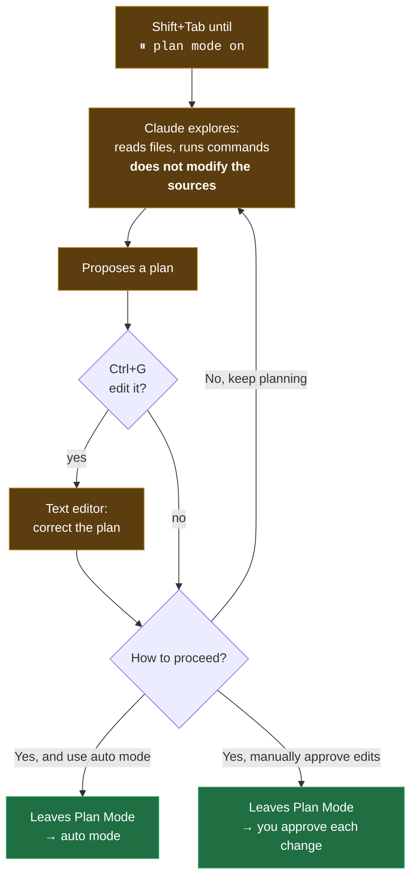

import { Tabs, TabItem, Steps, Aside } from '@astrojs/starlight/components';
import Zero from '@/components/Zero.astro';

<div class="meta-modulo">
	<span><strong>Estimated time:</strong> 40 minutes</span>
	<span><strong>Prerequisites:</strong> <a href="/en/fondamenta/agentic-coding/">module 3</a> and a project with more than a couple of files.</span>
</div>

The scenario this module solves: you ask Claude for a big change, it takes off like a train,
and ten minutes later you find yourself reviewing three hundred lines of changes that solve the
wrong problem. **Plan Mode** is the handbrake: first Claude studies and proposes a written plan, you
read it and correct it (it costs five lines, not three hundred), and only after your approval does
execution start. It is the difference between signing a quote and finding the work already done.

## Objectives

- Enter and leave Plan Mode in every interface, and recognize its state from the terminal status bar (the information line below the prompt).
- Know exactly what Claude can and cannot do while it plans.
- Review, edit and approve a plan, choosing the right mode for the execution phase.
- Make Plan Mode the default where it makes sense — and know where that setting is **not** read.
- Recognize the tasks for which planning is just wasted time.

## Key concepts

**What it is.** Plan Mode tells Claude to **research and propose changes without making them**. Claude reads
files, runs shell commands to explore and writes a plan, but does not touch your source files. Changes
stay blocked until you approve the plan.

**Why it matters.** Letting Claude dive into the code can produce code that solves the
wrong problem. Plan Mode separates research from execution: when the plan is wrong you notice
by reading five lines, not by reviewing a three-hundred-line diff.

**The six permission modes.** A "permission mode" defines **how much Claude can do without
asking you for confirmation** — from asking for every single change to never asking. Plan Mode is one
of the six, and it pays to see them together. (The table mentions the **classifier**: it is a second
AI model acting as a supervisor — it examines each action before it runs and blocks the
risky ones. It is the mechanism behind `auto` mode.)

| Mode | What runs without asking | Ideal for |
| --- | --- | --- |
| `default` (Manual) | Reads only | Reviewing every action, delicate work |
| `acceptEdits` | Reads, file edits and common filesystem commands (`mkdir`, `touch`, `mv`, `cp`, …) | Iterating on code you are already reviewing |
| **`plan`** | Reads, plus commands approved by the classifier when auto mode is available | **Exploring a codebase before changing it** |
| `auto` | Everything, with background safety checks | Long tasks, reducing confirmation fatigue |
| `dontAsk` | Only pre-approved tools | CI and locked-down scripts |
| `bypassPermissions` | Everything | Only isolated containers and VMs |

<Aside type="note" title="On Pro, Max and Team plans you already start in auto mode">
The default starting mode on these plans is **auto**, not Manual. It is a difference that changes
a lot: it means that, if you do nothing, Claude works with the classifier's checks in the background
instead of asking you for confirmation at every step. Plan Mode is a choice you make **before** a complex
task.
</Aside>

**What happens to commands during planning.** When auto mode is available and
the `useAutoModeDuringPlan` setting is on — it is by default — the **classifier** reviews
shell commands during planning, instead of asking you: approved commands run, rejected ones
are blocked. Otherwise, commands outside the built-in read-only set ask for
approval.

**The plan is not set in stone.** `Ctrl+G` opens the proposed plan in your text editor, where you edit it
directly before Claude proceeds. It is the step that most often makes the difference: correcting one line
of the plan costs seconds, correcting the implementation costs a session.

## Entering and leaving

Here the commands are **identical on macOS and Windows**, so no double tabs.

From the terminal, `Shift+Tab` cycles through the modes. Starting from `auto`, the first press goes to
`default`, then the cycle continues `default` → `acceptEdits` → `plan`.

The **status bar** — the information line below the Claude Code prompt — always shows the active
mode. The symbols read like this: `⏸` = Claude stops to ask, `⏵⏵` = Claude proceeds on its own:

```text
⏸ manual mode on          (default)
⏵⏵ accept edits on         (acceptEdits)
⏸ plan mode on             (plan)
⏵⏵ auto mode on            (auto)
⏵⏵ don't ask on            (dontAsk)
⏵⏵ bypass permissions on   (bypassPermissions)
```

For a single prompt, prefix it with `/plan`. At startup:

```bash
claude --permission-mode plan
```

To **leave without approving** a plan, press `Shift+Tab` again.

In the other interfaces:

| Interface | How to change mode |
| --- | --- |
| **VS Code** | Mode indicator at the bottom of the prompt box. The labels are *Manual*, *Edit automatically*, *Plan*, *Auto*, *Bypass permissions* |
| **JetBrains** | The plugin runs the CLI in the IDE terminal: it works as in the terminal |
| **Desktop** | Mode selector next to the send button, in the Code tab |
| **Web and mobile** | Drop-down menu next to the prompt box on claude.ai/code. Cloud sessions offer *Accept edits*, *Plan* and *Auto*; Remote Control sessions offer *Manual*, *Accept edits* and *Plan* |

<Aside type="caution" title="Asking Claude to change mode does not work">
The permission mode can only be changed from the interface controls or with flags: writing it in chat has
no effect at all.
</Aside>

## Reviewing and approving a plan

When the plan is ready, Claude presents it and asks how to proceed. The options:

| Option | Effect |
| --- | --- |
| **Yes, and use auto mode** | Approves and switches to auto mode. If auto is not available, the option reads **Yes, auto-accept edits**. In sessions started with bypass permissions it reads **Yes, and bypass permissions** |
| **Yes, manually approve edits** | Approves and has you review each change one by one |
| **No, keep planning** | Stays in Plan Mode: tell it what to change |

Approving a plan **leaves** Plan Mode and puts the session in the mode described by the chosen option,
so Claude starts writing. To plan again, go back to Plan Mode with `Shift+Tab` or prefix the
next prompt with `/plan`.

Two handy details:

- **`Ctrl+G`** opens the plan in your default text editor, to edit it before Claude proceeds.
- Accepting a plan **automatically names the session** based on the plan's content, unless
  you have already set a name with `--name` or `/rename`. Finding it again later with `claude --resume` becomes
  much easier.

If the `showClearContextOnPlanAccept` setting is on, the list gains a first option that approves
the plan **and clears the planning context** — useful when exploration has consumed a lot of
context and the implementation can restart cleanly from the plan.



## Making it the default

To make Plan Mode the default for a project's terminal sessions:

```json title=".claude/settings.json"
{
  "permissions": {
    "defaultMode": "plan"
  }
}
```

<Aside type="danger" title="The three defaultMode traps">
1. **VS Code does not read project settings** for the starting mode. There you must put
   `claudeCode.initialPermissionMode: "plan"` in VS Code's **user** settings.
2. **`defaultMode: "auto"` does not work from `.claude/settings.json`** or from `settings.local.json`: it must go
   in `~/.claude/settings.json`. If a terminal session starts in Manual without errors, it is almost always
   this.
3. In the **desktop** app, a mode chosen from the selector is remembered per folder and takes precedence
   over `defaultMode` — except for Plan, which applies only to the current session.
</Aside>

## When to use it and when not to

Plan Mode is useful **and has a cost**: it adds a round of exploration and a review before any
change starts.

| Plan when | Skip the plan when |
| --- | --- |
| You are not sure of the approach | You could describe the diff in one sentence |
| The change touches several files | It is a typo, a log line, a rename |
| You don't know the code that needs to change | You know the file well and the change is local |
| The cost of getting it wrong is high: changes to the database, its structure, or the login system | You are iterating quickly on code you review anyway |
| You want to align someone else before starting | The task is exploratory and you want to see where it goes |

The rule of thumb, verbatim from the documentation: **if you could describe the diff in one sentence, skip the
plan**.

## Guided example

Let's make a change that touches several files, which is the case where Plan Mode pays for itself.

<Steps>

1. **Start directly in Plan Mode.**

   <Tabs syncKey="os">
   <TabItem label="macOS" icon="apple">
   ```bash
   cd ~/progetti/il-tuo-progetto
   claude --permission-mode plan
   ```
   </TabItem>
   <TabItem label="Windows" icon="seti:windows">
   ```powershell
   cd $env:USERPROFILE\progetti\il-tuo-progetto
   claude --permission-mode plan
   ```
   </TabItem>
   </Tabs>

   Check the status bar: it must read `⏸ plan mode on`.

2. **Explore first, without asking for a plan yet.** It is the step almost everyone skips, and it makes
   the plan much better:

   ```text
   read src/ and understand how errors are currently handled and surfaced
   to the user. Also look at how we validate input. Don't propose anything yet.
   ```

   Claude reads and answers. It touches nothing.

3. **Now ask for the plan.**

   ```text
   I want every API handler to return a consistent error shape:
   { error: { code, message } }, with HTTP status derived from the code.

   What files need to change? What's the migration path for existing
   handlers? Create a plan.
   ```

4. **Open it in the editor and correct it.** Press `Ctrl+G`. The plan opens in your text editor. Look for the
   three things that most often go wrong:

   - **Out-of-scope files** — is there something that should not have been touched?
   - **Missing verification** — does the plan say how to check that it worked? If not, add it yourself.
   - **Wrong order** — is it changing the code that *uses* a function before changing the function itself? (First you change the contract, then whatever relies on it.)

   Add at the bottom, by hand:

   ```markdown
   ## Verifica
   - `npm test` verde
   - Nessun handler restituisce ancora la vecchia forma: `grep -r "res.status(500).send" src/` non trova nulla
   ```

   Save and close.

5. **Approve, choosing the right mode.** For a migration that touches many files and that you will review
   anyway with `git diff`, **Yes, and use auto mode** is the sensible choice. For a delicate change,
   **Yes, manually approve edits**.

6. **Check that it has left Plan Mode.** The status bar no longer says `⏸ plan mode on`: it shows the mode
   you chose when approving. If it still says plan mode, you did not approve — you answered *No, keep planning*.

7. **Find the session again tomorrow.** The name was assigned automatically from the plan's content:

   ```bash
   claude --resume
   ```

</Steps>

## Exercise

Use Plan Mode to avoid getting the wrong code written.

1. Pick a change in your project that touches at least three files.
2. Have it make a plan **without** exploring first, and read it.
3. Reject the plan, explore, and have it make another one. Compare the two.
4. Edit the second plan with `Ctrl+G`, adding a verification criterion, then approve it.
5. Configure the project so it always starts in Plan Mode, both from the terminal and in VS Code.

<details class="soluzione">
<summary>Solution</summary>

**Steps 2–3.** The comparison is the point of the exercise. Without exploration, the plan tends to be generic
and to invent the project structure: plausible but wrong file names, steps that assume
conventions you don't use. With exploration first, the plan cites files that really exist and follows the
patterns already there.

To reject and stay in Plan Mode, choose **No, keep planning** and tell it what is missing:

```text
No — you're assuming a service layer we don't have. Read src/ first and
base the plan on the structure that actually exists.
```

**Step 4.** `Ctrl+G` opens the plan in the editor defined by `$EDITOR` (macOS/Linux) or in the system's default
editor. Add at the bottom an **executable** verification section — not "check that it
works", but a command that produces pass or fail:

```markdown
## Verifica
1. `npm test` — tutti i test passano
2. `npm run typecheck` — nessun errore
3. `grep -rn "TODO: migrate" src/` — nessun risultato residuo
```

It is the same principle as [module 3](/en/fondamenta/agentic-coding/): without an executable check, "looks
done" is the only signal available.

**Step 5.** You need **two** separate configurations, because VS Code does not read project settings
for the starting mode.

For the terminal:

```json title=".claude/settings.json"
{
  "permissions": {
    "defaultMode": "plan"
  }
}
```

For VS Code, in the **user** settings (`Cmd+,` / `Ctrl+,` → Extensions → Claude Code, or
directly in VS Code's user `settings.json`):

```json title="settings.json (VS Code user settings)"
{
  "claudeCode.initialPermissionMode": "plan"
}
```

Check that you did it right: open a terminal session in the project and check that the
status bar says `⏸ plan mode on` without you pressing anything; then open the panel in VS Code and
check that the mode indicator says **Plan**.

</details>

## Common mistakes & troubleshooting

| Symptom | Cause | Solution |
| --- | --- | --- |
| You ask Claude to "switch to plan mode" and nothing happens | The mode can only be changed from the interface controls or with flags | `Shift+Tab`, `/plan`, or `--permission-mode plan` |
| `defaultMode: "plan"` in the project has no effect in VS Code | The extension does not read `.claude/settings.json` for the starting mode | `claudeCode.initialPermissionMode` in VS Code's **user** settings |
| `defaultMode: "auto"` has no effect and the session starts in Manual | `auto` is not read from `.claude/settings.json` or `settings.local.json` | Move it to `~/.claude/settings.json` |
| In the desktop app the project default is ignored | The mode chosen from the selector is remembered per folder and takes precedence | Change it again from the selector; Plan applies only to the current session anyway |
| In Plan Mode Claude asks for confirmation on every command | Auto mode is not available, or `useAutoModeDuringPlan` is off | Commands outside the read-only set require approval: this is the expected behavior |
| The plan is generic and cites nonexistent files | You asked for a plan without letting it explore first | First `read ... don't propose anything yet`, then ask for the plan |
| You approved but Claude modifies nothing | You chose *No, keep planning* | The status bar tells you: if it still reads `⏸ plan mode on`, you did not approve |
| The plan was good but the implementation wandered off | The plan contained no verification criteria or scope constraints | Add them with `Ctrl+G` before approving |
| After planning for a long time, the context is nearly full | Exploration has consumed the window | Turn on `showClearContextOnPlanAccept` to approve while clearing the planning context |
| You can't find yesterday's session | — | Accepting a plan assigns an automatic name: look for it with `claude --resume` |

## Cheat sheet

| Action | How |
| --- | --- |
| Enter Plan Mode | `Shift+Tab` until `⏸ plan mode on` |
| A single prompt in Plan Mode | Prefix it with `/plan` |
| Start in Plan Mode | `claude --permission-mode plan` |
| Leave without approving | `Shift+Tab` again |
| Edit the proposed plan | `Ctrl+G` — opens it in your editor |
| Approve and continue in auto | **Yes, and use auto mode** |
| Approve reviewing each change | **Yes, manually approve edits** |
| Keep planning | **No, keep planning** |
| Project default (terminal) | `permissions.defaultMode: "plan"` in `.claude/settings.json` |
| Default in VS Code | `claudeCode.initialPermissionMode: "plan"` in the **user** settings |
| Approve clearing the context | `showClearContextOnPlanAccept` setting |

**The four-phase flow**

```text
Explore  →  Plan  →  Implement  →  Commit
   ↑          ↑          ↑            ↑
 read      Ctrl+G     approve      "commit with a
 first    correct    the right      descriptive message
           the plan    mode          and open a PR"
```

## Sources

Official pages consulted, checked on **16 August 2026**:

- [Choose a permission mode](https://code.claude.com/docs/en/permission-modes) — all modes, Plan Mode, plan approval, defaults per interface
- [Best practices](https://code.claude.com/docs/en/best-practices) — the explore-plan-code-commit flow and when to skip the plan
- [Settings](https://code.claude.com/docs/en/settings) — `permissions.defaultMode` and `showClearContextOnPlanAccept`
- [Use Claude Code in VS Code](https://code.claude.com/docs/en/vs-code) — `claudeCode.initialPermissionMode` and plan review in the editor
- [Auto mode configuration](https://code.claude.com/docs/en/auto-mode-config) — the classifier and `useAutoModeDuringPlan`
- [Manage sessions](https://code.claude.com/docs/en/sessions) — automatic session naming and resuming
