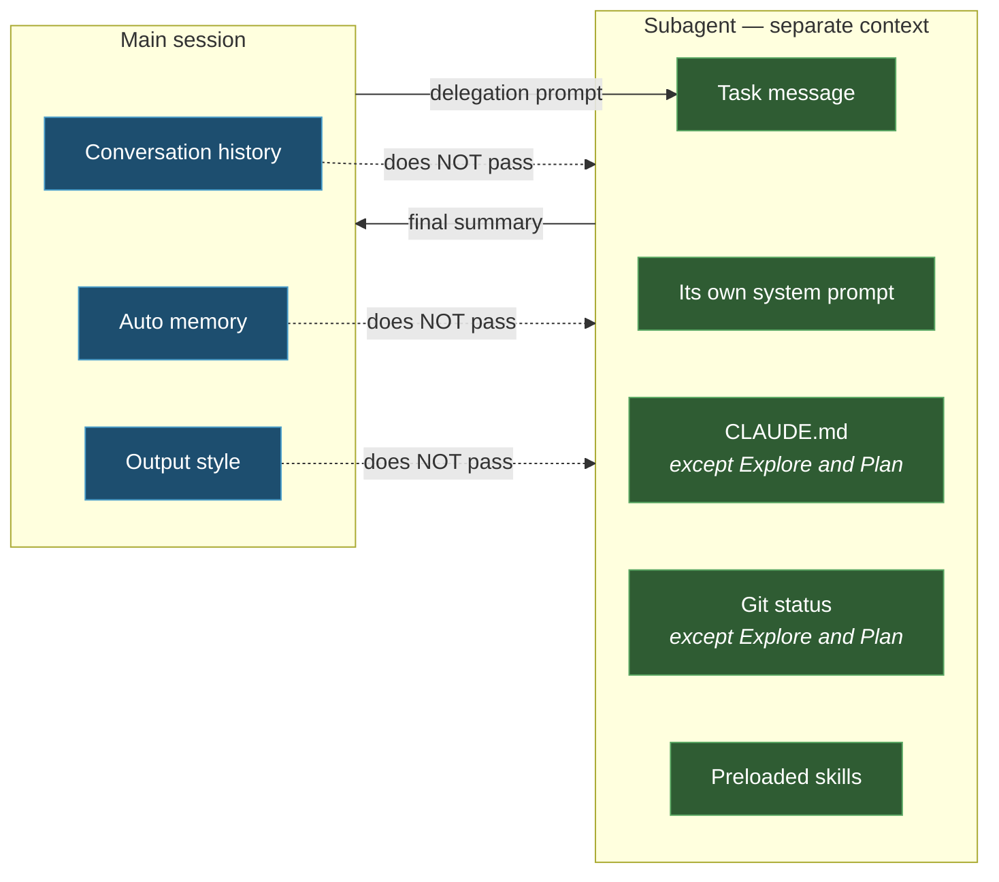

import { Tabs, TabItem, Steps, Aside, FileTree } from '@astrojs/starlight/components';
import Zero from '@/components/Zero.astro';

<div class="meta-modulo">
	<span><strong>Estimated time:</strong> 55 minutes</span>
	<span><strong>Prerequisites:</strong> modules <a href="/en/fondamenta/memoria-e-contesto/">4</a>, <a href="/en/personalizzazione/skills/">8</a> and <a href="/en/personalizzazione/hooks/">10</a>.</span>
</div>

A [subagent](/en/glossario/#subagent) is a helper that Claude launches to delegate a task: a
"second Claude" with its own separate working memory, which does its part and reports back only the
result. The analogy is the site manager who sends a worker to do an inspection: the worker
looks at everything, and what comes back to the boss is **the report**, not the whole visit. There are two reasons to use them, and it is
important to tell them apart: **savings** (the heavy reading stays in the helper's memory,
not in yours — the topic of module 4) and **quality** (a reviewer with a clean memory judges the
work without being attached to it). This module teaches you to use the ready-made helpers, to build
your own, and to combine them.

## Objectives

- Understand why a subagent solves the context problem better than any other technique.
- Use the built-in types — `Explore`, `Plan`, `general-purpose` — without defining new ones.
- Write a custom subagent with the right tools, model and permissions.
- Know what goes and what does **not** go into a subagent's context.
- Tell subagents and forks apart, and know when you need one or the other.

## Key concepts

**A subagent is a separate context window.** It is the one thing to remember, if you remember only one.
When you delegate a search that reads twenty files, those twenty files sit in the subagent's context, not in
yours: you get back only a summary. In the main session you pay ~80 tokens for the spawn and ~400 for the
report, instead of 20,000 of reading.

**It has its own tools, its own model, its own permissions.** A subagent can be read-only while the
main session writes, run on a different model, have hooks that apply only to it, and disappear
when it is done.

**It is also a quality tool, not just a savings one.** A reviewer running in a fresh context
sees **only the diff and the criteria you give it**, not the reasoning that produced that change. It judges
the result for what it is. That is why review with a subagent finds things that the session
that wrote the code does not find.

**Delegating is not free.** The subagent does not know your conversation: the delegation prompt must be
self-contained. A poorly briefed subagent rereads from scratch things that were already clear in the main
session.

## The built-in types

Before defining your own, check whether one of these is enough:

| Type | Model | Tools | What it is for |
| --- | --- | --- | --- |
| **`Explore`** | The same as the main conversation (at most Opus: if you use a higher model, the agent scales down to Opus) | **Read-only**: `Write` and `Edit` denied | File discovery, code search, codebase exploration |
| **`Plan`** | Inherits | Read-only | Codebase research for planning, in Plan Mode |
| **`general-purpose`** | Inherits | All those available to subagents | Complex multi-step tasks that need both exploration and action |
| `claude` | Inherits | All | Catch-all when the task does not fit a specialized agent |
| `statusline-setup` | Sonnet | `Read`, `Edit` | When you run `/statusline` |
| `claude-code-guide` | Haiku | `Bash`, `Read`, `WebFetch`, `WebSearch` | Questions about Claude Code features |

<Aside type="tip" title="`Explore` skips CLAUDE.md and git status">
`Explore` and `Plan` do **not** load the `CLAUDE.md` files or the git status. It is deliberate: they are fast
research agents, and that context is dead weight for them. If you need an agent to know the project's
conventions, don't use `Explore`.
</Aside>

## What goes into a subagent's context

At startup, a (non-fork) subagent has:

1. **Its own system prompt** — the agent's prompt plus the environment details. **Not** the full Claude Code
   system prompt.
2. **The task message** — the delegation prompt Claude writes.
3. **The `CLAUDE.md` files** at every level of the hierarchy — except for `Explore` and `Plan`.
4. **The git status** — a snapshot taken when the parent session started; this too is skipped by `Explore` and `Plan`.
5. **Preloaded skills** — the full content of the skills listed in the `skills` field.
6. **The list of other active agents** — the main conversation (`main`) and the agents with a
   name, so the subagent knows whom it can send messages to.

And above all, what does **not** arrive:

- Your conversation history (except in forks)
- Your output style
- The auto memory of the main conversation
- The context window size of the main conversation



## Defining a subagent

The files go in `agents/`, discovered **recursively** — you can organize them in subfolders:

<FileTree>

- .claude/agents/
  - code-reviewer.md
  - review/
    - security.md
    - performance.md
  - research/
    - api-docs.md

</FileTree>

The locations, from highest to lowest priority. (You will notice that here the **managed settings** and the
session flag sit above everything, and the project above the user: the order is **different** from that
of the skills in module 7, where your personal skill beats the project one. Each mechanism has its
own table: when you need certainty, look at the right one instead of going from memory.)

| Location | Scope |
| --- | --- |
| Managed settings | The whole organization |
| `--agents` flag | The current session only |
| `.claude/agents/` | The project — gets committed |
| `~/.claude/agents/` | All your projects |
| `agents/` of a plugin | Wherever the plugin is enabled |

### Frontmatter reference

```yaml
---
name: unique-identifier
description: When Claude should delegate to this subagent
tools: Read, Grep, Glob, Bash
disallowedTools: Write, Edit
model: sonnet
permissionMode: default
maxTurns: 10
skills:
  - api-conventions
  - error-handling-patterns
mcpServers:
  - server-name
hooks:
  PreToolUse:
    - matcher: "Bash"
      hooks:
        - type: command
          command: "./scripts/validate-command.sh"
memory: project
background: false
effort: high
isolation: worktree
color: blue
initialPrompt: Testo del primo turno, inviato automaticamente
---
```

**Required:** `name` (unique identifier, lowercase and hyphens) and `description` (when Claude should
delegate to this subagent).

| Field | What it does |
| --- | --- |
| `tools` | Tool allowlist. If omitted, it inherits all available ones |
| `disallowedTools` | Denylist |
| `model` | `sonnet`, `opus`, `haiku`, `fable`, a full ID, or `inherit` (default) |
| `permissionMode` | `default`, `acceptEdits`, `auto`, `dontAsk`, `bypassPermissions`, `plan` |
| `maxTurns` | Maximum number of agentic turns before stopping |
| `skills` | Skills preloaded into the context at startup |
| `mcpServers` | MCP servers available to this subagent |
| `hooks` | Hooks that apply **only** while the subagent runs |
| `memory` | `user`, `project` or `local` for persistent memory |
| `background` | `true` to keep it in the background even when Claude would want it in the foreground |
| `effort` | `low`, `medium`, `high`, `xhigh`, `max` |
| `isolation` | `worktree` to make it work in an isolated git [worktree](/en/glossario/#worktree) (a separate working copy of the same repository) |
| `color` | Color in the interface: `red`, `blue`, `green`, `yellow`, `purple`, `orange`, `pink`, `cyan` |
| `initialPrompt` | First user turn sent automatically |

### A complete file

```markdown title=".claude/agents/code-improver.md"
---
name: code-improver
description: Scans files and suggests improvements for readability, performance, and best practices. Use after writing or modifying code.
tools: Read, Grep, Glob
model: sonnet
memory: project
---

You are a code improvement specialist. For each issue you find:

1. Explain the problem clearly
2. Show the current code
3. Provide an improved version with explanation
4. Suggest when the improvement matters most

Focus on:
- Readability and clarity
- Performance and efficiency
- Best practices and patterns
- Maintainability and scalability

Be specific and actionable in your feedback.
```

Note `tools: Read, Grep, Glob`: **no `Write` or `Edit`**. A reviewer that can edit the code
stops being a reviewer. Restricting the tools is the most important part of the definition, not a
detail.

## Invoking a subagent

Three ways, in increasing order of strength:

<Steps>

1. **Natural language** — you name the subagent, Claude decides whether to delegate:

   ```text
   Use the test-runner subagent to fix failing tests
   ```

2. **@-mention** — **guarantees** that the subagent runs for that task. The syntax must be copied
   exactly: `@` opens the mention, the quotes are needed because the name contains a space, and the
   `(agent)` suffix distinguishes the agent from a file with the same name. When you type `@` in the prompt,
   autocomplete builds it for you:

   ```text
   @"code-reviewer (agent)" look at the auth changes
   ```

   *(= "code-reviewer, look at the changes to authentication")*

3. **Session default** — the whole session uses that agent:

   ```bash
   claude --agent code-reviewer
   ```

   ```json title=".claude/settings.json"
   {
     "agent": "code-reviewer"
   }
   ```

</Steps>

To **resume** a subagent, just ask: *"Continue that code review and now analyze the
authorization logic"*. Claude uses the `SendMessage` tool to reactivate it; the resumed subagent keeps
its whole history and picks up where it left off.

<Aside type="note" title="The `description` does the work">
As with skills, automatic delegation relies on the `description`. Including *"use proactively"* in the
description encourages Claude to delegate without you asking.
</Aside>

## Persistent memory

In [module 4](/en/fondamenta/memoria-e-contesto/) you saw **auto memory**: the notes the main
Claude takes between one session and the next. Subagents **do not inherit it** — but they can
have **their own**, separate, enabled by the `memory` field: same idea (notes that survive),
different directory, per agent. That way your reviewer remembers the false positives you pushed back on,
without mixing them with the main conversation's memory:

```yaml
---
name: code-reviewer
description: Reviews code for quality and best practices
memory: project
---
```

Its system prompt gains the instructions for reading and writing in the memory directory, plus the
**first 200 lines or 25 KB of `MEMORY.md`** — whichever comes first. The `Read`, `Write` and `Edit` tools
are enabled automatically.

| Scope | Path |
| --- | --- |
| `user` | `~/.claude/agent-memory/<nome-agente>/` |
| `project` | `.claude/agent-memory/<nome-agente>/` |
| `local` | `.claude/agent-memory-local/<nome-agente>/` |

It is the mechanism that makes a reviewer useful on the tenth run instead of the first: it remembers the
false positives you pushed back on.

## Forks: when the subagent must know everything

A **fork** is different from a normal subagent. It inherits from the current conversation:

- The whole history
- The same system prompt and the same tools
- The same model and the same permissions

And it isolates:

- Its own tool calls, which do not appear in the main conversation
- The final result, which comes back as a message

You create one with `/subtask <task>`, or by asking for the `fork` subagent type. Fork mode is **on by
default** in interactive sessions, controlled by the `CLAUDE_CODE_FORK_SUBAGENT` variable.

| Use a **subagent** when | Use a **fork** when |
| --- | --- |
| The task is self-contained and can be described in a prompt | The task depends on everything you have already discussed |
| You want fresh eyes — review, verification | You want continuity, not independence |
| You want different tools or model | The same configuration is fine |
| You want to save context | You only want to keep tool calls out of view |

## Guided example

Let's build a pair that is used together: a read-only researcher and an adversarial reviewer.

<Steps>

1. **First try without defining anything.** The built-in types cover more cases than it seems:

   ```text
   Use subagents to investigate how our authentication system handles token
   refresh, and whether we have any existing OAuth utilities I should reuse.
   Report back in under 30 lines.
   ```

   The length constraint is not pedantry: a subagent that hands you back a wall of text eats up
   the context savings.

2. **Define a specialized researcher.** It is useful when investigations repeat and you want them to always
   follow the same angle:

   ```markdown title=".claude/agents/ricercatore.md"
   ---
   name: ricercatore
   description: Indaga come funziona una parte del codebase e riporta i punti chiave. Usalo proattivamente prima di modifiche che toccano codice che non conosci.
   tools: Read, Grep, Glob, Bash
   disallowedTools: Write, Edit
   color: cyan
   ---

   Sei un ricercatore di codebase. Il tuo output viene letto da un altro agente
   che scriverà del codice: deve essere denso e verificabile, non discorsivo.

   Riporta sempre, in quest'ordine:

   1. **Punto d'ingresso** — da quale file si parte, con percorso e riga
   2. **Flusso** — i passaggi principali, con `file:riga` per ciascuno
   3. **Convenzioni** — i pattern che il codice esistente segue e che vanno rispettati
   4. **Trappole** — casi limite già gestiti, che una modifica ingenua romperebbe
   5. **Da riusare** — utility o astrazioni già presenti, con percorso

   Vincoli:
   - Massimo 40 righe. Se non ci stai, taglia le sezioni 3 e 4, mai la 1 e la 2.
   - Ogni affermazione deve avere un riferimento `file:riga`. Se non puoi citarlo,
     non affermarlo.
   - Non proporre modifiche. Non è il tuo compito.
   ```

3. **Define an adversarial reviewer.**

   ```markdown title=".claude/agents/revisore.md"
   ---
   name: revisore
   description: Rivede una diff cercando difetti di correttezza. Usalo dopo che una modifica è completa, prima del commit.
   tools: Read, Grep, Glob, Bash
   disallowedTools: Write, Edit
   model: opus
   effort: high
   memory: project
   color: red
   ---

   Sei un revisore. Vedi la diff e i criteri, non il ragionamento che l'ha prodotta.
   Valuta il risultato per quello che è.

   Cerca, in quest'ordine di priorità:

   1. **Correttezza** — la modifica fa quello che doveva? Casi limite non gestiti?
   2. **Regressioni** — c'è comportamento esistente che si rompe?
   3. **Requisiti mancanti** — qualcosa nella richiesta non è stato implementato?

   Per ogni rilievo, dai uno scenario concreto: input, stato, output sbagliato.
   Un rilievo senza scenario di fallimento non è un rilievo: non riportarlo.

   **Non** segnalare preferenze di stile, naming, o "si potrebbe astrarre".
   Se non trovi nulla che tocca correttezza o requisiti, dillo in una riga.

   Prima di rivedere, leggi la tua memoria: contiene i falsi positivi che ti sono
   già stati contestati su questo progetto. Dopo la revisione, se un tuo rilievo
   viene respinto, annotalo.
   ```

   Three choices to note: `model: opus` and `effort: high` — Opus is the most capable model and the most
   "expensive" in plan usage, and review is exactly the point where that extra usage
   pays off; `disallowedTools: Write, Edit`, because a reviewer that fixes things is no longer a reviewer; and
   `memory: project`, which makes it progressively less noisy.

4. **Use them in sequence.**

   ```text
   @"ricercatore (agent)" investigate how rate limiting works in this codebase
   ```

   Then, with the report in hand, implement. And finally:

   ```text
   @"revisore (agent)" review the diff against PLAN.md. Check that every
   requirement is implemented, that the listed edge cases have tests, and that
   nothing outside the task's scope changed.
   ```

5. **Check the context savings.**

   ```text
   /context
   ```

   Compare with what you would have spent doing the same investigation in the main session.

6. **Try isolation with a worktree.** If two agents must edit files in parallel, add to the
   frontmatter:

   ```yaml
   isolation: worktree
   ```

   Each run gets its own git worktree, so the changes do not collide. It is expensive — setup and disk
   space — so use it **only** when you really need it.

</Steps>

<Aside type="caution" title="The reviewer will always find something (the warning promised in module 3)">
A reviewer you ask to find gaps will find some, even when the work is solid: it is what you
asked it to do. Chasing them all leads to over-engineering — extra abstraction layers, defensive code, tests
for impossible cases. That is why the `revisore` prompt has the line *"un rilievo senza scenario
di fallimento non è un rilievo"* (a finding without a failure scenario is not a finding): it is that constraint that makes the output useful.
</Aside>

## Exercise

Build a three-agent pipeline and measure its effect.

1. Define three subagents: one that explores, one that implements, one that verifies.
2. Give each one the **minimum** tools needed.
3. Run a real task through all three.
4. Compare the context usage with the same task done in a single session.

<details class="soluzione">
<summary>Solution</summary>

**Steps 1–2.** The point of the exercise is **restricting the tools**: that is what makes each agent
reliable in its role.

| Agent | `tools` | `disallowedTools` | Why |
| --- | --- | --- | --- |
| `ricercatore` | `Read, Grep, Glob, Bash` | `Write, Edit` | It must read and run inspection commands, never edit |
| `implementatore` | *(omitted: inherits everything)* | — | It must be able to do everything |
| `revisore` | `Read, Grep, Glob, Bash` | `Write, Edit` | If it can fix, it stops reviewing and starts writing |

For the third agent you can reuse `revisore` from step 3 of the guided example. The implementer, if it does not
need a particular prompt, don't define it: use `general-purpose`, which is exactly that already.

**Step 3.** A realistic sequence on a medium-sized task:

```text
@"ricercatore (agent)" investigate how we validate request payloads.
I need to add validation to the new /webhooks endpoint.
```

Read the report. **Then** implement in the main session, which now has the dense context instead of the raw
files:

```text
Following the conventions from that report, add payload validation to
src/routes/webhooks.js. Write tests for: missing signature header,
invalid signature, valid payload. Run the tests.
```

Finally:

```text
@"revisore (agent)" review the diff for src/routes/webhooks.js and its tests.
```

**Step 4.** The comparison must be done honestly, with two separate sessions.

*Session A, all together:* `/clear`, then a single prompt asking to investigate, implement and
verify. At the end, `/context`.

*Session B, with delegation:* `/clear`, then the three-agent sequence above. At the end, `/context`.

What you should observe:

| | Session A | Session B |
| --- | --- | --- |
| Files read in the main context | All those explored | None: only the report |
| Context at the end of the task | High | Noticeably lower |
| Review quality | The reviewer is the same instance that wrote the code | Fresh context, it judges the result |

The second point is the measurable one; the third is the one that matters most, and it is the reason
delegation is worth it even when context is not a problem.

**If you see no difference**, check two things: that you really used the @-mention (natural
language *suggests* delegation, it does not guarantee it), and that the researcher respected the line
limit — a 300-line report is not delegation, it is copy-paste with intermediate steps.

</details>

## Common mistakes & troubleshooting

| Symptom | Cause | Solution |
| --- | --- | --- |
| Claude never delegates to your subagent | The `description` does not say **when** to delegate | Rewrite it in terms of situation; add *"use proactively"* |
| You want to be sure it starts | Natural language lets Claude decide | Use the @-mention: `@"nome (agent)"` |
| The subagent does not know the project's conventions | You are using `Explore` or `Plan`, which skip the `CLAUDE.md` files | Use `general-purpose` or a custom agent |
| The subagent asks about things already said in the conversation | The history does **not** pass to subagents | Make the delegation prompt self-contained, or use a fork |
| The reviewer fixes instead of reviewing | It has `Write` and `Edit` | `disallowedTools: Write, Edit` |
| The subagent's report is huge and you save no context | No length constraint | Put an explicit limit in the agent's prompt |
| Two subagents in parallel overwrite each other's files | They work in the same working copy | `isolation: worktree` |
| The subagent runs forever | No turn limit | `maxTurns` |
| The subagent is too slow or expensive | It inherits the session's model and effort | `model: haiku` and `effort: low` for mechanical tasks |
| The subagent's memory does not persist | The `memory` field is missing | `memory: project` (or `user` / `local`) |
| The main auto memory does not reach the subagent | It is intended: it is not passed | The subagent's memory is a separate directory |
| You need the subagent to know everything about the conversation | A normal subagent inherits nothing | Use a **fork**: `/subtask <task>` |

## Cheat sheet

**Minimal structure**

```markdown
---
name: nome-agente
description: Quando Claude deve delegare a questo agente
tools: Read, Grep, Glob
---

Il system prompt dell'agente.
```

**The fields you will actually use**

| Field | When |
| --- | --- |
| `tools` / `disallowedTools` | **Always**: it is what defines the role |
| `model` / `effort` | Raise for review, lower for mechanical tasks |
| `memory` | Recurring agents that should improve over time |
| `maxTurns` | Autonomous agents, to avoid loops |
| `isolation: worktree` | Only when several agents write in parallel |
| `skills` | Preloading conventions the agent must know |
| `permissionMode` | Agents that must work without confirmations |

**Invoking**

| Way | Strength |
| --- | --- |
| `Use the X subagent to ...` | Claude decides |
| `@"X (agent)" ...` | **Guaranteed** for that task |
| `claude --agent X` | Default for the whole session |
| `/subtask <task>` | Fork: inherits the conversation |

**Built-in types**

```text
Explore          → ricerca veloce, sola lettura, salta CLAUDE.md e git
Plan             → ricerca per la pianificazione, sola lettura
general-purpose  → task complessi, tutti i tool
```

**Paths**

```text
.claude/agents/<nome>.md            → progetto, si committa
~/.claude/agents/<nome>.md          → tutti i tuoi progetti
.claude/agent-memory/<nome>/        → memoria persistente (scope project)
```

## Sources

Official pages consulted, checked on **16 August 2026**:

- [Subagents](https://code.claude.com/docs/en/sub-agents) — locations, full frontmatter, built-in types, context at startup, persistent memory, forks
- [Agents](https://code.claude.com/docs/en/agents) — overview of agents
- [Best practices](https://code.claude.com/docs/en/best-practices) — delegating research and adversarial review
- [Agent teams](https://code.claude.com/docs/en/agent-teams) — automatic coordination of multiple sessions
- [Worktrees](https://code.claude.com/docs/en/worktrees) — isolation for parallel work
- [Hooks](https://code.claude.com/docs/en/hooks) — hooks with lifetime limited to the subagent
- [Model configuration](https://code.claude.com/docs/en/model-config) — models and effort
