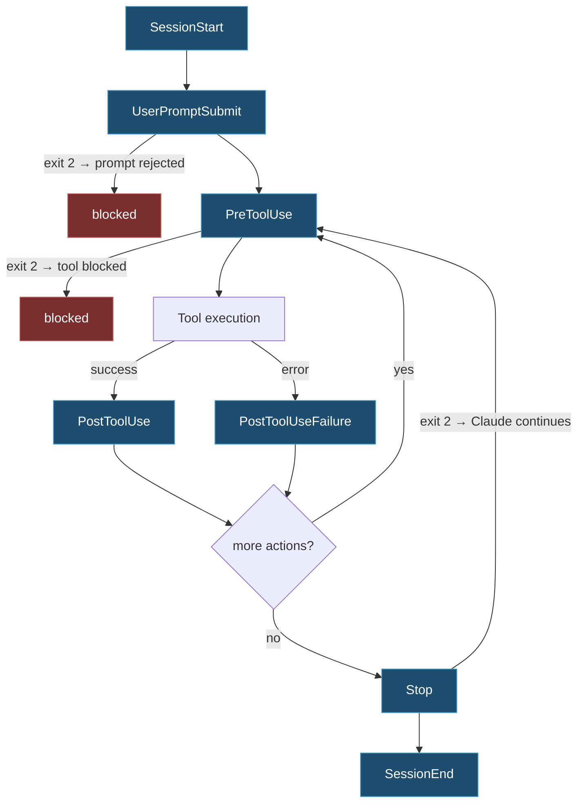

import { Tabs, TabItem, Steps, Aside } from '@astrojs/starlight/components';
import Zero from '@/components/Zero.astro';

<div class="meta-modulo">
	<span><strong>Estimated time:</strong> 60 minutes</span>
	<span><strong>Prerequisites:</strong> modules <a href="/en/fondamenta/anatomia-file/">2</a> and <a href="/en/personalizzazione/skills/">8</a>. You need <code>jq</code> installed for the shell examples.</span>
</div>

A [hook](/en/glossario/#hook) is a script of yours that Claude Code runs **automatically** at
a precise moment: before every command, after every file edit, at the end of a response. The right
analogy is a burglar alarm: you don't have to remember to turn it on — it goes off by itself, every time, when the
thing you installed it for happens. It is the step up from everything you have seen so far: the
instructions in `CLAUDE.md` are *advice* that Claude almost always follows; a hook is a *rule* that
is always applied, because it does not go through the model's judgment. Formatting code after every
edit, blocking dangerous commands, getting a notification when a long task finishes: all
jobs for hooks.

<Zero title="This is the most 'programmer-ish' module of the course">
Hooks are shell scripts, and the module shows them line by line with comments. If bash is not
your thing: read the comments (they say what each line does), copy the blocks as they are, and — above all
— know that the first step of the guided example has the legitimate shortcut: **getting Claude itself to write
the hooks**. Understanding *what* you want to automate matters more than knowing how to write the script.
</Zero>

## Objectives

- Understand when an instruction should be written as a hook instead of in `CLAUDE.md`.
- Choose the right event among those available.
- Write a hook that really blocks an action, using the exit code and JSON contract.
- Automate lint and tests after every edit, and get a notification at the end of a turn.
- Diagnose a hook that does not fire, without guessing.

## Key concepts

**Hooks are deterministic, `CLAUDE.md` is not.** That is why they exist. The instructions in
`CLAUDE.md` are **context**: Claude reads them and tries to follow them, but it can ignore them. A hook is **code**
that runs at a fixed point of the lifecycle, regardless of what Claude decides.

The rule of thumb is clear-cut: **if something must happen every time, with no exceptions, it is a hook.**

**They run as processes, not as context.** A hook does not take up the context window — with
one important exception: it can **inject** text into it, through `additionalContext` or stdout on
certain events.

**Five handler types.** A hook is not necessarily a shell script:

| Type | What it does | Default timeout |
| --- | --- | --- |
| `command` | Runs a local command | 600 s |
| `http` | Calls an HTTP endpoint | 600 s |
| `mcp_tool` | Invokes a tool of an MCP server | 600 s |
| `prompt` | Sends a prompt to a model | 30 s |
| `agent` | Launches a validation agent | 60 s |

**The contract is the exit code plus, optionally, JSON on stdout.** Exit `0` = success, exit `2` =
blocking error, anything else = non-blocking error. It is the mechanism a hook uses to say "no".

## The events

You won't need all of them. These are the ones that cover 95% of real cases:

| Event | When it fires | Blocks with exit 2? |
| --- | --- | --- |
| **`PreToolUse`** | Before a tool call is executed | **Yes** — blocks the call |
| **`PostToolUse`** | After a tool call has succeeded | No — shows stderr to Claude |
| `PostToolUseFailure` | After a tool call has failed | No |
| **`UserPromptSubmit`** | When you submit a prompt, before Claude processes it | **Yes** — rejects the prompt |
| **`Stop`** | When Claude finishes responding | **Yes** — makes the conversation continue |
| **`SessionStart`** | At the start or resumption of a session | No |
| `SessionEnd` | When the session closes | No |
| **`Notification`** | When Claude Code sends a notification | No |
| `SubagentStart` / `SubagentStop` | Start and end of a subagent | `SubagentStop`: yes |
| `PreCompact` / `PostCompact` | Before and after context compaction | No |
| `FileChanged` | When a watched file changes on disk | No |
| `InstructionsLoaded` | When a `CLAUDE.md` or a rule is loaded | No |
| `PermissionRequest` | When a tool call requires a permission decision | No — uses the JSON field `decision` |
| `PermissionDenied` | When auto mode denies a call | No |

<details class="soluzione">
<summary>The other 16 events, for completeness (open only if you need them)</summary>

| Event | When it fires |
| --- | --- |
| `Setup` | In non-interactive runs started with the initialization flags |
| `UserPromptExpansion` | When a slash command is expanded into the prompt |
| `PostToolBatch` | After a group of tool calls executed in parallel |
| `StopFailure` | When a turn ends because of an API error |
| `TaskCreated` / `TaskCompleted` | When a task in the shared list is created / completed |
| `TeammateIdle` | When a member of an agent team is about to stop |
| `MessageDisplay` | While the text of a response is being shown |
| `ConfigChange` | When a configuration file changes during the session |
| `CwdChanged` | When the working directory changes |
| `DirectoryAdded` | When you add a directory with `/add-dir` |
| `WorktreeCreate` / `WorktreeRemove` | When a worktree is created / removed |
| `Elicitation` / `ElicitationResult` | When an MCP server asks the user for input / receives the answer |

</details>



## Where they are configured

| Location | Scope | Shareable |
| --- | --- | --- |
| `~/.claude/settings.json` | All projects | No |
| `.claude/settings.json` | One project | **Yes, it gets committed** |
| `.claude/settings.local.json` | One project | No, gitignored |
| Managed policy settings | The whole organization | Yes, controlled by the admin |
| `hooks/hooks.json` of a plugin | Wherever the plugin is enabled | Yes |
| Skill and subagent frontmatter | Lifetime of the session / of the subagent | Yes |

The configuration format should be read **from the outside in**, and the structure — which at first
sight is confusing, with `hooks` appearing twice — has a logic: for each **event** (`PreToolUse`)
you can have several **groups**, each with its own filter (`matcher`: which tools it applies to), and each
group can run several **scripts** (the inner `hooks` list). So: event → filtered groups →
scripts to run.

```json title=".claude/settings.json"
{
  "hooks": {
    "PreToolUse": [            // ← the event: before every tool call...
      {
        "matcher": "Bash",     // ← ...if the tool is Bash...
        "hooks": [             // ← ...run these scripts:
          {
            "type": "command",
            "if": "Bash(rm *)",  // fine filter: only commands starting with "rm"
            "command": "${CLAUDE_PROJECT_DIR}/.claude/hooks/block-rm.sh",
            "timeout": 30        // seconds available to the script
          }
        ]
      }
    ]
  }
}
```

*(The `//` comments here are for teaching only: real JSON does not allow them — remove them if you copy by hand.
The example blocks further down are ready to copy.)*

### Matchers

| Matcher | Effect |
| --- | --- |
| `"*"`, `""` or omitted | Matches everything |
| `"Bash"` | Exact match |
| `"Edit\|Write"` | List of alternatives |
| `"^Notebook.*"` | Unanchored JavaScript regex |
| `"mcp__memory__.*"` | All tools of an MCP server |

The interpretation rule: only letters, digits, `_`, `-`, spaces, `,` and `|` → exact string or list.
Any other character → regex.

**What gets compared depends on the event:** on tool events, the `tool_name`; on `SessionStart`,
the start reason (`startup`, `resume`, `clear`, `compact`, `fork`); on `Notification`, the type; on
`SubagentStart`/`SubagentStop`, the agent type; on `FileChanged`, the literal file names to
watch.

### The `if` field

It filters further with a permission rule, so the script starts only when it is really needed:

```json
{ "type": "command", "if": "Bash(git push *)", "command": "..." }
{ "type": "command", "if": "Edit(*.ts)", "command": "..." }
```

### Path placeholders

| Placeholder | What it points to |
| --- | --- |
| `${CLAUDE_PROJECT_DIR}` | Project root |
| `${CLAUDE_PLUGIN_ROOT}` | Plugin installation directory |
| `${CLAUDE_PLUGIN_DATA}` | Plugin persistent data directory |

Always use them instead of absolute paths: a hook with `/Users/yourname/...` inside breaks for anyone
else.

## The output contract

### Exit code

| Exit | Meaning |
| --- | --- |
| **`0`** | Success. If stdout starts with `{`, it is read as JSON. On `UserPromptSubmit`, `UserPromptExpansion` and `SessionStart`, stdout is **added to the context** Claude sees; on other events it only ends up in the debug log |
| **`2`** | **Blocking** error. The block message is the `reason` from the JSON or the text on stderr |
| others | Non-blocking error. With valid JSON the decision is honored; with invalid JSON the action proceeds and `<name> hook error` is shown with the first line of stderr |

<Aside type="caution" title="Exit 2 cannot be overridden">
The JSON is still read, but an exit 2 **cannot** be cancelled by a `permissionDecision:
"allow"`. If you want to allow, exit with 0.
</Aside>

### JSON output

```json
{
  "continue": true,
  "stopReason": "Hook stopped processing",
  "systemMessage": "Messaggio di avviso mostrato all'utente",
  "additionalContext": "Testo aggiunto al contesto di Claude",
  "decision": "allow",
  "reason": "Spiegazione",
  "hookSpecificOutput": {
    "hookEventName": "PreToolUse",
    "permissionDecision": "deny",
    "permissionDecisionReason": "Violazione della policy di sicurezza"
  }
}
```

| Field | What it does |
| --- | --- |
| `continue: false` | Stops processing completely after the hook |
| `stopReason` | Message shown when `continue: false` |
| `systemMessage` | Warning shown to you |
| `additionalContext` | Text added to Claude's context |
| `decision` | `"allow"` or `"deny"` |
| `hookSpecificOutput` | Nested object with `hookEventName` plus the event-specific fields |

### Input

Every hook receives on stdin a JSON with the common fields:

```json
{
  "session_id": "abc123",
  "transcript_path": "/home/user/.claude/projects/.../transcript.jsonl",
  "cwd": "/home/user/my-project",
  "permission_mode": "default",
  "hook_event_name": "PreToolUse",
  "tool_name": "Bash",
  "tool_input": { "command": "rm -rf build/" }
}
```

Inside a subagent there are also `agent_id` and `agent_type`.

## Guided example

Three automations people actually use, from the simplest to the most useful. And first of all, the
legitimate shortcut:

<Aside type="tip" title="The fastest way: let Claude write them">
Claude can write its own hooks, and it is the method recommended by the official documentation too.
Describe what you want to happen, and it produces script and configuration:

```text
Write a hook that blocks any write to the migrations/ folder,
and one that runs `npm run typecheck` after every TypeScript edit.
```

*(= "write a hook that blocks every write to the migrations/ folder, and one that runs the
type check after every edit to a TypeScript file")*

We write the following steps by hand anyway — understanding how a hook is built helps you
fix them and trust the ones Claude generates.
</Aside>

<Steps>

1. **Prepare the hooks folder.**

   <Tabs syncKey="os">
   <TabItem label="macOS" icon="apple">
   ```bash
   mkdir -p .claude/hooks
   ```
   </TabItem>
   <TabItem label="Windows" icon="seti:windows">
   ```powershell
   New-Item -ItemType Directory -Force .claude\hooks
   ```
   </TabItem>
   </Tabs>

2. **Automatic lint after every edit.** The most requested automation, and the simplest.

   ```json title=".claude/settings.json"
   {
     "hooks": {
       "PostToolUse": [
         {
           "matcher": "Edit|Write",
           "hooks": [
             {
               "type": "command",
               "if": "Edit(*.{ts,tsx,js,jsx})",
               "command": "${CLAUDE_PROJECT_DIR}/.claude/hooks/lint.sh",
               "timeout": 60
             }
           ]
         }
       ]
     }
   }
   ```

   ```bash title=".claude/hooks/lint.sh"
   #!/usr/bin/env bash
   # set -euo pipefail = bash "careful" mode: stop at the first
   # error (-e), treat nonexistent variables as errors (-u), and don't
   # hide failures inside pipes (pipefail)
   set -euo pipefail

   # Claude Code passes the hook a JSON on stdin; jq extracts the path
   # of the edited file ("// empty" = if missing, empty string)
   FILE=$(jq -r '.tool_input.file_path // empty')
   # no file in the payload? nothing to do: exit without error
   [ -z "$FILE" ] && exit 0

   # Format silently, then check. If eslint finds problems,
   # we send them back to Claude on stderr with exit 2: on PostToolUse it
   # blocks nothing, but Claude reads them and fixes them by itself.
   npx prettier --write "$FILE" >/dev/null 2>&1 || true

   if ! OUTPUT=$(npx eslint "$FILE" 2>&1); then
     echo "$OUTPUT" >&2
     exit 2
   fi
   ```

   ```bash
   chmod +x .claude/hooks/lint.sh
   ```

   The subtlety is the exit 2 on `PostToolUse`: it **does not block** — the tool has already run — but it
   shows stderr to Claude, which sees the lint errors and fixes them without you having to say anything.

3. **Blocking destructive commands.** Here the exit code really matters.

   ```json title=".claude/settings.json"
   {
     "hooks": {
       "PreToolUse": [
         {
           "matcher": "Bash",
           "hooks": [
             {
               "type": "command",
               "if": "Bash(rm *)",
               "command": "${CLAUDE_PROJECT_DIR}/.claude/hooks/block-rm.sh"
             }
           ]
         }
       ]
     }
   }
   ```

   <Tabs syncKey="os">
   <TabItem label="macOS" icon="apple">
   ```bash title=".claude/hooks/block-rm.sh"
   #!/usr/bin/env bash
   COMMAND=$(jq -r '.tool_input.command')

   if echo "$COMMAND" | grep -q 'rm -rf'; then
     jq -n '{
       hookSpecificOutput: {
         hookEventName: "PreToolUse",
         permissionDecision: "deny",
         permissionDecisionReason: "Comando distruttivo bloccato da un hook di progetto"
       }
     }'
   else
     exit 0  # no decision: the normal permission flow applies
   fi
   ```
   </TabItem>
   <TabItem label="Windows" icon="seti:windows">
   The JSON here is **different** from the macOS one, and not by mistake: on Windows Claude can run
   commands either with the Bash tool (if you have Git for Windows) or with the PowerShell tool, so the `matcher`
   covers both, and you need **two** `if` entries — one for the delete syntax of each
   shell (`rm` and `Remove-Item`).

   ```json title=".claude/settings.json"
   {
     "hooks": {
       "PreToolUse": [
         {
           "matcher": "Bash|PowerShell",
           "hooks": [
             {
               "type": "command",
               "if": "Bash(rm *)",
               "command": "powershell.exe",
               "args": ["-NoProfile", "-ExecutionPolicy", "Bypass",
                        "-File", "${CLAUDE_PROJECT_DIR}/.claude/hooks/block-rm.ps1"]
             },
             {
               "type": "command",
               "if": "PowerShell(Remove-Item *)",
               "command": "powershell.exe",
               "args": ["-NoProfile", "-ExecutionPolicy", "Bypass",
                        "-File", "${CLAUDE_PROJECT_DIR}/.claude/hooks/block-rm.ps1"]
             }
           ]
         }
       ]
     }
   }
   ```

   ```powershell title=".claude/hooks/block-rm.ps1"
   $callInput = [Console]::In.ReadToEnd() | ConvertFrom-Json
   $command = $callInput.tool_input.command

   if ($command -match 'rm -rf|Remove-Item.*-Recurse') {
     @{
       hookSpecificOutput = @{
         hookEventName = "PreToolUse"
         permissionDecision = "deny"
         permissionDecisionReason = "Comando distruttivo bloccato da un hook di progetto"
       }
     } | ConvertTo-Json
   } else {
     exit 0
   }
   ```
   </TabItem>
   </Tabs>

   Note the `else` branch: exiting with `0` **without** printing JSON means "no decision", and the
   normal permission flow applies. It does not mean "allow".

   And as with `lint.sh` in step 2, on macOS/Linux the script must be made executable:
   `chmod +x .claude/hooks/block-rm.sh` — without it, the hook does not fire and does not warn you.

4. **Notification at the end of a turn.** Useful when you launch a long task and go do something else.

   ```json title="~/.claude/settings.json"
   {
     "hooks": {
       "Stop": [
         {
           "hooks": [
             {
               "type": "command",
               "command": "${CLAUDE_PROJECT_DIR}/.claude/hooks/notify.sh",
               "async": true
             }
           ]
         }
       ]
     }
   }
   ```

   <Tabs syncKey="os">
   <TabItem label="macOS" icon="apple">
   ```bash title=".claude/hooks/notify.sh"
   #!/usr/bin/env bash
   # takes the working folder name from the event JSON,
   # to use it as the notification title
   PROGETTO=$(basename "$(jq -r '.cwd')")
   # osascript runs AppleScript: it is the standard way to show
   # a system notification on macOS (with the "Glass" sound)
   osascript -e "display notification \"Claude ha finito\" with title \"$PROGETTO\" sound name \"Glass\""
   ```
   </TabItem>
   <TabItem label="Windows" icon="seti:windows">
   ```powershell title=".claude/hooks/notify.ps1"
   # reads the event JSON from stdin and turns it into an object
   $callInput = [Console]::In.ReadToEnd() | ConvertFrom-Json
   # the working folder name will be the title
   $progetto = Split-Path -Leaf $callInput.cwd
   # Windows has no simple command for notifications: you go
   # through the .NET libraries (which is why the following lines are verbose)
   [System.Reflection.Assembly]::LoadWithPartialName('System.Windows.Forms') | Out-Null
   $balloon = New-Object System.Windows.Forms.NotifyIcon
   $balloon.Icon = [System.Drawing.SystemIcons]::Information
   $balloon.BalloonTipTitle = $progetto
   $balloon.BalloonTipText = 'Claude ha finito'
   $balloon.Visible = $true
   # shows the balloon for 5000 milliseconds (5 seconds)
   $balloon.ShowBalloonTip(5000)
   ```
   </TabItem>
   </Tabs>

   `"async": true` means the turn does not wait for the notification. Here too, on macOS:
   `chmod +x .claude/hooks/notify.sh`.

5. **Check what is configured.**

   ```text
   /hooks
   ```

   It opens a read-only browser of all hooks, by event, matcher, type and source file.
   It is the first place to look when something does not fire.

</Steps>

## Hooks in skills and subagents

A hook can also be declared in the frontmatter of a skill or a subagent, instead of in the
settings. **Note: the syntax is identical in both cases** — what changes is *how long*
the hook stays active, and it depends only on where you declare it:

| Declared in | The hook lives… |
| --- | --- |
| Frontmatter of a **skill** | From when the skill is invoked until the **end of the session** |
| Frontmatter of a **subagent** | **Only** while the subagent runs: removed when it finishes |

The form, the same for both:

```yaml
---
name: secure-operations
hooks:
  PreToolUse:
    - matcher: "Bash"
      hooks:
        - type: command
          command: "./scripts/security-check.sh"
---
```

In skill frontmatter the `once: true` option is also available, which runs the hook once per
session and then removes it.

## Timeouts

The defaults per handler type are in the [Key concepts](#key-concepts) table (600 s for
`command`/`http`/`mcp_tool`, 30 s for `prompt`, 60 s for `agent`). Some events lower them:
`UserPromptSubmit` to 30 s, `MessageDisplay` to 10 s.

`SessionEnd` is a special case, and the rule must be read carefully: normally **all** its hooks
together have 1.5 seconds (the session is closing, it cannot wait); but if you have explicitly given a hook
a higher `timeout`, the budget grows up to that value, with a cap of 60 s.

When the timeout expires the hook is cancelled and the output discarded. On `PreToolUse` it **does not block**:
the normal permission flow continues.

## Disabling hooks

```json
{
  "disableAllHooks": true
}
```

For a single run:

```bash
claude --settings '{"disableAllHooks": true}'
```

`disableAllHooks` in user, project or local settings **cannot** disable managed policy
hooks: only a `disableAllHooks: true` at the managed level does that.

## Exercise

Build a safety net for a real project.

1. A hook that prevents Claude from editing the database migration files.
2. A hook that runs the tests after every edit to the source code and reports failures to Claude.
3. A hook that injects the current branch and CI status at session start.
4. Check that all three really fire.

<details class="soluzione">
<summary>Solution</summary>

```json title=".claude/settings.json"
{
  "hooks": {
    "PreToolUse": [
      {
        "matcher": "Edit|Write",
        "hooks": [
          {
            "type": "command",
            "command": "${CLAUDE_PROJECT_DIR}/.claude/hooks/protect-migrations.sh"
          }
        ]
      }
    ],
    "PostToolUse": [
      {
        "matcher": "Edit|Write",
        "hooks": [
          {
            "type": "command",
            "if": "Edit(src/**)",
            "command": "${CLAUDE_PROJECT_DIR}/.claude/hooks/test.sh",
            "timeout": 300
          }
        ]
      }
    ],
    "SessionStart": [
      {
        "hooks": [
          {
            "type": "command",
            "command": "${CLAUDE_PROJECT_DIR}/.claude/hooks/context.sh"
          }
        ]
      }
    ]
  }
}
```

**1. Protecting migrations.**

```bash title=".claude/hooks/protect-migrations.sh"
#!/usr/bin/env bash
FILE=$(jq -r '.tool_input.file_path // empty')

case "$FILE" in
  */migrations/*|*/migrate/*)
    jq -n --arg f "$FILE" '{
      hookSpecificOutput: {
        hookEventName: "PreToolUse",
        permissionDecision: "deny",
        permissionDecisionReason: ("Le migrazioni non si modificano dopo essere state applicate. " +
          "Per cambiare lo schema, crea una nuova migrazione. File rifiutato: " + $f)
      }
    }'
    ;;
  *)
    exit 0
    ;;
esac
```

The `permissionDecisionReason` is not decorative: **Claude reads it**. Writing in it *what to do instead* — "create
a new migration" — turns a block into a pointer, and Claude usually corrects itself on the
next attempt.

**2. Tests after every edit.**

```bash title=".claude/hooks/test.sh"
#!/usr/bin/env bash
# Note: the "-e" (stop at the first error) that was in lint.sh is missing here,
# and that is INTENTIONAL: failing tests make npm "fail", but we want
# to handle that failure ourselves (read its output and send it back to Claude),
# not have the script die halfway.
set -uo pipefail

FILE=$(jq -r '.tool_input.file_path // empty')
[ -z "$FILE" ] && exit 0

if ! OUTPUT=$(npm test --silent 2>&1); then
  # Only the tail: the full output of a test runner would flood the context.
  echo "$OUTPUT" | tail -40 >&2
  exit 2
fi
```

Two deliberate choices: `if: "Edit(src/**)"` in the config, because running the suite after every edit to
a `.md` would be absurd; and the `tail -40`, because everything that goes through stderr with exit 2 ends up in
Claude's context.

**3. Context at startup.**

Note the extra prerequisite of this hook: the third line uses `gh`, the GitHub CLI, which must be
installed and authenticated (`gh auth login`) — otherwise that entry will show "sconosciuto" (unknown), without
breaking anything (that is the point of the various `|| echo ...`: "if the command fails, use this fallback").

```bash title=".claude/hooks/context.sh"
#!/usr/bin/env bash
# the current branch name (or "non-git" outside a repository)
BRANCH=$(git rev-parse --abbrev-ref HEAD 2>/dev/null || echo "non-git")
# how many files are modified: git status in compact format,
# counted with wc -l (tr strips the spaces from the number)
SPORCO=$(git status --porcelain 2>/dev/null | wc -l | tr -d ' ')
# result of the last CI run on GitHub, read with gh
CI=$(gh run list --limit 1 --json conclusion --jq '.[0].conclusion' 2>/dev/null || echo "sconosciuto")

# builds the response JSON: additionalContext is the text that
# Claude Code injects into the context of the session just started
jq -n --arg b "$BRANCH" --arg s "$SPORCO" --arg c "$CI" '{
  hookSpecificOutput: {
    hookEventName: "SessionStart",
    additionalContext: ("Branch: " + $b + " · file modificati: " + $s + " · ultimo run CI: " + $c)
  }
}'
```

On `SessionStart` plain stdout would also end up in context, but `additionalContext` is explicit and
works on more events: better to get used to it.

**4. Checking that they fire.**

```bash
chmod +x .claude/hooks/*.sh
```

Then, in order:

```text
/hooks
```

All three must appear, with the right source file. If a hook is not listed, the problem is the
settings JSON, not the script.

Functional tests:

| Hook | How to test it | What must happen |
| --- | --- | --- |
| `protect-migrations` | `chiedi a Claude: "aggiungi una colonna in migrations/001_init.sql"` (ask Claude to add a column in that migration) | Block, with the reason suggesting a new migration |
| `test` | Break a test, then have a file in `src/` edited | Claude sees the failure and fixes it by itself |
| `context` | Start a new session and ask `"su che branch siamo?"` (which branch are we on?) | It answers without running `git` |

If a script does not start, suspect number one is the **execute bit** — the "permission to be
executed" every file must have, granted with `chmod +x` (that is why the step starts right
there); number two is `jq` not installed. Launch with `--debug` to see the real error.

</details>

## Common mistakes & troubleshooting

| Symptom | Cause | Solution |
| --- | --- | --- |
| The hook does not appear in `/hooks` | Malformed settings JSON or wrong key | `claude doctor` validates the settings files |
| The hook appears but does not run | The script lacks the execute bit | `chmod +x .claude/hooks/*.sh` |
| `jq: command not found` | `jq` not installed | Install it, or parse the JSON with the language you prefer |
| The hook works for you and not for your colleagues | Absolute path of your machine | Use `${CLAUDE_PROJECT_DIR}` |
| Exit 2 on `PostToolUse` blocks nothing | On `PostToolUse` exit 2 does **not** block: the tool has already run | To block you need `PreToolUse` |
| A `permissionDecision: "allow"` is ignored | The script exited with 2 | Exit 2 cannot be overridden: exit with 0 to allow |
| A hook that exits with 0 and no output "allows" everything | Exiting with 0 without JSON means **no decision** | The normal permission flow applies |
| The hook output does not reach Claude | On events other than `UserPromptSubmit`/`SessionStart`, stdout only goes to the debug log | Use `additionalContext` in the JSON, or stderr with exit 2 |
| The hook slows down every turn | High timeout and synchronous hook | `"async": true` where the result is not needed right away |
| A hook on `SessionEnd` never completes | Shared budget of 1.5 seconds | Raise the individual `timeout`, up to 60 s |
| A regex matcher does not match | The regex is **unanchored** and special characters matter | Only letters, digits, `_`, `-`, spaces, `,`, `\|` count as an exact string |
| You cannot disable a hook | It comes from managed policy | Only a `disableAllHooks` at the managed level disables it |
| The context fills up with hook output | A script prints too much on stderr with exit 2 | Truncate the output — `tail -40` or similar |

## Cheat sheet

**Minimal structure**

```json
{
  "hooks": {
    "<Evento>": [
      {
        "matcher": "<pattern>",
        "hooks": [
          { "type": "command", "command": "${CLAUDE_PROJECT_DIR}/.claude/hooks/x.sh" }
        ]
      }
    ]
  }
}
```

**The events to know**

| Event | Typical use |
| --- | --- |
| `PreToolUse` | Blocking dangerous actions |
| `PostToolUse` | Lint, format, tests after edits |
| `UserPromptSubmit` | Validating or enriching the prompt |
| `SessionStart` | Injecting context: branch, CI status, environment |
| `Stop` | Notifications, verification gates at the end of a turn |
| `Notification` | Reacting to Claude Code notifications |

**Exit code**

```text
0  → success. stdout read as JSON if it starts with {
2  → block. The reason comes from JSON or stderr
*  → non-blocking error
```

**Useful JSON fields**

| Field | |
| --- | --- |
| `hookSpecificOutput.permissionDecision` | `"deny"` to block on `PreToolUse` |
| `hookSpecificOutput.permissionDecisionReason` | **Claude reads it**: write what to do instead |
| `additionalContext` | Text injected into Claude's context |
| `systemMessage` | Warning shown to you |
| `continue: false` | Stops all processing |

**Commands**

| | |
| --- | --- |
| `/hooks` | Read-only browser of configured hooks |
| `claude doctor` | Validates the settings files |
| `claude --debug` | Shows hook execution errors |
| `claude --settings '{"disableAllHooks": true}'` | Disables everything for one run |

## Sources

Official pages consulted, checked on **16 August 2026**:

- [Hooks reference](https://code.claude.com/docs/en/hooks) — events, input fields, configuration format, exit code and JSON contract, timeouts
- [Get started with hooks](https://code.claude.com/docs/en/hooks-guide) — introductory guide and examples
- [Settings](https://code.claude.com/docs/en/settings) — where hooks are configured and `disableAllHooks`
- [Extend Claude with skills](https://code.claude.com/docs/en/skills) — hooks in skill frontmatter and the `once` option
- [Subagents](https://code.claude.com/docs/en/sub-agents) — hooks with lifetime limited to the subagent
- [Debug your configuration](https://code.claude.com/docs/en/debug-your-config) — diagnosing hooks that do not fire
