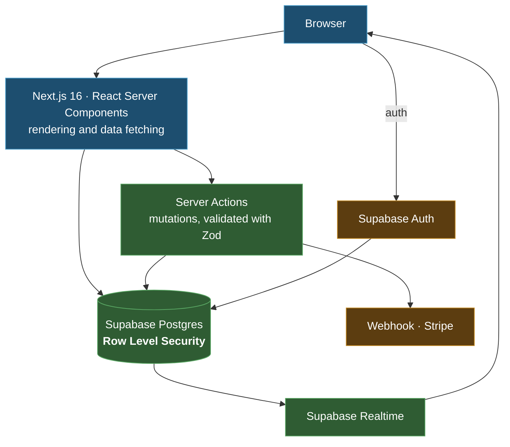
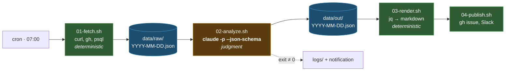
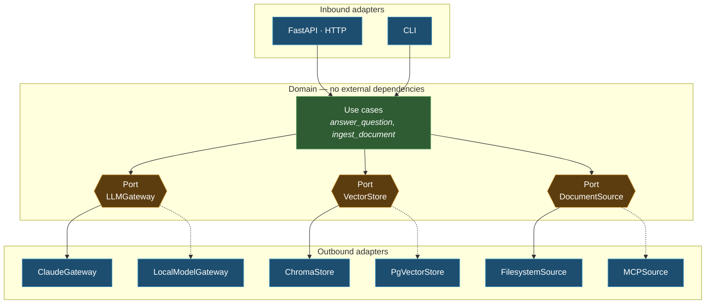

import { Tabs, TabItem, Steps, Aside, FileTree } from '@astrojs/starlight/components';
import Zero from '@/components/Zero.astro';

<div class="meta-modulo">
	<span><strong>Estimated time:</strong> 60 minutes</span>
	<span><strong>Prerequisites:</strong> modules <a href="/en/fondamenta/claude-md/">5</a>, <a href="/en/fondamenta/plan-mode/">6</a> and <a href="/en/automazione/cli-scripting/">12</a>.</span>
</div>

The three words in the title, first of all. The **stack** is the set of technologies you build on
— language, framework, database: the "ingredients". A **framework** is a ready-made code scaffold
that gives the application its shape: it brings you 80% of the structure, you write what is yours.
The **architecture** is how you arrange the rooms of the building: what goes where, and who can talk to whom.
This module is for the "blank page" moment — when the project is new and wrong choices
cost months — and it has one underlying idea: **choices are made with explicit criteria, not by fashion**,
and Claude can help you make them, if you give it those criteria.

## Objectives

- Choose the stack based on the type of application, not on trends.
- Recognize which reference architecture fits, and when it does **not**.
- Build three complete systems, each with its own structure and `CLAUDE.md`.
- Have Claude Code compare frameworks in Plan Mode, with explicit criteria instead of opinions.

## Key concepts

**You choose the stack from the type of problem, not from the language you prefer.** The three questions that
narrow the field more than any other: **who consumes the result** (a browser, another program, a
scheduler), **how much state there is** and where it lives, and **how much startup latency matters**.

**The rule that matters most with an agent:** choose the stack that has **the largest amount of well-written
public code**. An agent works better where there are established conventions, explicit types and
documentation. A niche framework with great design but little critical mass costs you more corrections.

**Architecture exists to protect a decision that will change.** An abstraction that protects nothing is
just one more layer. Before introducing one, ask yourself: *what will really change, and does this abstraction let me
change it without touching the rest?* If the answer is not clear, don't introduce it.

**The `CLAUDE.md` is part of the architecture.** In a project an agent works on, unwritten
conventions do not exist. Every example in this module has its own `CLAUDE.md`, and it is not an accessory: it is where
the contract that holds the structure together lives.

## Decision table

<Zero title="How to read this table (full of proper names)">
Each row is a *type* of application; the columns say what to build it with. The ~40 proper names are
technologies: **you don't need to know them** — you need to know they exist and roughly what they are. The
families: *web frameworks* (Next.js, SvelteKit, Nuxt, Astro: the scaffold of a site or app), *UI
libraries* (React, Svelte, Vue: the building blocks of the interface), *languages* (TypeScript, Python, Go, Rust),
*databases and surroundings* (Postgres, Supabase, Drizzle, Prisma), *web servers* (Hono, Fastify, Express,
FastAPI), *mobile* (React Native, Flutter, Swift, Kotlin). Use the table like this: find the row for your
project, read the first column of choices, and ask Claude to explain the entries you don't know —
that is exactly the kind of question it is good at.
</Zero>

The versions cited are those of **August 2026**: current numbers can be read on npm and PyPI, and it is a good habit to check them before you start.

| Application type | Recommended stack | Alternatives | When to avoid it |
| --- | --- | --- | --- |
| **Full-stack web app** | Next.js 16 + React 19 + TypeScript 7 + Postgres (Supabase or Neon) + Drizzle | SvelteKit 2 + Svelte 5 · Nuxt 4 · Rails · Django | If you need neither server-generated pages nor search engine visibility (SEO): a SPA — an app that lives entirely in the browser — with Vite 8 is simpler |
| **Content or documentation site** | **Astro 7** + Starlight | Docusaurus · VitePress · MkDocs Material | If the site is 90% interactive: Astro is designed for static pages with "islands" of interactivity, and you would be using it against the grain |
| **Backend API** | Hono 4 (portable and designed for the *edge*: servers distributed close to users instead of in a single data center) or Fastify 5 (mature Node) + TypeScript | FastAPI 0.141 if the ecosystem is Python · Go if latency matters | Express 5 on a new project: it works, but types and modern middleware are better elsewhere |
| **CLI tool** | TypeScript + Bun or Node · or Go for a single binary | Rust if performance matters · Python with Typer for internal scripts | Node if distribution must be a binary the user downloads |
| **Automation and data pipelines** | Python 3.12+ with Pydantic 2 · or Bash and `claude -p` for orchestration | Airflow or Dagster if there are many steps and dependencies · GitHub Actions when jobs are few and simple | An orchestration framework for three tasks in sequence: cron and a script are enough |
| **Mobile app** | React Native with Expo, if the team is already React | Flutter if the team has no web preference · native Swift/Kotlin for apps that live on the platform | Cross-platform if the app depends heavily on native APIs |
| **Agentic or RAG system** | Python + FastAPI + hexagonal architecture + Claude Agent SDK | TypeScript with the SDK if the stack is already Node · LangChain 1.3 only if you really use its abstractions | "Batteries included" RAG frameworks for a simple case: 200 lines of your own are more readable and debuggable |

<Aside type="caution" title="The risk of RAG abstractions">
**RAG** (*Retrieval-Augmented Generation*) means: before letting the
model answer, a system *retrieves* the relevant documents from your data and puts them in its
context — so it answers based on what you know, not only on what it knew. LangChain and LlamaIndex
solve real problems on complex RAG systems. On a RAG with one source and one
model, they add more concepts than they remove — and when something doesn't work, you are debugging
the abstraction instead of your problem. Start without them, and introduce them when you feel the pain they solve.
</Aside>

## Reference architectures

The four that cover the vast majority of projects, each in two sentences:

- **Modular monolith** — a single application, a single deploy, but organized inside into modules with
  clear boundaries (billing, users, notifications…). It is the right starting point almost always: the
  simplicity of a single thing, with the order that lets you extract a piece if one day you need to.
- **Hexagonal / clean architecture** — the core of the application (the business logic) does not know
  the outside world: it talks only to **ports** (abstract interfaces: "something that can save",
  "something that can answer"), and **adapters** connect each port to a concrete technology
  (that database, that AI model). Change technology = change adapter, the core stays untouched.
- **Event-driven** — components don't call each other: they publish *events* ("order created") on
  a queue, and whoever is interested consumes them when they can. It decouples and absorbs peaks, but the flow
  becomes much harder to follow and debug.
- **Serverless** — no server of your own running 24/7: you upload functions that the cloud runs *on demand* and
  you pay per execution. Perfect for irregular loads; awkward for persistent connections, long
  jobs, and cost predictability at steady state.

And in a table, when yes and when no:

| Architecture | Fits when | Does not fit when |
| --- | --- | --- |
| **Modular monolith** | Almost always at the start. A single deploy, modules with clear boundaries, the option to extract one if needed | Very large teams that need to release independently |
| **Hexagonal / clean** | The **domain is the value** and external dependencies will change: LLM gateway, payment provider, database | The app is just CRUD (*Create, Read, Update, Delete*: creating, reading, updating and deleting records) on a database: you are adding three layers to protect yourself from a change that will not happen |
| **Event-driven** | You need temporal decoupling, load peaks to absorb, or multiple consumers of the same event | You need strong consistency and synchronous responses: debugging complexity explodes |
| **Serverless** | Irregular load, lots of time at zero, and cold starts are not a problem | Persistent connections, long jobs, or predictable costs under constant load |

<Aside type="tip" title="The abstraction test">
Before introducing a port and an adapter, write the sentence: *"this will let me replace X with
Y without touching Z"*. If you can't fill the three letters with concrete things, the abstraction is not needed.

In the examples below the port exists **only** in the third one, where X = "Claude", Y = "a local model" and Z =
"the retrieval logic". In the other two it would have been ceremony.
</Aside>

---

## Example A · SaaS dashboard

A **SaaS** (*Software as a Service*) is software sold as a subscription service, used from the
browser: users install nothing. Stack: Next.js 16 + Supabase. **Multi-tenant** means that several customer organizations use the same
application and the same database, each one seeing only its own data — and to guarantee this the schema
relies on Postgres **Row Level Security (RLS)**: rules written *in the database* that filter every
row based on who is asking, so even a wrong query in the app cannot leak another
customer's data.

The diagram shows who talks to whom. The colors: **blue** = what runs in the user's browser,
**green** = what runs on your servers, **amber** = external services. The arrows are calls: they
read "A uses B".



<FileTree>

- saas-dashboard/
  - CLAUDE.md
  - .claude/
    - settings.json
    - rules/
      - react.md Rules tied to `src/components/**`
      - database.md Rules tied to `src/db/**`
  - .mcp.json Supabase, Vercel
  - src/
    - app/ Framework routes: **thin**, no logic
      - (dashboard)/
        - layout.tsx
        - page.tsx
      - api/
        - webhooks/stripe/route.ts
    - components/ Presentational components
    - features/ **One module per product capability**
      - billing/
        - actions.ts Server Actions
        - queries.ts Reads
        - schema.ts Zod schemas, shared between the two
      - projects/
    - db/
      - schema.ts Drizzle schema
      - migrations/
    - lib/
      - supabase/ Server and browser clients
      - env.ts **Env var validation, single point**
  - tests/
    - e2e/ Playwright
  - drizzle.config.ts

</FileTree>

The structural decision that matters: **`app/` contains only routing, `features/` contains the product.**
Framework route folders change with every major version; a `features/billing/` folder does not. And for an
agent it is the difference between "search for where billing lives" and "open `features/billing/`".

```markdown title="CLAUDE.md"
# SaaS Dashboard

Next.js 16 (App Router) · React 19 · TypeScript 7 · Supabase Postgres · Drizzle · Tailwind 4.

## Commands

- `npm run dev` — dev server
- `npm test` — Vitest. Run the single file, not the whole suite
- `npm run test:e2e` — Playwright
- `npm run typecheck` — **mandatory before every commit**
- `npm run db:generate` — generates the migration after changing `src/db/schema.ts`
- `npm run db:migrate` — applies the migrations

## Structure

- `src/app/` — **routing only**. No business logic in here
- `src/features/<capacita>/` — where the product lives: `actions.ts`, `queries.ts`, `schema.ts`
- `src/db/schema.ts` — the only schema definition. Migrations are **generated**, not written
- `src/lib/env.ts` — the only place where environment variables are read

## Non-negotiable rules

- **Every table has an RLS policy.** A table without RLS is a security incident,
  not a TODO. If you add a table, add the policy in the same migration
- Server Components by default. `"use client"` only when state or effects are really needed
- Every Server Action validates its input with the Zod schema from `schema.ts` **before** touching the database
- Never use the service role key outside `src/app/api/webhooks/`
- Applied migrations are never modified: if the schema changes, create a new migration

## Pitfalls of this project

- Supabase Realtime does not respect RLS on broadcast channels: filter server-side
- Server Actions also run on unauthenticated requests: the session must be checked
  in every action, not just in the layout
```

Three items in this file deserve a line of translation. **Zod** is a library that checks that a
piece of data has the expected shape ("this field is an email, this one a positive number") before using it. The
**service role key** is the Supabase key that *bypasses* RLS: in the wrong hands it cancels
all the protection, which is why it is confined to webhooks. And the two final "pitfalls" are real
Supabase behaviors that surprise everyone the first time: they are in the `CLAUDE.md` precisely so that Claude
— and the new colleague — don't discover them at the user's expense.

---

## Example B · Headless data pipeline

`claude -p` + JSON output + cron. No server, no UI: a scheduler, some scripts and some files.
It is the architecture built in full in [module 14](/en/automazione/pipeline-locali/) — here you look at it
from above. In the diagram: **green** = deterministic stages (same input → same output), **amber** =
the only stage that uses the LLM, **blue** = the files on disk between one stage and the next. The dashed
arrow is the error path: if the analysis fails, log and notify.



<FileTree>

- pipeline/
  - CLAUDE.md
  - .claude/
    - settings.json Minimal permissions
    - skills/
      - analizza/
        - SKILL.md The analysis prompt, versioned
  - bin/
    - run.sh Orchestrator: calls the stages in order
    - 01-fetch.sh Collection — **no LLM**
    - 02-analyze.sh `claude -p` with `--json-schema`
    - 03-render.sh JSON → markdown, with `jq`
    - 04-publish.sh Publishing
  - schemas/
    - analisi.json The JSON Schema of the output
  - data/
    - raw/ Raw input, by date — **immutable**
    - out/ Structured output, by date
  - logs/
  - .env.example

</FileTree>

The structural decision: **one file per stage, and only one stage uses the LLM.** Every stage reads from disk and
writes to disk, so each one can be re-run on its own. When something goes wrong at 7 in the morning, you know
exactly which stage to look at and you can rerun it without redoing the others.

```markdown title="CLAUDE.md"
# Headless data pipeline

Bash + `claude -p` + cron. No server, no database: files on disk.

## How to run it

- `bin/run.sh [YYYY-MM-DD]` — full pipeline. Without an argument, today
- Every stage can run on its own: `bin/02-analyze.sh 2026-08-16`
- `bin/run.sh --dry-run` — runs everything except publishing

## The contract

- Every stage reads from disk and writes to disk. No in-memory state between stages
- `data/raw/` is **immutable**: you add, you don't modify. It is the proof of what
  happened that day
- The output of `02-analyze.sh` is validated against `schemas/analisi.json`.
  **If the schema changes, the renderer changes too**
- Exit code: `0` ok · `1` pipeline failure · `2` tool error
  (Claude did not run). Monitoring tells them apart

## Non-negotiable rule

**Only `02-analyze.sh` calls Claude.** Collection, formatting and publishing are
deterministic commands. If you feel like asking Claude to run a `curl` or to
format some markdown, the answer is no: it costs more, it is less reliable and it is not
reproducible.

## Invocation

Always `--bare`, `--max-turns` and `--json-schema`. Never without. The prompt lives in
`.claude/skills/analizza/SKILL.md`, not inline in the scripts: that way it is versioned and
reviewable in a diff.

## Pitfalls

- `cron` has a minimal `PATH`: `bin/run.sh` sources `.env` and exports the full PATH
- `claude` is not in cron's PATH: use the absolute path from `command -v claude`
- If the API is slow, `02` can overrun the slot window: there is a lock in `logs/.lock`
```

The three "pitfalls", translated: `cron` launches scripts with an almost empty environment, so commands that
"are there" in a normal terminal (including `claude`) do not exist for it — hence the explicit PATH and
the absolute path. And the **lock** (a file that says "I'm already running") prevents the 7:00 run,
if still in progress, from colliding with the next one.

---

## Example C · Local agentic / RAG system

Hexagonal architecture with an **LLM gateway** — a single adapter through which every call to the
model passes, so changing model means changing that one file. It is the only one of the three examples where the
ports pay for themselves: here X = "Claude", Y = "a local model", Z = "the retrieval logic".

How to read the diagram: in the center (**green**) the domain, which talks only to the three ports
(**amber**, hexagonal shape); around it (**blue**) the adapters. Solid arrows are the connections
active in the default configuration; **dashed** ones are the alternative adapters already
planned — to activate them you change one line in `config.py`, not the domain.



<FileTree>

- agentic-rag/
  - CLAUDE.md
  - .claude/
    - agents/
      - researcher.md
      - coder.md
      - reviewer.md
    - settings.json
  - .mcp.json Filesystem, database
  - src/
    - domain/ **Zero imports from outside**
      - models.py Document, Chunk, Answer, Citation
      - ports.py The three ports, as Protocols
      - usecases/
        - answer_question.py
        - ingest_document.py
    - adapters/
      - llm/
        - claude.py Claude Agent SDK
        - local.py Local model
      - store/
        - chroma.py
        - pgvector.py
      - source/
        - filesystem.py
        - mcp.py
    - api/ FastAPI: **only HTTP ↔ domain translation**
    - cli/
    - config.py The "composition root": the only point where you decide and wire which adapter to use
  - tests/
    - domain/ With fake adapters, **no network**
    - adapters/ Contract: every adapter passes the same test
  - pyproject.toml

</FileTree>

The structural decision: **`domain/` imports nothing from outside.** It is a rule that can be checked
automatically, and that is why it works. The test that checks it is worth more than any paragraph of
documentation.

```markdown title="CLAUDE.md"
# Local agentic / RAG system

Python 3.12 · FastAPI · hexagonal architecture · Claude Agent SDK.

## Commands

- `uv run pytest` — tests. `uv run pytest tests/domain` for domain tests only (fast, offline)
- `uv run ruff check --fix` and `uv run mypy src` — **both green before every commit**
- `uv run uvicorn src.api.main:app --reload` — API locally
- `uv run python -m src.cli ingest ./docs` — ingest from the CLI

## The rule that holds everything up

**`src/domain/` imports nothing from outside itself.** No `httpx`, no `chromadb`,
no `anthropic`, no `fastapi`. Only the standard library and the domain models.

It is checked by `tests/domain/test_no_external_imports.py`. If that test fails, the
problem is the design, not the test: **do not add exceptions**.

## What goes where

| If you are writing… | It goes in |
| --- | --- |
| Logic that depends on the *problem* | `domain/usecases/` |
| Code that talks to an external service | `adapters/<categoria>/` |
| HTTP ↔ domain translation | `api/` |
| The choice of which adapter to use | `config.py` — **the only place** |

## Adding an adapter

1. Implement the `Protocol` in `domain/ports.py` — don't invent a new interface
2. Add it to the contract tests in `tests/adapters/`: **every adapter of the same
   port passes exactly the same tests**
3. Register it in `config.py`
4. Don't touch `domain/`. If you need to, the port is wrong: discuss it first

## Subagents

- `researcher` — read-only, explores the codebase and reports with `file:line` references
- `coder` — implements
- `reviewer` — read-only, Opus, checks the diff against the requirements

## Pitfalls

- Chroma persists to disk: tests that write use a temporary directory, never `./chroma`
- The LLM gateway's rate limit is per key, not per process: parallel ingest must be throttled
- Chunks from scanned documents arrive without punctuation: the chunker cannot assume sentences
```

Here too the "pitfalls" need a translation. **Chroma** is the example's vector database, and
"persists to disk" = data written by one test would stay there and pollute the next ones. The **rate
limit per key** means the limit on requests to the model applies to the account, not to each
process: ten parallel processes share the same budget. And **chunks** are the pieces a
document is cut into before being indexed — the boilerplate in
[module 18](/en/professionale/boilerplate/) builds exactly this system, commented.

---

## Letting Claude Code decide

The wrong way is to ask *"what is the best framework?"* — you will get a summary of opinions. The right
way is to give it **explicit criteria**, **your context**, and have it work in Plan Mode with web
research.

<Steps>

1. **Enter Plan Mode**, so it explores and proposes without writing anything:

   ```bash
   claude --permission-mode plan
   ```

2. **Use a prompt that weighs, instead of asking for an opinion:**

   ```text
   I need to choose the stack for a new project. Research current options on the web
   before answering — do not rely on your training data for versions, maintenance
   status or ecosystem size.

   ## Context
   - What it does: [descrizione in due righe]
   - Who uses it: [browser / altro programma / schedulatore], [quanti utenti]
   - Team: [dimensione], already know [linguaggi/framework]
   - Constraints: [deploy target, budget, compliance, latenza]
   - Timeline: [quanto tempo prima del primo rilascio]

   ## Criteria, in this order of weight
   1. Maturity: is it stable, and how often do breaking changes land?
   2. Ecosystem: are the libraries we need maintained?
   3. Team fit: how far is it from what we already know?
   4. Agent fit: how much good public code exists for it?
   5. Operability: how hard is it to deploy, monitor and debug in production?

   ## What I want back
   - Three candidate stacks, not one
   - A table scoring each against the five criteria, with the evidence for each score
   - For each: what would make me regret this choice in 18 months
   - Your recommendation, in one paragraph, and what would change it

   Do not recommend something because it is popular. Say when two options are
   genuinely equivalent for my case.
   ```

   The prompt asks for three candidate stacks scored against five weighted criteria, with web research
   instead of training memory, and an honest recommendation — the square brackets are the slots to fill in
   for your project (description in two lines, browser / other program / scheduler, number of users, team size,
   languages/frameworks you know, constraints, time to first release).

3. **Challenge the answer.** The real value comes on the second round:

   ```text
   You ranked A above B mainly on ecosystem size. My team has shipped three
   projects on B and zero on A. Redo the comparison with team fit weighted first.
   ```

4. **Open the plan with `Ctrl+G`** and fix whatever doesn't add up before approving.

5. **Write the decision into the repository**, not in a chat that will disappear:

   ```text
   Write the decision to docs/decisioni/0001-stack.md. Include: the options considered,
   the criteria, why we picked this one, and what would make us revisit it.
   ```

</Steps>

<Aside type="tip" title="The two sentences that raise the quality of the answer">
**"Research current options on the web"** — without it, the model answers from memory, and on versions and
maintenance status memory ages.

**"What would make me regret this choice in 18 months"** — forces it to spell out the downsides
that an enthusiastic comparison skips.
</Aside>

## Exercise

Design a real system, choosing deliberately.

1. Take a project idea you really have in mind.
2. Have it do the stack comparison in Plan Mode, with weighted criteria.
3. Choose the architecture **too**, and justify why you don't need a more complex one.
4. Write the `CLAUDE.md` and the folder structure before writing a line of code.

<details class="soluzione">
<summary>Solution</summary>

Let's assume: *an internal app that monitors supplier prices and alerts when they change beyond a
threshold. Two people, internal use, about ten users.*

**Step 2.** The prompt from the previous section, filled in. A plausible answer puts three very different
options on the table — a full-stack app, a scheduled script with a small UI, a service with a
queue — and the criteria table shows that with **ten users** and **two developers** criteria 3
(team fit) and 5 (operability) weigh much more than 1 and 2.

**Step 3 — the architecture, and why not the more complex one.**

```markdown title="docs/decisioni/0002-architettura.md"
# Architecture — modular monolith

## Choice
One application, one deploy, modules with clear boundaries: `scraping/`, `alerting/`, `web/`.

## Why not event-driven
A queue would solve the temporal decoupling between scraping and alerting. But:
- The volume is tens of checks per hour, not thousands per second
- There are no multiple consumers of the same event
- There are two of us: the debugging cost of an asynchronous system would fall entirely on us

A function call does the same thing and I can read it in a stack trace.
**If one day we need more consumers, the `alerting/` module already has the right boundary
to become a consumer.**

## Why not hexagonal
Ports protect against dependencies that change. Here:
- The database will not change: it is Postgres and stays Postgres
- The notification channel **might** change (Slack → email)

So: **one** interface, for `Notifier` only, and nothing else. No ports for
the database, no adapters for scraping. A single interface is not "hexagonal",
it is common sense.

## What would make us change our mind
- More than ~50 checks per minute, or scraping becoming the bottleneck → queue
- A third notification channel → the pattern is already there, add an implementation
- A second team on the project → then the boundaries must become deploy-independent
```

The document is the real deliverable: the reasoned choice *not* to use event-driven is worth more than the choice
to use it.

**Step 4 — structure and `CLAUDE.md` before the code.**

```text
monitor-prezzi/
├── CLAUDE.md
├── docs/decisioni/
│   ├── 0001-stack.md
│   └── 0002-architettura.md
├── src/
│   ├── scraping/       # one supplier = one module
│   ├── alerting/       # threshold rules + Notifier
│   ├── web/            # minimal UI
│   └── db/
└── tests/
```

```markdown title="CLAUDE.md"
# Supplier price monitor

Internal use, ~10 users. See `docs/decisioni/` for stack and architecture, **and read them
before proposing structural changes**.

## Commands
- `npm run dev` · `npm test` · `npm run typecheck` (mandatory before committing)
- `npm run scrape -- --fornitore=acme` — a single scraper, for debugging

## Structure
- `src/scraping/<fornitore>/` — one module per supplier, same interface
- `src/alerting/` — threshold rules. **The project's only interface is `Notifier`**
- `src/web/` — UI. No business logic here

## Rules
- Adding a supplier means adding a folder in `scraping/`, not
  touching the existing ones. If you have to touch one, the interface is wrong
- Every scraper has a test with a **saved HTML fixture**, not a network call
- Thresholds live in the database, not in the code

## What NOT to do without discussing it
- Introducing a queue or a message broker → see `docs/decisioni/0002`
- Adding interfaces beyond `Notifier` → we have no dependencies that change
```

The last section is the one that makes the difference with an agent: without it, the first time you ask
"make the scraping more robust" you end up with a queue nobody wanted.

</details>

## Common mistakes and troubleshooting

| Symptom | Cause | Solution |
| --- | --- | --- |
| Claude proposes the trendy stack instead of the right one | Prompt without criteria or context | Give it **weighted** criteria and your real context |
| The comparison cites wrong versions or maintenance status | It answered from memory | Explicitly ask it to search the web before answering |
| The architecture has more layers than necessary | Abstractions introduced "for the future" | Apply the test: *replace X with Y without touching Z*. If you can't fill it in, remove the layer |
| Claude adds complexity you didn't ask for | The `CLAUDE.md` doesn't say what **not** to do | A "What NOT to do without discussing it" section costs three lines |
| The structure degrades after a month | The conventions were not written down | Every structural rule goes in the `CLAUDE.md`, or better in a test |
| The boundary between domain and infrastructure crumbles | The rule was only documented | A test that checks imports is worth more than a paragraph |
| Nobody remembers why you chose that stack | The decision stayed in the chat | `docs/decisioni/NNNN-*.md`, committed |
| The `CLAUDE.md` has grown beyond 200 lines | You also put area-specific rules in it | Move them to `.claude/rules/` with `paths:` — see [module 5](/en/fondamenta/claude-md/) |
| In the pipeline you ask Claude for things `jq` would do | Confusion between orchestration and judgment | Only the judgment stage uses the LLM — see [module 14](/en/automazione/pipeline-locali/) |

## Cheat sheet

**The three questions that choose the stack**

```text
1. Who consumes the result?    browser · another program · scheduler
2. How much state, and where?  none · database · session · realtime
3. Does startup latency matter? yes → no cold serverless
```

**Quick choices**

| Type | First choice |
| --- | --- |
| Full-stack web app | Next.js 16 + Postgres + Drizzle |
| Content / docs | Astro 7 + Starlight |
| API | Hono 4 or Fastify 5 · FastAPI if Python |
| CLI | TypeScript · Go for a single binary |
| Data pipeline | Python + Pydantic · Bash + `claude -p` |
| Mobile | React Native + Expo if the team is React |
| Agentic / RAG | Python + FastAPI + hexagonal + Agent SDK |

**Architectures**

```text
Modular monolith   → the default. Start here
Hexagonal          → only where a dependency will really change
Event-driven       → multiple consumers, or peaks to absorb
Serverless         → irregular load, lots of time at zero
```

**The abstraction test**

```text
"This lets me replace X with Y without touching Z"
If you can't fill X, Y and Z with concrete things → it's not needed.
```

**What to put in every project `CLAUDE.md`**

```text
1. Commands Claude cannot guess
2. What goes where, in a table
3. The non-negotiable rules, few and checkable
4. The pitfalls specific to this project
5. What NOT to do without discussing it
```

## Sources

Package versions ([npm](https://www.npmjs.com) and [PyPI](https://pypi.org), August 2026):
Next.js 16.3.1 · React 19.2.8 · TypeScript 7.0.2 · Astro 7.2.2 · Vite 8.2.1 ·
SvelteKit 2.70.2 · Nuxt 4.5.2 · Hono 4.13.2 · Fastify 5.12.0 · Express 5.2.1 · Drizzle ORM 0.45.2 ·
Prisma 7.9.1 · `@supabase/supabase-js` 2.112.3 · Tailwind CSS 4.3.3 · Vitest 4.1.10 · Playwright 1.62.1 ·
`@anthropic-ai/claude-agent-sdk` 0.3.233 · FastAPI 0.141.1 · Pydantic 2.13.4 · LangChain 1.3.15 ·
LlamaIndex 0.14.23 · ChromaDB 1.5.9.

Official documentation consulted:

- [Best practices](https://code.claude.com/docs/en/best-practices) — an effective `CLAUDE.md`, explore-plan-code-commit
- [How Claude remembers your project](https://code.claude.com/docs/en/memory) — hierarchy and path-scoped rules
- [Choose a permission mode](https://code.claude.com/docs/en/permission-modes) — Plan Mode for decisions
- [Monorepos and large repos](https://code.claude.com/docs/en/large-codebases) — structure on large repositories
- [Agent SDK overview](https://code.claude.com/docs/en/agent-sdk/overview) — building agentic systems
- [Subagents](https://code.claude.com/docs/en/sub-agents) — the subagents in example C
