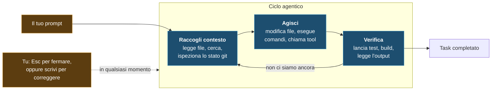

import { Tabs, TabItem, Steps, Aside } from '@astrojs/starlight/components';

<div class="meta-modulo">
	<span><strong>Tempo stimato:</strong> 45 minuti</span>
	<span><strong>Prerequisiti:</strong> i moduli <a href="/fondamenta/setup/">0</a> e <a href="/fondamenta/anatomia-file/">2</a>, e un progetto con una suite di test che gira.</span>
</div>

## Obiettivi

- Descrivere il ciclo agentico e riconoscerne le tre fasi mentre Claude lavora.
- Distinguere modello e harness, e capire perché sono i tool a rendere Claude Code "agentico".
- Adottare le quattro abitudini che cambiano davvero i risultati: verificare, esplorare prima, delegare, correggere presto.
- Riconoscere ed evitare i cinque pattern di fallimento più comuni.

## Concetti chiave

**Il ciclo agentico ha tre fasi.** Quando gli dai un task, Claude lavora in **raccogli contesto → agisci
→ verifica il risultato**, e ripete finché il task non è finito. Le fasi si mescolano: Claude usa tool in
tutte e tre, che sia cercare file per capire il codice, modificare per intervenire, o lanciare i test per
controllare il proprio lavoro.

Il ciclo si adatta alla richiesta. Una domanda sul codebase può fermarsi alla raccolta di contesto. La
correzione di un bug percorre tutte e tre le fasi più volte. Claude decide cosa serve a ogni passo in base
a quello che ha imparato al passo precedente, concatenando decine di azioni e correggendo la rotta strada
facendo.

**Modelli + tool = harness.** Il ciclo è alimentato da due componenti: i **modelli**, che ragionano, e i
**tool**, che agiscono. Claude Code è l'**harness agentico** attorno a Claude: fornisce i tool, la gestione
del contesto e l'ambiente di esecuzione che trasformano un modello linguistico in un agente di codice.
Senza tool, Claude può solo rispondere con del testo; con i tool può leggere il tuo codice, modificare
file, eseguire comandi, cercare sul web e parlare con servizi esterni.

I tool integrati ricadono in cinque categorie:

| Categoria | Cosa può fare Claude |
| --- | --- |
| **Operazioni sui file** | Leggere file, modificare codice, creare file nuovi, rinominare e riorganizzare |
| **Ricerca** | Trovare file per pattern, cercare contenuti con regex, esplorare codebase |
| **Esecuzione** | Eseguire comandi shell, avviare server, lanciare test, usare git |
| **Web** | Cercare sul web, scaricare documentazione, cercare messaggi di errore |
| **Code intelligence** | Vedere errori di tipo e warning dopo le modifiche, saltare alle definizioni, trovare i riferimenti (richiede i plugin di code intelligence) |

**Le sessioni sono indipendenti.** Ogni nuova sessione parte con una finestra di contesto pulita, senza la
cronologia delle precedenti. La persistenza tra sessioni passa da altre due strade: l'**auto memory**, gli
appunti che Claude si prende da solo, e il **`CLAUDE.md`**, le istruzioni che scrivi tu. Se una regola deve
sopravvivere, non va detta in chat: va scritta in `CLAUDE.md`.

**Il vincolo dominante è il contesto.** La finestra di contesto contiene tutta la conversazione: ogni
messaggio, ogni file letto, ogni output di comando. Si riempie in fretta, e le prestazioni degradano man
mano che si riempie: Claude comincia a "dimenticare" istruzioni date all'inizio e a sbagliare di più.
Quasi tutte le buone pratiche del prossimo modulo discendono da questo singolo vincolo.

**Sei dentro il ciclo anche tu.** Puoi interrompere in qualsiasi momento: `Esc` ferma Claude subito e la
chiamata a tool in corso viene annullata; scrivere una correzione e premere Invio la manda **senza**
fermare il tool corrente, e Claude la legge appena l'azione finisce. Claude lavora in autonomia ma resta
reattivo.

## Il ciclo, visualizzato



Un esempio concreto. Chiedi *"fix the failing tests"*. Claude potrebbe:

<Steps>

1. Eseguire la suite di test per vedere cosa fallisce. *(raccogli contesto)*
2. Leggere l'output di errore. *(raccogli contesto)*
3. Cercare i file sorgente rilevanti. *(raccogli contesto)*
4. Leggere quei file per capire il codice. *(raccogli contesto)*
5. Modificarli per risolvere il problema. *(agisci)*
6. Rilanciare i test. *(verifica)*

</Steps>

Ogni uso di un tool restituisce informazione che alimenta il passo successivo. Non è uno script: è una
catena di decisioni.

## A cosa ha accesso Claude

Quando lanci `claude` in una directory, Claude Code ottiene accesso a:

- **Il tuo progetto** — i file nella directory e nelle sottodirectory, e altri file altrove con il tuo permesso.
- **Il tuo terminale** — qualsiasi comando potresti lanciare tu: build tool, git, package manager, script.
- **Il tuo stato git** — branch corrente, modifiche non committate, cronologia recente dei commit.
- **Il tuo `CLAUDE.md`** — istruzioni, convenzioni e contesto che Claude deve avere a ogni sessione.
- **L'auto memory** — quello che Claude ha imparato lavorando. Le prime 200 righe o 25 KB di `MEMORY.md`, il limite che scatta per primo, vengono caricate all'inizio di ogni sessione.
- **Le estensioni che configuri** — server MCP, skill, subagent, Claude in Chrome.

È la differenza sostanziale con un assistente inline che vede solo il file aperto: quando chiedi di
sistemare il bug dell'autenticazione, Claude cerca i file rilevanti, ne legge diversi per capire il
contesto, fa modifiche coordinate su più file, lancia i test per verificare e — se glielo chiedi — committa.

## La mentalità: quattro abitudini

### 1. Dai a Claude qualcosa da verificare

È l'abitudine con il ritorno più alto, e quella che si trascura di più.

Claude si ferma quando il lavoro **sembra** finito. Senza un controllo che possa eseguire, "sembra finito"
è l'unico segnale disponibile, e il ciclo di verifica diventi tu: ogni errore aspetta che sia tu ad
accorgertene. Dagli qualcosa che produce un pass o un fail e il ciclo si chiude da solo.

| Strategia | Prima | Dopo |
| --- | --- | --- |
| **Fornisci criteri di verifica** | *"implementa una funzione che valida gli indirizzi email"* | *"scrivi `validateEmail`. Casi di test: `user@example.com` → true, `invalid` → false, `user@.com` → false. Lancia i test dopo aver implementato"* |
| **Verifica visivamente le modifiche UI** | *"fai stare meglio la dashboard"* | *"\[incolla screenshot] implementa questo design. Fai uno screenshot del risultato e confrontalo con l'originale. Elenca le differenze e correggile"* |
| **Vai alla causa, non al sintomo** | *"la build fallisce"* | *"la build fallisce con questo errore: \[incolla]. Correggilo e verifica che la build passi. Vai alla causa, non sopprimere l'errore"* |

Il controllo è qualsiasi cosa restituisca un segnale leggibile: una suite di test, l'exit code di una
build, un linter, uno script che confronta l'output con una fixture, uno screenshot del browser confrontato
con un design.

Chiedi anche a Claude di **mostrare le prove** invece di dichiarare il successo: l'output dei test, il
comando lanciato e cosa ha restituito. Rileggere le prove è più veloce che rifare la verifica a mano, e
funziona anche per le sessioni che non hai guardato.

### 2. Esplora, poi pianifica, poi scrivi codice

Lasciare che Claude si butti subito sul codice può produrre codice che risolve il problema sbagliato. Il
flusso consigliato ha quattro fasi — **Explore → Plan → Implement → Commit** — e le vediamo in dettaglio
nel [modulo 6](/fondamenta/plan-mode/).

<Aside type="note" title="Ma non sempre">
Il Plan Mode è utile e ha un costo. Per task con scope chiaro e intervento piccolo — correggere un refuso,
aggiungere una riga di log, rinominare una variabile — chiedi a Claude di farlo e basta. La regola pratica:
**se sapresti descrivere la diff in una frase, salta il piano.**
</Aside>

### 3. Delega, non dettare

Pensa a delegare a un collega capace: dai contesto e direzione, poi fidati che trovi i dettagli.

```text
The checkout flow is broken for users with expired cards.
The relevant code is in src/payments/. Can you investigate and fix it?
```

Non devi specificare quali file leggere né quali comandi eseguire. Ma **delegare non è essere vaghi**: più
è preciso il prompt iniziale, meno correzioni servono. Cita file specifici, dichiara i vincoli, indica
pattern da seguire.

| Strategia | Prima | Dopo |
| --- | --- | --- |
| **Delimita il task** | *"aggiungi test per foo.py"* | *"scrivi un test per foo.py che copra il caso limite dell'utente disconnesso. Evita i mock."* |
| **Indica la fonte** | *"perché ExecutionFactory ha una API così strana?"* | *"guarda la storia git di ExecutionFactory e riassumi come è arrivata a questa API"* |
| **Cita pattern esistenti** | *"aggiungi un widget calendario"* | *"guarda come sono implementati i widget esistenti nella home per capire il pattern. `HotDogWidget.php` è un buon esempio. Segui quel pattern per un widget calendario..."* |
| **Descrivi il sintomo** | *"correggi il bug del login"* | *"gli utenti riportano che il login fallisce dopo il timeout di sessione. Controlla il flusso in `src/auth/`, in particolare il refresh del token. Scrivi prima un test che riproduce il problema, poi correggilo"* |

I prompt vaghi hanno però un loro uso: quando stai esplorando e puoi permetterti di correggere la rotta.
*"cosa miglioreresti in questo file?"* fa emergere cose che non avresti pensato di chiedere.

### 4. Correggi presto e spesso

I risultati migliori vengono da cicli di feedback stretti.

- **`Esc`** — ferma Claude a metà azione. Il contesto è preservato, puoi ridirigere.
- **`Esc` `Esc` o `/rewind`** — apre il menu di rewind e ripristina conversazione e stato del codice a un punto precedente.
- **`"Undo that"`** — fai annullare le modifiche a Claude.
- **`/clear`** — azzera il contesto tra task non correlati.

<Aside type="tip" title="La regola delle due correzioni">
Se hai corretto Claude più di due volte sullo stesso problema nella stessa sessione, il contesto è ormai
pieno di tentativi falliti. Fai `/clear` e riparti con un prompt più specifico che incorpora quello che hai
imparato. Una sessione pulita con un prompt migliore batte quasi sempre una sessione lunga con correzioni
accumulate.
</Aside>

## Le due reti di sicurezza

**I checkpoint.** Prima di modificare un file, Claude ne salva uno snapshot. Se qualcosa va storto, premi
`Esc` due volte per tornare indietro, o chiedi a Claude di annullare. I checkpoint sono separati da git e
restano disponibili quando riprendi una conversazione.

<Aside type="caution" title="I checkpoint non sostituiscono git">
Tracciano **solo** le modifiche fatte con i tool di editing di Claude. Le modifiche fatte da comandi Bash
o da processi esterni non vengono catturate. E le azioni che toccano sistemi remoti — database, API,
deploy — non sono annullabili: è il motivo per cui Claude chiede il permesso prima di eseguire comandi con
effetti esterni.
</Aside>

**I permessi.** `Shift+Tab` cicla tra le modalità:

- **Manual** — chiede prima delle modifiche ai file e dei comandi shell.
- **Accept edits** — modifica file ed esegue comandi filesystem comuni come `mkdir` e `mv` senza chiedere; per gli altri comandi chiede.
- **Plan** — esplora e propone un piano senza modificare i sorgenti.
- **Auto** — valuta tutte le azioni con controlli di sicurezza in background.

Puoi anche consentire comandi specifici in `.claude/settings.json`, utile per cose fidate come `npm test`
o `git status`.

## Esempio guidato: lo stesso task, due modi

Mettiamo alla prova la differenza tra "dettare" e "delegare con verifica". Serve un progetto con test che
girano; se non ne hai uno, riusa `health-api/` del [modulo 1](/fondamenta/ide/).

<Steps>

1. **Prepara un bug reale.** Introduci un difetto vero, non un refuso. Nel tuo progetto, rompi la
   validazione di un input in modo che un caso limite fallisca — ad esempio accettando una stringa vuota
   dove non dovrebbe.

2. **Modo A — dettare.** Avvia una sessione e scrivi:

   ```text
   there's a bug, fix it
   ```

   Osserva cosa succede: Claude deve prima **scoprire** che c'è un bug, poi dove. Legge molti file. La
   fase "raccogli contesto" si dilata e consuma contesto. Annota quanti passi servono prima della prima
   modifica.

3. **Guarda quanto contesto è stato consumato.**

   ```text
   /context
   ```

   Mostra cosa sta occupando spazio nella finestra di contesto.

4. **Riparti pulito.**

   ```text
   /clear
   ```

5. **Modo B — delegare con verifica.** Stesso bug, prompt diverso:

   ```text
   Users can submit the form with an empty name and it is accepted.
   The validation lives in src/. Write a failing test that reproduces
   this first, then fix it, then run the test suite and show me the output.
   ```

   Nota i quattro ingredienti: il **sintomo**, la **posizione probabile**, il **criterio di verifica**
   (un test che fallisce) e la richiesta di **mostrare le prove**.

6. **Confronta.** Rilancia `/context` e confronta con il passo 3. Nel modo B la fase di raccolta contesto è
   corta perché gliel'hai data tu, e il ciclo si chiude da solo perché c'è un test che dice pass o fail.

7. **Interrompi di proposito.** Rilancia un task e, mentre Claude sta lavorando, scrivi una correzione e
   premi Invio **senza** premere `Esc`:

   ```text
   also make sure the error message is user-facing, not a stack trace
   ```

   Claude la legge appena l'azione corrente finisce e si adatta, senza ripartire da zero. Prova poi con
   `Esc`: l'azione in corso viene annullata subito.

</Steps>

## Esercizio

Trasforma un prompt vago in uno che chiude il ciclo da solo.

Parti da questo, deliberatamente pessimo:

```text
make the API better
```

1. Riscrivilo applicando le quattro abitudini: sintomo, posizione, criterio di verifica, richiesta di prove.
2. Eseguilo in Plan Mode e leggi il piano prima di approvarlo.
3. Dopo l'implementazione, fai rivedere la diff da un subagent con occhi freschi.

<details class="soluzione">
<summary>Soluzione</summary>

**Passo 1.** Il prompt vago non dice cosa c'è che non va, dove guardare, né cosa significhi "meglio". Una
riscrittura possibile:

```text
The POST /users endpoint returns 500 when the request body is missing
required fields, instead of 400 with a validation error.

The handler is in src/routes/users.js and validation helpers live in
src/lib/validate.js. Write failing tests for these cases first:
  - missing email          → 400, body { error: "email is required" }
  - missing name           → 400, body { error: "name is required" }
  - valid payload          → 201

Then fix the handler so the tests pass. Run the test suite and show me
the output. Don't change the response shape for the success case.
```

Cosa è stato aggiunto rispetto all'originale: il **sintomo** (500 invece di 400), la **posizione** (due
file specifici), i **criteri di verifica** (tre casi con l'output atteso), la richiesta di **mostrare
l'output**, e un **vincolo di non-regressione** (non cambiare la forma della risposta di successo).

**Passo 2.** Entra in Plan Mode con `Shift+Tab` finché la status bar non mostra `⏸ plan mode on`, oppure
avvia la sessione con:

```bash
claude --permission-mode plan
```

Manda il prompt. Claude legge i file e propone un piano senza toccare nulla. Premi `Ctrl+G` per aprire il
piano nel tuo editor e modificarlo direttamente prima che Claude proceda. Se il piano tocca file che non
c'entrano, è il momento di accorgersene: dopo, la diff sarebbe già scritta.

**Passo 3.** Dopo l'implementazione, chiedi una revisione avversariale in un contesto fresco:

```text
Use a subagent to review the diff for this change. Check that all three
test cases are covered, that the success response shape is unchanged, and
that nothing outside src/routes/users.js and src/lib/validate.js was
modified. Report gaps that affect correctness, not style preferences.
```

Il subagent gira in una finestra di contesto separata e vede solo la diff e i criteri, non il ragionamento
che ha prodotto la modifica: valuta il risultato per quello che è. In alternativa, per un controllo di
correttezza generico, esiste la skill integrata `/code-review`.

**Attenzione al rovescio della medaglia:** un revisore a cui chiedi di trovare lacune ne troverà quasi
sempre qualcuna, anche quando il lavoro è solido — è ciò che gli hai chiesto di fare. Inseguirle tutte
porta a over-engineering: astrazioni inutili, codice difensivo, test per casi impossibili. Digli
esplicitamente di segnalare solo le lacune che toccano correttezza o requisiti dichiarati.

</details>

## Errori comuni e troubleshooting

I cinque pattern di fallimento più frequenti, e cosa fare:

| Pattern | Cosa succede | Rimedio |
| --- | --- | --- |
| **La sessione tuttofare** | Parti con un task, ne chiedi uno scollegato, torni al primo. Il contesto è pieno di roba irrilevante | `/clear` tra task non correlati |
| **Correggere all'infinito** | Claude sbaglia, correggi, sbaglia ancora, correggi ancora. Il contesto si riempie di approcci falliti | Dopo due correzioni fallite, `/clear` e riscrivi il prompt iniziale incorporando quello che hai imparato |
| **Il `CLAUDE.md` sovraccarico** | Il file è troppo lungo e Claude ne ignora metà: le regole importanti si perdono nel rumore | Pota senza pietà. Se Claude fa già una cosa correttamente senza l'istruzione, cancellala o convertila in un hook |
| **Il divario fiducia-verifica** | Claude produce un'implementazione plausibile che non gestisce i casi limite | Fornisci sempre una verifica: test, script, screenshot. Se non puoi verificarlo, non spedirlo |
| **L'esplorazione infinita** | Chiedi di "investigare" senza delimitare. Claude legge centinaia di file e riempie il contesto | Delimita l'indagine, o usa i subagent così l'esplorazione non consuma il contesto principale |

Altri sintomi frequenti:

| Sintomo | Causa | Soluzione |
| --- | --- | --- |
| Claude "dimentica" un'istruzione data all'inizio | Il contesto si è compattato e le istruzioni iniziali si sono perse | Le regole persistenti vanno in `CLAUDE.md`, non nella conversazione |
| Claude dichiara "fatto" ma non funziona | Non aveva un controllo eseguibile: "sembra fatto" era l'unico segnale | Aggiungi un criterio di verifica al prompt |
| Claude modifica file che non c'entrano | Lo scope non era dichiarato | Dichiara esplicitamente cosa è fuori scope, e usa il Plan Mode per accorgertene prima |
| Un rewind non ha ripristinato tutto | I checkpoint tracciano solo le modifiche fatte dai tool di editing | Le modifiche fatte da comandi Bash non sono catturate: usa git |
| La sessione va sempre più lenta e sbaglia di più | La finestra di contesto è quasi piena | `/context` per vedere cosa occupa spazio, poi `/clear` o `/compact` |

## Cheat-sheet

**Il ciclo**

```text
prompt → raccogli contesto → agisci → verifica → (ripeti) → fatto
                    ↑                                ↓
                    └──────── correzione ────────────┘
```

**Comandi e tasti**

| Comando / tasto | Cosa fa |
| --- | --- |
| `Esc` | Ferma Claude subito, annullando il tool in corso. Il contesto resta |
| scrivi + `Invio` (durante il lavoro) | Manda una correzione senza fermare il tool corrente |
| `Esc` `Esc` o `/rewind` | Menu di rewind: ripristina conversazione, codice, o entrambi |
| `/clear` | Azzera il contesto — da usare tra task non correlati |
| `/context` | Mostra cosa sta occupando la finestra di contesto |
| `/compact <istruzioni>` | Compatta la conversazione mantenendo il focus indicato |
| `Shift+Tab` | Cicla tra le modalità di permessi |
| `/init` | Genera un `CLAUDE.md` di partenza per il progetto |
| `/code-review` | Revisione della diff corrente in un subagent fresco |
| `/model` | Cambia modello durante la sessione |

**Le quattro abitudini**

| Abitudine | In una riga |
| --- | --- |
| Verificare | Dai a Claude un controllo che produce pass o fail, e chiedi le prove |
| Esplorare prima | Separa ricerca e pianificazione dall'implementazione — ma non per i task piccoli |
| Delegare | Dai sintomo, posizione e vincoli; non dettare i passi |
| Correggere presto | `Esc` per fermare, `/clear` dopo due correzioni fallite |

## Fonti

Pagine ufficiali consultate, verificate il **16 agosto 2026**:

- [How Claude Code works](https://code.claude.com/docs/en/how-claude-code-works) — ciclo agentico, tool, accesso, sessioni, checkpoint e permessi
- [Best practices](https://code.claude.com/docs/en/best-practices) — verifica, explore-plan-code-commit, prompt specifici, pattern di fallimento
- [Tools available to Claude](https://code.claude.com/docs/en/tools-reference) — elenco completo dei tool integrati
- [Permission modes](https://code.claude.com/docs/en/permission-modes) — le modalità di permesso e quando usarle
- [Checkpointing](https://code.claude.com/docs/en/checkpointing) — funzionamento e limiti dei checkpoint
- [Subagents](https://code.claude.com/docs/en/sub-agents) — delega e revisione in contesto separato
