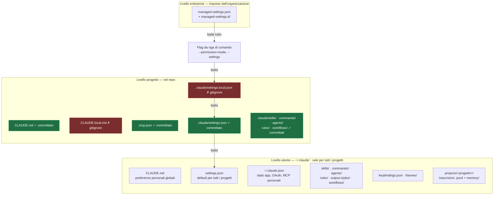

import { Tabs, TabItem, Steps, Aside, FileTree } from '@astrojs/starlight/components';
import Zero from '@/components/Zero.astro';

<div class="meta-modulo">
	<span><strong>Tempo stimato:</strong> 50 minuti</span>
	<span><strong>Prerequisiti:</strong> il <a href="/fondamenta/setup/">modulo 0</a> completato e almeno una sessione di Claude Code già fatta.</span>
</div>

Ogni volta che usi Claude Code, lui legge e scrive file sul tuo disco: impostazioni, istruzioni,
registrazioni delle conversazioni. Sapere **dove** stanno queste cose è quello che separa chi
subisce lo strumento da chi lo governa: ti permette di capire perché si comporta in un certo modo,
di condividere la configurazione col team, di ritrovare una conversazione di settimane fa e di fare
pulizia senza rompere nulla. Questo modulo è la mappa.

<Zero title="Cos'è un file di configurazione">
Molti programmi si personalizzano da un menu "Impostazioni". Gli strumenti da terminale, invece,
leggono le preferenze da **file di testo** in posti convenzionali: cambi il file, cambia il
comportamento. È più scomodo del menu, ma ha un vantaggio enorme: quei file si possono copiare,
versionare con git e condividere con il team — le impostazioni diventano parte del progetto. I nomi
che iniziano col punto (`.claude`, `.gitignore`) sono "nascosti": i gestori di file non li mostrano
di default, ma ci sono.
</Zero>

## Obiettivi

- Sapere a memoria dove vivono configurazione, estensioni e dati di Claude Code, su macOS e su Windows.
- Distinguere il livello utente dal livello progetto, e capire quale file va committato e quale no.
- Ricostruire l'ordine di precedenza con cui le impostazioni si sovrascrivono.
- Ritrovare la trascrizione di una sessione passata e riprenderla.
- Fare pulizia e backup in sicurezza, sapendo cosa si può cancellare e cosa no.

## Concetti chiave

**Due livelli, stessa struttura.** Claude Code legge la configurazione da due posti che hanno quasi la
stessa forma: `~/.claude/` nella tua cartella personale (livello **utente**: vale per tutti i tuoi
progetti) e `.claude/` dentro il [repository](/glossario/#repository-repo) (livello **progetto**: vale
solo lì, e viaggia con il codice). In entrambi trovi le stesse sottocartelle — una per ogni tipo di
personalizzazione che il corso insegna nei prossimi moduli: `skills/` e `commands/` (istruzioni
confezionate, moduli 7-8), `agents/` (aiutanti specializzati, modulo 11), `rules/` (regole per
argomento, modulo 5), più `settings.json` per permessi e opzioni. Quello che cambia è la portata, non
il formato: una [skill](/glossario/#skill) scritta in `~/.claude/skills/` ti segue ovunque; la stessa
skill in `.claude/skills/` è del progetto e la [committi](/glossario/#commit) per il team.

**La distinzione che conta di più: cosa si committa.** Dentro `.claude/` di progetto, `settings.json` è il
file **condiviso** — permessi, hook, variabili d'ambiente concordate col team — e va in git.
`settings.local.json` è il tuo file **personale** per quel progetto e sta fuori da git: Claude Code lo
aggiunge a `.gitignore` da solo quando ci salva un'impostazione. Stessa logica per la memoria: `CLAUDE.md`
è del progetto e si committa, `CLAUDE.local.md` sono le tue preferenze private e lo crei a mano
aggiungendolo a `.gitignore`.

**`.mcp.json` sta alla radice, non dentro `.claude/`.** È il file dei server MCP condivisi con il team, e
si committa. I server MCP personali finiscono invece in `~/.claude.json`.

**`~/.claude.json` non è `settings.json`.** È un errore frequentissimo. `~/.claude.json` è un file di
**stato dell'applicazione**, cioè le cose che Claude Code gestisce da solo: la sessione di
[login](/glossario/#oauth), i server [MCP](/glossario/#mcp) personali, il registro dei progetti di cui
ti fidi ("trust"), le [cache](/glossario/#cache) e le preferenze dell'interfaccia. `~/.claude/settings.json` è invece il
meccanismo ufficiale di configurazione del comportamento: permessi, hook, `env`, modello di default.
Modifichi il secondo; il primo lo gestisce Claude Code.

**`~/.claude/` contiene anche dati, non solo configurazione.** Trascrizioni delle conversazioni, cronologia
dei prompt, snapshot dei file prima delle modifiche, cache, log. Sono file **in chiaro**: se un tool legge
un `.env` o un comando stampa una credenziale, quel valore finisce nella trascrizione su disco. È il motivo
per cui la sezione sulla pulizia in fondo a questo modulo non è un dettaglio.

**La precedenza risolve i conflitti.** Quando la stessa impostazione compare in più file, vince quella con
priorità più alta. Dalla più forte alla più debole: **Managed → argomenti da riga di comando → Local →
Project → User**. Le impostazioni gestite dall'organizzazione stanno sopra tutto e non sono
sovrascrivibili, salvo eccezioni molto strette.

## La gerarchia, a colpo d'occhio

Il diagramma qui sotto mette insieme tutto il modulo in una figura: i tre livelli di configurazione
(organizzazione, utente, progetto), cosa contiene ciascuno, e le frecce della precedenza — chi vince
quando due livelli dicono cose diverse. **Verde = file che si committano** (condivisi col team via
git), **rosso = file personali** che restano fuori. Non serve capirlo tutto ora: è la cartina da
tenere sott'occhio mentre il modulo la percorre pezzo per pezzo.



## Livello utente: `~/.claude/`

I percorsi:

<Tabs syncKey="os">
<TabItem label="macOS" icon="apple">
- Configurazione ed estensioni: `~/.claude/`
- Stato dell'applicazione: `~/.claude.json`
- Credenziali: **Keychain di macOS** (cifrate) — non un file
</TabItem>
<TabItem label="Windows" icon="seti:windows">
- Configurazione ed estensioni: `%USERPROFILE%\.claude\`
- Stato dell'applicazione: `%USERPROFILE%\.claude.json`
- Credenziali: `%USERPROFILE%\.claude\.credentials.json`, protette dai permessi del profilo utente
</TabItem>
</Tabs>

<FileTree>

- ~/
  - .claude.json Stato dell'app, OAuth, server MCP personali, preferenze UI
  - .claude/
    - CLAUDE.md Preferenze personali valide in ogni progetto
    - settings.json Impostazioni di default per tutti i progetti
    - keybindings.json Scorciatoie da tastiera personalizzate
    - rules/ Regole a livello utente, valide ovunque
    - skills/ Skill personali, disponibili in ogni progetto
    - commands/ Comandi single-file personali
    - agents/ Subagent personali
    - output-styles/ Sezioni di [system prompt](/glossario/#sistema-prompt-di-system-prompt) (le istruzioni permanenti del modello) che cambiano come Claude lavora
    - workflows/ Workflow dinamici personali
    - agent-memory/ Memoria persistente dei subagent
    - themes/ Temi di colore personalizzati
    - plugins/ Marketplace clonati e plugin installati
    - projects/ **Cronologia delle sessioni**, una cartella per progetto
      - &lt;progetto&gt;/
        - &lt;sessione&gt;.jsonl Trascrizione completa della conversazione
        - &lt;sessione&gt;/subagents/ Trascrizioni dei subagent
        - &lt;sessione&gt;/tool-results/ Output dei tool troppo grandi per la trascrizione
        - memory/ Auto memory: gli appunti che Claude tiene tra una sessione e l'altra
    - file-history/ Snapshot dei file prima delle modifiche, per i checkpoint
    - plans/ I piani scritti in Plan Mode
    - history.jsonl Ogni prompt che hai digitato, con timestamp e progetto
    - shell-snapshots/ Alias e funzioni di shell catturati all'avvio
    - debug/ Log di debug per sessione (solo con `--debug` o `/debug`)
    - paste-cache/, image-cache/ Incollati lunghi e immagini allegate
    - backups/ Copie di `~/.claude.json` prima delle migrazioni di config

</FileTree>

### Le sessioni: `projects/`

È la parte che serve più spesso e che quasi nessuno conosce. Claude Code crea una cartella per ogni
progetto in cui hai lavorato, con il **percorso trasformato in nome**: gli slash diventano trattini e c'è
un trattino iniziale. Il progetto `/home/utente/work/my-repo` diventa:

```text
~/.claude/projects/-home-utente-work-my-repo/
```

Dentro, un file `.jsonl` per sessione con la [trascrizione](/glossario/#trascrizione) completa: ogni
messaggio, ogni comando eseguito, ogni risultato. Il formato è [JSONL](/glossario/#jsonl) — un oggetto
JSON per riga — e questo ha una conseguenza pratica preziosa: **si può cercare dentro con gli
strumenti di testo normali**, come vedremo tra poco nell'esempio guidato.

<Aside type="caution" title="Sono file in chiaro">
Trascrizioni e cronologia non sono cifrate a riposo: l'unica protezione sono i permessi del filesystem.
Tutto ciò che passa da un tool finisce lì dentro — contenuti di file, output di comandi, testo incollato.
</Aside>

## Livello progetto

<FileTree>

- il-tuo-progetto/
  - CLAUDE.md Istruzioni di progetto, lette a ogni sessione — **committato**
  - CLAUDE.local.md Le tue preferenze private per questo progetto — **gitignore**, da creare a mano
  - .mcp.json Server MCP di progetto, condivisi col team — **committato**
  - .worktreeinclude File gitignored da copiare nei nuovi worktree — **committato**
  - .claude/
    - settings.json Permessi, hook, env, configurazione — **committato**
    - settings.local.json I tuoi override personali — **gitignore**
    - rules/ Istruzioni per argomento, opzionalmente legate a percorsi
      - testing.md Convenzioni di test, valide sui file di test
      - api-design.md Convenzioni API, valide sul codice backend
    - skills/
      - security-review/
        - SKILL.md Entrypoint: quando si attiva, come si invoca, istruzioni
        - checklist.md File di supporto incluso nella skill
    - commands/
      - fix-issue.md Prompt single-file, invocabile con `/fix-issue`
    - agents/
      - code-reviewer.md Subagent con la propria finestra di contesto
    - output-styles/ Output style di progetto, se il team ne condivide
    - workflows/ Script di workflow che orchestrano più subagent
    - agent-memory/ Memoria persistente dei subagent di progetto

</FileTree>

### Livello enterprise: `managed-settings.json`

Le impostazioni imposte dall'organizzazione, che tu non puoi sovrascrivere:

| Sistema | Percorso |
| --- | --- |
| macOS | `/Library/Application Support/ClaudeCode/managed-settings.json` — drop-in in `managed-settings.d/` |
| Windows | `C:\Program Files\ClaudeCode\managed-settings.json` — drop-in in `managed-settings.d\` |
| Linux e WSL | `/etc/claude-code/managed-settings.json` — drop-in in `managed-settings.d/` |

Su macOS esiste anche il dominio di managed preferences `com.anthropic.claudecode`; su Windows le chiavi di
registro `HKLM\SOFTWARE\Policies\ClaudeCode` (admin) e `HKCU\SOFTWARE\Policies\ClaudeCode` (utente).

## Precedenza delle impostazioni

Quando la stessa chiave compare in più file, l'ordine è questo — dal più forte al più debole:

<Steps>

1. **Managed** — le impostazioni gestite dall'organizzazione. Non sovrascrivibili da nessun altro scope,
   salvo eccezioni ristrette e documentate.
2. **Argomenti da riga di comando** — override temporanei per quella sessione, ad esempio
   `--permission-mode` o `--settings`.
3. **Local** — `.claude/settings.local.json`: batte sia il progetto sia l'utente.
4. **Project** — `.claude/settings.json`: batte l'utente.
5. **User** — `~/.claude/settings.json`: si applica quando nient'altro specifica quella impostazione.

</Steps>

<Aside type="note" title="Attenzione all'ordine">
Molte guide in giro riportano "enterprise → CLI → progetto → utente" dimenticando `settings.local.json`.
È il file che nella pratica ti fa impazzire: hai messo un permesso nel `settings.json` condiviso, non ha
effetto, e la ragione è un `settings.local.json` che lo sovrascrive.
</Aside>

Alcune variabili d'ambiente hanno precedenza sull'impostazione equivalente, ma non tutte: quando conta,
verifica la singola variabile nel [riferimento delle env vars](https://code.claude.com/docs/en/env-vars).

## Tabella riassuntiva: quale file, quando

| File | Scope | Si committa? | Quando usarlo |
| --- | --- | --- | --- |
| `CLAUDE.md` | Progetto e utente | ✓ (progetto) | Dare a Claude contesto e convenzioni del progetto |
| `CLAUDE.local.md` | Progetto | ✗ | Le tue preferenze private su questo progetto |
| `rules/*.md` | Progetto e utente | ✓ | Istruzioni per argomento, opzionalmente legate a percorsi di file |
| `.claude/settings.json` | Progetto | ✓ | Permessi, hook, env var, modello di default condivisi col team |
| `.claude/settings.local.json` | Progetto | ✗ | I tuoi override personali su questo progetto |
| `~/.claude/settings.json` | Utente | — | I tuoi default per tutti i progetti |
| `.mcp.json` | Progetto | ✓ | Server MCP condivisi col team |
| `~/.claude.json` | Utente | — | Stato app, OAuth, MCP personali. **Lo gestisce Claude Code, non tu** |
| `.worktreeinclude` | Progetto | ✓ | File gitignored da copiare nei nuovi worktree |
| `skills/<nome>/SKILL.md` | Progetto e utente | ✓ | Prompt riusabili invocabili con `/nome` o attivati in automatico |
| `commands/*.md` | Progetto e utente | ✓ | Prompt single-file — stesso meccanismo delle skill |
| `agents/*.md` | Progetto e utente | ✓ | Subagent con prompt e tool propri |
| `workflows/*.js` | Progetto e utente | ✓ | Orchestrare molti subagent da uno script |
| `output-styles/*.md` | Progetto e utente | ✓ | Cambiare come Claude formatta le risposte |
| `agent-memory/<nome>/` | Progetto e utente | ✓ | Memoria persistente dei subagent |
| `keybindings.json` | Utente | — | Scorciatoie da tastiera personalizzate |
| `themes/*.json` | Utente | — | Temi di colore personalizzati |
| `projects/<progetto>/memory/` | Utente | — | Auto memory: gli appunti di Claude tra le sessioni |
| `managed-settings.json` | Sistema | — | Impostazioni imposte dall'organizzazione |

## Esempio guidato: esplora la tua `~/.claude/`

<Steps>

1. **Guarda cosa c'è.**

   <Tabs syncKey="os">
   <TabItem label="macOS" icon="apple">
   ```bash
   ls -la ~/.claude/
   ```

   Se hai `tree` installato, una vista a due livelli è più leggibile:

   ```bash
   tree -L 2 -a ~/.claude/
   ```
   </TabItem>
   <TabItem label="Windows" icon="seti:windows">
   ```powershell
   Get-ChildItem -Force $env:USERPROFILE\.claude\
   ```

   Per una vista ad albero:

   ```powershell
   tree /F /A $env:USERPROFILE\.claude | Select-Object -First 60
   ```
   </TabItem>
   </Tabs>

2. **Misura cosa occupa spazio.** Di solito la risposta è `projects/`, la cartella delle trascrizioni.

   <Tabs syncKey="os">
   <TabItem label="macOS" icon="apple">
   ```bash
   # du = "disk usage": misura ogni elemento di ~/.claude ("-s" un totale
   # per elemento, "-h" in unità leggibili tipo MB), poi ordina per
   # dimensione e mostra i 10 più grandi
   du -sh ~/.claude/* | sort -h | tail -10
   ```
   </TabItem>
   <TabItem label="Windows" icon="seti:windows">
   PowerShell non ha un equivalente diretto di `du`, quindi il comando è più lungo: elenca le
   cartelle, somma i byte dei file di ciascuna, converte in MB e ordina. Copialo com'è — fa solo
   letture:

   ```powershell
   # per ogni cartella dentro .claude...
   Get-ChildItem $env:USERPROFILE\.claude -Directory |
     ForEach-Object {
       # ...costruisci una riga di tabella: nome e dimensione totale in MB
       [PSCustomObject]@{
         Nome = $_.Name
         MB   = [math]::Round((Get-ChildItem $_.FullName -Recurse -File |
                Measure-Object Length -Sum).Sum / 1MB, 1)
       }
       # infine: ordina dalla più grande e tieni le prime 10
     } | Sort-Object MB -Descending | Select-Object -First 10
   ```
   </TabItem>
   </Tabs>

3. **Trova la cartella delle sessioni di un progetto.** Ricorda la regola: gli slash del percorso
   diventano trattini, con un trattino iniziale.

   <Tabs syncKey="os">
   <TabItem label="macOS" icon="apple">
   ```bash
   ls ~/.claude/projects/ | grep -i nome-del-progetto
   ```
   </TabItem>
   <TabItem label="Windows" icon="seti:windows">
   ```powershell
   Get-ChildItem $env:USERPROFILE\.claude\projects\ |
     Where-Object Name -like '*nome-del-progetto*'
   ```
   </TabItem>
   </Tabs>

4. **Cerca dentro le trascrizioni.** È il vero superpotere: le sessioni sono JSON Lines, quindi cercabili.

   <Tabs syncKey="os">
   <TabItem label="macOS" icon="apple">
   ```bash
   grep -l "endpoint" ~/.claude/projects/-home-*/*.jsonl
   ```

   Per vedere i file di sessione dal più recente:

   ```bash
   ls -lt ~/.claude/projects/-home-*/*.jsonl | head -5
   ```
   </TabItem>
   <TabItem label="Windows" icon="seti:windows">
   ```powershell
   Select-String -Path "$env:USERPROFILE\.claude\projects\*\*.jsonl" -Pattern 'endpoint' -List |
     Select-Object -ExpandProperty Path
   ```

   Per vedere i file di sessione dal più recente:

   ```powershell
   Get-ChildItem "$env:USERPROFILE\.claude\projects\*\*.jsonl" |
     Sort-Object LastWriteTime -Descending | Select-Object -First 5 Name, LastWriteTime
   ```
   </TabItem>
   </Tabs>

5. **Riprendi la sessione.** Non serve aprire il `.jsonl`: usa il selettore integrato dalla cartella del
   progetto.

   ```bash
   claude --resume
   ```

   Si apre un elenco navigabile delle conversazioni di quel progetto. Per riprendere direttamente l'ultima:

   ```bash
   claude --continue
   ```

6. **Guarda l'ordine di precedenza in azione.** L'esperimento: creiamo un progetto di prova con la
   **stessa** [variabile d'ambiente](/glossario/#variabile-dambiente) `DEMO` definita in due file di
   settings con valori diversi, e chiediamo a Claude quale vede.

   <Tabs syncKey="os">
   <TabItem label="macOS" icon="apple">
   ```bash
   # crea la cartella di prova (con la sottocartella .claude) ed entraci
   mkdir -p /tmp/precedenza/.claude && cd /tmp/precedenza

   # scrive i due file di settings (">" = "scrivi su questo file"):
   # nel settings condiviso, DEMO vale "progetto"...
   printf '{\n  "env": { "DEMO": "progetto" }\n}\n' > .claude/settings.json
   # ...in quello personale, DEMO vale "locale"
   printf '{\n  "env": { "DEMO": "locale" }\n}\n' > .claude/settings.local.json
   ```
   </TabItem>
   <TabItem label="Windows" icon="seti:windows">
   ```powershell
   # crea la cartella di prova (con la sottocartella .claude) ed entraci
   New-Item -ItemType Directory -Force $env:TEMP\precedenza\.claude | Out-Null
   cd $env:TEMP\precedenza

   # scrive i due file di settings:
   # nel settings condiviso, DEMO vale "progetto"...
   '{ "env": { "DEMO": "progetto" } }' | Set-Content .claude\settings.json
   # ...in quello personale, DEMO vale "locale"
   '{ "env": { "DEMO": "locale" } }' | Set-Content .claude\settings.local.json
   ```
   </TabItem>
   </Tabs>

   Poi lancia `claude` e, in chat, chiedigli di eseguire il comando che stampa la variabile:

   ```text
   run: echo $DEMO
   ```

   *(= "esegui: stampa il valore di DEMO" — `run:` non è una sintassi speciale, è solo un modo chiaro
   di chiedere a Claude di lanciare un comando)*

   Claude risponderà **`locale`**: `settings.local.json` batte `settings.json`, come dice la scala di
   precedenza. Se avessi lanciato con `--settings` da riga di comando, avrebbe vinto quello.

7. **Verifica lo stato della configurazione.** Da dentro la sessione:

   ```text
   /status
   ```

   Mostra account attivo, metodo di login e configurazione. Fuori dalla sessione, `claude doctor` valida i
   file di settings e segnala errori di parsing.

</Steps>

## Backup e pulizia in sicurezza

### Cosa viene già pulito da solo

Claude Code cancella da sé i file più vecchi di `cleanupPeriodDays` (default **30 giorni**, minimo 1;
il valore `0` fallisce con un errore di validazione). Rientrano nella pulizia automatica, sotto `~/.claude/`:

| Percorso | Contenuto |
| --- | --- |
| `projects/<progetto>/<sessione>.jsonl` | Trascrizione completa della conversazione |
| `projects/<progetto>/<sessione>/subagents/` | Trascrizioni dei subagent |
| `projects/<progetto>/<sessione>/tool-results/` | Output di tool troppo grandi |
| `file-history/<sessione>/` | Snapshot pre-modifica usati dai checkpoint |
| `plans/` | I piani scritti in Plan Mode |
| `debug/` | Log di debug per sessione |
| `paste-cache/`, `image-cache/` | Incollati lunghi e immagini allegate |
| `session-env/`, `tasks/`, `shell-snapshots/` | Metadati e stato per sessione |
| `backups/` | Copie di `~/.claude.json` prima delle migrazioni |
| `usage-data/`, `feedback-bundles/` | Report di utilizzo e archivi di feedback |

L'**auto memory** (`projects/<progetto>/memory/`) è esclusa dalla pulizia: la cartella viene rimossa solo
dopo essere rimasta vuota per l'intero periodo di retention.

### Cosa resta finché non lo cancelli tu

| Percorso | Contenuto |
| --- | --- |
| `history.jsonl` | Ogni prompt che hai digitato, con timestamp e progetto. Serve al richiamo con la freccia su |
| `stats-cache.json` | Conteggi aggregati di [token](/glossario/#token) (l'unità di misura del testo per l'AI — e del consumo del tuo piano) e costi mostrati da `/usage` |
| `remote-settings.json` | Copia cache delle impostazioni gestite dall'organizzazione |
| `cache/changelog.md` | Copia cache del changelog |
| `policy-limits.json` | Impostazioni di policy della tua organizzazione |

### Cancellare lo stato di un singolo progetto

C'è un comando apposta, che stampa il piano e chiede conferma prima di toccare qualsiasi cosa:

```bash
claude project purge ~/work/my-repo --dry-run
```

L'output elenca ogni elemento e il motivo per cui è incluso:

```text
Purge plan for /home/user/work/my-repo:

  dir:    /home/user/.claude/projects/-home-user-work-my-repo
           project transcripts (.jsonl) and memory/
  config: projects["/home/user/work/my-repo"]
           project entry in ~/.claude.json (trust, history, MCP servers)
  filter: /home/user/.claude/history.jsonl
           12 prompt(s) typed in this project

Dry run: 3 item(s) would be deleted.
```

Togli `--dry-run` per eseguire davvero.

<Aside type="danger" title="Cosa NON cancellare a mano">
- **`~/.claude.json`** — contiene la sessione OAuth, i server MCP personali e lo stato di trust dei
  progetti. Cancellarlo ti fa rifare login e riconfigurare gli MCP.
- **`~/.claude/settings.json`, `skills/`, `commands/`, `agents/`, `rules/`, `CLAUDE.md`** — è la roba che
  hai scritto tu. Nessuna pulizia automatica la tocca, e nessuna pulizia manuale dovrebbe.
- **`~/.claude/plugins/`** — gestita dai comandi `claude plugin`. Modificarla a mano lascia installazioni
  inconsistenti.

Se lo scopo è liberare spazio, agisci su `projects/` e `file-history/`, oppure abbassa
`cleanupPeriodDays`. Se lo scopo è la privacy, `claude project purge` fa un lavoro più completo di `rm`,
perché ripulisce anche `history.jsonl` e la voce in `~/.claude.json`.
</Aside>

### Ridurre l'esposizione dei dati

- Abbassa `cleanupPeriodDays` per accorciare la conservazione delle trascrizioni.
- Imposta `CLAUDE_CODE_SKIP_PROMPT_HISTORY` per non scrivere trascrizioni e cronologia dei prompt.
  In modalità non interattiva puoi anche passare `--no-session-persistence` insieme a `-p`.
- Usa le regole di permesso per **negare la lettura dei file di credenziali**.

## Esercizio

Fai un inventario ragionato della tua installazione.

1. Trova il progetto su cui hai lavorato di più con Claude Code, misurando lo spazio occupato dalle sue
   trascrizioni.
2. Cerca in quale sessione passata avevi parlato di un certo argomento e riprendila.
3. Crea in un progetto di prova un conflitto tra `settings.json` e `settings.local.json` e verifica chi
   vince.
4. Fai un backup della sola configurazione che hai scritto tu, escludendo dati e cache.

<details class="soluzione">
<summary>Soluzione</summary>

**Passo 1.**

<Tabs syncKey="os">
<TabItem label="macOS" icon="apple">
```bash
du -sh ~/.claude/projects/* | sort -h | tail -5
```
</TabItem>
<TabItem label="Windows" icon="seti:windows">
```powershell
Get-ChildItem "$env:USERPROFILE\.claude\projects" -Directory |
  ForEach-Object {
    [PSCustomObject]@{
      Progetto = $_.Name
      MB = [math]::Round((Get-ChildItem $_.FullName -Recurse -File |
           Measure-Object Length -Sum).Sum / 1MB, 1)
    }
  } | Sort-Object MB -Descending | Select-Object -First 5
```
</TabItem>
</Tabs>

Il nome della cartella è il percorso del progetto con i trattini al posto degli slash: leggi lì quale
progetto è.

**Passo 2.** Cerca il termine nelle trascrizioni, poi riprendi dalla cartella del progetto:

<Tabs syncKey="os">
<TabItem label="macOS" icon="apple">
```bash
grep -rl "autenticazione" ~/.claude/projects/ --include='*.jsonl' | head
cd ~/percorso/del/progetto
claude --resume
```
</TabItem>
<TabItem label="Windows" icon="seti:windows">
```powershell
Select-String -Path "$env:USERPROFILE\.claude\projects\*\*.jsonl" -Pattern 'autenticazione' -List |
  Select-Object -ExpandProperty Path
cd C:\percorso\del\progetto
claude --resume
```
</TabItem>
</Tabs>

`--resume` mostra le sessioni **della directory corrente**: devi essere nel progetto giusto, altrimenti
l'elenco è vuoto o sbagliato. È l'errore numero uno con questo comando.

**Passo 3.** Vedi il passo 6 dell'esempio guidato: vince `settings.local.json`. Il modo rapido per
convincersene senza avviare una sessione è ragionare sull'ordine — Managed, CLI, **Local**, Project, User —
ma il test empirico è più istruttivo perché ti abitua a verificare invece di ricordare.

**Passo 4.** Il backup utile è quello della **configurazione che hai scritto tu**. Trascrizioni, cache e
snapshot non servono a nulla in un backup: sono grandi, in chiaro e ricostruibili.

<Tabs syncKey="os">
<TabItem label="macOS" icon="apple">
```bash
# tar = strumento di archiviazione: "czf" = crea (c) un archivio
# compresso (z) nel file (f) indicato. "-C ~/.claude" = "entra lì
# prima di prendere i file". Le "\" a fine riga spezzano il comando
# su più righe per leggibilità: è UN comando solo.
tar czf ~/claude-config-backup.tgz \
  -C ~/.claude \
  CLAUDE.md settings.json keybindings.json \
  skills commands agents rules output-styles workflows themes
```
</TabItem>
<TabItem label="Windows" icon="seti:windows">
```powershell
# la cartella di partenza
$src = "$env:USERPROFILE\.claude"

# costruisce l'elenco dei percorsi da salvare e tiene solo quelli
# che esistono davvero (Test-Path), così il comando non fallisce
# se ti manca una cartella
$items = 'CLAUDE.md','settings.json','keybindings.json','skills','commands',
         'agents','rules','output-styles','workflows','themes' |
         ForEach-Object { Join-Path $src $_ } |
         Where-Object { Test-Path $_ }

# comprime tutto in uno zip nella tua cartella utente
Compress-Archive -Path $items -DestinationPath "$env:USERPROFILE\claude-config-backup.zip" -Force
```
</TabItem>
</Tabs>

Nota cosa **non** c'è nel comando: `projects/`, `file-history/`, `history.jsonl`, `plugins/` e
`~/.claude.json`. I primi tre sono dati rigenerabili e potenzialmente sensibili; `plugins/` va
reinstallato con `claude plugin`; `~/.claude.json` contiene credenziali OAuth e non va messo in un
archivio che poi finisce chissà dove.

</details>

## Errori comuni e troubleshooting

| Sintomo | Causa | Soluzione |
| --- | --- | --- |
| Un permesso in `.claude/settings.json` non ha effetto | Un `settings.local.json` lo sovrascrive | Controlla `.claude/settings.local.json`: sta più in alto nella precedenza |
| Un'impostazione non si applica affatto | È imposta da `managed-settings.json` | Le impostazioni gestite non sono sovrascrivibili: parlane con chi amministra |
| Hai modificato `~/.claude.json` e qualcosa si è rotto | È un file di stato, non di configurazione | Ripristina da `~/.claude/backups/`, e metti le tue impostazioni in `settings.json` |
| `claude --resume` non mostra nessuna sessione | Il selettore elenca le sessioni della **directory corrente** | Spostati nella cartella del progetto e riprova |
| Non trovi la cartella del progetto in `projects/` | Il nome è il percorso con i trattini al posto degli slash | Cerca con `ls ~/.claude/projects \| grep nome`; attenzione ai progetti spostati di posto |
| `~/.claude/` è enorme | Trascrizioni e snapshot dei file | Abbassa `cleanupPeriodDays`, oppure `claude project purge` sui progetti chiusi |
| Il team non vede le tue skill di progetto | Sono in `~/.claude/skills/`, che è personale | Spostale in `.claude/skills/` del repo e committale |
| Un server MCP non c'è per i colleghi | È nello scope personale, dentro `~/.claude.json` | Mettilo in `.mcp.json` alla radice del repo e committalo |
| Cancelli le vecchie sessioni ma lo spazio non scende | `history.jsonl` e le cache non rientrano nella pulizia automatica | Sono nella lista "kept until you delete them": vanno rimossi a mano o con `project purge` |
| Un errore di sintassi in un settings blocca la pulizia automatica | Se non riesce a leggere quanto a lungo conservare i dati, Claude Code sospende la pulizia periodica per prudenza | `claude doctor` mostra gli errori di validazione; `/status` avvisa finché non li correggi |

## Cheat-sheet

**Percorsi**

| Elemento | macOS / Linux | Windows |
| --- | --- | --- |
| Config utente | `~/.claude/` | `%USERPROFILE%\.claude\` |
| Stato app | `~/.claude.json` | `%USERPROFILE%\.claude.json` |
| Credenziali | Keychain (macOS) · `~/.claude/.credentials.json` (Linux) | `%USERPROFILE%\.claude\.credentials.json` |
| Sessioni | `~/.claude/projects/<progetto>/<sessione>.jsonl` | `%USERPROFILE%\.claude\projects\...` |
| Managed settings | `/Library/Application Support/ClaudeCode/` · `/etc/claude-code/` | `C:\Program Files\ClaudeCode\` |
| Config progetto | `.claude/` nel repo | idem |

**Precedenza** — dal più forte al più debole:

```text
Managed  →  flag CLI  →  settings.local.json  →  settings.json (progetto)  →  ~/.claude/settings.json
```

**Comandi**

| Comando | Cosa fa |
| --- | --- |
| `claude --resume` | Selettore delle sessioni della directory corrente |
| `claude --continue` | Riprende direttamente l'ultima sessione |
| `claude doctor` | Valida installazione e file di settings |
| `/status` | Account, metodo di login, stato della configurazione |
| `claude project purge <path> --dry-run` | Mostra cosa verrebbe cancellato per un progetto |
| `claude project purge <path>` | Cancella trascrizioni, memoria, task, cronologia e voce di config |

## Fonti

Pagine ufficiali consultate, verificate il **16 agosto 2026**:

- [Explore the .claude directory](https://code.claude.com/docs/en/claude-directory) — mappa completa dei file, tabella di riferimento, dati applicativi e pulizia
- [Settings](https://code.claude.com/docs/en/settings) — percorsi dei file di settings per sistema operativo e ordine di precedenza
- [Server-managed settings](https://code.claude.com/docs/en/server-managed-settings) — impostazioni gestite dall'organizzazione
- [Memory](https://code.claude.com/docs/en/memory) — `CLAUDE.md`, regole e auto memory
- [MCP installation scopes](https://code.claude.com/docs/en/mcp) — differenza tra `.mcp.json` e server personali
- [Sessions](https://code.claude.com/docs/en/sessions) — ripresa delle sessioni
- [Environment variables](https://code.claude.com/docs/en/env-vars) — variabili che hanno precedenza sulle impostazioni
