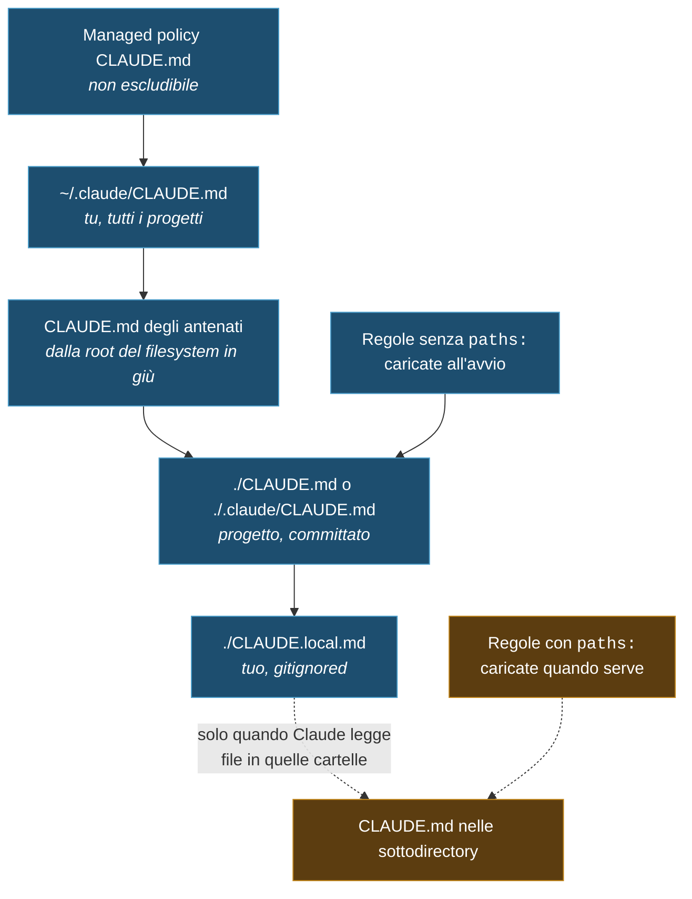

import { Tabs, TabItem, Steps, Aside, FileTree } from '@astrojs/starlight/components';

<div class="meta-modulo">
	<span><strong>Tempo stimato:</strong> 45 minuti</span>
	<span><strong>Prerequisiti:</strong> i moduli <a href="/fondamenta/anatomia-file/">2</a> e <a href="/fondamenta/memoria-e-contesto/">4</a>, e un progetto reale su cui lavorare.</span>
</div>

## Obiettivi

- Scegliere il livello giusto — organizzazione, utente, progetto, directory — per ogni istruzione.
- Ricostruire l'ordine esatto in cui i `CLAUDE.md` vengono trovati e concatenati.
- Usare gli import `@path` e le regole in `.claude/rules/` senza gonfiare il contesto.
- Scrivere istruzioni che Claude segue davvero, e riconoscere quelle che verrebbero ignorate.
- Diagnosticare il caso classico: "gliel'ho scritto nel `CLAUDE.md` ma non lo fa".

## Concetti chiave

**`CLAUDE.md` è contesto, non configurazione.** Il contenuto viene consegnato a Claude come messaggio
utente dopo il system prompt. Claude lo legge e cerca di seguirlo, ma **non c'è nessuna garanzia di
conformità stretta**, specie per istruzioni vaghe o in conflitto. Se una cosa deve succedere sempre, senza
eccezioni, non è materia da `CLAUDE.md`: è un [hook](/personalizzazione/hooks/), che esegue come codice a
eventi fissi del ciclo di vita.

**Cosa ci va, e cosa no.** `CLAUDE.md` è il posto in cui scrivi quello che altrimenti rispiegheresti ogni
volta. Il criterio operativo per ogni riga è uno solo: *"togliendola, Claude sbaglierebbe?"*. Se no, va
tolta.

| ✅ Includi | ❌ Escludi |
| --- | --- |
| Comandi di shell che Claude non può indovinare | Tutto ciò che Claude può capire leggendo il codice |
| Regole di stile che divergono dai default | Convenzioni standard del linguaggio, che già conosce |
| Istruzioni di test e test runner preferiti | Documentazione API dettagliata (metti un link) |
| Etichetta del repository (naming dei branch, convenzioni PR) | Informazioni che cambiano di frequente |
| Decisioni architetturali specifiche del progetto | Spiegazioni lunghe o tutorial |
| Stranezze dell'ambiente di sviluppo (env var obbligatorie) | Descrizioni file per file del codebase |
| Trappole e comportamenti non ovvi | Ovvietà tipo "scrivi codice pulito" |

**Quando aggiungere qualcosa.** Ci sono quattro segnali affidabili: Claude commette lo stesso errore per la
seconda volta; una code review coglie qualcosa che Claude avrebbe dovuto sapere di questo codebase; ti
ritrovi a digitare in chat la stessa correzione della sessione scorsa; un collega nuovo avrebbe bisogno
dello stesso contesto per essere produttivo.

**La dimensione conta.** L'obiettivo documentato è **sotto le 200 righe** per file. File più lunghi
consumano più contesto e **riducono l'aderenza**: se il file è troppo lungo, Claude ne ignora metà perché
le regole importanti si perdono nel rumore. Se le istruzioni crescono, la risposta non è un file più lungo:
sono le regole path-scoped.

**Tutti i file trovati vengono concatenati, non si sovrascrivono.** È la differenza sostanziale rispetto ai
`settings.json`. Non c'è "vince il più specifico": c'è "vengono letti tutti, in ordine". Il che rende le
**istruzioni contraddittorie** un problema reale — se due regole si contraddicono, Claude può sceglierne
una arbitrariamente.

## La gerarchia

I `CLAUDE.md` possono vivere in quattro posti, elencati in **ordine di caricamento**, dal più ampio al più
specifico:

| Scope | Posizione | A cosa serve | Condiviso con |
| --- | --- | --- | --- |
| **Managed policy** | macOS: `/Library/Application Support/ClaudeCode/CLAUDE.md`<br/>Linux e WSL: `/etc/claude-code/CLAUDE.md`<br/>Windows: `C:\Program Files\ClaudeCode\CLAUDE.md` | Istruzioni per tutta l'organizzazione, gestite dall'IT | Tutti nell'organizzazione |
| **User instructions** | `~/.claude/CLAUDE.md` | Preferenze personali per tutti i progetti | Solo te, ovunque |
| **Project instructions** | `./CLAUDE.md` **oppure** `./.claude/CLAUDE.md` | Istruzioni condivise col team | Il team, via version control |
| **Local instructions** | `./CLAUDE.local.md` | Preferenze personali su questo progetto | Solo te, questo progetto |

Il `CLAUDE.md` di managed policy **non può essere escluso** dalle impostazioni individuali. In alternativa
al file, l'organizzazione può mettere il contenuto direttamente in `managed-settings.json` con la chiave
`claudeMd` — che viene onorata **solo** nelle impostazioni managed e policy.



### Come vengono trovati

Claude Code **risale l'albero delle directory** dalla working directory, controllando in ogni cartella
`CLAUDE.md` e `CLAUDE.local.md`. Lanciando Claude Code in `foo/bar/`, carica le istruzioni da
`foo/bar/CLAUDE.md`, `foo/CLAUDE.md` e i `CLAUDE.local.md` accanto a loro.

L'ordine dentro il contesto va **dalla root del filesystem verso la working directory**: `foo/CLAUDE.md`
compare prima di `foo/bar/CLAUDE.md`. Le istruzioni più vicine a dove hai lanciato Claude sono le ultime
lette. Dentro ogni directory, `CLAUDE.local.md` viene aggiunto **dopo** `CLAUDE.md`, quindi le tue note
personali sono l'ultima cosa che Claude legge a quel livello.

I `CLAUDE.md` nelle **sottodirectory** sotto la working directory vengono scoperti ma **non** caricati
all'avvio: entrano in contesto quando Claude legge file in quelle sottodirectory.

<Aside type="tip" title="Commenti HTML gratis">
I commenti HTML a blocco (`<!-- nota per i manutentori -->`) nei `CLAUDE.md` vengono **rimossi** prima
dell'iniezione in contesto. Usali per lasciare note ai manutentori umani senza spendere token. I commenti
dentro i blocchi di codice invece restano.
</Aside>

## Import con `@path`

Un `CLAUDE.md` può importare altri file con la sintassi `@percorso/del/file`. I file importati vengono
espansi e caricati in contesto all'avvio, insieme al `CLAUDE.md` che li referenzia.

```markdown title="CLAUDE.md"
See @README for project overview and @package.json for available npm commands.

# Additional Instructions
- git workflow @docs/git-instructions.md
```

Le regole:

- Sono ammessi percorsi **relativi e assoluti**. I relativi si risolvono rispetto al file che contiene l'import, non alla working directory.
- I file importati possono importare ricorsivamente, fino a una **profondità massima di 4 salti**.
- Il parsing degli import **salta** code span e blocchi di codice recintati. Per citare un percorso senza importarlo, mettilo tra backtick: `` `@README` `` resta testo, `@README` fuori dai backtick importa il file.

<Aside type="caution" title="Gli import esterni chiedono approvazione">
Un import in un file di memoria di progetto è **esterno** quando il percorso si risolve fuori dalla working
directory — per esempio `@~/.claude/mie-istruzioni.md`. La prima volta che Claude Code ne incontra uno in un
progetto, mostra una finestra di approvazione con l'elenco dei file. Se rifiuti, gli import restano
disattivati e la finestra non ricompare.

Serve a proteggerti da file che altre persone committano in un progetto condiviso. Gli import nei file di
memoria di scope utente — `~/.claude/CLAUDE.md`, `~/.claude/rules/` — sono roba che hai scritto tu e si
caricano senza dialogo.
</Aside>

**Attenzione a cosa risolvono davvero gli import:** organizzano il file, ma **non riducono il contesto**,
perché i file importati vengono comunque caricati all'avvio. Se il problema è la dimensione, la soluzione
sono le regole path-scoped.

### Il caso dei worktree

Un `CLAUDE.local.md` gitignored esiste solo nel worktree dove l'hai creato. Per condividere istruzioni
personali tra più worktree dello stesso repo, importa un file dalla home:

```markdown title="CLAUDE.md"
# Individual Preferences
- @~/.claude/my-project-instructions.md
```

### Convivere con `AGENTS.md`

Claude Code legge `CLAUDE.md`, **non** `AGENTS.md`. Se il repo usa già `AGENTS.md` per altri agenti, crea
un `CLAUDE.md` che lo importa, così entrambi gli strumenti leggono le stesse istruzioni senza duplicarle:

```markdown title="CLAUDE.md"
@AGENTS.md

## Claude Code

Use plan mode for changes under `src/billing/`.
```

Funziona anche un symlink, se non ti serve aggiungere contenuto specifico:

```bash
ln -s AGENTS.md CLAUDE.md
```

Su Windows creare un symlink richiede privilegi di Amministratore o la Modalità sviluppatore: lì conviene
l'import `@AGENTS.md`.

## Regole in `.claude/rules/`

Per progetti grandi, le istruzioni si organizzano in file separati dentro `.claude/rules/`. Ogni file
copre un argomento, con un nome descrittivo. Tutti i `.md` vengono scoperti **ricorsivamente**, quindi puoi
organizzarli in sottocartelle.

<FileTree>

- il-tuo-progetto/
  - .claude/
    - CLAUDE.md Istruzioni principali di progetto
    - rules/
      - code-style.md Linee guida di stile
      - testing.md Convenzioni di test
      - security.md Requisiti di sicurezza
      - frontend/
        - components.md Organizzate anche in sottocartelle

</FileTree>

Le regole **senza** frontmatter `paths:` vengono caricate all'avvio, con la stessa priorità di
`.claude/CLAUDE.md`.

### Regole legate ai percorsi

È il meccanismo che ti permette di avere molte istruzioni senza pagarle sempre:

```markdown title=".claude/rules/api-design.md"
---
paths:
  - "src/api/**/*.ts"
---

# API Development Rules

- All API endpoints must include input validation
- Use the standard error response format
- Include OpenAPI documentation comments
```

Queste regole entrano in contesto **solo quando Claude legge un file corrispondente**, non a ogni uso di
tool. Pattern glob supportati:

| Pattern | Corrisponde a |
| --- | --- |
| `**/*.ts` | Tutti i file TypeScript in qualsiasi directory |
| `src/**/*` | Tutti i file sotto `src/` |
| `*.md` | I markdown nella root del progetto |
| `src/components/*.tsx` | I componenti React in una directory specifica |

Puoi usare più pattern e l'espansione con le graffe:

```markdown
---
paths:
  - "src/**/*.{ts,tsx}"
  - "lib/**/*.ts"
  - "tests/**/*.test.ts"
---
```

Ogni gruppo di graffe moltiplica il numero di pattern espansi: `src/*.{ts,tsx}` diventa due,
`{a,b}/{c,d}/*.{ts,tsx}` diventa otto. Per tenere l'espansione limitata, l'intera lista `paths` di una
regola condivide un budget di **1.000 pattern espansi e 4 MiB**; i pattern senza graffe non contano.
Un pattern che sforerebbe il budget viene usato **non espanso**, e le sue graffe letterali non
corrispondono a nulla.

<Aside type="caution" title="Le parentesi quadre">
La sintassi glob interpreta `[` come inizio di una bracket expression tipo `[abc]`. Un pattern con un `[`
che non si legge come bracket expression — per esempio `photos [2024/**` — è **invalido**: non corrisponde
a nulla, mentre gli altri pattern della stessa regola continuano a funzionare. Per corrispondere a un `[`
letterale nel nome di un file, va escapato: `photos \[2024/**`.
</Aside>

### Regole a livello utente e condivise

Le regole personali in `~/.claude/rules/` valgono per ogni progetto sulla macchina, e sono caricate
**prima** delle regole di progetto, che hanno quindi priorità più alta.

La directory `.claude/rules/` supporta i **symlink**, quindi puoi mantenere un set condiviso di regole e
collegarlo a più progetti:

```bash
ln -s ~/shared-claude-rules .claude/rules/shared
ln -s ~/company-standards/security.md .claude/rules/security.md
```

I symlink circolari vengono rilevati e gestiti senza problemi.

## Escludere i `CLAUDE.md` degli altri

Nei monorepo capita che i `CLAUDE.md` degli antenati contengano istruzioni di altri team, irrilevanti per
te. Il setting `claudeMdExcludes` li salta per percorso o glob:

```json title=".claude/settings.local.json"
{
  "claudeMdExcludes": [
    "**/monorepo/CLAUDE.md",
    "/home/user/monorepo/other-team/.claude/rules/**"
  ]
}
```

I pattern sono confrontati con i **percorsi assoluti**. Puoi configurarlo a qualsiasi livello di settings —
utente, progetto, locale o managed policy — e gli array si fondono tra i livelli. I `CLAUDE.md` di managed
policy **non** sono escludibili.

## Esempio guidato: dal niente a un `CLAUDE.md` che funziona

<Steps>

1. **Genera la base invece di scriverla a mano.**

   ```text
   /init
   ```

   Claude analizza il codebase e crea un file con comandi di build, istruzioni di test e convenzioni che ha
   scoperto. Se un `CLAUDE.md` esiste già, `/init` **propone miglioramenti** invece di sovrascriverlo.

   Per un flusso interattivo a più fasi, imposta `CLAUDE_CODE_NEW_INIT=1`: `/init` chiede quali artefatti
   preparare (CLAUDE.md, skill, hook), esplora il codebase con un subagent, colma le lacune con domande di
   follow-up e presenta una proposta rivedibile prima di scrivere qualsiasi file.

   `/init` legge anche le regole di Cursor (`.cursor/rules/` o `.cursorrules`) e di Copilot
   (`.github/copilot-instructions.md`) e ne incorpora le parti rilevanti.

2. **Verifica che sia stato caricato.**

   ```text
   /context
   ```

   Sotto **Memory files** deve comparire il tuo `CLAUDE.md`. Se non c'è, tutto il resto è inutile.

3. **Aggiungi quello che Claude non poteva scoprire da solo.** Il file generato conosce il codice; non
   conosce le tue convenzioni implicite. Esempio realistico:

   ```markdown title="CLAUDE.md"
   # Code style
   - Use ES modules (import/export) syntax, not CommonJS (require)
   - Destructure imports when possible (eg. import { foo } from 'bar')

   # Workflow
   - Be sure to typecheck when you're done making a series of code changes
   - Prefer running single tests, and not the whole test suite, for performance
   ```

   Nota la forma: header e bullet, frasi brevi, verificabili. `"Use 2-space indentation"` funziona meglio
   di `"Format code properly"`; `` "Run `npm test` before committing" `` meglio di `"Test your changes"`.

4. **Sposta le istruzioni settoriali nelle regole.** Se hai una sezione che vale solo per il backend,
   diventa un file con `paths:`:

   ```markdown title=".claude/rules/backend.md"
   ---
   paths:
     - "src/server/**/*.ts"
   ---

   # Backend

   - Ogni handler è puro: nessuna I/O diretta, usa i repository in `src/server/repos/`
   - Gli errori attesi sono `AppError`, non eccezioni generiche
   ```

5. **Aggiungi le tue preferenze private.**

   ```bash
   printf 'Il mio sandbox è su http://localhost:4000\nUsa i dati di test in fixtures/dev.json\n' > CLAUDE.local.md
   echo 'CLAUDE.local.md' >> .gitignore
   ```

6. **Testa che il comportamento cambi davvero.** Non fidarti del fatto che il file esista: fai fare a
   Claude qualcosa che dovrebbe rispettare la regola nuova e guarda se la rispetta. Se non lo fa, il
   problema è quasi sempre uno dei tre del troubleshooting qui sotto.

7. **Fai potare il file quando cresce.**

   ```text
   /doctor
   ```

   Tra i controlli, propone dei tagli per un `CLAUDE.md` committato: rimuove quello che Claude può dedurre
   dal codebase — layout delle directory, elenchi di dipendenze, panoramiche di architettura — e tiene
   trappole, motivazioni e convenzioni che divergono dai default degli strumenti.

</Steps>

## Esercizio

Prendi un progetto reale e costruisci una gerarchia di memoria a tre livelli.

1. Scrivi un `~/.claude/CLAUDE.md` con **al massimo cinque righe** di preferenze personali che valgono
   ovunque.
2. Nel progetto, separa le istruzioni sempre valide da quelle settoriali.
3. Crea una situazione di conflitto deliberato tra due livelli e osserva cosa succede.
4. Verifica quale parte della gerarchia sopravvive a una compattazione.

<details class="soluzione">
<summary>Soluzione</summary>

**Passo 1.** Il livello utente è quello che si gonfia più facilmente, perché lo paghi in **ogni** sessione
di **ogni** progetto. Cinque righe sono già tante:

```markdown title="~/.claude/CLAUDE.md"
- Rispondi in italiano; codice, commenti e nomi di file in inglese.
- Non aggiungere commenti che ripetono quello che il codice già dice.
- Prima di un commit, mostrami la diff invece di descriverla.
- Se una scelta ha più di un'opzione ragionevole, proponi la tua e spiega perché in una riga.
- Non creare file di documentazione se non te li ho chiesti.
```

Nota che sono tutte preferenze **di processo**, non tecniche: le cose tecniche cambiano da progetto a
progetto e appartengono al livello progetto.

**Passo 2.** La regola pratica: nel `CLAUDE.md` di progetto va ciò che serve **in ogni sessione**; in
`.claude/rules/` con `paths:` ciò che serve solo lavorando su una parte.

```markdown title="CLAUDE.md"
# Progetto

App Next.js con Supabase. Il codice sta in `src/`, i test accanto ai file come `*.test.ts`.

# Comandi

- `npm run dev` — dev server
- `npm test` — test (Vitest). Lancia il singolo file, non la suite intera
- `npm run typecheck` — obbligatorio prima di ogni commit

# Convenzioni

- ES modules, mai CommonJS
- Le variabili d'ambiente sono validate in `src/env.ts`: aggiungine di nuove solo lì
```

```markdown title=".claude/rules/react.md"
---
paths:
  - "src/components/**/*.tsx"
---

# Componenti React

- Server Component di default; `"use client"` solo quando serve davvero stato o effetti
- Niente `useEffect` per il data fetching: usa i loader del framework
```

**Passo 3.** Metti nel `~/.claude/CLAUDE.md` una riga come `- Usa sempre tabulazioni per l'indentazione` e
nel `CLAUDE.md` di progetto `- Usa 2 spazi per l'indentazione`. Poi chiedi a Claude di creare un file
nuovo.

Cosa osservi: entrambi i file **vengono caricati**, non si sovrascrivono. Il progetto viene letto **dopo**
l'utente, e nella pratica l'istruzione più vicina e più specifica tende a prevalere — ma **non è una
garanzia**: la documentazione dice esplicitamente che con regole contraddittorie Claude può sceglierne una
arbitrariamente. La lezione non è "impara l'ordine di precedenza": è **non lasciare contraddizioni**.
Rileggi periodicamente i `CLAUDE.md` annidati e le regole per togliere istruzioni obsolete o in conflitto.

**Passo 4.** Riempi il contesto lavorando, poi lancia `/compact` e verifica:

| Cosa | Sopravvive? |
| --- | --- |
| `~/.claude/CLAUDE.md` e `CLAUDE.md` di root | ✅ re-iniettati da disco |
| Regole senza `paths:` | ✅ re-iniettate |
| `.claude/rules/react.md` (con `paths:`) | ❌ persa finché non rileggi un `.tsx` |
| Un `CLAUDE.md` in una sottodirectory | ❌ perso finché non rileggi un file lì dentro |
| Un'istruzione data solo in chat | ❌ persa |

La conseguenza pratica: se una regola **deve** valere anche dopo la compattazione, toglile il frontmatter
`paths:` o spostala nel `CLAUDE.md` di root. Stai scambiando contesto risparmiato con affidabilità.

</details>

## Errori comuni e troubleshooting

### "Gliel'ho scritto nel `CLAUDE.md` ma non lo fa"

È il problema più comune, e ha tre cause in ordine di frequenza:

<Steps>

1. **Il file non è stato caricato.** Lancia `/context` e controlla la sezione **Memory files**. Se il file
   non è in elenco, Claude non lo vede: probabilmente non è in una posizione che viene caricata per questa
   sessione. Usa `/memory` per aprire e correggere i file.

2. **L'istruzione è troppo vaga.** `"Use 2-space indentation"` funziona; `"format code nicely"` no. Rendila
   concreta al punto da essere verificabile.

3. **Il file è troppo lungo.** Se Claude continua a fare una cosa che hai vietato, il file è probabilmente
   troppo lungo e la regola si perde. Pota. Puoi anche aggiungere enfasi (`IMPORTANT`, `YOU MUST`) per
   migliorare l'aderenza, ma è un cerotto: la cura è accorciare.

</Steps>

Se l'istruzione **deve** eseguire a un punto preciso — prima di ogni commit, dopo ogni modifica di file —
non è materia da `CLAUDE.md`: scrivila come [hook](/personalizzazione/hooks/).

Per capire esattamente quali file di istruzioni sono stati caricati, quando e perché, esiste l'hook
`InstructionsLoaded`, utile per debuggare regole path-specific e file caricati pigramente.

### Tabella dei sintomi

| Sintomo | Causa | Soluzione |
| --- | --- | --- |
| Il `CLAUDE.md` non compare in `/context` | Posizione non caricata per questa sessione | Verifica la gerarchia; `/memory` per aprirlo |
| Claude segue una regola e ne ignora un'altra opposta | Istruzioni contraddittorie tra livelli | Rivedi tutti i `CLAUDE.md` e le regole, elimina il conflitto |
| Un import `@file` non funziona | È dentro un backtick o un blocco di codice | Il parsing salta code span e blocchi recintati |
| Un import esterno non viene caricato | Hai rifiutato il dialogo di approvazione | Il rifiuto è permanente per quel progetto |
| L'import non riduce il contesto | I file importati si caricano comunque all'avvio | Usa regole con `paths:`, non import |
| Una regola con `paths:` non scatta mai | Il pattern glob non corrisponde | Attenzione a `[` non escapato e al budget delle graffe |
| Regole di altri team caricate nel monorepo | I `CLAUDE.md` degli antenati vengono letti risalendo l'albero | `claudeMdExcludes` in `.claude/settings.local.json` |
| Un `CLAUDE.local.md` non c'è in un altro worktree | È gitignored, esiste solo dove l'hai creato | Importa un file dalla home con `@~/...` |
| Claude Code non legge `AGENTS.md` | Legge solo `CLAUDE.md` | Crea un `CLAUDE.md` con `@AGENTS.md`, o un symlink |
| Le istruzioni spariscono dopo `/compact` | Erano solo in chat, o in una regola path-scoped | Spostale nel `CLAUDE.md` di root |
| `--add-dir` non carica i `CLAUDE.md` della cartella aggiunta | Comportamento di default | `CLAUDE_CODE_ADDITIONAL_DIRECTORIES_CLAUDE_MD=1` |

## Cheat-sheet

**Posizioni, in ordine di caricamento**

```text
1. Managed policy   /Library/Application Support/ClaudeCode/CLAUDE.md   (macOS)
                    /etc/claude-code/CLAUDE.md                          (Linux, WSL)
                    C:\Program Files\ClaudeCode\CLAUDE.md               (Windows)
2. Utente           ~/.claude/CLAUDE.md
3. Antenati         ogni CLAUDE.md risalendo l'albero, dalla root in giù
4. Progetto         ./CLAUDE.md  oppure  ./.claude/CLAUDE.md
5. Locale           ./CLAUDE.local.md
→ pigro             CLAUDE.md nelle sottodirectory, quando Claude ci legge dentro
```

**Comandi**

| Comando | Cosa fa |
| --- | --- |
| `/init` | Genera un `CLAUDE.md` di partenza dal codebase |
| `/memory` | Elenca e apre i file di memoria di ogni scope |
| `/context` | Verifica quali file di memoria sono **davvero** caricati |
| `/doctor` | Propone tagli per un `CLAUDE.md` committato |
| `/import` | Importa la configurazione di un altro agente (v2.1.213+) |

**Sintassi**

| Cosa | Come |
| --- | --- |
| Importare un file | `@percorso/del/file` — max 4 salti di profondità |
| Citare un percorso senza importarlo | `` `@README` `` tra backtick |
| Nota per gli umani, gratis in contesto | `<!-- commento a blocco -->` |
| Regola legata a percorsi | frontmatter `paths:` con pattern glob |
| Escludere i `CLAUDE.md` altrui | `claudeMdExcludes` nei settings |
| Contenuto managed inline | chiave `claudeMd` in `managed-settings.json` |

**Numeri**

| Cosa | Valore |
| --- | --- |
| Dimensione consigliata per file | Sotto 200 righe |
| Profondità massima degli import | 4 salti |
| Budget di espansione dei `paths` | 1.000 pattern, 4 MiB per regola |

## Fonti

Pagine ufficiali consultate, verificate il **16 agosto 2026**:

- [How Claude remembers your project](https://code.claude.com/docs/en/memory) — gerarchia, ordine di caricamento, import, regole, troubleshooting
- [Best practices](https://code.claude.com/docs/en/best-practices) — cosa includere ed escludere, dimensione, specificità
- [Explore the context window](https://code.claude.com/docs/en/context-window) — cosa sopravvive alla compattazione
- [Settings](https://code.claude.com/docs/en/settings) — `claudeMdExcludes` e livelli di settings
- [Hooks](https://code.claude.com/docs/en/hooks) — quando un'istruzione va scritta come hook, e l'hook `InstructionsLoaded`
- [Skills](https://code.claude.com/docs/en/skills) — quando usare una skill al posto di una riga di `CLAUDE.md`
- [Monorepos and large repos](https://code.claude.com/docs/en/large-codebases) — layout di `CLAUDE.md` e regole nei monorepo
