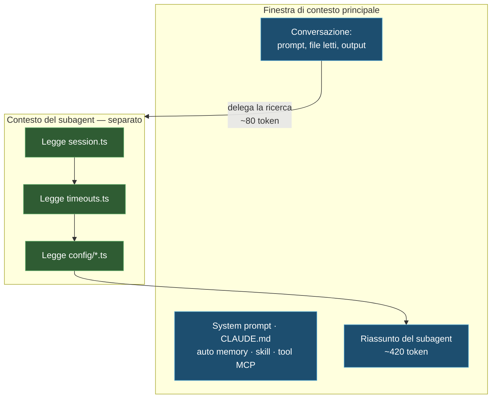

import { Tabs, TabItem, Steps, Aside } from '@astrojs/starlight/components';
import Zero from '@/components/Zero.astro';

<div class="meta-modulo">
	<span><strong>Tempo stimato:</strong> 50 minuti</span>
	<span><strong>Prerequisiti:</strong> il <a href="/fondamenta/agentic-coding/">modulo 3</a> e una sessione lunga già vissuta almeno una volta.</span>
</div>

Il titolo è in inglese perché nel settore si chiama così — *context engineering*, l'ingegneria del
contesto — ma l'idea si spiega con una scrivania. La [finestra di
contesto](/glossario/#finestra-di-contesto) è la **memoria di lavoro** di Claude: tutto ciò che sa in
questo momento deve stare fisicamente lì — la conversazione, i file letti, le istruzioni. La scrivania
è grande ma non infinita, si misura in [token](/glossario/#token) (l'unità di misura del testo: ~3-4
caratteri l'uno), e **quando è ingombra si lavora male**. Questo modulo insegna a tenerla in ordine:
è la competenza singola che più distingue chi ottiene ottimi risultati da chi si chiede perché "Claude
si è rincretinito dopo un'ora". Se i cinque concetti AI di base ti sono nuovi, [Le
basi](/basi/#come-ragiona-un-modello-ai) li copre in due minuti.

## Obiettivi

- Sapere cosa entra nella finestra di contesto, quando, e quanto costa in [token](/glossario/#token).
- Leggere l'output di `/context` e agire di conseguenza.
- Scegliere consapevolmente tra `/compact`, `/clear`, `/autocompact` e delega a subagent.
- Capire cosa sopravvive alla compattazione e cosa no — è la causa numero uno di istruzioni "sparite".
- Configurare l'auto memory e sapere dove finiscono gli appunti che Claude si prende.

## Concetti chiave

**Il contesto è la risorsa fondamentale.** La finestra di contesto contiene tutta la conversazione: ogni
messaggio, ogni file letto, ogni output di comando, più il system prompt, il `CLAUDE.md`, l'auto memory,
le descrizioni delle skill e le istruzioni di sistema. Si riempie in fretta — una singola sessione di
debug può consumare decine di migliaia di token — e **le prestazioni degradano man mano che si riempie**.
Quando è quasi piena, Claude comincia a "dimenticare" istruzioni date all'inizio e a sbagliare di più.

**Parte già mezza occupata.** Prima ancora che tu scriva qualcosa, in contesto ci sono già system prompt,
auto memory, informazioni sull'ambiente, nomi dei tool MCP, descrizioni delle skill, `CLAUDE.md` utente e
di progetto. Su una configurazione tipica sono nell'ordine dei 7–8.000 token: non tantissimo su una
finestra da 200.000, ma cresce con ogni server MCP e ogni skill che aggiungi.

**Gli schemi dei tool MCP sono differiti.** Di default, in contesto entrano solo i **nomi** dei tool MCP;
gli schemi completi vengono caricati su richiesta tramite la *tool search*, quando Claude ha bisogno di uno
specifico tool. È il motivo per cui puoi permetterti molti server MCP senza affogare il contesto. Con
`ENABLE_TOOL_SEARCH=auto` gli schemi vengono caricati subito se stanno entro il 10% della finestra; con
`ENABLE_TOOL_SEARCH=false` viene caricato tutto.

**Le skill costano poco finché non le usi.** All'avvio Claude vede solo le **descrizioni** delle skill; il
contenuto completo si carica quando la skill viene usata. Per le skill che invochi solo a mano, metti
`disable-model-invocation: true` per tenere fuori dal contesto anche la descrizione.

**La compattazione è automatica ma non gratuita.** Avvicinandosi al limite, Claude Code prima elimina gli
output di tool più vecchi, poi riassume la conversazione. Le tue richieste e i frammenti di codice chiave
vengono preservati; **le istruzioni dettagliate date all'inizio della conversazione possono andare perse**.
È la ragione per cui le regole persistenti vanno in `CLAUDE.md` e non dette in chat.

**I subagent sono il vero moltiplicatore.** Un subagent gira in una finestra di contesto **sua**,
completamente separata dalla conversazione principale. Se gli deleghi una ricerca che legge venti file, i
venti file stanno nel suo contesto, non nel tuo: a te torna solo un riassunto. È il motivo per cui i
subagent aiutano nelle sessioni lunghe più di qualsiasi altra tecnica.

**Se ti serve più spazio, cambia modello.** I [modelli](/glossario/#modello) Claude più recenti — Fable 5, Sonnet 5, Opus 4.6 e successivi, e Sonnet 4.6 —
supportano una finestra da **1 milione di token**. Sonnet 5 gira a 1M senza bisogno di selezionare una
variante `[1m]`. La compattazione funziona allo stesso modo anche al limite più grande.

## Cosa si carica, e quando

Una sessione tipica, con valori rappresentativi in token:

| Momento | Cosa entra in contesto | Costo indicativo |
| --- | --- | --- |
| **Avvio** | System prompt | ~4.200 |
| | Auto memory (`MEMORY.md`) | ~680 |
| | Info sull'ambiente (cwd, piattaforma, shell, stato git) | ~280 |
| | Nomi dei tool MCP (schemi differiti) | ~120 |
| | Descrizioni delle skill | ~450 |
| | `~/.claude/CLAUDE.md` | ~320 |
| | `CLAUDE.md` di progetto | ~1.800 |
| **Mentre Claude lavora** | Ogni file letto | 1.000–2.500 l'uno |
| | Regole con `paths:` che scattano sui file letti | ~300–400 |
| | Output dei comandi (es. `npm test`) | ~1.200 |
| | Output degli hook `PostToolUse` | ~100–150 |
| **Delega** | Spawn di un subagent | ~80 |
| | Il subagent legge N file | **0 nel tuo contesto** |
| | Riassunto restituito dal subagent | ~420 |

Guarda le due righe della delega: il subagent legge N file e nel **tuo** contesto entrano **0 token**;
a te torna solo il riassunto (~420). È il punto di tutto il modulo: la stessa ricerca costa migliaia
di token se la fai nel contesto principale, e ~500 se la deleghi.



## Cosa sopravvive alla compattazione

Questa tabella spiega il 90% dei "ma io te l'avevo detto" che ti capiteranno. "Re-iniettato da disco"
significa: dopo la compattazione, Claude Code **rilegge il file e lo rimette in contesto da solo** —
quindi sopravvive. Ciò che vive solo nella conversazione, invece, viene riassunto, e i dettagli si
perdono:

| Meccanismo | Dopo la compattazione |
| --- | --- |
| System prompt e output style | Invariati: non fanno parte della cronologia dei messaggi |
| `CLAUDE.md` alla radice del progetto e regole senza `paths:` | **Re-iniettati da disco** |
| Auto memory | **Re-iniettata da disco** |
| Regole con frontmatter `paths:` | **Perse** finché non viene riletto un file corrispondente |
| `CLAUDE.md` annidati in sottodirectory | **Persi** finché non viene letto un file in quella sottodirectory |
| Corpi delle skill invocate | Re-iniettati, con un tetto di 5.000 token per skill e 25.000 totali; le più vecchie cadono per prime |
| Hook | Non applicabile: gli hook girano come codice, non come contesto |
| **Istruzioni date solo in chat** | **Perse** |

<Aside type="tip" title="Le skill si troncano dall'inizio">
Il troncamento dei corpi delle skill mantiene l'**inizio** del file. Metti le istruzioni più importanti in
cima a `SKILL.md`, non in fondo.
</Aside>

## Gli strumenti a disposizione

### `/context` — la diagnosi

Mostra una ripartizione live dell'uso del contesto per categoria, con suggerimenti di ottimizzazione, e
include l'elenco dei file `CLAUDE.md` e di auto memory effettivamente caricati sotto **Memory files**.
È anche il modo per verificare che il tuo `CLAUDE.md` sia stato letto davvero: se non compare lì, Claude
non lo vede.

### `/compact` — riassumi, non azzerare

Sostituisce la conversazione con un riassunto strutturato, mantenendo la continuità. Usalo con un **focus**
prima di iniziare un task lungo nuovo:

```text
/compact focus on the auth bug fix
```

Il riassunto conserva quello che scegli tu, invece di quello che il passaggio automatico indovina essere
importante. Puoi anche configurare il comportamento aggiungendo una sezione **Compact Instructions** al
`CLAUDE.md`, ad esempio: *"When compacting, always preserve the full list of modified files and any test
commands"*.

### `/clear` — azzera

Resetta completamente la finestra di contesto. È lo strumento giusto **tra task non correlati**: la
conversazione vecchia toglie spazio ai file che ti servono adesso e costa token a ogni messaggio.

### `/autocompact` — anticipa la soglia

La compattazione automatica scatta quando la finestra è quasi piena. Con `/autocompact` decidi **tu**
la soglia: `500k` significa "compatta quando arrivi a 500.000 token" (la `k` sta per migliaia). Utile
sui modelli con finestra da 1 milione, per compattare a metà invece che all'ultimo:

```text
/autocompact 500k
```

### `Esc` `Esc` o `/rewind` — compattazione parziale

Seleziona un checkpoint e scegli **Summarize from here** (condensa i messaggi da quel punto in avanti,
tenendo intatto il contesto precedente) oppure **Summarize up to here** (condensa i messaggi precedenti,
tenendo per esteso quelli recenti).

### `/btw` — domande fuori contesto

Per domande la cui risposta non deve restare in contesto. La risposta non entra mai nella cronologia della
conversazione, quindi puoi verificare un dettaglio senza far crescere il contesto.

### Subagent — la delega

Il [subagent](/glossario/#subagent) è l'aiutante con la scrivania separata: gli passi una ricerca, lui
legge tutti i file che servono **nel suo contesto**, e a te torna solo il riassunto. Non serve nessun
comando speciale — basta chiederlo nel prompt:

```text
Use subagents to investigate how our authentication system handles token
refresh, and whether we have any existing OAuth utilities I should reuse.
```

*(= "usa dei subagent per indagare come il nostro sistema di autenticazione gestisce il rinnovo dei
token, e se abbiamo già utility OAuth da riusare" — qui "token" è il gettone di accesso di un login,
un altro significato rispetto ai token dell'AI)*

I subagent hanno un intero modulo dedicato, l'[11](/personalizzazione/agents-subagents/): qui basta
sapere che esistono e quando invocarli.

## Auto memory

L'auto memory è il meccanismo con cui **Claude prende appunti per sé** tra una sessione e l'altra: comandi
di build, intuizioni di debugging, note di architettura, preferenze di stile, abitudini di workflow. Claude
non salva qualcosa a ogni sessione: decide cosa vale la pena ricordare in base a quanto sarebbe utile in
una conversazione futura.

### Dove sta

```text
~/.claude/projects/<progetto>/memory/
├── MEMORY.md          # Indice conciso, caricato in ogni sessione
├── debugging.md       # Note dettagliate sui pattern di debugging
├── api-conventions.md # Decisioni di design delle API
└── ...                # Altri file per argomento creati da Claude
```

Il `<progetto>` è derivato dal **repository git**, quindi tutti i worktree e le sottodirectory dello stesso
repo condividono una sola cartella di auto memory. Fuori da un repo git si usa la root del progetto.
L'auto memory è **locale alla macchina**: non viene condivisa tra macchine né con gli ambienti cloud.

Per cambiare posizione, `autoMemoryDirectory` in `settings.json` (percorso assoluto o che inizia per `~/`).

### Come funziona il caricamento

Le **prime 200 righe di `MEMORY.md`, o i primi 25 KB — quello che scatta per primo** — vengono caricate
all'inizio di ogni conversazione. Il contenuto oltre quella soglia non viene caricato all'avvio: Claude
tiene `MEMORY.md` conciso spostando le note di dettaglio in file per argomento, che legge su richiesta.

Se il file si avvicina al limite, Claude Code ricorda a Claude di accorciarlo. Se lo supera, la scrittura
riesce comunque ma viene restituito un errore che chiede di riscrivere l'indice, perché tutto ciò che sta
oltre il limite viene scartato al caricamento successivo. Frontmatter YAML e commenti HTML a blocco vengono
tolti prima del caricamento e **non contano** verso i limiti.

<Aside type="note" title="Il limite vale solo per MEMORY.md">
I file `CLAUDE.md` vengono caricati **per intero**, indipendentemente dalla lunghezza. Il che non è un
invito a farli lunghi: file più corti producono un'aderenza migliore.
</Aside>

L'auto memory della conversazione principale **non** viene caricata nei subagent, con l'eccezione dei fork,
che ereditano la conversazione padre. Un subagent può avere una sua auto memory separata.

### Attivare, disattivare, ispezionare

L'auto memory è **attiva di default**. Per gestirla:

| Come | Effetto |
| --- | --- |
| `/memory` → toggle | Salva `autoMemoryEnabled` in `~/.claude/settings.json` |
| `{"autoMemoryEnabled": false}` in `.claude/settings.json` | Disattiva per il singolo progetto |
| `CLAUDE_CODE_DISABLE_AUTO_MEMORY=1` | Disattiva via variabile d'ambiente |

Quando in interfaccia leggi *"Saved 2 memories"* o *"Recalled 2 memories"*, Claude sta scrivendo o leggendo
in quella cartella. I file sono markdown normale: puoi aprirli, correggerli e cancellarli quando vuoi.

L'auto memory è **esclusa dalla pulizia automatica** delle trascrizioni: `MEMORY.md` e i file per argomento
restano finché non li modifichi o cancelli tu o Claude.

## Esempio guidato: dimagrire una sessione

<Steps>

1. **Fotografa il punto di partenza.** In una sessione già avviata su un progetto reale:

   ```text
   /context
   ```

   Annota il totale e le due o tre voci più grosse. Tipicamente: i file letti e il `CLAUDE.md` di progetto.

2. **Verifica cosa è stato caricato davvero.** Nell'output di `/context`, guarda la sezione **Memory
   files**. Se il tuo `CLAUDE.md` non è in elenco, il problema non è che Claude lo ignora: è che non lo
   ha mai visto.

3. **Fai una ricerca nel modo sbagliato.** Chiedi un'indagine ampia direttamente nel contesto principale:

   ```text
   investigate how error handling works across this codebase
   ```

   Lascialo lavorare, poi rilancia `/context`. Vedrai il salto: ogni file letto è rimasto nel tuo contesto.

4. **Azzera e rifallo nel modo giusto.**

   ```text
   /clear
   ```

   ```text
   Use a subagent to investigate how error handling works across this
   codebase. Report the patterns used, where they diverge, and which files
   are the canonical examples. Keep the report under 30 lines.
   ```

   Rilancia `/context`: il costo è il riassunto, non i file. Nota anche il vincolo sulla lunghezza del
   report — senza, un subagent può restituirti un muro di testo che ti rimangia il risparmio.

5. **Compatta con un focus invece che a caso.** Prima di cambiare task:

   ```text
   /compact focus on the error handling conventions we just mapped
   ```

6. **Verifica cosa è sopravvissuto.** Dopo la compattazione, chiedi qualcosa che dipende da un'istruzione
   che avevi dato **solo in chat** all'inizio della sessione. Molto probabilmente è sparita. Poi chiedi
   qualcosa che dipende dal `CLAUDE.md` di progetto: quello c'è ancora, perché viene re-iniettato da disco.

7. **Ispeziona cosa ha imparato Claude.**

   ```text
   /memory
   ```

   Seleziona la cartella di auto memory e leggi `MEMORY.md`. Se durante la sessione hai corretto Claude su
   qualcosa di ricorrente, è probabile che se lo sia annotato.

</Steps>

## Esercizio

Ottimizza una sessione reale e misura il risultato.

1. Apri un progetto vero e misura il contesto a freddo, appena avviata la sessione.
2. Identifica la voce di avvio più costosa e riducila.
3. Imposta delle istruzioni di compattazione nel `CLAUDE.md` e verifica che funzionino.
4. Trova una skill che stai pagando in contesto senza usarla, e togliela di mezzo.

<details class="soluzione">
<summary>Soluzione</summary>

**Passo 1.** Avvia la sessione e, **senza scrivere altro**, lancia `/context`. Quello che vedi è il costo
fisso della tua configurazione: lo paghi a ogni singola sessione su quel progetto.

**Passo 2.** Nella maggior parte dei casi la voce più grossa è il `CLAUDE.md` di progetto. Due strade:

- **Potarlo.** L'obiettivo documentato è **sotto le 200 righe**. Per ogni riga chiediti: *"togliendola,
  Claude sbaglierebbe?"*. Se no, va tolta. Il comando `/doctor` propone anche dei tagli automatici per un
  `CLAUDE.md` committato: rimuove ciò che Claude può dedurre dal codice — layout delle directory, elenchi
  di dipendenze, panoramiche di architettura — e tiene trappole, motivazioni e convenzioni che divergono
  dai default degli strumenti.
- **Spostare in regole con `paths:`.** Le istruzioni che valgono solo per una parte del codebase diventano
  file in `.claude/rules/` con frontmatter:

  ```markdown title=".claude/rules/api-design.md"
  ---
  paths:
    - "src/api/**/*.ts"
  ---

  # Regole per le API

  - Ogni endpoint deve validare l'input
  - Usa il formato standard per le risposte di errore
  ```

  Così quelle istruzioni entrano in contesto **solo** quando Claude legge un file corrispondente.

  Il rovescio della medaglia: le regole con `paths:` **non sopravvivono alla compattazione** finché non
  viene riletto un file che le attiva. Se una regola deve valere sempre, toglile il frontmatter o
  spostala nel `CLAUDE.md` di root.

**Passo 3.** Aggiungi in fondo al `CLAUDE.md` una sezione dedicata:

```markdown title="CLAUDE.md"
## Compact Instructions

Quando compatti, preserva sempre: l'elenco completo dei file modificati,
i comandi di test lanciati e il loro esito, e le decisioni di design prese
in questa sessione.
```

Per verificarlo: lavora abbastanza da riempire il contesto, lancia `/compact`, poi chiedi *"quali file hai
modificato finora in questa sessione?"*. Se l'elenco è completo, l'istruzione ha funzionato.

**Passo 4.** In `/context`, la voce delle descrizioni delle skill ti dice quanto stai pagando. Per una
skill che invochi solo a mano, aggiungi al suo `SKILL.md`:

```markdown title=".claude/skills/deploy/SKILL.md"
---
name: deploy
description: Deploy in produzione
disable-model-invocation: true
---
```

La descrizione resta fuori dal contesto finché non invochi `/deploy`. Per le skill che non hai scritto tu
— quelle che arrivano dai plugin — lo stesso effetto si ottiene da settings con `skillOverrides`.

</details>

## Errori comuni e troubleshooting

| Sintomo | Causa | Soluzione |
| --- | --- | --- |
| Un'istruzione data all'inizio è "sparita" | Era solo in chat, ed è stata persa nella compattazione | Spostala in `CLAUDE.md`: viene re-iniettato da disco |
| Una regola con `paths:` non ha più effetto dopo `/compact` | Le regole path-scoped non vengono re-iniettate | Rileggi un file corrispondente, o togli il frontmatter `paths:` |
| Il `CLAUDE.md` non sembra letto | Potrebbe non essere in una posizione che viene caricata | `/context` → sezione **Memory files**: se non c'è, Claude non lo vede |
| La sessione rallenta e sbaglia sempre di più | Contesto quasi pieno | `/context` per la diagnosi, poi `/clear` o `/compact` con focus |
| La compattazione automatica si blocca con un errore di *thrashing* ("sbattimento": comprime, si riempie di nuovo subito, comprime ancora — all'infinito) | Un singolo file o output di tool è così grande che il contesto si riempie subito dopo ogni riassunto | Non leggere quel file per intero: fai leggere solo le parti che servono, o delega a un subagent |
| Le istruzioni di una skill lunga vengono ignorate dopo la compattazione | I corpi delle skill sono troncati a 5.000 token, mantenendo l'inizio | Metti le istruzioni importanti in cima a `SKILL.md` |
| Non sai cosa ha salvato l'auto memory | I file sono markdown normale | `/memory`, poi apri la cartella di auto memory |
| L'auto memory non si aggiorna | Disattivata a livello utente o di progetto | Controlla `autoMemoryEnabled` e `CLAUDE_CODE_DISABLE_AUTO_MEMORY` |
| `MEMORY.md` dà errore di dimensione | Supera 200 righe o 25 KB | Va riscritto come indice: una riga per voce, dettagli nei file per argomento |
| Troppi tool MCP mangiano contesto | Gli schemi sono differiti, ma i nomi no | `/mcp` per vedere il costo per server, e disattiva quelli che non usi |

## Cheat-sheet

| Comando | Cosa fa |
| --- | --- |
| `/context` | Ripartizione live dell'uso del contesto + file di memoria caricati |
| `/compact <focus>` | Riassume la conversazione mantenendo il focus indicato |
| `/clear` | Azzera completamente il contesto |
| `/autocompact 500k` | Imposta la soglia di compattazione automatica |
| `Esc` `Esc` o `/rewind` | Rewind, con **Summarize from here** / **Summarize up to here** |
| `/btw <domanda>` | Domanda la cui risposta non entra in contesto |
| `/memory` | Elenca e apre i file di memoria; toggle dell'auto memory |
| `/mcp` | Costo in contesto per server MCP |
| `/model` | Cambia modello — utile per passare a una finestra da 1M |

**Numeri da ricordare**

| Cosa | Valore |
| --- | --- |
| `MEMORY.md` caricato all'avvio | Prime 200 righe **o** 25 KB, quello che scatta per primo |
| `CLAUDE.md` consigliato | Sotto le 200 righe (ma caricato per intero comunque) |
| Skill re-iniettate dopo compattazione | 5.000 token per skill, 25.000 totali |
| Finestra estesa | 1 milione di token su Fable 5, Sonnet 5, Opus 4.6+, Sonnet 4.6 |
| Tool search automatica | Schemi caricati subito se stanno entro il 10% della finestra |

**Ordine delle mosse quando il contesto si riempie**

```text
1. /context            → capisci cosa occupa spazio
2. delega a subagent   → le letture pesanti stanno fuori dal tuo contesto
3. /compact <focus>    → se devi mantenere continuità
4. /clear              → se il prossimo task non c'entra col precedente
```

## Fonti

Pagine ufficiali consultate, verificate il **16 agosto 2026**:

- [Explore the context window](https://code.claude.com/docs/en/context-window) — cosa si carica, costi in token, cosa sopravvive alla compattazione
- [How Claude remembers your project](https://code.claude.com/docs/en/memory) — auto memory, `MEMORY.md`, limiti e configurazione
- [How Claude Code works](https://code.claude.com/docs/en/how-claude-code-works) — gestione del contesto e compattazione automatica
- [Best practices](https://code.claude.com/docs/en/best-practices) — gestione aggressiva del contesto e uso dei subagent
- [Subagents](https://code.claude.com/docs/en/sub-agents) — contesto separato e memoria dei subagent
- [Model configuration](https://code.claude.com/docs/en/model-config) — contesto esteso a 1M e soglie di auto-compact
- [Reduce token usage](https://code.claude.com/docs/en/costs) — strategie per ridurre il consumo
