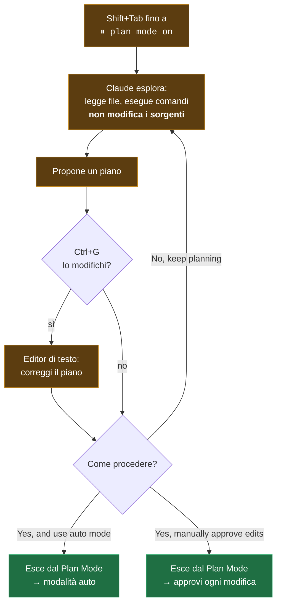

import { Tabs, TabItem, Steps, Aside } from '@astrojs/starlight/components';
import Zero from '@/components/Zero.astro';

<div class="meta-modulo">
	<span><strong>Tempo stimato:</strong> 40 minuti</span>
	<span><strong>Prerequisiti:</strong> il <a href="/fondamenta/agentic-coding/">modulo 3</a> e un progetto con più di un paio di file.</span>
</div>

Lo scenario che questo modulo risolve: chiedi a Claude una modifica grossa, lui parte come un treno,
e dieci minuti dopo ti ritrovi a rivedere trecento righe di modifiche che risolvono il problema
sbagliato. Il **Plan Mode** è il freno a mano: prima Claude studia e ti propone un piano scritto, tu
lo leggi e lo correggi (costa cinque righe, non trecento), e solo dopo la tua approvazione parte
l'esecuzione. È la differenza tra firmare un preventivo e trovarsi i lavori già fatti.

## Obiettivi

- Entrare e uscire dal Plan Mode in tutte le interfacce, e riconoscerne lo stato dalla barra di stato del terminale (la riga informativa sotto il prompt).
- Sapere esattamente cosa Claude può e non può fare mentre pianifica.
- Rivedere, modificare e approvare un piano scegliendo la modalità giusta per la fase di esecuzione.
- Impostare il Plan Mode come default dove ha senso — e sapere dove quell'impostazione **non** viene letta.
- Riconoscere i task per cui pianificare è solo tempo perso.

## Concetti chiave

**Cos'è.** Il Plan Mode dice a Claude di **ricercare e proporre modifiche senza farle**. Claude legge
file, esegue comandi shell per esplorare e scrive un piano, ma non tocca i tuoi sorgenti. Le modifiche
restano bloccate finché non approvi il piano.

**Perché serve.** Lasciare che Claude si butti sul codice può produrre codice che risolve il problema
sbagliato. Il Plan Mode separa la ricerca dall'esecuzione: quando il piano è sbagliato te ne accorgi
leggendo cinque righe, non rivedendo una diff da trecento.

**Le sei modalità di permessi.** Una "modalità di permesso" definisce **quanto Claude può fare senza
chiederti conferma** — dal chiedere per ogni singola modifica al non chiedere mai. Il Plan Mode è una
delle sei, e conviene vederle insieme. (Nella tabella compare il **classificatore**: è un secondo
modello AI che fa da supervisore — esamina ogni azione prima che venga eseguita e blocca quelle
rischiose. È il meccanismo dietro la modalità `auto`.)

| Modalità | Cosa gira senza chiedere | Ideale per |
| --- | --- | --- |
| `default` (Manual) | Solo letture | Rivedere ogni azione, lavoro delicato |
| `acceptEdits` | Letture, modifiche ai file e comandi filesystem comuni (`mkdir`, `touch`, `mv`, `cp`, …) | Iterare su codice che stai già rivedendo |
| **`plan`** | Letture, più i comandi approvati dal classificatore quando la modalità auto è disponibile | **Esplorare un codebase prima di cambiarlo** |
| `auto` | Tutto, con controlli di sicurezza in background | Task lunghi, ridurre la fatica da conferme |
| `dontAsk` | Solo i tool pre-approvati | CI e script blindati |
| `bypassPermissions` | Tutto | Solo container e VM isolate |

<Aside type="note" title="Sui piani Pro, Max e Team parti già in auto mode">
La modalità di partenza predefinita su questi piani è **auto**, non Manual. È una differenza che cambia
molto: significa che, se non fai nulla, Claude lavora con i controlli del classificatore in background
invece di chiederti conferma a ogni passo. Il Plan Mode è una scelta che fai **prima** di un task
complesso.
</Aside>

**Cosa succede ai comandi durante la pianificazione.** Quando la modalità auto è disponibile e
l'impostazione `useAutoModeDuringPlan` è attiva — lo è di default — è il **classificatore** a rivedere i
comandi shell durante la pianificazione, invece di chiedere a te: i comandi approvati girano, quelli
respinti vengono bloccati. Altrimenti, i comandi fuori dall'insieme integrato di sola lettura chiedono
approvazione.

**Il piano non è irreversibile.** `Ctrl+G` apre il piano proposto nel tuo editor di testo, dove lo modifichi
direttamente prima che Claude proceda. È il passaggio che più spesso fa la differenza: correggere una riga
del piano costa secondi, correggere l'implementazione costa una sessione.

## Entrare e uscire

Qui i comandi sono **identici su macOS e Windows**, quindi niente tab doppi.

Da terminale, `Shift+Tab` cicla tra le modalità. Partendo da `auto`, la prima pressione porta a
`default`, poi il ciclo prosegue `default` → `acceptEdits` → `plan`.

La **barra di stato** — la riga informativa sotto il prompt di Claude Code — mostra sempre la modalità
attiva. I simboli si leggono così: `⏸` = Claude si ferma a chiedere, `⏵⏵` = Claude procede da solo:

```text
⏸ manual mode on          (default)
⏵⏵ accept edits on         (acceptEdits)
⏸ plan mode on             (plan)
⏵⏵ auto mode on            (auto)
⏵⏵ don't ask on            (dontAsk)
⏵⏵ bypass permissions on   (bypassPermissions)
```

Per un singolo prompt, prefissalo con `/plan`. All'avvio:

```bash
claude --permission-mode plan
```

Per **uscire senza approvare** un piano, premi di nuovo `Shift+Tab`.

Nelle altre interfacce:

| Interfaccia | Come si cambia modalità |
| --- | --- |
| **VS Code** | Indicatore di modalità in fondo alla prompt box. Le etichette sono *Manual*, *Edit automatically*, *Plan*, *Auto*, *Bypass permissions* |
| **JetBrains** | Il plugin esegue la CLI nel terminale dell'IDE: funziona come da terminale |
| **Desktop** | Selettore di modalità accanto al pulsante di invio, nella tab Code |
| **Web e mobile** | Menu a tendina accanto alla prompt box su claude.ai/code. Le sessioni cloud offrono *Accept edits*, *Plan* e *Auto*; le sessioni Remote Control offrono *Manual*, *Accept edits* e *Plan* |

<Aside type="caution" title="Chiedere a Claude di cambiare modalità non funziona">
La modalità di permessi si cambia solo dai controlli dell'interfaccia o dai flag: scriverlo in chat non ha
alcun effetto.
</Aside>

## Rivedere e approvare un piano

Quando il piano è pronto, Claude lo presenta e chiede come procedere. Le opzioni:

| Opzione | Effetto |
| --- | --- |
| **Yes, and use auto mode** | Approva e passa alla modalità auto. Se auto non è disponibile, l'opzione legge **Yes, auto-accept edits**. Nelle sessioni avviate con bypass permissions legge **Yes, and bypass permissions** |
| **Yes, manually approve edits** | Approva e ti fa rivedere ogni modifica una per una |
| **No, keep planning** | Resta in Plan Mode: digli cosa cambiare |

Approvare un piano **esce** dal Plan Mode e porta la sessione nella modalità descritta dall'opzione scelta,
così Claude comincia a scrivere. Per pianificare di nuovo, torna al Plan Mode con `Shift+Tab` o prefissa il
prossimo prompt con `/plan`.

Due dettagli che fanno comodo:

- **`Ctrl+G`** apre il piano nel tuo editor di testo predefinito, per modificarlo prima che Claude proceda.
- Accettare un piano **dà automaticamente un nome alla sessione** a partire dal contenuto del piano, a meno
  che tu non l'abbia già impostato con `--name` o `/rename`. Ritrovarla dopo con `claude --resume` diventa
  molto più facile.

Se l'impostazione `showClearContextOnPlanAccept` è attiva, l'elenco guadagna una prima opzione che approva
il piano **e azzera il contesto della pianificazione** — utile quando l'esplorazione ha consumato molto
contesto e l'implementazione può ripartire pulita dal piano.



## Impostarlo come default

Per rendere il Plan Mode il default delle sessioni da terminale di un progetto:

```json title=".claude/settings.json"
{
  "permissions": {
    "defaultMode": "plan"
  }
}
```

<Aside type="danger" title="Le tre trappole di defaultMode">
1. **VS Code non legge le impostazioni di progetto** per la modalità di partenza. Lì devi mettere
   `claudeCode.initialPermissionMode: "plan"` nelle impostazioni **utente** di VS Code.
2. **`defaultMode: "auto"` non funziona da `.claude/settings.json`** né da `settings.local.json`: va messo
   in `~/.claude/settings.json`. Se una sessione da terminale parte in Manual senza errori, è quasi sempre
   questo.
3. Nell'app **desktop**, una modalità scelta dal selettore viene ricordata per cartella e ha la precedenza
   su `defaultMode` — con l'eccezione di Plan, che vale solo per la sessione corrente.
</Aside>

## Quando usarlo e quando no

Il Plan Mode è utile **e ha un costo**: aggiunge un giro di esplorazione e una revisione prima che parta
qualsiasi modifica.

| Pianifica quando | Salta il piano quando |
| --- | --- |
| Non sei sicuro dell'approccio | Sapresti descrivere la diff in una frase |
| La modifica tocca più file | È un refuso, una riga di log, un rename |
| Non conosci il codice che va cambiato | Conosci bene il file e l'intervento è locale |
| Il costo di sbagliare è alto: modifiche al database, alla sua struttura, o al sistema di login | Stai iterando velocemente su codice che rivedi comunque |
| Vuoi allineare qualcun altro prima di partire | Il task è esplorativo e vuoi vedere dove va |

La regola pratica, testuale dalla documentazione: **se sapresti descrivere la diff in una frase, salta il
piano**.

## Esempio guidato

Facciamo un cambiamento che tocca più file, che è il caso in cui il Plan Mode si ripaga.

<Steps>

1. **Avvia direttamente in Plan Mode.**

   <Tabs syncKey="os">
   <TabItem label="macOS" icon="apple">
   ```bash
   cd ~/progetti/il-tuo-progetto
   claude --permission-mode plan
   ```
   </TabItem>
   <TabItem label="Windows" icon="seti:windows">
   ```powershell
   cd $env:USERPROFILE\progetti\il-tuo-progetto
   claude --permission-mode plan
   ```
   </TabItem>
   </Tabs>

   Verifica in status bar: deve leggersi `⏸ plan mode on`.

2. **Prima esplora, senza chiedere ancora un piano.** È il passaggio che quasi tutti saltano, e che rende
   il piano molto migliore:

   ```text
   read src/ and understand how errors are currently handled and surfaced
   to the user. Also look at how we validate input. Don't propose anything yet.
   ```

   Claude legge e risponde. Non tocca nulla.

3. **Ora chiedi il piano.**

   ```text
   I want every API handler to return a consistent error shape:
   { error: { code, message } }, with HTTP status derived from the code.

   What files need to change? What's the migration path for existing
   handlers? Create a plan.
   ```

4. **Aprilo nell'editor e correggilo.** Premi `Ctrl+G`. Il piano si apre nel tuo editor di testo. Cerca le
   tre cose che vanno storte più spesso:

   - **File fuori scope** — c'è qualcosa che non doveva essere toccato?
   - **Verifica assente** — il piano dice come si controlla che abbia funzionato? Se no, aggiungilo tu.
   - **Ordine sbagliato** — sta cambiando chi *usa* una funzione prima di aver cambiato la funzione stessa? (Prima si cambia il contratto, poi chi ci si appoggia.)

   Aggiungi in fondo, a mano:

   ```markdown
   ## Verifica
   - `npm test` verde
   - Nessun handler restituisce ancora la vecchia forma: `grep -r "res.status(500).send" src/` non trova nulla
   ```

   Salva e chiudi.

5. **Approva scegliendo la modalità giusta.** Per una migrazione che tocca molti file e che rivedrai
   comunque con `git diff`, **Yes, and use auto mode** è la scelta sensata. Per una modifica delicata,
   **Yes, manually approve edits**.

6. **Verifica che sia uscito dal Plan Mode.** La status bar non dice più `⏸ plan mode on`: dice la modalità
   che hai scelto approvando. Se dice ancora plan mode, non hai approvato — hai risposto *No, keep planning*.

7. **Ritrova la sessione domani.** Il nome è stato assegnato in automatico dal contenuto del piano:

   ```bash
   claude --resume
   ```

</Steps>

## Esercizio

Usa il Plan Mode per non farti scrivere il codice sbagliato.

1. Scegli nel tuo progetto un cambiamento che tocchi almeno tre file.
2. Fatti fare un piano **senza** esplorare prima, e leggilo.
3. Rifiuta il piano, esplora, e fattene fare un altro. Confronta i due.
4. Modifica il secondo piano con `Ctrl+G` aggiungendo un criterio di verifica, poi approvalo.
5. Configura il progetto perché parta sempre in Plan Mode, sia da terminale sia in VS Code.

<details class="soluzione">
<summary>Soluzione</summary>

**Passi 2–3.** Il confronto è il punto dell'esercizio. Senza esplorazione, il piano tende a essere generico
e a inventarsi la struttura del progetto: nomi di file plausibili ma sbagliati, passaggi che assumono
convenzioni che non usi. Con l'esplorazione prima, il piano cita file che esistono davvero e segue i
pattern che ci sono già.

Per rifiutare e restare in Plan Mode, scegli **No, keep planning** e digli cosa manca:

```text
No — you're assuming a service layer we don't have. Read src/ first and
base the plan on the structure that actually exists.
```

**Passo 4.** `Ctrl+G` apre il piano nell'editor definito da `$EDITOR` (macOS/Linux) o dall'editor
predefinito di sistema. Aggiungi in fondo una sezione di verifica **eseguibile** — non "controllare che
funzioni", ma un comando che produce pass o fail:

```markdown
## Verifica
1. `npm test` — tutti i test passano
2. `npm run typecheck` — nessun errore
3. `grep -rn "TODO: migrate" src/` — nessun risultato residuo
```

È lo stesso principio del [modulo 3](/fondamenta/agentic-coding/): senza un controllo eseguibile, "sembra
fatto" è l'unico segnale disponibile.

**Passo 5.** Servono **due** configurazioni distinte, perché VS Code non legge le impostazioni di progetto
per la modalità di partenza.

Per il terminale:

```json title=".claude/settings.json"
{
  "permissions": {
    "defaultMode": "plan"
  }
}
```

Per VS Code, nelle impostazioni **utente** (`Cmd+,` / `Ctrl+,` → Extensions → Claude Code, oppure
direttamente nel `settings.json` utente di VS Code):

```json title="settings.json (VS Code user settings)"
{
  "claudeCode.initialPermissionMode": "plan"
}
```

Verifica di aver fatto le cose giuste: apri una sessione da terminale nel progetto e controlla che la
status bar dica `⏸ plan mode on` senza che tu abbia premuto nulla; poi apri il pannello in VS Code e
controlla che l'indicatore di modalità dica **Plan**.

</details>

## Errori comuni e troubleshooting

| Sintomo | Causa | Soluzione |
| --- | --- | --- |
| Chiedi a Claude di "passare in plan mode" e non succede nulla | La modalità si cambia solo dai controlli dell'interfaccia o dai flag | `Shift+Tab`, `/plan`, o `--permission-mode plan` |
| `defaultMode: "plan"` nel progetto non ha effetto in VS Code | L'estensione non legge `.claude/settings.json` per la modalità di partenza | `claudeCode.initialPermissionMode` nelle impostazioni **utente** di VS Code |
| `defaultMode: "auto"` non ha effetto e la sessione parte in Manual | `auto` non viene letto da `.claude/settings.json` né da `settings.local.json` | Spostalo in `~/.claude/settings.json` |
| Nell'app desktop il default di progetto viene ignorato | La modalità scelta dal selettore è ricordata per cartella e ha la precedenza | Ricambiala dal selettore; Plan comunque vale solo per la sessione corrente |
| In Plan Mode Claude chiede conferma per ogni comando | La modalità auto non è disponibile, o `useAutoModeDuringPlan` è disattivata | I comandi fuori dall'insieme di sola lettura richiedono approvazione: è il comportamento previsto |
| Il piano è generico e cita file inesistenti | Gli hai chiesto un piano senza fargli prima esplorare | Prima `read ... don't propose anything yet`, poi chiedi il piano |
| Hai approvato ma Claude non modifica nulla | Hai scelto *No, keep planning* | La status bar te lo dice: se legge ancora `⏸ plan mode on`, non hai approvato |
| Il piano era buono ma l'implementazione ha divagato | Il piano non conteneva criteri di verifica né vincoli di scope | Aggiungili con `Ctrl+G` prima di approvare |
| Dopo aver pianificato a lungo, il contesto è quasi pieno | L'esplorazione ha consumato la finestra | Attiva `showClearContextOnPlanAccept` per approvare azzerando il contesto di pianificazione |
| Non ritrovi più la sessione di ieri | — | Accettare un piano assegna un nome automatico: cercalo con `claude --resume` |

## Cheat-sheet

| Azione | Come |
| --- | --- |
| Entrare in Plan Mode | `Shift+Tab` fino a `⏸ plan mode on` |
| Un solo prompt in Plan Mode | Prefissalo con `/plan` |
| Avviare in Plan Mode | `claude --permission-mode plan` |
| Uscire senza approvare | `Shift+Tab` di nuovo |
| Modificare il piano proposto | `Ctrl+G` — lo apre nel tuo editor |
| Approvare e proseguire in auto | **Yes, and use auto mode** |
| Approvare rivedendo ogni modifica | **Yes, manually approve edits** |
| Continuare a pianificare | **No, keep planning** |
| Default di progetto (terminale) | `permissions.defaultMode: "plan"` in `.claude/settings.json` |
| Default in VS Code | `claudeCode.initialPermissionMode: "plan"` nelle impostazioni **utente** |
| Approvare azzerando il contesto | Impostazione `showClearContextOnPlanAccept` |

**Il flusso in quattro fasi**

```text
Explore  →  Plan  →  Implement  →  Commit
   ↑          ↑          ↑            ↑
 leggi     Ctrl+G     approva      "commit with a
 prima    correggi    la modalità   descriptive message
           il piano    giusta        and open a PR"
```

## Fonti

Pagine ufficiali consultate, verificate il **16 agosto 2026**:

- [Choose a permission mode](https://code.claude.com/docs/en/permission-modes) — tutte le modalità, Plan Mode, approvazione dei piani, default per interfaccia
- [Best practices](https://code.claude.com/docs/en/best-practices) — il flusso explore-plan-code-commit e quando saltare il piano
- [Settings](https://code.claude.com/docs/en/settings) — `permissions.defaultMode` e `showClearContextOnPlanAccept`
- [Use Claude Code in VS Code](https://code.claude.com/docs/en/vs-code) — `claudeCode.initialPermissionMode` e revisione dei piani nell'editor
- [Auto mode configuration](https://code.claude.com/docs/en/auto-mode-config) — il classificatore e `useAutoModeDuringPlan`
- [Manage sessions](https://code.claude.com/docs/en/sessions) — nome automatico della sessione e ripresa
