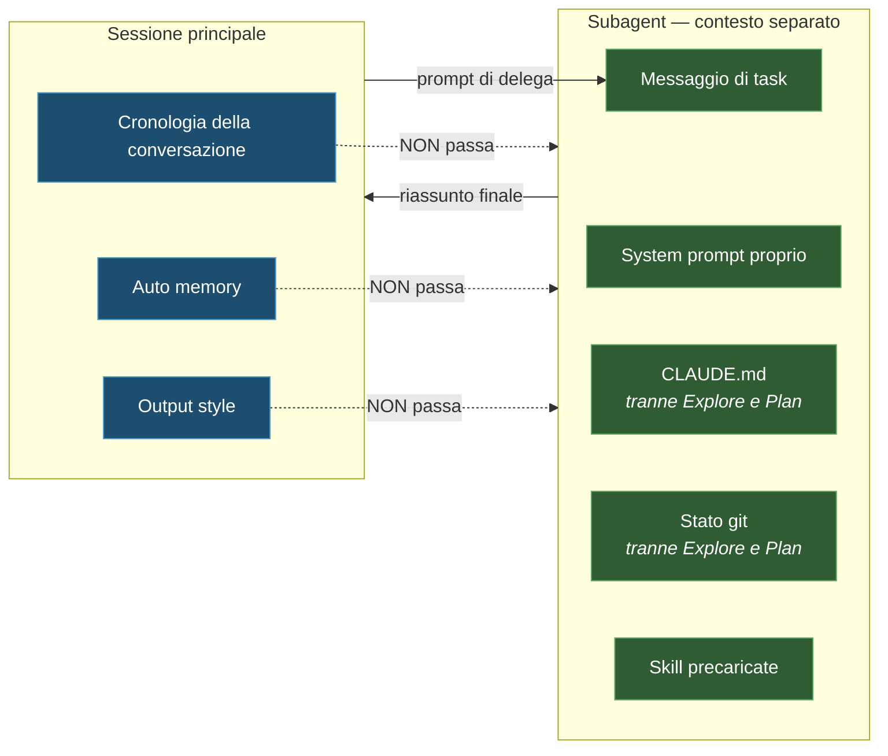

import { Tabs, TabItem, Steps, Aside, FileTree } from '@astrojs/starlight/components';
import Zero from '@/components/Zero.astro';

<div class="meta-modulo">
	<span><strong>Tempo stimato:</strong> 55 minuti</span>
	<span><strong>Prerequisiti:</strong> i moduli <a href="/fondamenta/memoria-e-contesto/">4</a>, <a href="/personalizzazione/skills/">8</a> e <a href="/personalizzazione/hooks/">10</a>.</span>
</div>

Un [subagent](/glossario/#subagent) è un aiutante che Claude lancia per delegare un compito: un
"secondo Claude" con la sua memoria di lavoro separata, che fa il suo pezzo e riporta solo il
risultato. L'analogia è il capocantiere che manda un operaio a fare un sopralluogo: l'operaio si
guarda tutto, e al capo torna **il rapporto**, non l'intera visita. Due i motivi per usarli, ed è
importante distinguerli: il **risparmio** (le letture pesanti restano nella memoria dell'aiutante,
non nella tua — il tema del modulo 4) e la **qualità** (un revisore con la memoria pulita giudica il
lavoro senza esserne affezionato). Questo modulo insegna a usare gli aiutanti pronti, a costruirne
di tuoi, e a combinarli.

## Obiettivi

- Capire perché un subagent risolve il problema del contesto meglio di qualsiasi altra tecnica.
- Usare i tipi integrati — `Explore`, `Plan`, `general-purpose` — senza definirne di nuovi.
- Scrivere un subagent custom con i tool, il modello e i permessi giusti.
- Sapere cosa entra e cosa **non** entra nel contesto di un subagent.
- Distinguere subagent e fork, e sapere quando serve l'uno o l'altro.

## Concetti chiave

**Un subagent è una finestra di contesto separata.** È l'unica cosa da ricordare, se ne ricordi una sola.
Quando deleghi una ricerca che legge venti file, quei venti file stanno nel contesto del subagent, non nel
tuo: a te torna solo un riassunto. Nella sessione principale paghi ~80 token per lo spawn e ~400 per il
report, invece di 20.000 di letture.

**Ha i suoi tool, il suo modello, i suoi permessi.** Un subagent può essere in sola lettura mentre la
sessione principale scrive, girare su un modello diverso, avere hook che valgono solo per lui e sparire
quando ha finito.

**È anche uno strumento di qualità, non solo di risparmio.** Un revisore che gira in un contesto fresco
vede **solo la diff e i criteri che gli dai**, non il ragionamento che ha prodotto quella modifica. Valuta
il risultato per quello che è. È la ragione per cui la revisione con un subagent trova cose che la sessione
che ha scritto il codice non trova.

**Delegare non è gratis.** Il subagent non conosce la tua conversazione: il prompt di delega deve essere
autosufficiente. Un subagent istruito male rilegge da zero cose che nella sessione principale erano già
chiare.

## I tipi integrati

Prima di definirne uno tuo, controlla se ti basta uno di questi:

| Tipo | Modello | Tool | A cosa serve |
| --- | --- | --- | --- |
| **`Explore`** | Lo stesso della conversazione principale (al massimo Opus: se usi un modello superiore, l'agente scala a Opus) | **Solo lettura**: `Write` ed `Edit` negati | Scoperta di file, ricerca nel codice, esplorazione del codebase |
| **`Plan`** | Eredita | Solo lettura | Ricerca nel codebase per la pianificazione, in Plan Mode |
| **`general-purpose`** | Eredita | Tutti quelli disponibili ai subagent | Task complessi multi-step che richiedono sia esplorazione sia azione |
| `claude` | Eredita | Tutti | Catch-all quando il task non rientra in un agente specializzato |
| `statusline-setup` | Sonnet | `Read`, `Edit` | Quando lanci `/statusline` |
| `claude-code-guide` | Haiku | `Bash`, `Read`, `WebFetch`, `WebSearch` | Domande su funzionalità di Claude Code |

<Aside type="tip" title="`Explore` salta CLAUDE.md e git status">
`Explore` e `Plan` **non** caricano i `CLAUDE.md` né lo stato git. È deliberato: sono agenti di ricerca
veloce, e quel contesto per loro è peso morto. Se ti serve che un agente conosca le convenzioni del
progetto, non usare `Explore`.
</Aside>

## Cosa entra nel contesto di un subagent

All'avvio, un subagent (non-fork) ha:

1. **Il suo system prompt** — il prompt dell'agente più i dettagli d'ambiente. **Non** il system prompt
   completo di Claude Code.
2. **Il messaggio di task** — il prompt di delega che Claude scrive.
3. **I file `CLAUDE.md`** di ogni livello della gerarchia — tranne per `Explore` e `Plan`.
4. **Lo stato git** — snapshot preso all'avvio della sessione padre; anche questo saltato da `Explore` e `Plan`.
5. **Le skill precaricate** — contenuto completo delle skill elencate nel campo `skills`.
6. **L'elenco degli altri agenti attivi** — la conversazione principale (`main`) e gli agenti con un
   nome, così il subagent sa a chi può mandare messaggi.

E soprattutto, cosa **non** arriva:

- La tua cronologia di conversazione (tranne nei fork)
- Il tuo output style
- L'auto memory della conversazione principale
- La dimensione della finestra di contesto della conversazione principale



## Definire un subagent

I file vanno in `agents/`, scoperti **ricorsivamente** — puoi organizzarli in sottocartelle:

<FileTree>

- .claude/agents/
  - code-reviewer.md
  - review/
    - security.md
    - performance.md
  - research/
    - api-docs.md

</FileTree>

Le posizioni, dalla priorità più alta alla più bassa. (Noterai che qui i **managed settings** e il
flag di sessione stanno sopra tutto, e il progetto sopra l'utente: l'ordine è **diverso** da quello
delle skill del modulo 7, dove la tua skill personale batte quella di progetto. Ogni meccanismo ha la
sua tabella: quando serve la certezza, guarda quella giusta invece di andare a memoria.)

| Posizione | Portata |
| --- | --- |
| Managed settings | Tutta l'organizzazione |
| Flag `--agents` | Solo la sessione corrente |
| `.claude/agents/` | Il progetto — si committa |
| `~/.claude/agents/` | Tutti i tuoi progetti |
| `agents/` di un plugin | Dove il plugin è abilitato |

### Riferimento del frontmatter

```yaml
---
name: unique-identifier
description: When Claude should delegate to this subagent
tools: Read, Grep, Glob, Bash
disallowedTools: Write, Edit
model: sonnet
permissionMode: default
maxTurns: 10
skills:
  - api-conventions
  - error-handling-patterns
mcpServers:
  - server-name
hooks:
  PreToolUse:
    - matcher: "Bash"
      hooks:
        - type: command
          command: "./scripts/validate-command.sh"
memory: project
background: false
effort: high
isolation: worktree
color: blue
initialPrompt: Testo del primo turno, inviato automaticamente
---
```

**Obbligatori:** `name` (identificatore univoco, minuscole e trattini) e `description` (quando Claude deve
delegare a questo subagent).

| Campo | Cosa fa |
| --- | --- |
| `tools` | Allowlist dei tool. Se omesso, eredita tutti quelli disponibili |
| `disallowedTools` | Denylist |
| `model` | `sonnet`, `opus`, `haiku`, `fable`, un ID completo, o `inherit` (default) |
| `permissionMode` | `default`, `acceptEdits`, `auto`, `dontAsk`, `bypassPermissions`, `plan` |
| `maxTurns` | Numero massimo di turni agentici prima di fermarsi |
| `skills` | Skill precaricate nel contesto all'avvio |
| `mcpServers` | Server MCP disponibili a questo subagent |
| `hooks` | Hook che valgono **solo** mentre il subagent gira |
| `memory` | `user`, `project` o `local` per la memoria persistente |
| `background` | `true` per tenerlo in background anche quando Claude lo vorrebbe in primo piano |
| `effort` | `low`, `medium`, `high`, `xhigh`, `max` |
| `isolation` | `worktree` per farlo lavorare in un [worktree](/glossario/#worktree) git isolato (una copia di lavoro separata dello stesso repository) |
| `color` | Colore nell'interfaccia: `red`, `blue`, `green`, `yellow`, `purple`, `orange`, `pink`, `cyan` |
| `initialPrompt` | Primo turno utente inviato automaticamente |

### Un file completo

```markdown title=".claude/agents/code-improver.md"
---
name: code-improver
description: Scans files and suggests improvements for readability, performance, and best practices. Use after writing or modifying code.
tools: Read, Grep, Glob
model: sonnet
memory: project
---

You are a code improvement specialist. For each issue you find:

1. Explain the problem clearly
2. Show the current code
3. Provide an improved version with explanation
4. Suggest when the improvement matters most

Focus on:
- Readability and clarity
- Performance and efficiency
- Best practices and patterns
- Maintainability and scalability

Be specific and actionable in your feedback.
```

Nota `tools: Read, Grep, Glob`: **nessun `Write` né `Edit`**. Un revisore che può modificare il codice
smette di essere un revisore. La restrizione dei tool è la parte più importante della definizione, non un
dettaglio.

## Invocare un subagent

Tre modi, in ordine crescente di forza:

<Steps>

1. **Linguaggio naturale** — nomini il subagent, Claude decide se delegare:

   ```text
   Use the test-runner subagent to fix failing tests
   ```

2. **@-menzione** — **garantisce** che il subagent giri per quel task. La sintassi va copiata
   esatta: `@` apre la menzione, le virgolette servono perché il nome contiene uno spazio, e il
   suffisso `(agent)` distingue l'agente da un file con lo stesso nome. Scrivendo `@` nel prompt,
   l'autocomplete te la compone da solo:

   ```text
   @"code-reviewer (agent)" look at the auth changes
   ```

   *(= "code-reviewer, guarda le modifiche all'autenticazione")*

3. **Default di sessione** — tutta la sessione usa quell'agente:

   ```bash
   claude --agent code-reviewer
   ```

   ```json title=".claude/settings.json"
   {
     "agent": "code-reviewer"
   }
   ```

</Steps>

Per far **riprendere** un subagent, basta chiederlo: *"Continue that code review and now analyze the
authorization logic"*. Claude usa il tool `SendMessage` per riattivarlo; il subagent ripreso conserva
tutta la sua cronologia e riparte da dove si era fermato.

<Aside type="note" title="La `description` fa il lavoro">
Come per le skill, la delega automatica si basa sulla `description`. Includere *"use proactively"* nella
descrizione incoraggia Claude a delegare senza che tu lo chieda.
</Aside>

## Memoria persistente

Nel [modulo 4](/fondamenta/memoria-e-contesto/) hai visto l'**auto memory**: gli appunti che il Claude
principale si prende tra una sessione e l'altra. I subagent **non la ereditano** — e possono però
averne **una propria**, separata, attivata dal campo `memory`: stessa idea (appunti che sopravvivono),
directory diversa, per agente. Così il tuo revisore ricorda i falsi positivi che gli hai contestato,
senza mescolarli con la memoria della conversazione principale:

```yaml
---
name: code-reviewer
description: Reviews code for quality and best practices
memory: project
---
```

Il suo system prompt guadagna le istruzioni per leggere e scrivere nella directory di memoria, più le
**prime 200 righe o 25 KB di `MEMORY.md`** — quello che scatta per primo. I tool `Read`, `Write` ed `Edit`
vengono abilitati automaticamente.

| Scope | Percorso |
| --- | --- |
| `user` | `~/.claude/agent-memory/<nome-agente>/` |
| `project` | `.claude/agent-memory/<nome-agente>/` |
| `local` | `.claude/agent-memory-local/<nome-agente>/` |

È il meccanismo che rende un revisore utile alla decima esecuzione invece che alla prima: si ricorda i
falsi positivi che gli hai contestato.

## Fork: quando il subagent deve sapere tutto

Un **fork** è diverso da un subagent normale. Eredita dalla conversazione corrente:

- Tutta la cronologia
- Lo stesso system prompt e gli stessi tool
- Lo stesso modello e gli stessi permessi

E isola:

- Le proprie chiamate a tool, che non compaiono nella conversazione principale
- Il risultato finale, che torna come messaggio

Si crea con `/subtask <task>`, oppure chiedendo il tipo di subagent `fork`. La modalità fork è **attiva di
default** nelle sessioni interattive, controllata dalla variabile `CLAUDE_CODE_FORK_SUBAGENT`.

| Usa un **subagent** quando | Usa un **fork** quando |
| --- | --- |
| Il task è autosufficiente e descrivibile in un prompt | Il task dipende da tutto quello che avete già discusso |
| Vuoi occhi freschi — revisione, verifica | Vuoi continuità, non indipendenza |
| Vuoi tool o modello diversi | Va bene la stessa configurazione |
| Vuoi risparmiare contesto | Vuoi solo tenere le chiamate a tool fuori dalla vista |

## Esempio guidato

Costruiamo una coppia che si usa insieme: un ricercatore in sola lettura e un revisore avversariale.

<Steps>

1. **Prima prova senza definire nulla.** I tipi integrati coprono più casi di quanto sembri:

   ```text
   Use subagents to investigate how our authentication system handles token
   refresh, and whether we have any existing OAuth utilities I should reuse.
   Report back in under 30 lines.
   ```

   Il vincolo sulla lunghezza non è pignoleria: un subagent che ti restituisce un muro di testo ti rimangia
   il risparmio di contesto.

2. **Definisci un ricercatore specializzato.** Serve quando le indagini si ripetono e vuoi che seguano
   sempre lo stesso taglio:

   ```markdown title=".claude/agents/ricercatore.md"
   ---
   name: ricercatore
   description: Indaga come funziona una parte del codebase e riporta i punti chiave. Usalo proattivamente prima di modifiche che toccano codice che non conosci.
   tools: Read, Grep, Glob, Bash
   disallowedTools: Write, Edit
   color: cyan
   ---

   Sei un ricercatore di codebase. Il tuo output viene letto da un altro agente
   che scriverà del codice: deve essere denso e verificabile, non discorsivo.

   Riporta sempre, in quest'ordine:

   1. **Punto d'ingresso** — da quale file si parte, con percorso e riga
   2. **Flusso** — i passaggi principali, con `file:riga` per ciascuno
   3. **Convenzioni** — i pattern che il codice esistente segue e che vanno rispettati
   4. **Trappole** — casi limite già gestiti, che una modifica ingenua romperebbe
   5. **Da riusare** — utility o astrazioni già presenti, con percorso

   Vincoli:
   - Massimo 40 righe. Se non ci stai, taglia le sezioni 3 e 4, mai la 1 e la 2.
   - Ogni affermazione deve avere un riferimento `file:riga`. Se non puoi citarlo,
     non affermarlo.
   - Non proporre modifiche. Non è il tuo compito.
   ```

3. **Definisci un revisore avversariale.**

   ```markdown title=".claude/agents/revisore.md"
   ---
   name: revisore
   description: Rivede una diff cercando difetti di correttezza. Usalo dopo che una modifica è completa, prima del commit.
   tools: Read, Grep, Glob, Bash
   disallowedTools: Write, Edit
   model: opus
   effort: high
   memory: project
   color: red
   ---

   Sei un revisore. Vedi la diff e i criteri, non il ragionamento che l'ha prodotta.
   Valuta il risultato per quello che è.

   Cerca, in quest'ordine di priorità:

   1. **Correttezza** — la modifica fa quello che doveva? Casi limite non gestiti?
   2. **Regressioni** — c'è comportamento esistente che si rompe?
   3. **Requisiti mancanti** — qualcosa nella richiesta non è stato implementato?

   Per ogni rilievo, dai uno scenario concreto: input, stato, output sbagliato.
   Un rilievo senza scenario di fallimento non è un rilievo: non riportarlo.

   **Non** segnalare preferenze di stile, naming, o "si potrebbe astrarre".
   Se non trovi nulla che tocca correttezza o requisiti, dillo in una riga.

   Prima di rivedere, leggi la tua memoria: contiene i falsi positivi che ti sono
   già stati contestati su questo progetto. Dopo la revisione, se un tuo rilievo
   viene respinto, annotalo.
   ```

   Tre scelte da notare: `model: opus` ed `effort: high` — Opus è il modello più capace e più
   "costoso" in consumo del piano, e la revisione è esattamente il punto in cui quel consumo extra
   rende; `disallowedTools: Write, Edit`, perché un revisore che corregge non è più un revisore; e
   `memory: project`, che lo rende progressivamente meno rumoroso.

4. **Usali in sequenza.**

   ```text
   @"ricercatore (agent)" investigate how rate limiting works in this codebase
   ```

   Poi, con il report in mano, implementa. E infine:

   ```text
   @"revisore (agent)" review the diff against PLAN.md. Check that every
   requirement is implemented, that the listed edge cases have tests, and that
   nothing outside the task's scope changed.
   ```

5. **Verifica il risparmio di contesto.**

   ```text
   /context
   ```

   Confronta con quello che avresti speso facendo la stessa indagine nella sessione principale.

6. **Prova l'isolamento con un worktree.** Se due agenti devono modificare file in parallelo, aggiungi al
   frontmatter:

   ```yaml
   isolation: worktree
   ```

   Ogni esecuzione ottiene un worktree git suo, così le modifiche non collidono. È costoso — setup e spazio
   su disco — quindi usalo **solo** quando serve davvero.

</Steps>

<Aside type="caution" title="Il revisore troverà sempre qualcosa (l'avviso promesso al modulo 3)">
Un revisore a cui chiedi di trovare lacune ne troverà, anche quando il lavoro è solido: è ciò che gli hai
chiesto. Inseguirle tutte porta a over-engineering — livelli di astrazione in più, codice difensivo, test
per casi impossibili. È il motivo per cui nel prompt del `revisore` c'è la riga *"un rilievo senza scenario
di fallimento non è un rilievo"*: è quel vincolo a rendere l'output utile.
</Aside>

## Esercizio

Costruisci una pipeline a tre agenti e misurane l'effetto.

1. Definisci tre subagent: uno che esplora, uno che implementa, uno che verifica.
2. Dai a ciascuno i tool **minimi** necessari.
3. Fai passare un task reale attraverso tutti e tre.
4. Confronta il consumo di contesto con lo stesso task fatto in una sessione sola.

<details class="soluzione">
<summary>Soluzione</summary>

**Passi 1–2.** Il punto dell'esercizio è la **restrizione dei tool**: è quella che rende ciascun agente
affidabile nel suo ruolo.

| Agente | `tools` | `disallowedTools` | Perché |
| --- | --- | --- | --- |
| `ricercatore` | `Read, Grep, Glob, Bash` | `Write, Edit` | Deve leggere ed eseguire comandi di ispezione, mai modificare |
| `implementatore` | *(omesso: eredita tutto)* | — | Deve poter fare tutto |
| `revisore` | `Read, Grep, Glob, Bash` | `Write, Edit` | Se può correggere, smette di rivedere e comincia a scrivere |

Per il terzo agente puoi riusare `revisore` del passo 3 dell'esempio guidato. L'implementatore, se non ha
bisogno di un prompt particolare, non definirlo: usa `general-purpose`, che è già quello.

**Passo 3.** Una sequenza realistica su un task medio:

```text
@"ricercatore (agent)" investigate how we validate request payloads.
I need to add validation to the new /webhooks endpoint.
```

Leggi il report. **Poi** implementa nella sessione principale, che ora ha il contesto denso invece dei file
grezzi:

```text
Following the conventions from that report, add payload validation to
src/routes/webhooks.js. Write tests for: missing signature header,
invalid signature, valid payload. Run the tests.
```

Infine:

```text
@"revisore (agent)" review the diff for src/routes/webhooks.js and its tests.
```

**Passo 4.** Il confronto va fatto onestamente, con due sessioni separate.

*Sessione A, tutto insieme:* `/clear`, poi un solo prompt che chiede di indagare, implementare e
verificare. Alla fine, `/context`.

*Sessione B, con delega:* `/clear`, poi la sequenza a tre agenti sopra. Alla fine, `/context`.

Cosa dovresti osservare:

| | Sessione A | Sessione B |
| --- | --- | --- |
| File letti nel contesto principale | Tutti quelli esplorati | Nessuno: solo il report |
| Contesto a fine task | Alto | Sensibilmente più basso |
| Qualità della revisione | Il revisore è la stessa istanza che ha scritto il codice | Contesto fresco, valuta il risultato |

Il secondo punto è quello misurabile; il terzo è quello che conta di più, ed è la ragione per cui la
delega vale la pena anche quando il contesto non è un problema.

**Se non vedi differenza**, controlla due cose: che tu abbia davvero usato la @-menzione (il linguaggio
naturale *suggerisce* la delega, non la garantisce), e che il ricercatore abbia rispettato il limite di
righe — un report da 300 righe non è delega, è copia-incolla con passaggi intermedi.

</details>

## Errori comuni e troubleshooting

| Sintomo | Causa | Soluzione |
| --- | --- | --- |
| Claude non delega mai al tuo subagent | La `description` non dice **quando** delegare | Riscrivila in termini di situazione; aggiungi *"use proactively"* |
| Vuoi essere sicuro che parta | Il linguaggio naturale lascia decidere a Claude | Usa la @-menzione: `@"nome (agent)"` |
| Il subagent non conosce le convenzioni del progetto | Stai usando `Explore` o `Plan`, che saltano i `CLAUDE.md` | Usa `general-purpose` o un agente custom |
| Il subagent chiede cose già dette in conversazione | La cronologia **non** passa ai subagent | Rendi il prompt di delega autosufficiente, o usa un fork |
| Il revisore corregge invece di rivedere | Ha `Write` ed `Edit` | `disallowedTools: Write, Edit` |
| Il report del subagent è enorme e non risparmi contesto | Nessun vincolo di lunghezza | Metti un limite esplicito nel prompt dell'agente |
| Due subagent in parallelo si sovrascrivono i file | Lavorano nella stessa working copy | `isolation: worktree` |
| Il subagent gira all'infinito | Nessun limite di turni | `maxTurns` |
| Il subagent è troppo lento o costoso | Eredita modello ed effort della sessione | `model: haiku` ed `effort: low` per i task meccanici |
| La memoria del subagent non persiste | Manca il campo `memory` | `memory: project` (o `user` / `local`) |
| L'auto memory principale non arriva al subagent | È voluto: non viene passata | La memoria del subagent è una directory separata |
| Hai bisogno che il subagent sappia tutto della conversazione | Un subagent normale non eredita nulla | Usa un **fork**: `/subtask <task>` |

## Cheat-sheet

**Struttura minima**

```markdown
---
name: nome-agente
description: Quando Claude deve delegare a questo agente
tools: Read, Grep, Glob
---

Il system prompt dell'agente.
```

**I campi che userai davvero**

| Campo | Quando |
| --- | --- |
| `tools` / `disallowedTools` | **Sempre**: è ciò che definisce il ruolo |
| `model` / `effort` | Alza per la revisione, abbassa per i task meccanici |
| `memory` | Agenti ricorrenti che devono migliorare nel tempo |
| `maxTurns` | Agenti autonomi, per evitare loop |
| `isolation: worktree` | Solo quando più agenti scrivono in parallelo |
| `skills` | Precaricare convenzioni che l'agente deve conoscere |
| `permissionMode` | Agenti che devono lavorare senza conferme |

**Invocare**

| Modo | Forza |
| --- | --- |
| `Use the X subagent to ...` | Claude decide |
| `@"X (agent)" ...` | **Garantito** per quel task |
| `claude --agent X` | Default di tutta la sessione |
| `/subtask <task>` | Fork: eredita la conversazione |

**Tipi integrati**

```text
Explore          → ricerca veloce, sola lettura, salta CLAUDE.md e git
Plan             → ricerca per la pianificazione, sola lettura
general-purpose  → task complessi, tutti i tool
```

**Percorsi**

```text
.claude/agents/<nome>.md            → progetto, si committa
~/.claude/agents/<nome>.md          → tutti i tuoi progetti
.claude/agent-memory/<nome>/        → memoria persistente (scope project)
```

## Fonti

Pagine ufficiali consultate, verificate il **16 agosto 2026**:

- [Subagents](https://code.claude.com/docs/en/sub-agents) — posizioni, frontmatter completo, tipi integrati, contesto all'avvio, memoria persistente, fork
- [Agents](https://code.claude.com/docs/en/agents) — panoramica degli agenti
- [Best practices](https://code.claude.com/docs/en/best-practices) — delega delle ricerche e revisione avversariale
- [Agent teams](https://code.claude.com/docs/en/agent-teams) — coordinamento automatico di più sessioni
- [Worktrees](https://code.claude.com/docs/en/worktrees) — isolamento per il lavoro in parallelo
- [Hooks](https://code.claude.com/docs/en/hooks) — hook con durata limitata al subagent
- [Model configuration](https://code.claude.com/docs/en/model-config) — modelli ed effort
