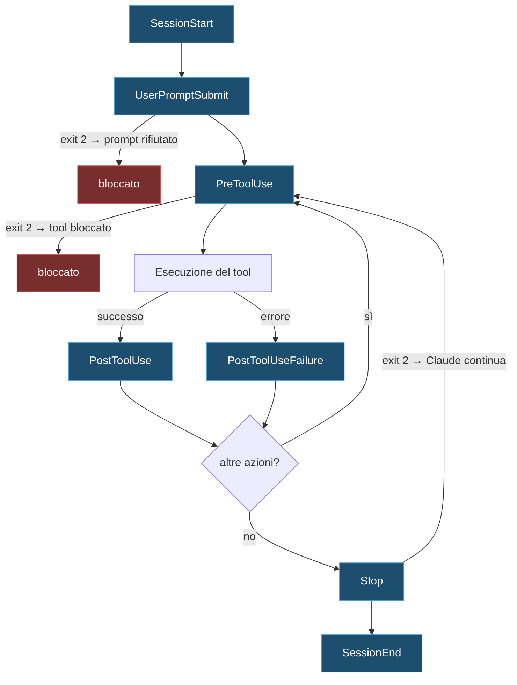

import { Tabs, TabItem, Steps, Aside } from '@astrojs/starlight/components';

<div class="meta-modulo">
	<span><strong>Tempo stimato:</strong> 60 minuti</span>
	<span><strong>Prerequisiti:</strong> i moduli <a href="/fondamenta/anatomia-file/">2</a> e <a href="/personalizzazione/skills/">8</a>. Serve <code>jq</code> installato per gli esempi shell.</span>
</div>

## Obiettivi

- Capire quando un'istruzione va scritta come hook invece che nel `CLAUDE.md`.
- Scegliere l'evento giusto tra quelli disponibili.
- Scrivere un hook che blocca davvero un'azione, usando il contratto di exit code e JSON.
- Automatizzare lint e test dopo ogni modifica, e ricevere una notifica a fine turno.
- Diagnosticare un hook che non scatta, senza tirare a indovinare.

## Concetti chiave

**Gli hook sono deterministici, il `CLAUDE.md` no.** È la ragione per cui esistono. Le istruzioni nel
`CLAUDE.md` sono **contesto**: Claude le legge e cerca di seguirle, ma può ignorarle. Un hook è **codice**
che esegue a un punto fisso del ciclo di vita, indipendentemente da cosa decide Claude.

La regola di scelta è netta: **se una cosa deve succedere ogni volta, senza eccezioni, è un hook.**

**Girano come processi, non come contesto.** Un hook non occupa la finestra di contesto — con
un'eccezione importante: può **iniettarci dentro** del testo, tramite `additionalContext` o lo stdout su
certi eventi.

**Cinque tipi di handler.** Un hook non è per forza uno script di shell:

| Tipo | Cosa fa | Timeout di default |
| --- | --- | --- |
| `command` | Esegue un comando locale | 600 s |
| `http` | Chiama un endpoint HTTP | 600 s |
| `mcp_tool` | Invoca un tool di un server MCP | 600 s |
| `prompt` | Manda un prompt a un modello | 30 s |
| `agent` | Lancia un agente di validazione | 60 s |

**Il contratto è l'exit code più, opzionalmente, del JSON su stdout.** Exit `0` = successo, exit `2` =
errore bloccante, qualunque altro = errore non bloccante. È il meccanismo con cui un hook dice "no".

## Gli eventi

Non ti serviranno tutti. Questi sono quelli che coprono il 95% dei casi reali:

| Evento | Quando scatta | Blocca con exit 2? |
| --- | --- | --- |
| **`PreToolUse`** | Prima che una chiamata a tool venga eseguita | **Sì** — blocca la chiamata |
| **`PostToolUse`** | Dopo che una chiamata a tool è riuscita | No — mostra stderr a Claude |
| `PostToolUseFailure` | Dopo che una chiamata a tool è fallita | No |
| **`UserPromptSubmit`** | Quando invii un prompt, prima che Claude lo elabori | **Sì** — rifiuta il prompt |
| **`Stop`** | Quando Claude finisce di rispondere | **Sì** — fa continuare la conversazione |
| **`SessionStart`** | All'inizio o alla ripresa di una sessione | No |
| `SessionEnd` | Alla chiusura della sessione | No |
| **`Notification`** | Quando Claude Code manda una notifica | No |
| `SubagentStart` / `SubagentStop` | Avvio e fine di un subagent | `SubagentStop`: sì |
| `PreCompact` / `PostCompact` | Prima e dopo la compattazione del contesto | No |
| `FileChanged` | Quando un file sorvegliato cambia su disco | No |
| `InstructionsLoaded` | Quando viene caricato un `CLAUDE.md` o una regola | No |
| `PermissionRequest` | Quando una chiamata a tool richiede una decisione sui permessi | No — usa il campo JSON `decision` |
| `PermissionDenied` | Quando la modalità auto nega una chiamata | No |

Esistono anche `Setup`, `UserPromptExpansion`, `PostToolBatch`, `StopFailure`, `TaskCreated`,
`TaskCompleted`, `TeammateIdle`, `MessageDisplay`, `ConfigChange`, `CwdChanged`, `DirectoryAdded`,
`WorktreeCreate`, `WorktreeRemove`, `Elicitation` ed `ElicitationResult`.



## Dove si configurano

| Posizione | Portata | Condivisibile |
| --- | --- | --- |
| `~/.claude/settings.json` | Tutti i progetti | No |
| `.claude/settings.json` | Un progetto | **Sì, si committa** |
| `.claude/settings.local.json` | Un progetto | No, gitignored |
| Managed policy settings | Tutta l'organizzazione | Sì, la controlla l'admin |
| `hooks/hooks.json` di un plugin | Dove il plugin è abilitato | Sì |
| Frontmatter di skill e subagent | Durata della sessione / del subagent | Sì |

Formato base:

```json title=".claude/settings.json"
{
  "hooks": {
    "PreToolUse": [
      {
        "matcher": "Bash",
        "hooks": [
          {
            "type": "command",
            "if": "Bash(rm *)",
            "command": "${CLAUDE_PROJECT_DIR}/.claude/hooks/block-rm.sh",
            "args": [],
            "timeout": 30
          }
        ]
      }
    ]
  }
}
```

### I matcher

| Matcher | Effetto |
| --- | --- |
| `"*"`, `""` o omesso | Corrisponde a tutto |
| `"Bash"` | Corrispondenza esatta |
| `"Edit\|Write"` | Elenco di alternative |
| `"^Notebook.*"` | Regex JavaScript non ancorata |
| `"mcp__memory__.*"` | Tutti i tool di un server MCP |

La regola di interpretazione: solo lettere, cifre, `_`, `-`, spazi, `,` e `|` → stringa esatta o elenco.
Qualsiasi altro carattere → regex.

**Cosa viene confrontato dipende dall'evento:** sugli eventi dei tool, il `tool_name`; su `SessionStart`,
il motivo di avvio (`startup`, `resume`, `clear`, `compact`, `fork`); su `Notification`, il tipo; su
`SubagentStart`/`SubagentStop`, il tipo di agente; su `FileChanged`, i nomi di file letterali da
sorvegliare.

### Il campo `if`

Filtra ulteriormente con una regola di permesso, così lo script parte solo quando serve davvero:

```json
{ "type": "command", "if": "Bash(git push *)", "command": "..." }
{ "type": "command", "if": "Edit(*.ts)", "command": "..." }
```

### Segnaposto di percorso

| Segnaposto | Cosa punta |
| --- | --- |
| `${CLAUDE_PROJECT_DIR}` | Root del progetto |
| `${CLAUDE_PLUGIN_ROOT}` | Directory di installazione del plugin |
| `${CLAUDE_PLUGIN_DATA}` | Directory dati persistenti del plugin |

Usali sempre invece dei percorsi assoluti: un hook con `/Users/tuonome/...` dentro si rompe per chiunque
altro.

## Il contratto di output

### Exit code

| Exit | Significato |
| --- | --- |
| **`0`** | Successo. Se stdout inizia con `{`, viene letto come JSON. Su `UserPromptSubmit`, `UserPromptExpansion` e `SessionStart`, lo stdout viene **aggiunto al contesto** che Claude vede; sugli altri eventi finisce solo nel log di debug |
| **`2`** | Errore **bloccante**. Il messaggio di blocco è la `reason` dal JSON o il testo su stderr |
| altri | Errore non bloccante. Con JSON valido la decisione viene onorata; con JSON invalido l'azione procede e viene mostrato `<nome> hook error` con la prima riga di stderr |

<Aside type="caution" title="Exit 2 non è sovrascrivibile">
Il JSON viene comunque letto, ma un exit 2 **non** può essere annullato da un `permissionDecision:
"allow"`. Se vuoi permettere, esci con 0.
</Aside>

### Output JSON

```json
{
  "continue": true,
  "stopReason": "Hook stopped processing",
  "systemMessage": "Messaggio di avviso mostrato all'utente",
  "additionalContext": "Testo aggiunto al contesto di Claude",
  "decision": "allow",
  "reason": "Spiegazione",
  "hookSpecificOutput": {
    "hookEventName": "PreToolUse",
    "permissionDecision": "deny",
    "permissionDecisionReason": "Violazione della policy di sicurezza"
  }
}
```

| Campo | Cosa fa |
| --- | --- |
| `continue: false` | Ferma completamente l'elaborazione dopo l'hook |
| `stopReason` | Messaggio mostrato quando `continue: false` |
| `systemMessage` | Avviso mostrato a te |
| `additionalContext` | Testo aggiunto al contesto di Claude |
| `decision` | `"allow"` o `"deny"` |
| `hookSpecificOutput` | Oggetto annidato con `hookEventName` più i campi specifici dell'evento |

### Input

Ogni hook riceve su stdin un JSON con i campi comuni:

```json
{
  "session_id": "abc123",
  "transcript_path": "/home/user/.claude/projects/.../transcript.jsonl",
  "cwd": "/home/user/my-project",
  "permission_mode": "default",
  "hook_event_name": "PreToolUse",
  "tool_name": "Bash",
  "tool_input": { "command": "rm -rf build/" }
}
```

Dentro un subagent ci sono anche `agent_id` e `agent_type`.

## Esempio guidato

Tre automazioni che si usano davvero, dalla più semplice alla più utile.

<Steps>

1. **Prepara la cartella degli hook.**

   <Tabs syncKey="os">
   <TabItem label="macOS" icon="apple">
   ```bash
   mkdir -p .claude/hooks
   ```
   </TabItem>
   <TabItem label="Windows" icon="seti:windows">
   ```powershell
   New-Item -ItemType Directory -Force .claude\hooks
   ```
   </TabItem>
   </Tabs>

2. **Lint automatico dopo ogni modifica.** L'automazione più richiesta, e la più semplice.

   ```json title=".claude/settings.json"
   {
     "hooks": {
       "PostToolUse": [
         {
           "matcher": "Edit|Write",
           "hooks": [
             {
               "type": "command",
               "if": "Edit(*.{ts,tsx,js,jsx})",
               "command": "${CLAUDE_PROJECT_DIR}/.claude/hooks/lint.sh",
               "timeout": 60
             }
           ]
         }
       ]
     }
   }
   ```

   ```bash title=".claude/hooks/lint.sh"
   #!/usr/bin/env bash
   set -euo pipefail

   FILE=$(jq -r '.tool_input.file_path // empty')
   [ -z "$FILE" ] && exit 0

   # Formatta in silenzio, poi controlla. Se eslint trova problemi,
   # li rimandiamo a Claude su stderr con exit 2: su PostToolUse non
   # blocca nulla, ma Claude li legge e li corregge da solo.
   npx prettier --write "$FILE" >/dev/null 2>&1 || true

   if ! OUTPUT=$(npx eslint "$FILE" 2>&1); then
     echo "$OUTPUT" >&2
     exit 2
   fi
   ```

   ```bash
   chmod +x .claude/hooks/lint.sh
   ```

   La sottigliezza sta nell'exit 2 su `PostToolUse`: **non blocca** — il tool è già stato eseguito — ma
   mostra lo stderr a Claude, che vede gli errori di lint e li corregge senza che tu debba dire nulla.

3. **Bloccare i comandi distruttivi.** Qui l'exit code conta davvero.

   ```json title=".claude/settings.json"
   {
     "hooks": {
       "PreToolUse": [
         {
           "matcher": "Bash",
           "hooks": [
             {
               "type": "command",
               "if": "Bash(rm *)",
               "command": "${CLAUDE_PROJECT_DIR}/.claude/hooks/block-rm.sh"
             }
           ]
         }
       ]
     }
   }
   ```

   <Tabs syncKey="os">
   <TabItem label="macOS" icon="apple">
   ```bash title=".claude/hooks/block-rm.sh"
   #!/usr/bin/env bash
   COMMAND=$(jq -r '.tool_input.command')

   if echo "$COMMAND" | grep -q 'rm -rf'; then
     jq -n '{
       hookSpecificOutput: {
         hookEventName: "PreToolUse",
         permissionDecision: "deny",
         permissionDecisionReason: "Comando distruttivo bloccato da un hook di progetto"
       }
     }'
   else
     exit 0  # nessuna decisione: si applica il normale flusso dei permessi
   fi
   ```
   </TabItem>
   <TabItem label="Windows" icon="seti:windows">
   ```json title=".claude/settings.json"
   {
     "hooks": {
       "PreToolUse": [
         {
           "matcher": "Bash|PowerShell",
           "hooks": [
             {
               "type": "command",
               "if": "Bash(rm *)",
               "command": "powershell.exe",
               "args": ["-NoProfile", "-ExecutionPolicy", "Bypass",
                        "-File", "${CLAUDE_PROJECT_DIR}/.claude/hooks/block-rm.ps1"]
             },
             {
               "type": "command",
               "if": "PowerShell(Remove-Item *)",
               "command": "powershell.exe",
               "args": ["-NoProfile", "-ExecutionPolicy", "Bypass",
                        "-File", "${CLAUDE_PROJECT_DIR}/.claude/hooks/block-rm.ps1"]
             }
           ]
         }
       ]
     }
   }
   ```

   ```powershell title=".claude/hooks/block-rm.ps1"
   $callInput = [Console]::In.ReadToEnd() | ConvertFrom-Json
   $command = $callInput.tool_input.command

   if ($command -match 'rm -rf|Remove-Item.*-Recurse') {
     @{
       hookSpecificOutput = @{
         hookEventName = "PreToolUse"
         permissionDecision = "deny"
         permissionDecisionReason = "Comando distruttivo bloccato da un hook di progetto"
       }
     } | ConvertTo-Json
   } else {
     exit 0
   }
   ```
   </TabItem>
   </Tabs>

   Nota il ramo `else`: uscire con `0` **senza** stampare JSON significa "nessuna decisione", e si applica
   il normale flusso dei permessi. Non significa "permetti".

4. **Notifica a fine turno.** Utile quando lanci un task lungo e vai a fare altro.

   ```json title="~/.claude/settings.json"
   {
     "hooks": {
       "Stop": [
         {
           "hooks": [
             {
               "type": "command",
               "command": "${CLAUDE_PROJECT_DIR}/.claude/hooks/notify.sh",
               "async": true
             }
           ]
         }
       ]
     }
   }
   ```

   <Tabs syncKey="os">
   <TabItem label="macOS" icon="apple">
   ```bash title=".claude/hooks/notify.sh"
   #!/usr/bin/env bash
   PROGETTO=$(basename "$(jq -r '.cwd')")
   osascript -e "display notification \"Claude ha finito\" with title \"$PROGETTO\" sound name \"Glass\""
   ```
   </TabItem>
   <TabItem label="Windows" icon="seti:windows">
   ```powershell title=".claude/hooks/notify.ps1"
   $callInput = [Console]::In.ReadToEnd() | ConvertFrom-Json
   $progetto = Split-Path -Leaf $callInput.cwd
   [System.Reflection.Assembly]::LoadWithPartialName('System.Windows.Forms') | Out-Null
   $balloon = New-Object System.Windows.Forms.NotifyIcon
   $balloon.Icon = [System.Drawing.SystemIcons]::Information
   $balloon.BalloonTipTitle = $progetto
   $balloon.BalloonTipText = 'Claude ha finito'
   $balloon.Visible = $true
   $balloon.ShowBalloonTip(5000)
   ```
   </TabItem>
   </Tabs>

   `"async": true` fa sì che il turno non aspetti la notifica.

5. **Verifica cosa è configurato.**

   ```text
   /hooks
   ```

   Apre un browser in sola lettura di tutti gli hook, per evento, matcher, tipo e file di origine.
   È il primo posto in cui guardare quando qualcosa non scatta.

6. **Fai scrivere gli hook a Claude.** Non è barare, è il modo consigliato:

   ```text
   Write a hook that blocks any write to the migrations/ folder,
   and one that runs `npm run typecheck` after every TypeScript edit.
   ```

</Steps>

## Hook nelle skill e nei subagent

Un hook può essere dichiarato nel frontmatter, invece che nei settings.

**In una skill** — viene registrato quando la skill è invocata e resta per il **resto della sessione**:

```yaml
---
name: secure-operations
hooks:
  PreToolUse:
    - matcher: "Bash"
      hooks:
        - type: command
          command: "./scripts/security-check.sh"
---
```

**In un subagent** — gira **solo** mentre il subagent gira, e viene rimosso quando finisce:

```yaml
---
name: my-subagent
hooks:
  PreToolUse:
    - matcher: "Bash"
      hooks:
        - type: command
          command: "./scripts/check.sh"
---
```

Nel frontmatter delle skill è disponibile anche l'opzione `once: true`, che esegue l'hook una volta per
sessione e poi lo rimuove.

## Timeout

| Tipo | Default |
| --- | --- |
| `command`, `http`, `mcp_tool` | 600 secondi |
| `prompt` | 30 secondi |
| `agent` | 60 secondi |

Alcuni eventi abbassano il default: `UserPromptSubmit` a 30 s, `MessageDisplay` a 10 s. `SessionEnd` ha un
budget **condiviso di 1,5 secondi** tra tutti i suoi hook, alzabile fino a 60 s se il timeout individuale è
maggiore.

Allo scadere del timeout l'hook viene annullato e l'output scartato. Su `PreToolUse` **non blocca**: si
prosegue con il normale flusso dei permessi.

## Disattivare gli hook

```json
{
  "disableAllHooks": true
}
```

Per un singolo run:

```bash
claude --settings '{"disableAllHooks": true}'
```

`disableAllHooks` nelle impostazioni utente, di progetto o locali **non** può disattivare gli hook di
managed policy: solo un `disableAllHooks: true` a livello managed lo fa.

## Esercizio

Costruisci una rete di sicurezza per un progetto reale.

1. Un hook che impedisce a Claude di modificare i file di migrazione del database.
2. Un hook che lancia i test dopo ogni modifica al codice sorgente e riporta i fallimenti a Claude.
3. Un hook che inietta all'avvio della sessione il branch corrente e lo stato di CI.
4. Verifica che tutti e tre scattino davvero.

<details class="soluzione">
<summary>Soluzione</summary>

```json title=".claude/settings.json"
{
  "hooks": {
    "PreToolUse": [
      {
        "matcher": "Edit|Write",
        "hooks": [
          {
            "type": "command",
            "command": "${CLAUDE_PROJECT_DIR}/.claude/hooks/protect-migrations.sh"
          }
        ]
      }
    ],
    "PostToolUse": [
      {
        "matcher": "Edit|Write",
        "hooks": [
          {
            "type": "command",
            "if": "Edit(src/**)",
            "command": "${CLAUDE_PROJECT_DIR}/.claude/hooks/test.sh",
            "timeout": 300
          }
        ]
      }
    ],
    "SessionStart": [
      {
        "hooks": [
          {
            "type": "command",
            "command": "${CLAUDE_PROJECT_DIR}/.claude/hooks/context.sh"
          }
        ]
      }
    ]
  }
}
```

**1. Proteggere le migrazioni.**

```bash title=".claude/hooks/protect-migrations.sh"
#!/usr/bin/env bash
FILE=$(jq -r '.tool_input.file_path // empty')

case "$FILE" in
  */migrations/*|*/migrate/*)
    jq -n --arg f "$FILE" '{
      hookSpecificOutput: {
        hookEventName: "PreToolUse",
        permissionDecision: "deny",
        permissionDecisionReason: ("Le migrazioni non si modificano dopo essere state applicate. " +
          "Per cambiare lo schema, crea una nuova migrazione. File rifiutato: " + $f)
      }
    }'
    ;;
  *)
    exit 0
    ;;
esac
```

La `permissionDecisionReason` non è decorativa: **Claude la legge**. Scriverci *cosa fare invece* — "crea
una nuova migrazione" — trasforma un blocco in un'indicazione, e Claude di solito corregge da solo al
tentativo successivo.

**2. Test dopo ogni modifica.**

```bash title=".claude/hooks/test.sh"
#!/usr/bin/env bash
set -uo pipefail

FILE=$(jq -r '.tool_input.file_path // empty')
[ -z "$FILE" ] && exit 0

if ! OUTPUT=$(npm test --silent 2>&1); then
  # Solo la coda: l'output completo di un test runner inonderebbe il contesto.
  echo "$OUTPUT" | tail -40 >&2
  exit 2
fi
```

Due scelte deliberate: `if: "Edit(src/**)"` nella config, perché far girare la suite dopo ogni modifica a
un `.md` sarebbe assurdo; e il `tail -40`, perché tutto ciò che passa da stderr con exit 2 finisce nel
contesto di Claude.

**3. Contesto all'avvio.**

```bash title=".claude/hooks/context.sh"
#!/usr/bin/env bash
BRANCH=$(git rev-parse --abbrev-ref HEAD 2>/dev/null || echo "non-git")
SPORCO=$(git status --porcelain 2>/dev/null | wc -l | tr -d ' ')
CI=$(gh run list --limit 1 --json conclusion --jq '.[0].conclusion' 2>/dev/null || echo "sconosciuto")

jq -n --arg b "$BRANCH" --arg s "$SPORCO" --arg c "$CI" '{
  hookSpecificOutput: {
    hookEventName: "SessionStart",
    additionalContext: ("Branch: " + $b + " · file modificati: " + $s + " · ultimo run CI: " + $c)
  }
}'
```

Su `SessionStart` anche il semplice stdout finirebbe in contesto, ma `additionalContext` è esplicito e
funziona su più eventi: meglio abituarcisi.

**4. Verificare che scattino.**

```bash
chmod +x .claude/hooks/*.sh
```

Poi, in ordine:

```text
/hooks
```

Devono comparire tutti e tre, con il file di origine giusto. Se un hook non è in elenco, il problema è il
JSON dei settings, non lo script.

Test funzionali:

| Hook | Come provarlo | Cosa deve succedere |
| --- | --- | --- |
| `protect-migrations` | `chiedi a Claude: "aggiungi una colonna in migrations/001_init.sql"` | Blocco, con la ragione che suggerisce una nuova migrazione |
| `test` | Rompi un test, poi fai modificare un file in `src/` | Claude vede il fallimento e lo corregge da solo |
| `context` | Avvia una sessione nuova e chiedi `"su che branch siamo?"` | Risponde senza eseguire `git` |

Se uno script non parte, il sospetto numero uno è il **bit di esecuzione**; il numero due è `jq` non
installato. Lancia con `--debug` per vedere l'errore vero.

</details>

## Errori comuni e troubleshooting

| Sintomo | Causa | Soluzione |
| --- | --- | --- |
| L'hook non compare in `/hooks` | JSON dei settings malformato o chiave sbagliata | `claude doctor` valida i file di settings |
| L'hook compare ma non esegue | Manca il bit di esecuzione sullo script | `chmod +x .claude/hooks/*.sh` |
| `jq: command not found` | `jq` non installato | Installalo, o parsa il JSON con il linguaggio che preferisci |
| L'hook funziona per te e non per i colleghi | Percorso assoluto della tua macchina | Usa `${CLAUDE_PROJECT_DIR}` |
| Exit 2 su `PostToolUse` non blocca nulla | Su `PostToolUse` l'exit 2 **non** blocca: il tool è già stato eseguito | Per bloccare serve `PreToolUse` |
| Un `permissionDecision: "allow"` viene ignorato | Lo script è uscito con 2 | Exit 2 non è sovrascrivibile: esci con 0 per permettere |
| Un hook che esce con 0 senza output "permette" tutto | Uscire con 0 senza JSON significa **nessuna decisione** | Si applica il normale flusso dei permessi |
| L'output dell'hook non arriva a Claude | Su eventi diversi da `UserPromptSubmit`/`SessionStart`, lo stdout va solo nel log di debug | Usa `additionalContext` nel JSON, o stderr con exit 2 |
| L'hook rallenta ogni turno | Timeout alto e hook sincrono | `"async": true` dove il risultato non serve subito |
| Un hook su `SessionEnd` non completa mai | Budget condiviso di 1,5 secondi | Alza il `timeout` individuale, fino a 60 s |
| Un matcher regex non corrisponde | La regex è **non ancorata** e distingue i caratteri speciali | Solo lettere, cifre, `_`, `-`, spazi, `,`, `\|` valgono come stringa esatta |
| Non riesci a disattivare un hook | È di managed policy | Solo un `disableAllHooks` a livello managed lo disattiva |
| Il contesto si riempie di output degli hook | Uno script stampa troppo su stderr con exit 2 | Tronca l'output — `tail -40` o simili |

## Cheat-sheet

**Struttura minima**

```json
{
  "hooks": {
    "<Evento>": [
      {
        "matcher": "<pattern>",
        "hooks": [
          { "type": "command", "command": "${CLAUDE_PROJECT_DIR}/.claude/hooks/x.sh" }
        ]
      }
    ]
  }
}
```

**Gli eventi da sapere**

| Evento | Uso tipico |
| --- | --- |
| `PreToolUse` | Bloccare azioni pericolose |
| `PostToolUse` | Lint, format, test dopo le modifiche |
| `UserPromptSubmit` | Validare o arricchire il prompt |
| `SessionStart` | Iniettare contesto: branch, stato CI, ambiente |
| `Stop` | Notifiche, gate di verifica a fine turno |
| `Notification` | Reagire alle notifiche di Claude Code |

**Exit code**

```text
0  → successo. stdout letto come JSON se inizia con {
2  → blocco. La reason viene da JSON o stderr
*  → errore non bloccante
```

**Campi JSON utili**

| Campo | |
| --- | --- |
| `hookSpecificOutput.permissionDecision` | `"deny"` per bloccare su `PreToolUse` |
| `hookSpecificOutput.permissionDecisionReason` | **Claude la legge**: scrivici cosa fare invece |
| `additionalContext` | Testo iniettato nel contesto di Claude |
| `systemMessage` | Avviso mostrato a te |
| `continue: false` | Ferma tutta l'elaborazione |

**Comandi**

| | |
| --- | --- |
| `/hooks` | Browser in sola lettura degli hook configurati |
| `claude doctor` | Valida i file di settings |
| `claude --debug` | Mostra gli errori di esecuzione degli hook |
| `claude --settings '{"disableAllHooks": true}'` | Disattiva tutto per un run |

## Fonti

Pagine ufficiali consultate, verificate il **16 agosto 2026**:

- [Hooks reference](https://code.claude.com/docs/en/hooks) — eventi, campi di input, formato di configurazione, contratto di exit code e JSON, timeout
- [Get started with hooks](https://code.claude.com/docs/en/hooks-guide) — guida introduttiva ed esempi
- [Settings](https://code.claude.com/docs/en/settings) — dove si configurano gli hook e `disableAllHooks`
- [Extend Claude with skills](https://code.claude.com/docs/en/skills) — hook nel frontmatter delle skill e opzione `once`
- [Subagents](https://code.claude.com/docs/en/sub-agents) — hook con durata limitata al subagent
- [Debug your configuration](https://code.claude.com/docs/en/debug-your-config) — diagnosi di hook che non scattano
