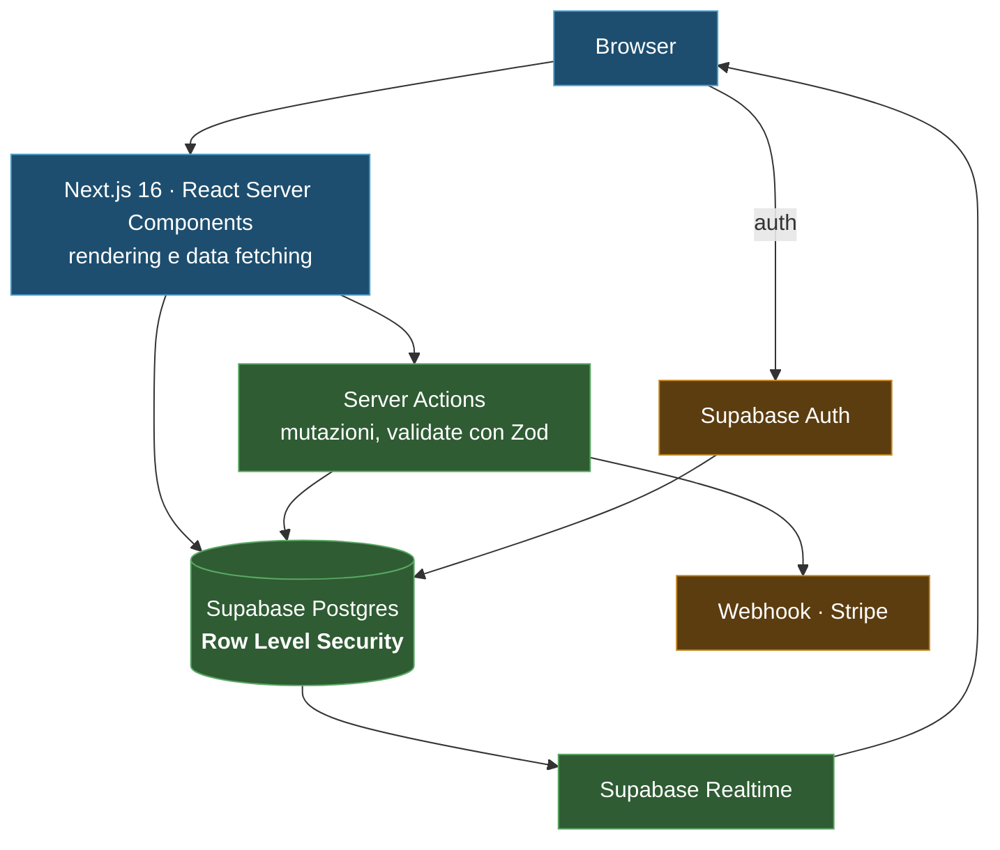
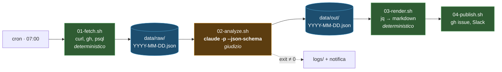
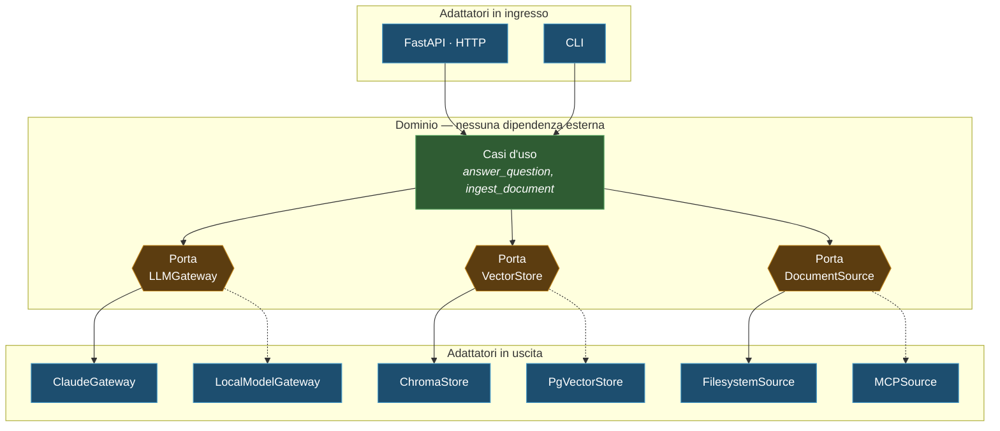

import { Tabs, TabItem, Steps, Aside, FileTree } from '@astrojs/starlight/components';
import Zero from '@/components/Zero.astro';

<div class="meta-modulo">
	<span><strong>Tempo stimato:</strong> 60 minuti</span>
	<span><strong>Prerequisiti:</strong> i moduli <a href="/fondamenta/claude-md/">5</a>, <a href="/fondamenta/plan-mode/">6</a> e <a href="/automazione/cli-scripting/">12</a>.</span>
</div>

Le tre parole del titolo, prima di tutto. Lo **stack** è l'insieme delle tecnologie su cui costruisci
— linguaggio, framework, database: gli "ingredienti". Un **framework** è un'impalcatura di codice già
pronta che dà forma all'applicazione: ti porta l'80% della struttura, tu scrivi ciò che è tuo.
L'**architettura** è come organizzi le stanze dell'edificio: cosa sta dove, e chi può parlare con chi.
Questo modulo è per il momento "foglio bianco" — quando il progetto è nuovo e le scelte sbagliate
costano mesi — e ha un'idea di fondo: **le scelte si fanno con criteri espliciti, non per moda**,
e Claude può aiutarti a farle, se glieli dai.

## Obiettivi

- Scegliere lo stack in base al tipo di applicazione, non alle mode.
- Riconoscere quale architettura di riferimento conviene, e quando **non** conviene.
- Costruire tre sistemi completi, ciascuno con struttura e `CLAUDE.md` propri.
- Far confrontare framework a Claude Code in Plan Mode, con criteri espliciti invece di opinioni.

## Concetti chiave

**Lo stack si sceglie dal tipo di problema, non dal linguaggio che preferisci.** Le tre domande che
restringono il campo più di ogni altra: **chi consuma il risultato** (un browser, un altro programma, uno
schedulatore), **quanto stato c'è** e dove vive, e **quanto conta la latenza di avvio**.

**La regola che conta di più con un agente:** scegli lo stack che ha **la maggior quantità di codice
pubblico scritto bene**. Un agente lavora meglio dove ci sono convenzioni consolidate, tipi espliciti e
documentazione. Un framework di nicchia con ottimo design ma poca massa critica ti costa più correzioni.

**L'architettura serve a proteggere una decisione che cambierà.** Un'astrazione che non protegge nulla è
solo un livello in più. Prima di introdurne una, chiediti: *cosa cambierà davvero, e questa astrazione mi
permette di cambiarlo senza toccare il resto?* Se la risposta non è chiara, non introdurla.

**Il `CLAUDE.md` fa parte dell'architettura.** In un progetto su cui lavora un agente, le convenzioni non
scritte non esistono. Ogni esempio di questo modulo ha il suo `CLAUDE.md`, e non è un accessorio: è dove
vive il contratto che tiene insieme la struttura.

## Tabella decisionale

<Zero title="Come leggere questa tabella (piena di nomi propri)">
Ogni riga è un *tipo* di applicazione; le colonne dicono con cosa costruirla. I ~40 nomi propri sono
tecnologie: **non serve conoscerle** — serve sapere che esistono e cosa sono a grandi linee. Le
famiglie: *framework web* (Next.js, SvelteKit, Nuxt, Astro: l'impalcatura di un sito o app), *librerie
UI* (React, Svelte, Vue: i mattoni dell'interfaccia), *linguaggi* (TypeScript, Python, Go, Rust),
*database e dintorni* (Postgres, Supabase, Drizzle, Prisma), *server web* (Hono, Fastify, Express,
FastAPI), *mobile* (React Native, Flutter, Swift, Kotlin). Usa la tabella così: trova la riga del tuo
progetto, leggi la prima colonna di scelte, e chiedi a Claude di spiegarti le voci che non conosci —
è esattamente il tipo di domanda su cui rende.
</Zero>

Versioni verificate su npm e PyPI il **16 agosto 2026**.

| Tipo di applicazione | Stack consigliato | Alternative | Quando evitarlo |
| --- | --- | --- | --- |
| **Web app full-stack** | Next.js 16 + React 19 + TypeScript 7 + Postgres (Supabase o Neon) + Drizzle | SvelteKit 2 + Svelte 5 · Nuxt 4 · Rails · Django | Se non ti servono pagine generate dal server né visibilità sui motori di ricerca (SEO): una SPA — un'app che vive tutta nel browser — con Vite 8 è più semplice |
| **Sito di contenuti o documentazione** | **Astro 7** + Starlight | Docusaurus · VitePress · MkDocs Material | Se il sito è per il 90% interattivo: Astro è pensato per pagine statiche con "isole" di interattività, e lo staresti usando controcorrente |
| **API backend** | Hono 4 (portabile e pensato per l'*edge*: i server distribuiti vicino agli utenti invece che in un data center solo) o Fastify 5 (Node maturo) + TypeScript | FastAPI 0.141 se l'ecosistema è Python · Go se conta la latenza | Express 5 su un progetto nuovo: funziona, ma i tipi e i middleware moderni sono migliori altrove |
| **CLI tool** | TypeScript + Bun o Node · oppure Go per un binario singolo | Rust se conta la performance · Python con Typer per script interni | Node se la distribuzione deve essere un binario che l'utente scarica |
| **Automazione e pipeline dati** | Python 3.12+ con Pydantic 2 · oppure Bash e `claude -p` per orchestrazione | Airflow o Dagster se i passaggi e le dipendenze sono molti · GitHub Actions quando i job sono pochi e semplici | Un framework di orchestrazione per tre task in sequenza: cron e uno script bastano |
| **App mobile** | React Native con Expo, se il team è già React | Flutter se il team non ha una preferenza web · Swift/Kotlin nativi per app che vivono di piattaforma | Il cross-platform se l'app dipende in modo pesante da API native |
| **Sistema agentic o RAG** | Python + FastAPI + architettura esagonale + Claude Agent SDK | TypeScript con l'SDK se lo stack è già Node · LangChain 1.3 solo se ne usi davvero le astrazioni | I framework RAG "batteria inclusa" per un caso semplice: 200 righe tue sono più leggibili e debuggabili |

<Aside type="caution" title="Il rischio delle astrazioni RAG">
**RAG** (*Retrieval-Augmented Generation*, "generazione aumentata dal recupero") significa: prima di far
rispondere il modello, un sistema *recupera* i documenti pertinenti dai tuoi dati e glieli mette nel
contesto — così risponde su ciò che sai tu, non solo su ciò che sapeva lui. LangChain e LlamaIndex
risolvono problemi reali su sistemi RAG complessi. Su un RAG con una sorgente e un
modello, aggiungono più concetti di quanti ne tolgano — e quando qualcosa non funziona, stai debuggando
l'astrazione invece del tuo problema. Comincia senza, e introducili quando senti il dolore che risolvono.
</Aside>

## Architetture di riferimento

Le quattro che coprono la stragrande maggioranza dei progetti, ciascuna in due frasi:

- **Monolite modulare** — un'unica applicazione, un unico deploy, ma organizzata dentro in moduli con
  confini chiari (fatturazione, utenti, notifiche…). È il punto di partenza giusto quasi sempre: la
  semplicità di una cosa sola, con l'ordine che permette di estrarre un pezzo se un giorno servirà.
- **Hexagonal / clean architecture** — il cuore dell'applicazione (la logica di business) non conosce
  il mondo esterno: parla solo con delle **porte** (interfacce astratte: "qualcosa che sa salvare",
  "qualcosa che sa rispondere"), e degli **adattatori** collegano ogni porta a una tecnologia concreta
  (quel database, quel modello AI). Cambi tecnologia = cambi adattatore, il cuore non si tocca.
- **Event-driven** — i componenti non si chiamano a vicenda: pubblicano *eventi* ("ordine creato") su
  una coda, e chi è interessato li consuma quando può. Disaccoppia e assorbe i picchi, ma il flusso
  diventa molto più difficile da seguire e debuggare.
- **Serverless** — niente server tuo acceso h24: carichi funzioni che il cloud esegue *a richiesta* e
  paghi per esecuzione. Perfetto per carichi irregolari; scomodo per connessioni persistenti, job
  lunghi, e prevedibilità dei costi a regime.

E in tabella, quando sì e quando no:

| Architettura | Conviene quando | Non conviene quando |
| --- | --- | --- |
| **Monolite modulare** | Quasi sempre all'inizio. Un deploy solo, moduli con confini chiari, la possibilità di estrarne uno se serve | Team molto grandi che devono rilasciare in modo indipendente |
| **Hexagonal / clean** | Il **dominio è il valore** e le dipendenze esterne cambieranno: gateway LLM, provider di pagamento, database | L'app è solo CRUD (*Create, Read, Update, Delete*: creare, leggere, aggiornare e cancellare record) su un database: stai aggiungendo tre livelli per proteggerti da un cambiamento che non avverrà |
| **Event-driven** | Serve disaccoppiamento temporale, picchi di carico da assorbire, o più consumatori dello stesso evento | Hai bisogno di consistenza forte e risposte sincrone: la complessità di debug esplode |
| **Serverless** | Carico irregolare, molto tempo a zero, e la freddezza dell'avvio non è un problema | Connessioni persistenti, job lunghi, o costi prevedibili su carico costante |

<Aside type="tip" title="Il test dell'astrazione">
Prima di introdurre una porta e un adattatore, scrivi la frase: *"questo mi permetterà di sostituire X con
Y senza toccare Z"*. Se non riesci a riempire le tre lettere con cose concrete, l'astrazione non serve.

Negli esempi qui sotto la porta c'è **solo** nel terzo, dove X = "Claude", Y = "un modello locale" e Z =
"la logica di retrieval". Negli altri due sarebbe stata cerimonia.
</Aside>

---

## Esempio A · SaaS dashboard

Un **SaaS** (*Software as a Service*) è un software venduto come servizio in abbonamento, usato dal
browser: chi lo usa non installa niente. Stack: Next.js 16 + Supabase. **Multi-tenant** vuol dire che più organizzazioni-clienti usano la stessa
applicazione e lo stesso database, ognuna vedendo solo i propri dati — e per garantirlo lo schema si
appoggia alla **Row Level Security (RLS)** di Postgres: regole scritte *nel database* che filtrano ogni
riga in base a chi sta chiedendo, così anche una query sbagliata nell'app non può far trapelare i dati
di un altro cliente.

Il diagramma mostra chi parla con chi. I colori: **blu** = ciò che gira nel browser dell'utente,
**verde** = ciò che gira sui tuoi server, **ambra** = servizi esterni. Le frecce sono chiamate: si
leggono "A usa B".



<FileTree>

- saas-dashboard/
  - CLAUDE.md
  - .claude/
    - settings.json
    - rules/
      - react.md Regole legate a `src/components/**`
      - database.md Regole legate a `src/db/**`
  - .mcp.json Supabase, Vercel
  - src/
    - app/ Route del framework: **thin**, nessuna logica
      - (dashboard)/
        - layout.tsx
        - page.tsx
      - api/
        - webhooks/stripe/route.ts
    - components/ Componenti presentazionali
    - features/ **Un modulo per capacità di prodotto**
      - billing/
        - actions.ts Server Actions
        - queries.ts Letture
        - schema.ts Schemi Zod, condivisi tra le due
      - projects/
    - db/
      - schema.ts Schema Drizzle
      - migrations/
    - lib/
      - supabase/ Client server e browser
      - env.ts **Validazione delle env var, unico punto**
  - tests/
    - e2e/ Playwright
  - drizzle.config.ts

</FileTree>

La decisione strutturale che conta: **`app/` contiene solo routing, `features/` contiene il prodotto.**
Le cartelle di route dei framework cambiano a ogni major; una cartella `features/billing/` no. E per un
agente è la differenza tra "cerca dove sta la fatturazione" e "apri `features/billing/`".

```markdown title="CLAUDE.md"
# SaaS Dashboard

Next.js 16 (App Router) · React 19 · TypeScript 7 · Supabase Postgres · Drizzle · Tailwind 4.

## Comandi

- `npm run dev` — dev server
- `npm test` — Vitest. Lancia il singolo file, non la suite intera
- `npm run test:e2e` — Playwright
- `npm run typecheck` — **obbligatorio prima di ogni commit**
- `npm run db:generate` — genera la migrazione dopo aver modificato `src/db/schema.ts`
- `npm run db:migrate` — applica le migrazioni

## Struttura

- `src/app/` — **solo routing**. Nessuna logica di business qui dentro
- `src/features/<capacita>/` — dove vive il prodotto: `actions.ts`, `queries.ts`, `schema.ts`
- `src/db/schema.ts` — l'unica definizione dello schema. Le migrazioni si **generano**, non si scrivono
- `src/lib/env.ts` — l'unico posto dove si leggono le variabili d'ambiente

## Regole non negoziabili

- **Ogni tabella ha una policy RLS.** Una tabella senza RLS è un incidente di sicurezza,
  non un TODO. Se aggiungi una tabella, aggiungi la policy nella stessa migrazione
- Server Component di default. `"use client"` solo quando servono davvero stato o effetti
- Ogni Server Action valida l'input con lo schema Zod di `schema.ts` **prima** di toccare il database
- Mai usare la service role key fuori da `src/app/api/webhooks/`
- Le migrazioni applicate non si modificano: se lo schema cambia, si crea una migrazione nuova

## Trappole di questo progetto

- Supabase Realtime non rispetta la RLS sui canali di broadcast: filtra lato server
- Le Server Actions girano anche su richieste non autenticate: la sessione va verificata
  in ogni action, non solo nel layout
```

Tre voci di questo file meritano una riga di traduzione. **Zod** è una libreria che verifica che un
dato abbia la forma attesa ("questo campo è una email, questo un numero positivo") prima di usarlo. La
**service role key** è la chiave di Supabase che *scavalca* la RLS: in mano al posto sbagliato annulla
tutta la protezione, per questo è confinata ai webhook. E le due "trappole" finali sono comportamenti
reali di Supabase che sorprendono chiunque la prima volta: sono nel `CLAUDE.md` proprio perché Claude
— e il collega nuovo — non li scoprano a spese dell'utente.

---

## Esempio B · Pipeline dati headless

`claude -p` + output JSON + cron. Nessun server, nessuna UI: uno schedulatore, degli script e dei file.
È l'architettura costruita per intero nel [modulo 14](/automazione/pipeline-locali/) — qui la guardi
dall'alto. Nel diagramma: **verde** = stadi deterministici (stesso input → stesso output), **ambra** =
l'unico stadio che usa l'LLM, **blu** = i file su disco tra uno stadio e l'altro. La freccia
tratteggiata è il percorso d'errore: se l'analisi fallisce, log e notifica.



<FileTree>

- pipeline/
  - CLAUDE.md
  - .claude/
    - settings.json Permessi minimi
    - skills/
      - analizza/
        - SKILL.md Il prompt di analisi, versionato
  - bin/
    - run.sh Orchestratore: chiama gli stadi in ordine
    - 01-fetch.sh Raccolta — **nessun LLM**
    - 02-analyze.sh `claude -p` con `--json-schema`
    - 03-render.sh JSON → markdown, con `jq`
    - 04-publish.sh Pubblicazione
  - schemas/
    - analisi.json Lo JSON Schema dell'output
  - data/
    - raw/ Input grezzo, per data — **immutabile**
    - out/ Output strutturato, per data
  - logs/
  - .env.example

</FileTree>

La decisione strutturale: **un file per stadio, e un solo stadio usa l'LLM.** Ogni stadio legge da disco e
scrive su disco, quindi ognuno è ri-eseguibile da solo. Quando qualcosa va storto alle 7 del mattino, sai
esattamente quale stadio guardare e puoi rilanciarlo senza rifare gli altri.

```markdown title="CLAUDE.md"
# Pipeline dati headless

Bash + `claude -p` + cron. Nessun server, nessun database: file su disco.

## Come si esegue

- `bin/run.sh [YYYY-MM-DD]` — pipeline completa. Senza argomento, oggi
- Ogni stadio è eseguibile da solo: `bin/02-analyze.sh 2026-08-16`
- `bin/run.sh --dry-run` — esegue tutto tranne la pubblicazione

## Il contratto

- Ogni stadio legge da disco e scrive su disco. Nessuno stato in memoria tra stadi
- `data/raw/` è **immutabile**: si aggiunge, non si modifica. È la prova di cosa è
  successo quel giorno
- L'output di `02-analyze.sh` è validato contro `schemas/analisi.json`.
  **Se lo schema cambia, cambia anche il renderer**
- Exit code: `0` ok · `1` fallimento della pipeline · `2` errore dello strumento
  (Claude non ha girato). Il monitoraggio li distingue

## Regola non negoziabile

**Solo `02-analyze.sh` chiama Claude.** Raccolta, formattazione e pubblicazione sono
comandi deterministici. Se ti viene voglia di chiedere a Claude di fare un `curl` o di
formattare del markdown, la risposta è no: costa di più, è meno affidabile e non è
riproducibile.

## Invocazione

Sempre `--bare`, `--max-turns` e `--json-schema`. Mai senza. Il prompt vive in
`.claude/skills/analizza/SKILL.md`, non inline negli script: così è versionato e
rivedibile in diff.

## Trappole

- `cron` ha un `PATH` minimo: `bin/run.sh` fa il source di `.env` ed esporta il PATH pieno
- `claude` non è nel PATH di cron: usa il percorso assoluto da `command -v claude`
- Se l'API è lenta, `02` può superare la finestra dello slot: c'è un lock in `logs/.lock`
```

Le tre "trappole", tradotte: `cron` lancia gli script con un ambiente quasi vuoto, quindi i comandi che
in un terminale normale "ci sono" (incluso `claude`) per lui non esistono — da qui il PATH esplicito e
il percorso assoluto. E il **lock** (un file che dice "sto già girando") evita che l'esecuzione delle
7:00, se ancora in corso, si scontri con quella successiva.

---

## Esempio C · Sistema agentic / RAG locale

Architettura esagonale con **gateway LLM** — un adattatore unico attraverso cui passa ogni chiamata al
modello, così cambiare modello significa cambiare quel solo file. È l'unico dei tre esempi in cui le
porte si ripagano: qui X = "Claude", Y = "un modello locale", Z = "la logica di retrieval".

Come leggere il diagramma: al centro (**verde**) il dominio, che parla solo con le tre porte
(**ambra**, forma esagonale); intorno (**blu**) gli adattatori. Le frecce piene sono i collegamenti
attivi nella configurazione di default; quelle **tratteggiate** sono gli adattatori alternativi già
previsti — per attivarli si cambia una riga in `config.py`, non il dominio.



<FileTree>

- agentic-rag/
  - CLAUDE.md
  - .claude/
    - agents/
      - researcher.md
      - coder.md
      - reviewer.md
    - settings.json
  - .mcp.json Filesystem, database
  - src/
    - domain/ **Zero import da fuori**
      - models.py Document, Chunk, Answer, Citation
      - ports.py Le tre porte, come Protocol
      - usecases/
        - answer_question.py
        - ingest_document.py
    - adapters/
      - llm/
        - claude.py Claude Agent SDK
        - local.py Modello locale
      - store/
        - chroma.py
        - pgvector.py
      - source/
        - filesystem.py
        - mcp.py
    - api/ FastAPI: **solo traduzione HTTP ↔ dominio**
    - cli/
    - config.py Il "composition root": l'unico punto in cui si decide e si monta quale adattatore usare
  - tests/
    - domain/ Con adattatori finti, **nessuna rete**
    - adapters/ Contratto: ogni adattatore supera lo stesso test
  - pyproject.toml

</FileTree>

La decisione strutturale: **`domain/` non importa nulla dall'esterno.** È una regola verificabile
automaticamente, e per questo funziona. Il test che la controlla vale più di qualsiasi paragrafo di
documentazione.

```markdown title="CLAUDE.md"
# Sistema agentic / RAG locale

Python 3.12 · FastAPI · architettura esagonale · Claude Agent SDK.

## Comandi

- `uv run pytest` — test. `uv run pytest tests/domain` per i soli test di dominio (veloci, offline)
- `uv run ruff check --fix` e `uv run mypy src` — **entrambi verdi prima di ogni commit**
- `uv run uvicorn src.api.main:app --reload` — API in locale
- `uv run python -m src.cli ingest ./docs` — ingest da CLI

## La regola che tiene in piedi tutto

**`src/domain/` non importa niente da fuori di sé.** Niente `httpx`, niente `chromadb`,
niente `anthropic`, niente `fastapi`. Solo la standard library e i modelli del dominio.

È verificata da `tests/domain/test_no_external_imports.py`. Se quel test fallisce, il
problema è il design, non il test: **non aggiungere eccezioni**.

## Dove va cosa

| Se stai scrivendo… | Va in |
| --- | --- |
| Logica che dipende dal *problema* | `domain/usecases/` |
| Codice che parla con un servizio esterno | `adapters/<categoria>/` |
| Traduzione HTTP ↔ dominio | `api/` |
| La scelta di quale adattatore usare | `config.py` — **l'unico posto** |

## Aggiungere un adattatore

1. Implementa il `Protocol` in `domain/ports.py` — non inventare un'interfaccia nuova
2. Aggiungilo ai test di contratto in `tests/adapters/`: **ogni adattatore della stessa
   porta supera esattamente gli stessi test**
3. Registralo in `config.py`
4. Non toccare `domain/`. Se ti serve, la porta è sbagliata: discutine prima

## Subagent

- `researcher` — sola lettura, esplora il codebase e riporta con riferimenti `file:riga`
- `coder` — implementa
- `reviewer` — sola lettura, Opus, verifica la diff contro i requisiti

## Trappole

- Chroma persiste su disco: i test che scrivono usano una directory temporanea, mai `./chroma`
- Il rate limit del gateway LLM è per chiave, non per processo: l'ingest parallelo va limitato
- I chunk di documenti scansionati arrivano senza punteggiatura: il chunker non può assumere frasi
```

Anche qui le "trappole" chiedono una traduzione. **Chroma** è il database vettoriale dell'esempio, e
"persiste su disco" = i dati scritti da un test resterebbero lì a sporcare i successivi. Il **rate
limit per chiave** significa che il limite di richieste al modello vale per l'account, non per ogni
processo: dieci processi paralleli si dividono lo stesso budget. E i **chunk** sono i pezzi in cui un
documento viene tagliato prima di essere indicizzato — il boilerplate del
[modulo 18](/professionale/boilerplate/) costruisce esattamente questo sistema, commentato.

---

## Far decidere Claude Code

Il modo sbagliato è chiedere *"qual è il framework migliore?"* — otterrai un riassunto di opinioni. Il modo
giusto è dargli **criteri espliciti**, il **tuo contesto**, e farlo lavorare in Plan Mode con ricerca sul
web.

<Steps>

1. **Entra in Plan Mode**, così esplora e propone senza scrivere niente:

   ```bash
   claude --permission-mode plan
   ```

2. **Usa un prompt che pesa, invece di chiedere un'opinione:**

   ```text
   I need to choose the stack for a new project. Research current options on the web
   before answering — do not rely on your training data for versions, maintenance
   status or ecosystem size.

   ## Context
   - What it does: [descrizione in due righe]
   - Who uses it: [browser / altro programma / schedulatore], [quanti utenti]
   - Team: [dimensione], already know [linguaggi/framework]
   - Constraints: [deploy target, budget, compliance, latenza]
   - Timeline: [quanto tempo prima del primo rilascio]

   ## Criteria, in this order of weight
   1. Maturity: is it stable, and how often do breaking changes land?
   2. Ecosystem: are the libraries we need maintained?
   3. Team fit: how far is it from what we already know?
   4. Agent fit: how much good public code exists for it?
   5. Operability: how hard is it to deploy, monitor and debug in production?

   ## What I want back
   - Three candidate stacks, not one
   - A table scoring each against the five criteria, with the evidence for each score
   - For each: what would make me regret this choice in 18 months
   - Your recommendation, in one paragraph, and what would change it

   Do not recommend something because it is popular. Say when two options are
   genuinely equivalent for my case.
   ```

   *(= "Devo scegliere lo stack per un progetto nuovo. Cerca sul web prima di rispondere — non fidarti
   della tua memoria su versioni e stato di manutenzione. **Contesto:** cosa fa, chi lo usa, team,
   vincoli, tempi. **Criteri, in quest'ordine di peso:** maturità, ecosistema, affinità col team,
   resa con un agente, operabilità in produzione. **Cosa voglio:** tre stack candidati, una tabella
   con i punteggi e le prove, per ciascuno cosa me lo farebbe rimpiangere tra 18 mesi, e la tua
   raccomandazione in un paragrafo. Non consigliare per popolarità; dimmi quando due opzioni sono
   equivalenti per il mio caso.")* — le parentesi quadre sono i punti da riempire col tuo progetto.

3. **Contesta la risposta.** Il valore vero arriva al secondo giro:

   ```text
   You ranked A above B mainly on ecosystem size. My team has shipped three
   projects on B and zero on A. Redo the comparison with team fit weighted first.
   ```

4. **Apri il piano con `Ctrl+G`** e correggi quello che non torna prima di approvare.

5. **Scrivi la decisione nel repository**, non in una chat che sparirà:

   ```text
   Write the decision to docs/decisioni/0001-stack.md. Include: the options considered,
   the criteria, why we picked this one, and what would make us revisit it.
   ```

</Steps>

<Aside type="tip" title="Le due frasi che alzano la qualità della risposta">
**"Research current options on the web"** — senza, il modello risponde da memoria, e sulle versioni e sullo
stato di manutenzione la memoria invecchia.

**"What would make me regret this choice in 18 months"** — costringe a esplicitare i rovesci della medaglia
che un confronto entusiasta salta.
</Aside>

## Esercizio

Progetta un sistema reale scegliendo consapevolmente.

1. Prendi un'idea di progetto che hai davvero in mente.
2. Fatti fare il confronto di stack in Plan Mode, con criteri pesati.
3. Scegli **anche** l'architettura, e giustifica perché non ne serve una più complessa.
4. Scrivi il `CLAUDE.md` e la struttura di cartelle prima di scrivere una riga di codice.

<details class="soluzione">
<summary>Soluzione</summary>

Ipotizziamo: *un'app interna che monitora i prezzi dei fornitori e avvisa quando cambiano oltre una
soglia. Due persone, uso interno, una decina di utenti.*

**Passo 2.** Il prompt del capitolo precedente, riempito. La risposta plausibile mette in tavola tre
opzioni molto diverse — un'app full-stack, uno script schedulato con una piccola UI, un servizio con
coda — e la tabella dei criteri fa emergere che con **dieci utenti** e **due sviluppatori** i criteri 3
(team fit) e 5 (operabilità) pesano molto più di 1 e 2.

**Passo 3 — l'architettura, e perché no a quella più complessa.**

```markdown title="docs/decisioni/0002-architettura.md"
# Architettura — monolite modulare

## Scelta
Un'applicazione, un deploy, moduli con confini chiari: `scraping/`, `alerting/`, `web/`.

## Perché non event-driven
Una coda risolverebbe il disaccoppiamento temporale tra scraping e alerting. Ma:
- Il volume è di decine di controlli l'ora, non migliaia al secondo
- Non ci sono più consumatori dello stesso evento
- Siamo in due: il costo di debug di un sistema asincrono ricadrebbe interamente su noi

Una chiamata di funzione fa la stessa cosa e la posso leggere in uno stack trace.
**Se un giorno serviranno più consumatori, il modulo `alerting/` ha già il confine giusto
per diventare un consumer.**

## Perché non hexagonal
Le porte proteggono da dipendenze che cambiano. Qui:
- Il database non cambierà: è Postgres e resta Postgres
- Il canale di notifica **potrebbe** cambiare (Slack → email)

Quindi: **una** interfaccia, per il solo `Notifier`, e nient'altro. Niente porte per
il database, niente adapter per lo scraping. Un'interfaccia sola non è "hexagonal",
è buon senso.

## Cosa ci farebbe cambiare idea
- Più di ~50 controlli al minuto, o scraping che diventa il collo di bottiglia → coda
- Un terzo canale di notifica → il pattern è già lì, si aggiunge un'implementazione
- Un secondo team sul progetto → allora i confini vanno resi deploy-indipendenti
```

Il documento è il vero deliverable: la scelta di *non* usare event-driven, motivata, vale più della scelta
di usarlo.

**Passo 4 — struttura e `CLAUDE.md` prima del codice.**

```text
monitor-prezzi/
├── CLAUDE.md
├── docs/decisioni/
│   ├── 0001-stack.md
│   └── 0002-architettura.md
├── src/
│   ├── scraping/       # un fornitore = un modulo
│   ├── alerting/       # regole di soglia + Notifier
│   ├── web/            # UI minima
│   └── db/
└── tests/
```

```markdown title="CLAUDE.md"
# Monitor prezzi fornitori

Uso interno, ~10 utenti. Vedi `docs/decisioni/` per stack e architettura, **e leggile
prima di proporre cambi strutturali**.

## Comandi
- `npm run dev` · `npm test` · `npm run typecheck` (obbligatorio prima del commit)
- `npm run scrape -- --fornitore=acme` — un singolo scraper, per debug

## Struttura
- `src/scraping/<fornitore>/` — un modulo per fornitore, stessa interfaccia
- `src/alerting/` — regole di soglia. **L'unica interfaccia del progetto è `Notifier`**
- `src/web/` — UI. Nessuna logica di business qui

## Regole
- Aggiungere un fornitore significa aggiungere una cartella in `scraping/`, non
  toccare quelle esistenti. Se devi toccarne una, l'interfaccia è sbagliata
- Ogni scraper ha un test con una **fixture HTML salvata**, non una chiamata di rete
- Le soglie stanno nel database, non nel codice

## Cosa NON fare senza discuterne
- Introdurre una coda o un message broker → vedi `docs/decisioni/0002`
- Aggiungere interfacce oltre a `Notifier` → non abbiamo dipendenze che cambiano
```

L'ultima sezione è quella che fa la differenza con un agente: senza, la prima volta che chiedi
"rendi più robusto lo scraping" ti ritrovi una coda che nessuno voleva.

</details>

## Errori comuni e troubleshooting

| Sintomo | Causa | Soluzione |
| --- | --- | --- |
| Claude propone lo stack di moda invece di quello adatto | Prompt senza criteri né contesto | Dagli criteri **pesati** e il tuo contesto reale |
| Il confronto cita versioni o stati di manutenzione sbagliati | Ha risposto da memoria | Chiedi esplicitamente di cercare sul web prima di rispondere |
| L'architettura ha più livelli del necessario | Astrazioni introdotte "per il futuro" | Applica il test: *sostituire X con Y senza toccare Z*. Se non lo riempi, togli il livello |
| Claude aggiunge complessità che non hai chiesto | Il `CLAUDE.md` non dice cosa **non** fare | Una sezione "Cosa NON fare senza discuterne" costa tre righe |
| La struttura si degrada dopo un mese | Le convenzioni non erano scritte | Ogni regola strutturale va nel `CLAUDE.md`, o meglio in un test |
| Il confine tra dominio e infrastruttura si sfalda | La regola era solo documentata | Un test che verifica gli import vale più di un paragrafo |
| Nessuno ricorda perché avete scelto quello stack | La decisione è rimasta in chat | `docs/decisioni/NNNN-*.md`, committato |
| Il `CLAUDE.md` è cresciuto oltre le 200 righe | Ci hai messo anche le regole settoriali | Spostale in `.claude/rules/` con `paths:` — vedi il [modulo 5](/fondamenta/claude-md/) |
| Nella pipeline chiedi a Claude cose che farebbe `jq` | Confusione tra orchestrazione e giudizio | Solo lo stadio di giudizio usa l'LLM — vedi il [modulo 14](/automazione/pipeline-locali/) |

## Cheat-sheet

**Le tre domande che scelgono lo stack**

```text
1. Chi consuma il risultato?   browser · altro programma · schedulatore
2. Quanto stato c'è, e dove?   nessuno · database · sessione · realtime
3. La latenza di avvio conta?  sì → niente serverless a freddo
```

**Scelte rapide**

| Tipo | Prima scelta |
| --- | --- |
| Web app full-stack | Next.js 16 + Postgres + Drizzle |
| Contenuti / docs | Astro 7 + Starlight |
| API | Hono 4 o Fastify 5 · FastAPI se Python |
| CLI | TypeScript · Go per un binario singolo |
| Pipeline dati | Python + Pydantic · Bash + `claude -p` |
| Mobile | React Native + Expo se il team è React |
| Agentic / RAG | Python + FastAPI + esagonale + Agent SDK |

**Architetture**

```text
Monolite modulare  → il default. Comincia qui
Hexagonal          → solo dove una dipendenza cambierà davvero
Event-driven       → più consumatori, o picchi da assorbire
Serverless         → carico irregolare, molto tempo a zero
```

**Il test dell'astrazione**

```text
"Questo mi permette di sostituire X con Y senza toccare Z"
Se non riesci a riempire X, Y e Z con cose concrete → non serve.
```

**Cosa mettere in ogni `CLAUDE.md` di progetto**

```text
1. Comandi che Claude non può indovinare
2. Dove va cosa, in una tabella
3. Le regole non negoziabili, poche e verificabili
4. Le trappole specifiche di questo progetto
5. Cosa NON fare senza discuterne
```

## Fonti

Versioni dei pacchetti verificate su [npm](https://www.npmjs.com) e [PyPI](https://pypi.org) il
**16 agosto 2026**: Next.js 16.3.1 · React 19.2.8 · TypeScript 7.0.2 · Astro 7.2.2 · Vite 8.2.1 ·
SvelteKit 2.70.2 · Nuxt 4.5.2 · Hono 4.13.2 · Fastify 5.12.0 · Express 5.2.1 · Drizzle ORM 0.45.2 ·
Prisma 7.9.1 · `@supabase/supabase-js` 2.112.3 · Tailwind CSS 4.3.3 · Vitest 4.1.10 · Playwright 1.62.1 ·
`@anthropic-ai/claude-agent-sdk` 0.3.233 · FastAPI 0.141.1 · Pydantic 2.13.4 · LangChain 1.3.15 ·
LlamaIndex 0.14.23 · ChromaDB 1.5.9.

Documentazione ufficiale consultata:

- [Best practices](https://code.claude.com/docs/en/best-practices) — `CLAUDE.md` efficace, explore-plan-code-commit
- [How Claude remembers your project](https://code.claude.com/docs/en/memory) — gerarchia e regole path-scoped
- [Choose a permission mode](https://code.claude.com/docs/en/permission-modes) — Plan Mode per le decisioni
- [Monorepos and large repos](https://code.claude.com/docs/en/large-codebases) — struttura su repository grandi
- [Agent SDK overview](https://code.claude.com/docs/en/agent-sdk/overview) — costruire sistemi agentici
- [Subagents](https://code.claude.com/docs/en/sub-agents) — i subagent dell'esempio C
